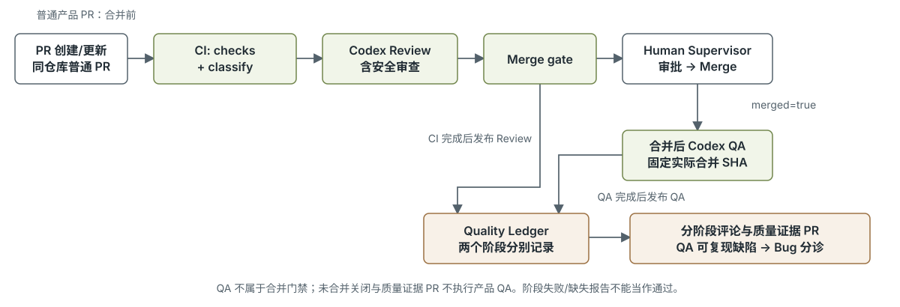

# GitHub Actions 工作流说明

本文说明仓库中四个 GitHub Actions 工作流的触发条件、执行步骤、依赖关系和输出。

## 1. 整体关系

这四个文件组成以下流程：合并前常规检查 → Codex Review（含安全审查）→ Merge gate → Human Supervisor → Merge；合并后 Codex QA 验收实际合并提交。两个阶段各自发布质量记录。

| 文件 | 职责 | 触发方式 |
| --- | --- | --- |
| [ci.yml](../workflows/ci.yml) | 总调度、构建和测试、最终检查关卡 | main push、指定 PR 事件、手动运行 |
| [codex-qa.yml](../workflows/codex-qa.yml) | 合并后按 Issue 验收实际合并提交 | PR closed 且实际合入默认分支 |
| [codex-review.yml](../workflows/codex-review.yml) | 合并前独立审查代码和安全问题 | 由 CI 在基础检查成功后调用 |
| [quality-ledger.yml](../workflows/quality-ledger.yml) | 发布分阶段评论、Bug Issue 和质量记录 PR | CI 或 Codex QA 完成后触发 |



该图展示普通 PR 的主流程；当前 PR 分类和证据 PR 路径以以下说明及 `ci.yml` 为准。

[Mermaid 源码](ci-flow.mmd)

运行路径分为三种：

- **普通 PR 事件**：`checks` 与 `classify` 成功后执行 Review；`gate` 要求这三个阶段全部成功。QA 不属于本次 CI。
- **Quality Ledger 证据 PR**：`classify` 从可信 base 加载分类脚本，校验 bot 来源、同仓库、保留分支名及质量文档文件范围；校验通过后跳过 Review，`gate` 要求基础检查与分类成功且 Review 为 skipped；这类 PR 合并后也不执行产品 QA。校验失败时阻断。
- **推送 main 或手动运行**：执行 `checks` 和 `classify`，跳过 Review，`gate` 要求基础检查与分类成功。

合并到默认分支的普通产品 PR 还会由 `codex-qa.yml` 独立验收；只关闭未合并、fork 和其他目标分支不执行产品 QA。Quality Ledger 监听 CI 和 Codex QA 完成事件，只发布与同仓库来源 PR 绑定的阶段。

## 2. ci.yml：总调度和最终检查关卡

### 2.1 触发条件

```yaml
on:
  push:
    branches: [main]
  pull_request:
    types: [opened, synchronize, reopened, ready_for_review, edited]
  workflow_dispatch:
```

| 事件 | 含义 |
| --- | --- |
| push 到 main | main 收到新提交，包括通常的 PR 合并 |
| opened | 新建 PR |
| synchronize | PR 分支更新了提交 |
| reopened | 关闭的 PR 被重新打开 |
| ready_for_review | 草稿 PR 转为正式待审查 |
| edited | PR 标题、正文等发生编辑 |
| workflow_dispatch | 手动运行 |

没有设置“草稿 PR 跳过”的条件，因此创建草稿 PR 也可能启动检查。

`edited` 对本仓库尤其有用：后续脚本会读取 PR 正文中的 `Closes #7` 等关联 Issue 信息，编辑这些信息后可以重新检查。

### 2.2 权限和并发

默认权限是 `contents: read`，允许读取仓库内容。CI 中的 Review 和独立 QA 工作流另外声明读取 Issue、PR 的权限。

```yaml
concurrency:
  group: ci-${{ github.event.pull_request.number || github.ref }}
  cancel-in-progress: true
```

同一个 PR 的 CI 归入同一并发组，非 PR 事件按分支引用分组。新运行启动时会取消同组尚未完成的旧运行，避免旧提交持续占用资源。

### 2.3 checks：传统工具检查

运行环境为 `ubuntu-latest`，任务超时为 25 分钟。步骤按以下顺序执行：

| 步骤 | 作用 |
| --- | --- |
| actions/checkout@v4 | 检出代码 |
| actions/setup-node@v4 | 配置 Node.js 22，启用 Yarn 缓存 |
| yarn install --frozen-lockfile --non-interactive | 按 yarn.lock 安装依赖，锁文件需要变更时失败 |
| node --test .github/scripts/automation.test.cjs .github/scripts/post-merge.test.cjs | 测试自动化脚本 |
| yarn build | 构建 Next.js 应用 |
| yarn lint | 执行 ESLint |
| yarn typecheck | 执行 package.json 中的 tsc --noEmit 类型检查 |
| yarn test:unit | 执行单元测试 |
| yarn test:integration | 执行集成测试 |

`persist-credentials: false` 表示 checkout 后不把认证凭据持续保留在 Git 配置中。Yarn 缓存用于加速依赖安装，不能替代锁文件安装步骤。

这些步骤顺序执行，前面失败后，后面的普通步骤默认跳过。

`checks` 没有显式指定 checkout 的 `ref`，PR 场景通常检查 GitHub 生成的 PR 合并引用；Review 明确检查 PR head SHA；合并后 QA 明确检查实际合并提交，因此它们的提交身份不同。

当前流程基仓库没有 `package.json`、`yarn.lock` 或 `src/` 应用，真实应用检查依赖后续工程接入。运行与检查脚本以 `package.json` 为准；当前 CI 执行单元和集成测试，没有 `test:e2e` 步骤。新增 E2E 时应同时准备浏览器、服务和测试数据，并接入 CI。

### 2.4 保存测试证据

上传步骤使用 `if: always()`，在前面的检查失败后仍尝试保存：

```text
coverage/
test-results/
playwright-report/
```

Artifact 名称为 `ci-evidence`，保留 30 天。目录不存在时忽略，不会仅因没有证据文件而报错。

### 2.5 调用合并前 Review

`review` 使用 `needs: [checks, classify]`，要求常规检查和分类成功；普通 PR 执行 Review，已验证证据 PR 跳过。QA 不再由 CI 调用，不影响合并前 Review 的调度。

CI 通过 `uses: ./.github/workflows/codex-review.yml` 调用可复用 Review 工作流，并显式传入 `OPENAI_API_KEY`。Review 只在普通 `pull_request` 事件下执行。

### 2.6 Merge gate

`gate` 使用 `if: always()`，依赖 `checks`、`classify`、`review`。前面的任务失败或跳过后，仍安排这个汇总任务判定结果。

判断规则：

- 所有事件：`checks` 和 `classify` 必须为 `success`。
- 普通 PR：`review` 必须为 `success`。
- 已验证的 Quality Ledger 证据 PR：`review` 必须为 `skipped`。QA 是合并后的验收，不是 Merge gate 的输入。

判定逻辑由 [merge-gate.cjs](../scripts/merge-gate.cjs) 实现；分类约束见 [evidence-pr.cjs](../scripts/evidence-pr.cjs)。

**Merge gate 只提供检查结果，不会自行阻止或执行合并。** 仓库的分支保护或 Ruleset 必须把它设为必需检查，才会形成合并限制。工作流文件本身不能证明该规则已配置。

## 3. codex-qa.yml：根据 Issue 验收实际行为

QA 关注实现是否满足 Issue 验收标准，以及实际运行是否正确。任务运行于 `ubuntu-latest`，超时为 30 分钟。

### 3.1 调用入口和前置条件

入口为 `pull_request: types: [closed]`，不再是可复用工作流。`target` job 仅在事件 `merged=true` 时运行，从默认分支加载 [post-merge.cjs](../scripts/post-merge.cjs)，重新查询 GitHub PR 元数据，确认同仓库、closed/merged、目标为默认分支及实际合并 SHA。事件和 API 提交不符时失败。

来源或目标不适用时不执行产品 QA；已验证的质量证据 PR 也排除，伪造的保留分支分类失败。`qa` job 只在 target 输出 eligible=true 后执行，并检查 `OPENAI_API_KEY` 非空。缺少密钥会失败，不能当作验收通过。

### 3.2 准备代码和依赖

```yaml
ref: ${{ needs.target.outputs.commit }}
fetch-depth: 0
persist-credentials: false
```

工作流检出准确的实际合并提交并获取完整历史，配置 Node.js 22，采集合并后上下文，再执行 `yarn install --frozen-lockfile --non-interactive`。merge/squash/rebase 都使用合并后 PR API 的 merge_commit_sha，不使用较新的默认分支 tip 或原 head 代替。字段语义见 [GitHub Pull requests API](https://docs.github.com/en/rest/pulls/pulls#get-a-pull-request)。

### 3.3 加载 Issue 规格和讨论

[context.cjs](../scripts/context.cjs) 生成 `evidence/context.json`，并检查：

- PR 正文通过 `Closes #123`、`Fixes #123` 等形式关联恰好一个不同的主 Issue。
- 关联编号指向 Issue，不能指向 PR。
- Issue 包含 `Type`、`Problem`、`User Outcome`、`Scope`、`Non-goals`、`Acceptance Criteria`、`References`、`Dependencies`、`Risk`、`Owner`、`Estimate`、`AI Ready`。
- `AI Ready` 为 `Yes`，`Estimate` 为 Owner 确认的 1、2、3、5 或 8；TBD 不可实施。估算规则见 [研发流程](../../a2a_dev_process.md#estimate-管理规则)。自动化校验字段和点数取值，Owner 确认依据由 Agent 和监督者核查。
- 验收标准使用 `AC-1` 这样的编号。

上下文还包含 Issue 评论、PR 普通评论、行内审查评论，以及 base/head SHA。Review context 的 phase=review、commit=PR head；QA context 的 phase=qa、commit=实际合并提交，changed_files 保存 GitHub PR API 的完整文件变更（截断/重复/数量不符均拒绝）。合并后检查这些变更对应的目标文件及行为，不把原 PR head/base 的三点 diff 当作 squash/rebase 的合并结果。整个验收以 GitHub Issue 为规格依据。

Issue 正文由共享 [issue-contract.cjs](../scripts/issue-contract.cjs) 的 `execution` 模式校验：除以上门槛外，还检查所有类型专属必填字段、唯一三级字段标题、合法枚举、Owner 格式以及唯一非空 AC。创建和局部更新正文的 CLI 使用同一模块；[正文校验说明](../issue-contract.md) 定义了机器校验与人工批准的边界。

### 3.4 执行 Codex QA

```yaml
uses: openai/codex-action@v1
with:
  prompt-file: .github/prompts/qa.md
  output-file: evidence/qa.json
  sandbox: workspace-write
  safety-strategy: drop-sudo
  codex-args: '["--output-schema", ".github/schemas/qa.json"]'
```

`prompt-file` 提供任务说明，`output-file` 指定报告路径，`--output-schema` 要求输出符合 JSON 结构。`workspace-write` 允许在工作区写入临时测试和证据，`drop-sudo` 使用移除 sudo 能力的安全策略。

[qa.md](../prompts/qa.md) 要求 Codex：

- 逐项验证 AC，执行当前 CI 要求的单元、集成和 Issue/变更适用的端到端测试。
- 检查异常路径，以及适用的加载、空数据、错误、权限、可访问性和安全边界。
- 可以添加临时测试，但保持产品代码不变。
- 保存命令、退出码、日志和临时测试补丁。
- 不推送、不合并、不发评论、不创建 Issue。
- 无法验证、依赖不可用或测试受阻时，不得声称通过。

“保持产品代码不变”是 prompt 中的行为要求；`workspace-write` 本身并没有把写入能力限制为仅测试文件。

### 3.5 校验报告和保存证据

```bash
node .github/scripts/report.cjs qa evidence/qa.json evidence/context.json
```

[report.cjs](../scripts/report.cjs) 检查 JSON 字段和类型，核对 Issue、PR、commit，并要求每个 AC 恰好被覆盖一次且有证据。

如果报告声明 `pass`，不能同时存在未通过的 AC、Bug 或回归，且测试执行记录不能为空。有效报告的结论为 `fail` 时，脚本也会以非零退出码结束，使任务失败。

这些检查可以验证结构和部分逻辑一致性，不能仅凭 JSON 证明测试实际执行；仍需结合日志和证据判断。

最后以 `if: always()` 尝试上传 `evidence/`，artifact 名为 `codex-qa`，保留 30 天。没有文件时给出警告。

## 4. codex-review.yml：内容独立、调度串行的代码审查

Review 关注代码正确性、回归、安全问题，以及实现是否符合规格。任务运行于 `ubuntu-latest`，超时为 30 分钟。

Review 在合并前依赖基础检查和分类：检查同仓库 PR 和 API Key，检出准确 head SHA，获取完整历史，配置 Node.js，加载 Issue 和 PR 上下文，然后调用 Codex、校验报告并上传证据。Review 独立审查代码与安全，不等待合并后的 QA。

### 4.1 与 QA 的区别

| 项目 | QA | Review |
| --- | --- | --- |
| 执行时机/提交 | 合并后/实际合并提交 | 合并前/PR head |
| 核心任务 | 验收实际行为、执行测试 | 阅读 diff、审查实现 |
| 安装项目依赖 | 执行 Yarn 锁文件安装 | 不安装项目依赖 |
| 沙箱 | workspace-write | read-only |
| 提示文件 | qa.md | review.md |
| 报告 | evidence/qa.json | evidence/review.json |
| Artifact | codex-qa | codex-review |

[review.md](../prompts/review.md) 要求检查正确性、回归、数据处理、授权、注入、敏感信息泄露、API 兼容性、测试覆盖和验收标准，并为可操作的问题提供文件、行号和证据。

“独立”体现在重新阅读实现和规格，不依赖 QA 结论；工作流也没有下载 QA artifact。调度上，Review 在合并前运行，QA 在合并后独立运行。

`read-only` 约束 Codex 的审查过程，不表示整个 GitHub job 无法写文件。上下文生成、报告保存和 artifact 上传仍由工作流步骤完成。

### 4.2 结论校验

报告输出为 `evidence/review.json`，并按 [review.json](../schemas/review.json) 规定结构。

校验脚本会拒绝“结论为 pass，但 security 为 fail，或存在 blocking finding”这样的矛盾报告。有效报告的 `result` 不是 `pass` 时，任务失败。

证据以 `codex-review` artifact 保存 30 天；失败后也会尝试上传。

## 5. quality-ledger.yml：发布结果和质量记录

### 5.1 触发条件

```yaml
on:
  workflow_run:
    workflows: [CI, Codex QA]
    types: [completed]
```

这里监听工作流名称 `CI` 和 `Codex QA`，不要求上游成功。失败的运行也可以发布本阶段失败结果或未完成状态。

发布任务只处理原始事件为 `pull_request`、来源仓库为当前仓库的运行。脚本再检查工作流名称/路径与 PR 身份；QA 必须对应实际合入默认分支的普通产品 PR。main push、手动 CI、不适用的关闭/合并和证据 PR 均不产生产品质量记录。

任务运行于 `ubuntu-latest`，超时为 10 分钟。全局使用 `quality-ledger` 并发组，并设置 `cancel-in-progress: false`，使新的发布运行不主动取消正在执行的发布任务。

### 5.2 权限和发布代码来源

| 权限 | 用途 |
| --- | --- |
| actions: read | 下载 CI artifact |
| contents: write | 创建质量记录分支和提交 |
| issues: write | 创建 Bug Issue、更新评论 |
| pull-requests: write | 创建质量记录 PR |

检查阶段生成报告，发布阶段执行 GitHub 写操作。

发布阶段显式检出默认分支：

```yaml
ref: ${{ github.event.repository.default_branch }}
```

这样，持有写权限的任务执行的是默认分支中的发布程序，而不是直接执行 PR 修改后的发布脚本。

### 5.3 下载和提取报告

工作流查找 `codex-qa`、`codex-review` artifact，忽略缺失或过期的产物，拒绝超过 20,000,000 字节的压缩包。

解压阶段只读取压缩包根目录中的 `qa.json`、`review.json`，每个文件不超过 500,000 字节。不解压并执行整个 artifact 中的代码，而是将 JSON 作为数据处理。

### 5.4 发布前验证身份和时效

[quality-source.cjs](../scripts/quality-source.cjs) 与 [ledger.cjs](../scripts/ledger.cjs) 重新核对：

- CI 和合并后 QA 各自通过固定 run-name 中的 PR 编号和 head/合并 SHA（GitHub run 元数据）绑定来源，兼容发布时 workflow_run.pull_requests 为空。旧 CI 没有固定运行名时必须有唯一的 GitHub PR 关联；QA 旧运行不接受。artifact 中的编号不能决定发布对象。
- PR 仍来自同一仓库。
- Review 的 PR 当前 head SHA 与该次 CI 运行 SHA 一致；QA 的实际 merge_commit_sha 与固定 run-name 捕获的 SHA 一致。
- PR 仍关联恰好一个 Issue。
- 报告中的 Issue、PR、commit 与 GitHub 元数据一致。

Review head 已更新则旧 Review 不发布；QA 始终核对固定合并提交，后续默认分支前移不影响该次验收。旧的可复用 QA 没有合并后 run-name 身份，不能作为新阶段报告发布；需触发新的合并后运行。

### 5.5 发布 PR 汇总评论

各阶段汇总包含自身结果、提交和运行链接；QA 还包含 AC 证据、测试、回归和 Bug，Review 包含安全审查和 findings。

脚本使用包含 review/qa 的阶段标记更新各自机器人评论，互不覆盖。缺失当前阶段报告时标记 not completed 和 [AI-BLOCKED]；合并前 QA 尚未运行只标记 deferred until after merge，不误记为门禁失败。

### 5.6 创建 Bug Issue

脚本只从 QA 报告的 `bugs` 创建 Bug Issue，按“来源 PR + Bug 标题”的指纹去重。

新 Issue 带有 `needs-triage` 标签、严重程度、复现步骤和证据，`AI Ready` 为 `No`，等待人工分诊。

每份待创建 Bug 正文先由共享校验器的 `ledger-bug` 模式验证，全部 Bug 字段仍须完整。脚本复制来源 Issue 的合法 Owner；无法解析时使用明确的待分诊 Owner。Expected / Actual 记录来源 AC 和 QA 观察，Environment 记录来源 PR、提交 SHA、运行链接，未提供的浏览器/OS/device 标为未知。Estimate=TBD、AI Ready=No；这一有限例外不适用于普通 CLI 提交或执行门禁。已有指纹匹配的历史 Issue 不由本次逻辑覆写。

Review findings 会进入汇总，但不会在这里逐条自动转为 Bug Issue。

### 5.7 创建质量记录 PR

生成的文档路径类似：

```text
docs/quality/reports/PR-123.md           # 公共索引
docs/quality/reports/PR-123-review.md    # PR head 上的合并前 Review
docs/quality/reports/PR-123-qa.md        # 实际合并提交上的合并后 QA
docs/quality/bugs/BUG-456.md
```

每次只写当前阶段文档和公共索引，沿已有台账分支树保留另一个阶段文件。脚本创建或更新 `quality-ledger/pr-123` 分支，并在需要时创建 PR，由人审核后合并。它不会自动合并产品 PR，也不会自动关闭原始 Issue。

发布脚本还提示：机器人创建的 PR 不会触发常规工作流；如果分支规则要求检查，需要通过维护者凭据重新触发验证。

### 5.8 与 Merge gate 的关系

Ledger 是 CI 或 Codex QA 完成后启动的独立工作流，不属于 Merge gate 的依赖。

- Review 失败会影响 Merge gate；合并后 QA 失败作为验收失败/缺陷处理，不会逆转已发生的合并。
- Ledger 发布失败，不会反过来改变已经完成的 CI 结果。
- 能否创建质量记录 PR，还取决于仓库对 GitHub Actions 创建 PR 等操作的设置。

## 6. 当前配置的实际运行路径

假设创建一个同仓库 PR，正文包含 `Closes #7`。理想路径是：

```text
构建、lint、类型检查和测试通过
→ Issue #7 满足规格格式要求
→ Codex Review 审查实现和安全
→ Merge gate 通过
→ Human Supervisor 审批并合并
→ Codex QA 验收实际合并提交的全部 AC
→ Ledger 分别保存 Review/QA 评论、提交和质量记录 PR
```

当前流程基仓库尚缺应用依赖和必要脚本，不能声称应用检查已通过。基础检查任一步失败会阻断 Review，普通 PR 的 Merge gate 因此失败。QA 在合并后独立执行；验收失败需分诊并跟进修复。已验证的 Quality Ledger 证据 PR 按前述分类规则跳过 Review，合并后也跳过产品 QA。脚本存在或静态配置正确不等于目标提交已通过检查。

Ledger 仍有机会运行，缺失本阶段报告会被标记为未完成；其发布还要求关联 Issue 等其他条件有效。合并前记录不会要求尚未执行的 QA 报告。

本文依据仓库文件静态整理，未实际触发工作流，也未核查线上 Secret、Actions 设置或分支保护规则。后续修改工作流、脚本或测试命令时，应同步更新本文。
