# I01 User Journey：创建项目与 JD 接入

| 项 | 内容 |
|---|---|
| 模块 | I01 创建项目与 JD 接入 |
| 版本 / 日期 | v1.0 / 2026-10-15（草稿，待评审） |
| 同目录文档 | [产品文档](PRD.md) · [输入输出闭环](Loop_IO.md) · [User Cases](User_Cases.md) |
| 依据 | [PRD.md](PRD.md)；公共约定见 [Interview README](../README.md) |
| 实现现状 | 🟡 有单文件上传、关联已有岗位、按简历建 Task、Screening 交接；JD-only 建项目与现有模型（Task 必须有候选人）不一致；文件夹 / 邮件导入未实现 |

## 角色与权限（公共）

| 角色 | 登录后的主要目的 | 测试身份 | 权限视图 |
|---|---|---|---|
| HR / Recruiter | 建项目、定标准、排期、推进流程；最终结论的 HR 方确认 | hr_a（原型 Sarah Chen） | editor：全部页面可用 |
| Hiring Manager | 统一岗位标准，看证据和分歧；最终结论的 HM 方确认；也可以担任面试官 | hm_a（原型 David Kim，第 1 轮面试官） | 原型通过角色切换完成 HM 确认 |
| Interviewer | 读 Brief、按计划提问、提交 Scorecard | interviewer_a（原型 Priya Nair，第 2 轮面试官） | assignee：只能打开 Overview、Brief、Live Interview、Review |
| Hiring Committee | 查看逐项证据和反证，参与 Debrief | hc_a | 原型未体现 |
| Candidate | 参与面试，知情录制 | — | 不访问面试工作区 |

所有权限由服务端保证，不能只靠前端隐藏；现有后端只校验 Workspace，没有业务角色校验（功能拆分 I15），权限类用例在实现前为 known gap。

# 旅程

**主角色**：HR / Recruiter
**登录目的**：手里只有一份 JD 时就把面试项目建起来，候选人和其他材料之后再补。
**入口**：Interview 首页 `+ New Interview Project`，或左侧栏 `+`

## 输入

| 类型 | 内容 |
|---|---|
| 前置数据（seed） | I01a：S0_logged_in_hr；I01b：S0_logged_in_hr |
| 用户数据 | JD 文本或文件、JD Management 已有岗位、可选的简历 / 筛选 / 测评报告 |
| 外部依赖 | file.parser、core_record.materials、jd_management.jobs |

## 流程

流程图与 [输入输出闭环 §4](Loop_IO.md) 一致：

```mermaid
flowchart TD
  subgraph I01a["I01a 新建项目"]
    I01a_N1["I01a.N1 打开新建弹窗"]
    I01a_C1["I01a.C1 ✔ 弹窗标题与三种来源"]
    I01a_N2["I01a.N2 提供 JD 与可选材料"]
    I01a_G1{"I01a.G1 JD 来源"}
    I01a_CE1["I01a.CE1 ✔ JD 为空被拒"]
    I01a_G2{"I01a.G2 文件可读"}
    I01a_CE2["I01a.CE2 ✔ 文件不可用"]
    I01a_C2["I01a.C2 ✔ 已有岗位引用"]
    I01a_N3["I01a.N3 点击 Create project<br/>注入：double_click / network_down"]
    I01a_G3{"I01a.G3 引用一致"}
    I01a_CE3["I01a.CE3 ✔ 引用不一致被拒"]
    I01a_C3["I01a.C3 ✔ 创建成功"]
    I01a_T1(["project.draft"])
    I01a_T2(["no_change"])
    I01a_N1 --> I01a_C1
    I01a_C1 --> I01a_N2
    I01a_N2 --> I01a_G1
    I01a_G1 -->|"未提供 JD"| I01a_CE1
    I01a_CE1 --> I01a_T2
    I01a_G1 -->|"上传文件"| I01a_G2
    I01a_G2 -->|"file_bad_*"| I01a_CE2
    I01a_CE2 --> I01a_T2
    I01a_G2 -->|"可读"| I01a_N3
    I01a_G1 -->|"粘贴文本"| I01a_N3
    I01a_G1 -->|"关联已有岗位"| I01a_C2
    I01a_C2 --> I01a_N3
    I01a_N3 --> I01a_G3
    I01a_G3 -->|"引用不一致"| I01a_CE3
    I01a_CE3 --> I01a_T2
    I01a_G3 -->|"一致"| I01a_C3
    I01a_C3 --> I01a_T1
  end
  subgraph I01b["I01b 权限与注入"]
    I01b_N1["I01b.N1 Interviewer 调用建项目"]
    I01b_C1["I01b.C1 ✔ 无入口且 403"]
    I01b_N2["I01b.N2 JD 含注入指令"]
    I01b_C2["I01b.C2 ✔ 注入不生效"]
    I01b_T1(["no_unauthorized_change"])
    I01b_N1 --> I01b_C1
    I01b_C1 --> I01b_T1
    I01b_N2 --> I01b_C2
    I01b_C2 --> I01b_T1
  end
  classDef err stroke:#d33,stroke-dasharray:4 3,color:#d33
  classDef done fill:#e6f4ea,stroke:#1e8e3e
  class I01a_CE1,I01a_CE2,I01a_CE3 err
  class I01a_T1,I01a_T2,I01b_T1 done
```

## 步骤

| # | 用户意图与操作 | 系统反馈（可观察） | 用户需要判断 |
|---|---|---|---|
| 1 | 打开新建项目弹窗 | 标题 Start with a job description；三种来源标签 | 用哪种来源提供 JD |
| 2 | 粘贴 JD 文本（或选择 JD 文件） | 文件显示格式和大小限制；不可用时给出具体原因 | JD 是否完整 |
| 3 | （可选）附加简历、筛选、测评材料 | Candidate materials 标为 Optional | 现在附还是之后关联 |
| 4 | （可选）选择 JD Management 已有岗位 | 带入岗位 ID 和 JD 版本 | 是否与已有岗位是同一个 |
| 5 | 点击 Create project | 项目出现在首页，状态 No candidate linked；提示去 Overview 抽取要求 | — |
| 6 | JD 为空时点击创建 | 提示 JD 必填，不创建 | 补 JD |

## 可见 / 不可见

- HR 可以看到新建入口和三种来源；Interviewer 看不到新建入口。
- 材料只在本 Workspace 内可见。

## 异常与恢复

| 场景 | 预期 |
|---|---|
| JD 文件不支持 / 空 / 扫描件 | 显示具体原因，不生成空项目 |
| JD 解析失败 | 项目仍可创建，Overview 显示解析失败和重试 |
| 引用不一致（Job / Candidate / Workspace） | 拒绝并说明哪一项不匹配 |
| 双击 Create project | 只创建一个项目 |
| 网络中断 | 提示失败，已填内容保留 |

## 输出与交接

| 输出 | 内容 |
|---|---|
| 持久化 | Job（来源、JD 版本）、项目（draft）、可选 TaskMaterial、ParseJob |
| 交接 | → I02 Overview（关联候选人）→ I03 抽取要求 |

**禁止副作用**：未提供 JD 就创建项目；把缺失的简历 / 筛选 / 测评显示为 Pass；同名 JD 自动合并为同一岗位；JD 中的指令改变权限或评分。

**成功标准**：只有 JD 就能创建草稿项目；其他材料缺失不阻塞也不被当作通过；重复点击只建一个项目。

**测试映射**：闭环 I01a、I01b（见 [Loop_IO](Loop_IO.md)）；用例见 [User_Cases](User_Cases.md)。

**待确认**（来自 PRD）：

1. 正式支持的 JD 格式、大小、页数上限（原型写 10 MB，PRD 交由部署配置）。
2. 扫描件 JD 是否做 OCR。
3. 文件夹、邮件导入在 I13 上线前是否先隐藏，还是保留模拟入口。
4. 现有数据模型中项目由简历创建（Task 必须有候选人）。是否改为 Task 可以没有候选人，还是首页把「只有 Job、无 Task」的岗位当作 `No candidate linked` 项目展示？
5. 独立导入的 JD 之后接入 JD Management 时，如何与已有岗位建立映射（PRD §9 RoleIdentity）。
