# I02 输入输出闭环：项目概览与候选人关联

| 项 | 内容 |
|---|---|
| 模块 | I02 项目概览与候选人关联 |
| 版本 / 日期 | v1.0 / 2026-10-15（草稿，待评审） |
| 同目录文档 | [产品文档](PRD.md) · [User Journey](User_Journey.md) · [User Cases](User_Cases.md) |
| 依据 | [PRD.md](PRD.md)；公共约定见 [Interview README](../README.md) |
| 实现现状 | 🟡 Overview 读取项目详情；可更新 intake 和附加材料；没有“先建项目后关联候选人”的接口；重复处理、Triage、Recent activity 未实现 |

本模块拆成 3 个子流程：**I02a 查看概览与关联候选人**、**I02b 材料处理**、**I02c 步骤门槛与权限**。

## 1. 结构化规格

```yaml
# ---------- I02a 查看概览与关联候选人 ----------
flow_id: I02a
actor: hr_a
seed: S_jd_only_project
entry: I02a.N1
max_loop: 2
external: [core_record.candidates]

nodes:
  - {id: I02a.N1, type: action, do: "打开项目 Overview 标签"}
  - {id: I02a.C1, type: check, expect: {ui: "头部 Candidate not linked；Source materials 中简历 / 筛选 / 测评为可选缺失；Requirement coverage 提示需要候选人证据；草稿横幅给出下一步"}}
  - {id: I02a.N2, type: action, do: "点击 Link candidate", inject: [double_click]}
  - {id: I02a.G1, type: decision, on: "选择了候选人、上传了简历，还是都没有"}
  - {id: I02a.CE1, type: check, expect: {ui: "提示 Select a candidate or upload a résumé.", db: "项目未变化"}}
  - {id: I02a.C2, type: check, expect: {ui: "头部显示候选人姓名和背景摘要；默认简历出现在 Source materials；状态从 No candidate linked 前进", db: "项目引用 candidate_id 和 resume material_id，不复制候选人事实"}}
  - {id: I02a.N3, type: action, do: "点击简历入口"}
  - {id: I02a.C3, type: check, expect: {ui: "右侧抽屉打开预览；关闭后回到原位置；未上传简历时入口为弱态且不打开"}}
  - {id: I02a.T1, type: terminal, state: project.candidate_linked}
  - {id: I02a.T2, type: terminal, state: no_change}

edges:
  - [I02a.N1, I02a.C1]
  - [I02a.C1, I02a.N2]
  - [I02a.N2, I02a.G1]
  - [I02a.G1, I02a.CE1, {when: "都没有"}]
  - [I02a.CE1, I02a.T2]
  - [I02a.G1, I02a.C2, {when: "选择候选人 / 上传简历"}]
  - [I02a.C2, I02a.N3]
  - [I02a.N3, I02a.C3]
  - [I02a.C3, I02a.T1]
---
# ---------- I02b 材料处理 ----------
flow_id: I02b
actor: hr_a
seed: S_project_with_materials
entry: I02b.N1

nodes:
  - {id: I02b.N1, type: action, do: "对 Duplicate · needs resolution 的筛选报告点击 Resolve"}
  - {id: I02b.C1, type: check, expect: {db: "新版本为当前版本；旧版本标 superseded 且仍可查看"}}
  - {id: I02b.N2, type: action, do: "对 Unassigned · needs triage 的附件点击 Triage 并选择类型"}
  - {id: I02b.C2, type: check, expect: {db: "Triage 前附件不出现在任何证据列表；Triage 后归到所选类型"}}
  - {id: I02b.T1, type: terminal, state: materials_resolved}

edges:
  - [I02b.N1, I02b.C1]
  - [I02b.C1, I02b.T1]
  - [I02b.N2, I02b.C2]
  - [I02b.C2, I02b.T1]
---
# ---------- I02c 步骤门槛与权限 ----------
flow_id: I02c
actors: [hr_a, interviewer_a]
seed: S_jd_only_project
entry: I02c.N1

nodes:
  - {id: I02c.N1, type: action, do: "未关联候选人时点击 Interview Brief"}
  - {id: I02c.C1, type: check, expect: {ui: "提示 Link a candidate before …，不进入"}}
  - {id: I02c.N2, type: action, actor: interviewer_a, do: "以 interviewer_a 打开项目并调用关联接口"}
  - {id: I02c.C2, type: check, expect: {ui: "Overview 只读；除 Overview、Brief、Live Interview、Review 外的标签置灰", api: "关联接口 403"}}
  - {id: I02c.T1, type: terminal, state: no_change}

edges:
  - [I02c.N1, I02c.C1]
  - [I02c.C1, I02c.T1]
  - [I02c.N2, I02c.C2]
  - [I02c.C2, I02c.T1]
```

## 2. 测试数据

| 名称 | 内容 |
|---|---|
| elena | 候选人 Elena Torres（elena.torres@example.com），默认简历 Elena_Torres_Resume.pdf |
| resume_only | 只上传一份简历，不选候选人 |
| none | 既不选候选人也不上传简历 |
| dup_screening | 同一候选人的两份筛选报告 |
| unassigned_attachment | 无法自动归类的附件 |

## 3. 路径清单（一条路径 = 一个 test case）

| 路径 | 节点序列 | 数据 / 注入 | 终态 |
|---|---|---|---|
| P1 JD-only 概览 | I02a: N1 → C1 | — | — |
| P2 选择候选人关联 | I02a: N1 → C1 → N2 → G1 → C2 | elena | project.candidate_linked |
| P3 只上传简历关联 | I02a: … → G1 → C2 | resume_only | project.candidate_linked |
| P4 缺少输入 | I02a: … → G1 → CE1 | none | no_change |
| P5 简历抽屉 | I02a: C2 → N3 → C3；另测未上传简历的弱态 | elena | — |
| P6 双击关联 | P2，在 N2 注入 double_click | elena | 只关联一次 |
| P7 重复报告 Resolve | I02b: N1 → C1 | dup_screening | materials_resolved |
| P8 Triage | I02b: N2 → C2 | unassigned_attachment | materials_resolved |
| P9 门槛 | I02c: N1 → C1 | — | no_change |
| P10 Interviewer 权限 | I02c: N2 → C2 | — | no_change |

## 4. 流程图（由规格生成）

```mermaid
flowchart TD
  subgraph I02a["I02a 查看概览与关联候选人"]
    I02a_N1["I02a.N1 打开 Overview"]
    I02a_C1["I02a.C1 ✔ 未关联状态"]
    I02a_N2["I02a.N2 打开 Link candidate<br/>注入：double_click"]
    I02a_G1{"I02a.G1 关联输入"}
    I02a_CE1["I02a.CE1 ✔ 缺少输入"]
    I02a_C2["I02a.C2 ✔ 关联成功"]
    I02a_N3["I02a.N3 打开简历抽屉"]
    I02a_C3["I02a.C3 ✔ 简历预览"]
    I02a_T1(["project.candidate_linked"])
    I02a_T2(["no_change"])
    I02a_N1 --> I02a_C1
    I02a_C1 --> I02a_N2
    I02a_N2 --> I02a_G1
    I02a_G1 -->|"都没有"| I02a_CE1
    I02a_CE1 --> I02a_T2
    I02a_G1 -->|"选择候选人 / 上传简历"| I02a_C2
    I02a_C2 --> I02a_N3
    I02a_N3 --> I02a_C3
    I02a_C3 --> I02a_T1
  end
  subgraph I02b["I02b 材料处理"]
    I02b_N1["I02b.N1 处理重复报告"]
    I02b_C1["I02b.C1 ✔ 新版本当前、旧版本保留"]
    I02b_N2["I02b.N2 Triage 未归类附件"]
    I02b_C2["I02b.C2 ✔ 匹配后才成为证据"]
    I02b_T1(["materials_resolved"])
    I02b_N1 --> I02b_C1
    I02b_C1 --> I02b_T1
    I02b_N2 --> I02b_C2
    I02b_C2 --> I02b_T1
  end
  subgraph I02c["I02c 步骤门槛与权限"]
    I02c_N1["I02c.N1 未关联时进 Brief"]
    I02c_C1["I02c.C1 ✔ 门槛提示"]
    I02c_N2["I02c.N2 Interviewer 打开项目"]
    I02c_C2["I02c.C2 ✔ 只读与 403"]
    I02c_T1(["no_change"])
    I02c_N1 --> I02c_C1
    I02c_C1 --> I02c_T1
    I02c_N2 --> I02c_C2
    I02c_C2 --> I02c_T1
  end
  classDef err stroke:#d33,stroke-dasharray:4 3,color:#d33
  classDef done fill:#e6f4ea,stroke:#1e8e3e
  class I02a_CE1 err
  class I02a_T1,I02a_T2,I02b_T1,I02c_T1 done
```



## 5. 待确认

- “先建项目后关联”需要新接口还是改模型（影响 I02a 能否执行）
- Hiring Manager 能否关联候选人
