# I02 User Journey：项目概览与候选人关联

| 项 | 内容 |
|---|---|
| 模块 | I02 项目概览与候选人关联 |
| 版本 / 日期 | v1.0 / 2026-10-15（草稿，待评审） |
| 同目录文档 | [产品文档](PRD.md) · [输入输出闭环](Loop_IO.md) · [User Cases](User_Cases.md) |
| 依据 | [PRD.md](PRD.md)；公共约定见 [Interview README](../README.md) |
| 实现现状 | 🟡 Overview 读取项目详情；可更新 intake 和附加材料；没有“先建项目后关联候选人”的接口；重复处理、Triage、Recent activity 未实现 |

## 角色与权限（公共）

| 角色 | 登录后的主要目的 | 测试身份 | 权限视图 |
|---|---|---|---|
| HR / Recruiter | 建项目、定标准、排期、推进流程；最终结论的 HR 方确认 | hr_a（原型 Sarah Chen） | editor：全部页面可用 |
| Hiring Manager | 统一岗位标准，看证据和分歧；最终结论的 HM 方确认；也可以担任面试官 | hm_a（原型 David Kim，第 1 轮面试官） | 原型通过角色切换完成 HM 确认 |
| Interviewer | 读 Brief、按计划提问、提交 Scorecard | interviewer_a（原型 Priya Nair，第 2 轮面试官） | assignee：只能打开 Overview、Brief、Live Interview、Review |
| Hiring Committee | 查看逐项证据和反证，参与 Debrief | hc_a | 原型未体现 |
| Candidate | 参与面试，知情录制 | — | 不访问面试工作区 |

所有权限由服务端保证，不能只靠前端隐藏；现有后端只校验 Workspace，没有业务角色校验（功能拆分 I15），权限类用例在实现前为 known gap。

# 旅程

**主角色**：HR / Recruiter；Interviewer 只读
**登录目的**：一眼看清项目现状和下一步，并在这里完成候选人关联和材料整理。
**入口**：首页任务列表 → 点击项目 → Overview 标签

## 输入

| 类型 | 内容 |
|---|---|
| 前置数据（seed） | I02a：S_jd_only_project；I02b：S_project_with_materials；I02c：S_jd_only_project |
| 用户数据 | 候选人选择或简历文件、重复的筛选报告、未归类附件 |
| 外部依赖 | core_record.candidates |

## 流程

流程图与 [输入输出闭环 §4](Loop_IO.md) 一致：

```mermaid
flowchart TD
  subgraph I02a["I02a 查看概览与关联候选人"]
    I02a_N1["I02a.N1 打开 Overview"]
    I02a_C1["I02a.C1 ✔ 未关联状态"]
    I02a_N2["I02a.N2 打开 Link candidate<br/>注入：double_click"]
    I02a_G1{"I02a.G1 关联输入"}
    I02a_CE1["I02a.CE1 ✔ 缺少输入"]
    I02a_C2["I02a.C2 ✔ 关联成功"]
    I02a_N3["I02a.N3 打开简历抽屉"]
    I02a_C3["I02a.C3 ✔ 简历预览"]
    I02a_T1(["project.candidate_linked"])
    I02a_T2(["no_change"])
    I02a_N1 --> I02a_C1
    I02a_C1 --> I02a_N2
    I02a_N2 --> I02a_G1
    I02a_G1 -->|"都没有"| I02a_CE1
    I02a_CE1 --> I02a_T2
    I02a_G1 -->|"选择候选人 / 上传简历"| I02a_C2
    I02a_C2 --> I02a_N3
    I02a_N3 --> I02a_C3
    I02a_C3 --> I02a_T1
  end
  subgraph I02b["I02b 材料处理"]
    I02b_N1["I02b.N1 处理重复报告"]
    I02b_C1["I02b.C1 ✔ 新版本当前、旧版本保留"]
    I02b_N2["I02b.N2 Triage 未归类附件"]
    I02b_C2["I02b.C2 ✔ 匹配后才成为证据"]
    I02b_T1(["materials_resolved"])
    I02b_N1 --> I02b_C1
    I02b_C1 --> I02b_T1
    I02b_N2 --> I02b_C2
    I02b_C2 --> I02b_T1
  end
  subgraph I02c["I02c 步骤门槛与权限"]
    I02c_N1["I02c.N1 未关联时进 Brief"]
    I02c_C1["I02c.C1 ✔ 门槛提示"]
    I02c_N2["I02c.N2 Interviewer 打开项目"]
    I02c_C2["I02c.C2 ✔ 只读与 403"]
    I02c_T1(["no_change"])
    I02c_N1 --> I02c_C1
    I02c_C1 --> I02c_T1
    I02c_N2 --> I02c_C2
    I02c_C2 --> I02c_T1
  end
  classDef err stroke:#d33,stroke-dasharray:4 3,color:#d33
  classDef done fill:#e6f4ea,stroke:#1e8e3e
  class I02a_CE1 err
  class I02a_T1,I02a_T2,I02b_T1,I02c_T1 done
```

## 步骤

| # | 用户意图与操作 | 系统反馈（可观察） | 用户需要判断 |
|---|---|---|---|
| 1 | 打开 Overview | 头部岗位信息和 Candidate not linked；四个区块；草稿横幅给出下一步 | 先做哪一步 |
| 2 | 查看 Source materials | 缺失项显示为可选，不显示 Pass | 是否需要补材料 |
| 3 | 点击 Link candidate，选择 Elena Torres | 自动附上默认简历；头部显示候选人 | 是否选对人 |
| 4 | 处理重复的筛选报告：Resolve | 新版本为当前，旧版本标 superseded | 保留哪一版 |
| 5 | Triage 未归类附件 | 匹配到具体类型后才成为证据 | 属于哪类材料 |
| 6 | 点击简历入口 | 右侧抽屉预览，关闭回原位 | — |
| 7 | 未关联时点击 Interview Brief | 提示先关联候选人，不进入 | — |

## 可见 / 不可见

- HR 可以关联候选人、处理材料。
- Interviewer 只读 Overview，只能进入 Overview、Brief、Live Interview、Review。
- 关联前项目只代表岗位，不出现候选人证据或评分。

## 异常与恢复

| 场景 | 预期 |
|---|---|
| 既未选候选人也未上传简历 | 提示 Select a candidate or upload a résumé. |
| 双击关联 | 只生效一次 |
| 未上传简历 | 简历入口弱态，不打开抽屉 |

## 输出与交接

| 输出 | 内容 |
|---|---|
| 持久化 | 候选人与简历引用、材料处理记录（superseded / Triage）、活动记录 |
| 交接 | → I03 要求与评分标准；→ I06 Brief 使用候选人材料 |

**禁止副作用**：复制候选人事实到项目；未 Triage 的附件成为证据；删除旧版本材料；一个项目关联多名候选人。

**成功标准**：JD-only 项目如实显示缺失；关联一步完成；重复和未归类材料可追溯处理；门槛提示清楚。

**测试映射**：闭环 I02a、I02b、I02c（见 [Loop_IO](Loop_IO.md)）；用例见 [User_Cases](User_Cases.md)。

**待确认**（来自 PRD）：

1. 现有模型 Task 必须有候选人，「先建项目后关联」需要改模型还是新增关联接口（同 I01 待确认 4）。
2. Hiring Manager 是否可以关联候选人、处理材料。
3. Recent activity 是否复用 I13 的统一操作历史，还是项目自己的事件流。
4. 关联后发现候选人选错了，是否允许解除关联；已有评分时如何处理。
