# I03 输入输出闭环：要求与评分标准

| 项 | 内容 |
|---|---|
| 模块 | I03 要求与评分标准 |
| 版本 / 日期 | v1.0 / 2026-10-15（草稿，待评审） |
| 同目录文档 | [产品文档](PRD.md) · [User Journey](User_Journey.md) · [User Cases](User_Cases.md) |
| 依据 | [PRD.md](PRD.md)；公共约定见 [Interview README](../README.md) |
| 实现现状 | 🟡 后端支持 AI 生成能力卡、编辑草稿、确认、新版本、有评分后锁定；标准按 Job 保存 |

本模块拆成 2 个子流程：**I03a 抽取、编辑与确认**、**I03b 版本锁定与门槛**。

## 1. 结构化规格

```yaml
# ---------- I03a 抽取、编辑与确认 ----------
flow_id: I03a
actor: hr_a
seed: S_project_linked
entry: I03a.N1
max_loop: 3
external: [llm.capability_cards]

nodes:
  - {id: I03a.N1, type: action, do: "打开 Requirements & Rubric 标签"}
  - {id: I03a.C1, type: check, expect: {ui: "Requirements have not been extracted from the JD yet；Extract requirements from JD 按钮"}}
  - {id: I03a.N2, type: action, do: "点击 Extract requirements from JD", inject: [llm_fail, double_click]}
  - {id: I03a.CE1, type: check, expect: {ui: "显示失败原因和重试，不显示空的已抽取"}}
  - {id: I03a.C2, type: check, expect: {ui: "能力列表（演示 6 项）；草稿说明 No score can be recorded until a human confirms it.；每项名称、Must-have、Required L、Weight、JD 原文；1–5 锚点针对该能力；验证卡含所需证据、简历 Claim、STAR 追问", db: "RubricVersion status=draft，记录来源 JD 版本", record: "AI 运行记录"}}
  - {id: I03a.N3, type: action, do: "编辑能力、锚点或权重 W"}
  - {id: I03a.G1, type: decision, on: "权重合计是否等于 100%"}
  - {id: I03a.CE2, type: check, expect: {ui: "不能确认并指出差额"}}
  - {id: I03a.N4, type: action, do: "点击确认", inject: [double_click]}
  - {id: I03a.C3, type: check, expect: {db: "Rubric v1 confirmed，记录确认人与时间", ui: "项目状态从 Requirements ready 前进到 Planning"}}
  - {id: I03a.T1, type: terminal, state: rubric.v1_confirmed}
  - {id: I03a.T2, type: terminal, state: rubric.draft}

edges:
  - [I03a.N1, I03a.C1]
  - [I03a.C1, I03a.N2]
  - [I03a.N2, I03a.C2]
  - [I03a.N2, I03a.CE1, {when: "llm_fail"}]
  - [I03a.CE1, I03a.T2]
  - [I03a.C2, I03a.N3]
  - [I03a.N3, I03a.G1]
  - [I03a.G1, I03a.CE2, {when: "≠ 100%"}]
  - [I03a.CE2, I03a.N3]
  - [I03a.G1, I03a.N4, {when: "= 100%"}]
  - [I03a.N4, I03a.C3]
  - [I03a.C3, I03a.T1]
---
# ---------- I03b 版本锁定与门槛 ----------
flow_id: I03b
actors: [hr_a, interviewer_a]
seed: S_rubric_v1_scored
entry: I03b.N1

nodes:
  - {id: I03b.N1, type: action, do: "直接调用接口编辑已有评分的 Rubric v1"}
  - {id: I03b.C1, type: check, expect: {api: "4xx；v1 不变"}}
  - {id: I03b.N2, type: action, do: "点击 New version"}
  - {id: I03b.C2, type: check, expect: {db: "v2 draft 由 v1 复制；已有分数仍绑定 v1"}}
  - {id: I03b.N3, type: action, do: "在 S_rubric_draft 状态下进入 Interview Plan，并调用评分接口"}
  - {id: I03b.C3, type: check, expect: {ui: "提示 Confirm the rubric before …", api: "评分接口拒绝"}}
  - {id: I03b.N4, type: action, actor: interviewer_a, do: "以 interviewer_a 打开 Rubric 并调用编辑 / 确认接口"}
  - {id: I03b.C4, type: check, expect: {ui: "可展开锚点，没有编辑和确认按钮", api: "403"}}
  - {id: I03b.T1, type: terminal, state: no_unauthorized_change}

edges:
  - [I03b.N1, I03b.C1]
  - [I03b.C1, I03b.T1]
  - [I03b.N2, I03b.C2]
  - [I03b.C2, I03b.T1]
  - [I03b.N3, I03b.C3]
  - [I03b.C3, I03b.T1]
  - [I03b.N4, I03b.C4]
  - [I03b.C4, I03b.T1]
```

## 2. 测试数据

| 名称 | 内容 |
|---|---|
| demo_jd | 演示岗位 Senior Backend Engineer 的 JD |
| weights_95 | 把一项能力权重从 22% 改为 17%（合计 95%） |
| weights_100 | 演示权重 22/22/18/13/13/12 |
| resume_no_match | 简历中没有 Security 相关经历 |

## 3. 路径清单（一条路径 = 一个 test case）

| 路径 | 节点序列 | 数据 / 注入 | 终态 |
|---|---|---|---|
| P1 抽取并确认 | I03a: N1 → C1 → N2 → C2 → N3 → G1 → N4 → C3 | demo_jd、weights_100 | rubric.v1_confirmed |
| P2 抽取失败 | I03a: N1 → C1 → N2 → CE1 | 注入 llm_fail | rubric.draft |
| P3 权重不足 | I03a: … → N3 → G1 → CE2 | weights_95 | rubric.draft |
| P4 锚点与验证卡 | I03a: C2 | demo_jd、resume_no_match | — |
| P5 抽取一致性 | I03a: N2 跑 2 次 | demo_jd | 能力数量与名称基本一致 |
| P6 已评分 v1 不能改 | I03b: N1 → C1 | — | v1 不变 |
| P7 新版本 | I03b: N2 → C2 | — | v2 draft，旧分绑定 v1 |
| P8 未确认门槛 | I03b: N3 → C3 | seed 改为 S_rubric_draft | — |
| P9 Interviewer 只读 | I03b: N4 → C4 | — | — |
| P10 双击确认 | P1，在 N4 注入 double_click | — | 只有 1 个 v1 |

## 4. 流程图（由规格生成）

```mermaid
flowchart TD
  subgraph I03a["I03a 抽取、编辑与确认"]
    I03a_N1["I03a.N1 打开 Requirements & Rubric"]
    I03a_C1["I03a.C1 ✔ 未抽取状态"]
    I03a_N2["I03a.N2 抽取要求<br/>注入：llm_fail / double_click"]
    I03a_CE1["I03a.CE1 ✔ 抽取失败"]
    I03a_C2["I03a.C2 ✔ 能力草稿"]
    I03a_N3["I03a.N3 编辑能力与权重"]
    I03a_G1{"I03a.G1 权重合计"}
    I03a_CE2["I03a.CE2 ✔ 权重不足 100%"]
    I03a_N4["I03a.N4 确认 Rubric<br/>注入：double_click"]
    I03a_C3["I03a.C3 ✔ 确认成功"]
    I03a_T1(["rubric.v1_confirmed"])
    I03a_T2(["rubric.draft"])
    I03a_N1 --> I03a_C1
    I03a_C1 --> I03a_N2
    I03a_N2 --> I03a_C2
    I03a_N2 -->|"llm_fail"| I03a_CE1
    I03a_CE1 --> I03a_T2
    I03a_C2 --> I03a_N3
    I03a_N3 --> I03a_G1
    I03a_G1 -->|"≠ 100%"| I03a_CE2
    I03a_CE2 --> I03a_N3
    I03a_G1 -->|"= 100%"| I03a_N4
    I03a_N4 --> I03a_C3
    I03a_C3 --> I03a_T1
  end
  subgraph I03b["I03b 版本锁定与门槛"]
    I03b_N1["I03b.N1 编辑已评分的 v1"]
    I03b_C1["I03b.C1 ✔ 编辑被拒"]
    I03b_N2["I03b.N2 新建版本"]
    I03b_C2["I03b.C2 ✔ 生成 v2 草稿"]
    I03b_N3["I03b.N3 未确认时规划"]
    I03b_C3["I03b.C3 ✔ 门槛"]
    I03b_N4["I03b.N4 Interviewer 打开 Rubric"]
    I03b_C4["I03b.C4 ✔ 只读与 403"]
    I03b_T1(["no_unauthorized_change"])
    I03b_N1 --> I03b_C1
    I03b_C1 --> I03b_T1
    I03b_N2 --> I03b_C2
    I03b_C2 --> I03b_T1
    I03b_N3 --> I03b_C3
    I03b_C3 --> I03b_T1
    I03b_N4 --> I03b_C4
    I03b_C4 --> I03b_T1
  end
  classDef err stroke:#d33,stroke-dasharray:4 3,color:#d33
  classDef done fill:#e6f4ea,stroke:#1e8e3e
  class I03a_CE1,I03a_CE2 err
  class I03a_T1,I03a_T2,I03b_T1 done
```



## 5. 待确认

- 确认人是否必须是 HM（影响 C3）
- 标准按 Job 共享还是按项目版本（影响 seed 设计）
