# I03 User Journey：要求与评分标准

| 项 | 内容 |
|---|---|
| 模块 | I03 要求与评分标准 |
| 版本 / 日期 | v1.0 / 2026-10-15（草稿，待评审） |
| 同目录文档 | [产品文档](PRD.md) · [输入输出闭环](Loop_IO.md) · [User Cases](User_Cases.md) |
| 依据 | [PRD.md](PRD.md)；公共约定见 [Interview README](../README.md) |
| 实现现状 | 🟡 后端支持 AI 生成能力卡、编辑草稿、确认、新版本、有评分后锁定；标准按 Job 保存 |

## 角色与权限（公共）

| 角色 | 登录后的主要目的 | 测试身份 | 权限视图 |
|---|---|---|---|
| HR / Recruiter | 建项目、定标准、排期、推进流程；最终结论的 HR 方确认 | hr_a（原型 Sarah Chen） | editor：全部页面可用 |
| Hiring Manager | 统一岗位标准，看证据和分歧；最终结论的 HM 方确认；也可以担任面试官 | hm_a（原型 David Kim，第 1 轮面试官） | 原型通过角色切换完成 HM 确认 |
| Interviewer | 读 Brief、按计划提问、提交 Scorecard | interviewer_a（原型 Priya Nair，第 2 轮面试官） | assignee：只能打开 Overview、Brief、Live Interview、Review |
| Hiring Committee | 查看逐项证据和反证，参与 Debrief | hc_a | 原型未体现 |
| Candidate | 参与面试，知情录制 | — | 不访问面试工作区 |

所有权限由服务端保证，不能只靠前端隐藏；现有后端只校验 Workspace，没有业务角色校验（功能拆分 I15），权限类用例在实现前为 known gap。

# 旅程

**主角色**：HR / Recruiter、Hiring Manager；Interviewer 只读
**登录目的**：评分前和团队统一岗位标准，确认后才能开始计划和评分。
**入口**：项目页 Requirements & Rubric 标签；或 Overview 草稿横幅

## 输入

| 类型 | 内容 |
|---|---|
| 前置数据（seed） | I03a：S_project_linked；I03b：S_rubric_v1_scored |
| 用户数据 | JD、对能力 / 锚点 / 权重的编辑 |
| 外部依赖 | llm.capability_cards |

## 流程

流程图与 [输入输出闭环 §4](Loop_IO.md) 一致：

```mermaid
flowchart TD
  subgraph I03a["I03a 抽取、编辑与确认"]
    I03a_N1["I03a.N1 打开 Requirements & Rubric"]
    I03a_C1["I03a.C1 ✔ 未抽取状态"]
    I03a_N2["I03a.N2 抽取要求<br/>注入：llm_fail / double_click"]
    I03a_CE1["I03a.CE1 ✔ 抽取失败"]
    I03a_C2["I03a.C2 ✔ 能力草稿"]
    I03a_N3["I03a.N3 编辑能力与权重"]
    I03a_G1{"I03a.G1 权重合计"}
    I03a_CE2["I03a.CE2 ✔ 权重不足 100%"]
    I03a_N4["I03a.N4 确认 Rubric<br/>注入：double_click"]
    I03a_C3["I03a.C3 ✔ 确认成功"]
    I03a_T1(["rubric.v1_confirmed"])
    I03a_T2(["rubric.draft"])
    I03a_N1 --> I03a_C1
    I03a_C1 --> I03a_N2
    I03a_N2 --> I03a_C2
    I03a_N2 -->|"llm_fail"| I03a_CE1
    I03a_CE1 --> I03a_T2
    I03a_C2 --> I03a_N3
    I03a_N3 --> I03a_G1
    I03a_G1 -->|"≠ 100%"| I03a_CE2
    I03a_CE2 --> I03a_N3
    I03a_G1 -->|"= 100%"| I03a_N4
    I03a_N4 --> I03a_C3
    I03a_C3 --> I03a_T1
  end
  subgraph I03b["I03b 版本锁定与门槛"]
    I03b_N1["I03b.N1 编辑已评分的 v1"]
    I03b_C1["I03b.C1 ✔ 编辑被拒"]
    I03b_N2["I03b.N2 新建版本"]
    I03b_C2["I03b.C2 ✔ 生成 v2 草稿"]
    I03b_N3["I03b.N3 未确认时规划"]
    I03b_C3["I03b.C3 ✔ 门槛"]
    I03b_N4["I03b.N4 Interviewer 打开 Rubric"]
    I03b_C4["I03b.C4 ✔ 只读与 403"]
    I03b_T1(["no_unauthorized_change"])
    I03b_N1 --> I03b_C1
    I03b_C1 --> I03b_T1
    I03b_N2 --> I03b_C2
    I03b_C2 --> I03b_T1
    I03b_N3 --> I03b_C3
    I03b_C3 --> I03b_T1
    I03b_N4 --> I03b_C4
    I03b_C4 --> I03b_T1
  end
  classDef err stroke:#d33,stroke-dasharray:4 3,color:#d33
  classDef done fill:#e6f4ea,stroke:#1e8e3e
  class I03a_CE1,I03a_CE2 err
  class I03a_T1,I03a_T2,I03b_T1 done
```

## 步骤

| # | 用户意图与操作 | 系统反馈（可观察） | 用户需要判断 |
|---|---|---|---|
| 1 | 打开 Requirements & Rubric | 未抽取提示和抽取按钮 | — |
| 2 | 点击 Extract requirements from JD | 生成能力草稿，标明确认前不能评分 | AI 抽取的能力是否合理 |
| 3 | 展开 1–5 行为锚点 | 每级描述针对该能力 | 锚点能否区分等级 |
| 4 | 查看能力验证卡 | 所需证据、简历 Claim（无匹配显示 No matching experience found）、STAR 追问 | 要验证什么 |
| 5 | 编辑能力、Must-have、等级、权重 | 权重合计实时显示，不等于 100% 时指出差额 | 权重是否合理 |
| 6 | 点击确认 | 生成 Rubric v1，记录确认人；项目进入 Planning | 是否可以确认 |
| 7 | 已有评分后需要调整：New version | 生成 v2 草稿，旧分仍绑定 v1 | — |

## 可见 / 不可见

- HR / HM 可编辑和确认；Interviewer 只读，可展开锚点。
- 简历经历显示为待核实的 Claim。

## 异常与恢复

| 场景 | 预期 |
|---|---|
| AI 抽取失败 | 显示原因和重试，没有假成功 |
| 权重合计不是 100% | 不能确认，指出差额 |
| 编辑已有评分的版本 | 拒绝，需要新建版本 |
| 双击确认 | 只生成一个版本 |

## 输出与交接

| 输出 | 内容 |
|---|---|
| 持久化 | RubricVersion（draft / confirmed / locked）、CapabilityCard、AI 运行记录 |
| 交接 | → I04 面试计划；→ I06 Brief；→ I08 评分绑定版本 |

**禁止副作用**：未确认就允许评分；修改已有评分的版本；AI 草稿直接成为正式标准；从声音、面容推断敏感属性。

**成功标准**：从 JD 得到可编辑的能力草稿，人工确认形成版本；已评分版本不可改，新版本不改写旧分数。

**测试映射**：闭环 I03a、I03b（见 [Loop_IO](Loop_IO.md)）；用例见 [User_Cases](User_Cases.md)。

**待确认**（来自 PRD）：

1. 标准按 Job 共享（现有实现、原型「JD baseline is reused across candidates」）还是按项目各自版本（PRD §3.4「独立模式可保存项目版本」）？
2. 确认人是 HR、HM 任一方即可，还是需要 HM 确认（原型显示「Rubric confirmed by David Kim」，即 HM）。
3. 集成模式下 AI 补充的要求如何回写 JD Management 确认。
4. 能力验证卡和 Rubric 是同一页的两种视图，还是两份独立对象。
