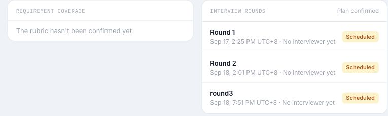
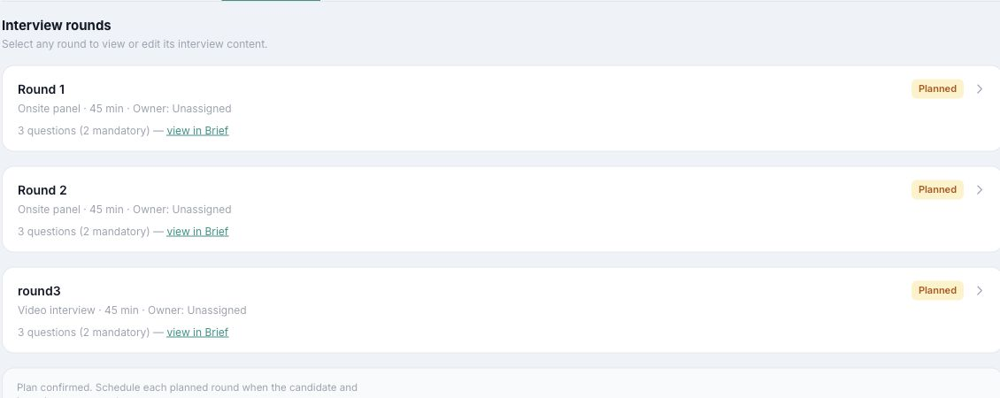
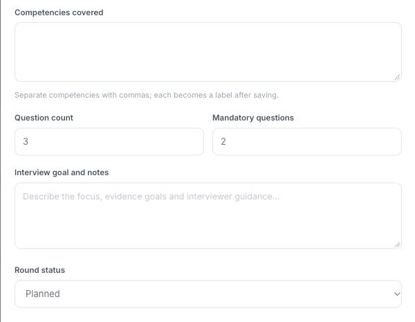
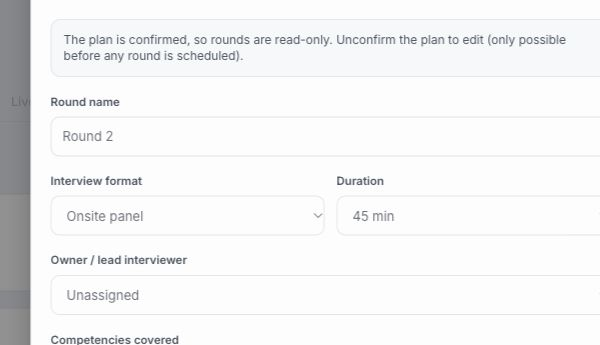
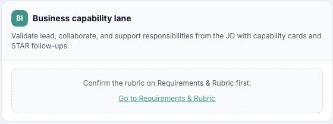
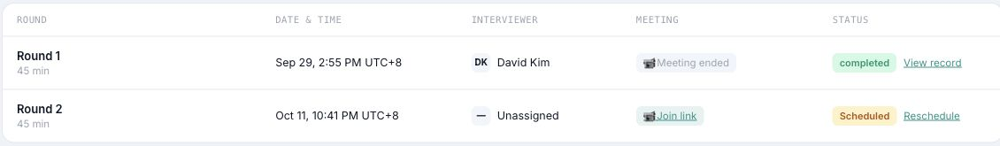
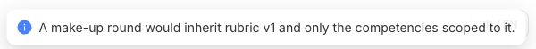

# I04 Issue 草稿与截图

**状态：**9 项已提交 GitHub；下文保留提交前草稿，最终字段和讨论以 GitHub Issue 为准。以下截图均从 2026-10-15 的线上页面截取，并裁掉候选人身份区域。截图只能证明其中可见的状态，不能证明接口权限、历史数据成因或未执行的写入流程。测试详情见 [Test_Report_2026-10-15.md](Test_Report_2026-10-15.md)。截图已上传至 `codex/i04-issue-evidence` 分支，提交为 `ecbc095dddeccc7bb0c32df0085a6607b390b9c9`，并嵌入各 Issue 正文。

| 草稿 | GitHub Issue |
| --- | --- |
| 1 | [#266](https://github.com/TelyAgent/HireOSV2/issues/266) |
| 2 | [#267](https://github.com/TelyAgent/HireOSV2/issues/267) |
| 3 | [#268](https://github.com/TelyAgent/HireOSV2/issues/268) |
| 4 | [#269](https://github.com/TelyAgent/HireOSV2/issues/269) |
| 5 | [#270](https://github.com/TelyAgent/HireOSV2/issues/270) |
| 6 | [#271](https://github.com/TelyAgent/HireOSV2/issues/271) |
| 7 | [#272](https://github.com/TelyAgent/HireOSV2/issues/272) |
| 8 | [#273](https://github.com/TelyAgent/HireOSV2/issues/273) |
| 9 | [#274](https://github.com/TelyAgent/HireOSV2/issues/274) |

## 草稿 1｜Rubric 未确认但计划及排期显示完成

**标题：** `[Bug] I04 Rubric 未确认时已有计划和排期显示完成`

- **Type / Subsystem / Severity / Risk：** Bug / hireos-interview / S2 / medium
- **Problem：** 线上项目显示 Rubric 尚未确认、没有能力卡，但计划已确认且三轮已排期；Brief 仍要求先确认 Rubric。现有证据不能确定异常记录的形成方式。
- **User Outcome：** HR 和面试官能准确判断计划是否具备已确认的岗位标准，以及下一步该做什么。
- **Scope：** Plan 与 Rubric 前置状态校验；现存异常记录的状态提示与处理路径。
- **Non-goals：** 不重写 I03 编辑流程，不自动取消既有面试。
- **Acceptance Criteria：** AC-1：Rubric 未确认时，新计划无法批准或排期，UI/API 给出原因。AC-2：历史异常项目标为需修复，不能显示正常就绪。AC-3：自动测试覆盖未确认、已确认和历史异常数据，核对 Overview、Plan、Brief、Schedule。
- **References：** [I04 PRD AC-1、BR-1](PRD.md)；[测试报告 F-01](Test_Report_2026-10-15.md)。
- **Dependencies：** I03 Rubric 确认状态；I05 排期门禁。
- **Reproduction：** 打开[受影响项目 Overview](https://hireos.aipollo.me/hireos/interview/project/3027ca2b-7aa1-42db-aa76-4a941d39f2f3/overview)，对照 Rubric、Plan、Brief。
- **Expected / Actual：** 预期未确认 Rubric 的计划不可交给排期；实际为 Plan confirmed、三轮 Scheduled。
- **Environment：** 2026-10-15，HireOS 线上环境，Chrome 桌面浏览器；构建号未知。
- **截图：** [Rubric 未确认与计划已确认/已排期](evidence/F01-rubric-plan-state.jpg)。
- **Owner / AI Ready：** @JsonSuCoder / No。

## 草稿 2｜已确认并排期的轮次没有负责人

**标题：** `[Bug] I04 已确认并排期的面试轮次仍可显示负责人为空`

- **Type / Subsystem / Severity / Risk：** Bug / hireos-interview / S2 / medium
- **Problem：** 现存轮次 Owner 为 Unassigned，计划显示 confirmed，排期显示 Scheduled；准备与反馈的责任人不明。
- **User Outcome：** 每个可执行轮次均有明确负责人，历史异常场次也能被处理。
- **Scope：** 保存、批准、排期时的负责人校验；历史空负责人场次的处理。
- **Non-goals：** 不扩展多人 Panel 或改变面试官分配规则。
- **Acceptance Criteria：** AC-1：名称或负责人为空时阻止保存并给出提示。AC-2：批准和排期再次校验负责人。AC-3：历史异常可审计地指派或重新排期，Plan、Schedule、个人任务一致。AC-4：自动测试覆盖空值、有效值和历史数据。
- **References：** [I04 PRD FR-3](PRD.md)；[UC-I04-03](User_Cases.md)；[测试报告 F-02](Test_Report_2026-10-15.md)。
- **Dependencies：** I05 排期校验。
- **Reproduction：** 查看[受影响项目 Plan](https://hireos.aipollo.me/hireos/interview/project/3027ca2b-7aa1-42db-aa76-4a941d39f2f3/plan)与[另一项目 Schedule](https://hireos.aipollo.me/hireos/interview/project/5f57f693-470d-4d27-96dd-592aafdd8db6/schedule)。
- **Expected / Actual：** 预期已批准/已排期轮次有负责人；实际有 Unassigned 轮次。
- **Environment：** 同草稿 1。
- **截图：** [已确认计划中的空负责人轮次](evidence/F02-plan-unassigned.jpg)、[排期表中的 Unassigned](evidence/F06-overdue-scheduled.jpg)。
- **Owner / AI Ready：** @JsonSuCoder / No。

## 草稿 3｜轮次缺少目标能力和目标说明

**标题：** `[Bug] I04 已确认轮次缺少目标能力和面试目标`

- **Type / Subsystem / Severity / Risk：** Bug / hireos-interview / S2 / medium
- **Problem：** 被测已确认轮次的 Competencies covered、Interview goal and notes 均为空；轮次卡也未展示这两项摘要。
- **User Outcome：** HR 能检查各轮考察目标和 Must-have 覆盖，面试官能据此准备。
- **Scope：** 目标字段校验、轮次卡摘要、Rubric × Round 覆盖提示。
- **Non-goals：** 不改 Rubric 定义，不自动判断候选人能力。
- **Acceptance Criteria：** AC-1：缺目标能力或目标说明时不能以就绪状态批准。AC-2：卡片与详情展示一致。AC-3：未覆盖 Must-have 明确标出。AC-4：自动测试覆盖完整、空白与未覆盖计划。
- **References：** [I04 PRD FR-2、FR-5、AC-3](PRD.md)；[测试报告 F-03](Test_Report_2026-10-15.md)。
- **Dependencies：** I03 能力清单；I04 能力覆盖功能。
- **Reproduction：** 打开[受影响项目 Plan](https://hireos.aipollo.me/hireos/interview/project/3027ca2b-7aa1-42db-aa76-4a941d39f2f3/plan)中的轮次抽屉。
- **Expected / Actual：** 预期轮次有目标及能力；实际字段为空且只读。
- **Environment：** 同草稿 1。
- **截图：** [空白的能力与目标字段](evidence/F03-empty-goal-competencies.jpg)。
- **Owner / AI Ready：** @JsonSuCoder / No。

## 草稿 4｜未来轮次缺少可追溯的新计划版本

**标题：** `[Bug] I04 调整未执行轮次缺少计划新版本和批准记录`

- **Type / Subsystem / Severity / Risk：** Bug / hireos-interview / S2 / medium
- **Problem：** Plan 仅显示 confirmed，未显示批准人、时间或版本；已排期的未来轮次只读，页面说明任何轮次已排期后不能取消确认。文档将新计划版本标为未实现。
- **User Outcome：** HR 能调整未执行轮次并重新批准，完成轮次保留原批准版本。
- **Scope：** 新计划版本、批准记录、未来轮次调整、历史版本查看。
- **Non-goals：** 不改写已完成轮次；不在本项决定 HM 是否共同批准。
- **Acceptance Criteria：** AC-1：完成轮次 UI/API 均不可修改。AC-2：未来轮次修改生成待批准的新版本。AC-3：旧轮次保留原版本关联，新旧批准人、时间、范围可查。AC-4：自动测试覆盖多轮版本与重新批准。
- **References：** [I04 PRD AC-4、FR-9](PRD.md)；[UC-I04-06](User_Cases.md)；[测试报告 F-04](Test_Report_2026-10-15.md)。
- **Dependencies：** 计划版本模型与 HM 批准角色待产品决定。
- **Reproduction：** 打开[进行中项目 Plan](https://hireos.aipollo.me/hireos/interview/project/5f57f693-470d-4d27-96dd-592aafdd8db6/plan)的未来轮次抽屉。
- **Expected / Actual：** 预期未来轮次可调整并形成新版本；实际只读且提示已排期后无法取消确认。截图不能证明后端版本数据是否存在。
- **Environment：** 同草稿 1；未执行写入或 DB 验证。
- **截图：** [未来轮次只读提示](evidence/F04-future-round-readonly.jpg)。
- **Owner / AI Ready：** @JsonSuCoder / No。

## 草稿 5｜view in Brief 无法查看所承诺的问题

**标题：** `[Bug] I04 计划卡显示必问题数量但 Brief 无对应问题`

- **Type / Subsystem / Severity / Risk：** Bug / hireos-interview / S3 / low
- **Problem：** 计划卡写“3 questions (2 mandatory) — view in Brief”，进入 Brief 后却要求先确认 Rubric，不能查看所承诺的问题。
- **User Outcome：** 面试官能判断题目是否已备好，并打开真实可用的问题。
- **Scope：** 问题数口径、问题可用状态、Plan → Brief 链接反馈。
- **Non-goals：** 不实现 AI 出题或改变必问题规则。
- **Acceptance Criteria：** AC-1：区分计划题目配额与已生成问题。AC-2：可用时打开对应题目；不可用时显示原因和下一步。AC-3：自动测试覆盖已生成、未生成和 Rubric 未确认。
- **References：** [I04 PRD FR-2、BR-5](PRD.md)；[测试报告 F-05](Test_Report_2026-10-15.md)。
- **Dependencies：** 草稿 1 的状态处理；I06 Brief。
- **Reproduction：** 在[受影响项目 Plan](https://hireos.aipollo.me/hireos/interview/project/3027ca2b-7aa1-42db-aa76-4a941d39f2f3/plan)点击“view in Brief”。
- **Expected / Actual：** 预期看到题目或在点击前获知不可用；实际进入 Brief 后才看到 Rubric 阻断。
- **Environment：** 同草稿 1。
- **截图：** [计划卡的题目数与链接](evidence/F02-plan-unassigned.jpg)、[Brief 的 Rubric 阻断](evidence/F05-brief-blocked.jpg)。
- **Owner / AI Ready：** @JsonSuCoder / No。

## 草稿 6｜过期场次仍显示 Scheduled

**标题：** `[Bug] I04/I05 已过期面试场次仍显示待进行且缺少处理指引`

- **Type / Subsystem / Severity / Risk：** Bug / hireos-interview / S3 / low
- **Problem：** 场次在预定时间过去数日后仍显示 Scheduled、Join link，没有可见的逾期标记或处理指引。
- **User Outcome：** HR 能识别未关闭的过期场次，并记录结果、缺席、改期或取消。
- **Scope：** 逾期显示、下一步入口、项目和个人任务状态同步。
- **Non-goals：** 不自动判定缺席或取消。
- **Acceptance Criteria：** AC-1：过期未完成场次明确标为逾期。AC-2：HR 有适用的处理入口。AC-3：自动测试覆盖未来、进行中、过期和已完成状态。
- **References：** [测试报告 F-06](Test_Report_2026-10-15.md)；I05 排期规格。
- **Dependencies：** I05 状态与改期/取消流程，修复归属待确定。
- **Reproduction：** 打开[受影响项目 Schedule](https://hireos.aipollo.me/hireos/interview/project/5f57f693-470d-4d27-96dd-592aafdd8db6/schedule)：第 2 轮为 2026-10-11 22:41 UTC+8，10 月 15 日测试时仍显示 Scheduled。
- **Expected / Actual：** 预期明确逾期与处理方式；实际是普通待进行状态。
- **Environment：** 同草稿 1。
- **截图：** [过期场次仍为 Scheduled](evidence/F06-overdue-scheduled.jpg)。
- **Owner / AI Ready：** @JsonSuCoder / No。

## 草稿 7｜支持逐轮规划

**标题：** `[Feature] I04 支持逐轮规划并批准下一轮`

- **Type / Subsystem / Severity / Risk：** Feature / hireos-interview / S2（建议）/ medium
- **Problem：** I04 规定两种规划方式，但文档标记方式切换未实现。本次仅在已确认计划的页面上未看到入口，不能据此证明可编辑状态一定没有入口。
- **User Outcome：** HR 可先规划并批准下一轮，再依据结果决定后续轮次。
- **Scope：** 模式选择、逐轮批准门槛、状态保存及排期范围。
- **Non-goals：** 不自动决定候选人是否进入下一轮。
- **Acceptance Criteria：** AC-1：可选择并理解两种模式。AC-2：逐轮模式只规划下一轮即可批准排期。AC-3：后续新增/调整轮次时状态正确更新。AC-4：自动测试覆盖模式、持久化与排期门禁。
- **References：** [I04 PRD FR-1、AC-7](PRD.md)；[UC-I04-09](User_Cases.md)。
- **Dependencies：** I04 批准状态；I05 排期门禁。
- **Reproduction：** 文档标记未实现；本次只读查看[已确认 Plan](https://hireos.aipollo.me/hireos/interview/project/3027ca2b-7aa1-42db-aa76-4a941d39f2f3/plan)。
- **Expected / Actual：** 预期可逐轮规划；实际完整操作未验证，现有文档记载该能力未实现。
- **Environment：** 同草稿 1。
- **截图：** [已确认计划的当前页面](evidence/F02-plan-unassigned.jpg)。**证据范围：**只展示当前页面，没有验证可编辑状态的模式入口。
- **Owner / AI Ready：** @JsonSuCoder / No。

## 草稿 8｜落实 Interviewer 只读权限

**标题：** `[Feature] I04 面试官轮次详情只读并由服务端拒绝编辑`

- **Type / Subsystem / Severity / Risk：** Feature / hireos-interview / S2（建议）/ high
- **Problem：** I04 要求面试官只读负责轮次，编辑 API 返回 403；文档标记业务角色校验未实现。本次没有 Interviewer 测试账号，不能用 HR 页面截图证明权限结果。
- **User Outcome：** 面试官可查看自己负责的计划，不能改动 HR 批准的范围。
- **Scope：** 项目/轮次可见范围、只读提示、服务端新增/编辑/批准授权。
- **Non-goals：** 不决定 HM 是否有批准权。
- **Acceptance Criteria：** AC-1：Interviewer 负责轮次详情为只读。AC-2：新增、编辑、批准的未授权请求被服务端拒绝，编辑 API 返回 403，数据不变。AC-3：不能读取未授权项目/轮次。AC-4：自动测试覆盖 HR、Interviewer、非项目成员。
- **References：** [I04 PRD FR-12、AC-6](PRD.md)；[UC-I04-08](User_Cases.md)；[User Journey 权限说明](User_Journey.md)。
- **Dependencies：** 业务角色与项目成员身份校验（I15）。
- **Reproduction：** 当前是文档记录的已知缺口；尚无 Interviewer 身份用于线上复现。
- **Expected / Actual：** 预期 Interviewer 只读且 API 拒绝编辑；实际权限行为未测试。
- **Environment：** 同草稿 1；缺第二角色账号。
- **截图：** [现有轮次抽屉只读界面](evidence/F04-future-round-readonly.jpg)仅作页面上下文，**不能证明 Interviewer 权限或 403**。有效权限截图待用 Interviewer 账号补采。
- **Owner / AI Ready：** @JsonSuCoder / No。

## 草稿 9｜Debrief 补证轮交接

**标题：** `[Feature] I04 展示并规划 Debrief 发起的补证轮`

- **Type / Subsystem / Severity / Risk：** Feature / hireos-interview / S2（建议）/ medium
- **Problem：** I04 要求 Debrief 补证请求形成带证据目标、负责人、截止日期的轮次。Schedule 已有“Add make-up round”按钮，但本次点击只显示“would inherit rubric v1…”说明，没有打开表单或新增轮次。缺少 `S_evidence_requested` 数据，尚未执行 Debrief 发起路径。
- **User Outcome：** HR 能将证据缺口转为可负责、可排期的补证轮，完成后返回决策。
- **Scope：** I09→I04 交接；证据目标、负责人、截止日期；批准与排期入口。
- **Non-goals：** 不自动生成录用结论，不改写已完成轮次。
- **Acceptance Criteria：** AC-1：Debrief 请求后 Plan 显示补证轮及来源、目标、负责人、截止日期。AC-2：补证轮继承适用 Rubric 版本，只覆盖指定能力。AC-3：完成排期和执行后可返回决策，I04/I05/I09/I10 状态一致。AC-4：自动测试覆盖正常、缺字段及返回决策路径。
- **References：** [I04 PRD FR-11、BR-4](PRD.md)；[UC-I04-10](User_Cases.md)；[Loop_IO P11](Loop_IO.md)。
- **Dependencies：** I09 补证请求；I05 排期；I10 决策状态。
- **Reproduction：** 在[进行中项目 Schedule](https://hireos.aipollo.me/hireos/interview/project/5f57f693-470d-4d27-96dd-592aafdd8db6/schedule)点击“Add make-up round”，只见说明提示；Debrief 发起流程尚未实测。
- **Expected / Actual：** 预期补证请求产生可追溯的补证轮；实际该按钮只展示说明，完整闭环未验证。
- **Environment：** 同草稿 1；缺 `S_evidence_requested` 测试数据。
- **截图：** [Add make-up round 入口](evidence/G09-makeup-button.jpg)、[点击后的说明提示](evidence/G09-makeup-placeholder-toast.jpg)。**证据范围：**仅证明当前按钮行为，不证明 Debrief 发起路径。
- **Owner / AI Ready：** @JsonSuCoder / No。

