# I04 输入输出闭环：面试计划

| 项 | 内容 |
|---|---|
| 模块 | I04 面试计划 |
| 版本 / 日期 | v1.0 / 2026-10-15（草稿，待评审） |
| 同目录文档 | [产品文档](PRD.md) · [User Journey](User_Journey.md) · [User Cases](User_Cases.md) |
| 依据 | [PRD.md](PRD.md)；公共约定见 [Interview README](../README.md) |
| 实现现状 | 🟡 后端支持轮次增改（乐观锁）、确认计划（未确认 Rubric 拒绝）、列出面试官；两种规划方式切换、能力覆盖检查、计划版本未实现 |

本模块拆成 2 个子流程：**I04a 规划与批准**、**I04b 锁定、补证轮与权限**。

## 1. 结构化规格

```yaml
# ---------- I04a 规划与批准 ----------
flow_id: I04a
actor: hr_a
seed: S_rubric_confirmed
entry: I04a.N1
max_loop: 3
external: [llm.plan_draft]

nodes:
  - {id: I04a.N1, type: action, do: "打开 Interview Plan 标签"}
  - {id: I04a.G0, type: decision, on: "Rubric 是否已确认"}
  - {id: I04a.CE0, type: check, expect: {ui: "提示先确认标准", api: "编辑 / 批准接口拒绝"}}
  - {id: I04a.N2, type: action, do: "选择 Plan all rounds 或 Plan one round at a time"}
  - {id: I04a.N3, type: action, do: "打开抽屉，填写名称、形式、时长、负责人、能力（逗号分隔）、题目数、必问题数", inject: [concurrent_edit]}
  - {id: I04a.G1, type: decision, on: "名称和负责人是否填写"}
  - {id: I04a.CE1, type: check, expect: {ui: "提示 Enter a round name and owner."}}
  - {id: I04a.C1, type: check, expect: {ui: "能力保存为标签；显示能力覆盖，未覆盖的 Must-have 高亮；计划回到待批准 The interview plan now requires approval.", db: "InterviewRound 保存，version +1"}}
  - {id: I04a.N4, type: action, do: "点击 Approve", inject: [double_click]}
  - {id: I04a.C2, type: check, expect: {ui: "提示 Plan approved. Schedule each planned round…；排期解锁；重复批准提示已批准", db: "计划批准人与时间"}}
  - {id: I04a.T1, type: terminal, state: plan.approved}
  - {id: I04a.T2, type: terminal, state: plan.pending}

edges:
  - [I04a.N1, I04a.G0]
  - [I04a.G0, I04a.CE0, {when: "否"}]
  - [I04a.CE0, I04a.T2]
  - [I04a.G0, I04a.N2, {when: "是"}]
  - [I04a.N2, I04a.N3]
  - [I04a.N3, I04a.G1]
  - [I04a.G1, I04a.CE1, {when: "缺失"}]
  - [I04a.CE1, I04a.N3]
  - [I04a.G1, I04a.C1, {when: "齐全"}]
  - [I04a.C1, I04a.N3, {when: "继续编辑"}]
  - [I04a.C1, I04a.N4, {when: "准备批准"}]
  - [I04a.N4, I04a.C2]
  - [I04a.C2, I04a.T1]
---
# ---------- I04b 锁定、补证轮与权限 ----------
flow_id: I04b
actors: [hr_a, interviewer_a]
seed: S_round1_completed
entry: I04b.N1

nodes:
  - {id: I04b.N1, type: action, do: "打开第 1 轮抽屉并调用编辑接口"}
  - {id: I04b.C1, type: check, expect: {ui: "Completed interview scope is locked", api: "编辑被拒"}}
  - {id: I04b.N2, type: action, do: "修改第 2 轮能力并保存"}
  - {id: I04b.C2, type: check, expect: {db: "新计划版本；第 1 轮仍挂在原批准版本", ui: "计划回到待批准"}}
  - {id: I04b.N3, type: action, do: "在 S_evidence_requested 状态打开计划"}
  - {id: I04b.C3, type: check, expect: {ui: "出现补证轮，带证据目标、负责人、截止日期；提示先排期完成再回到决定"}}
  - {id: I04b.N4, type: action, actor: interviewer_a, do: "以 interviewer_a 打开轮次抽屉并调用编辑接口"}
  - {id: I04b.C4, type: check, expect: {ui: "Business interviewer view: round details are view-only", api: "403"}}
  - {id: I04b.T1, type: terminal, state: no_unauthorized_change}

edges:
  - [I04b.N1, I04b.C1]
  - [I04b.C1, I04b.T1]
  - [I04b.N2, I04b.C2]
  - [I04b.C2, I04b.T1]
  - [I04b.N3, I04b.C3]
  - [I04b.C3, I04b.T1]
  - [I04b.N4, I04b.C4]
  - [I04b.C4, I04b.T1]
```

## 2. 测试数据

| 名称 | 内容 |
|---|---|
| round_full | Round 1 System Design & Architecture，David Kim，60 分钟，能力 Distributed Systems Design, Backend Engineering Depth，题目 6 / 必问 2 |
| round_missing | 名称或负责人为空 |
| must_uncovered | 没有任何轮次覆盖 Security & Compliance Awareness（Must-have） |
| one_round_mode | 选择 Plan one round at a time，只规划第 1 轮 |

## 3. 路径清单（一条路径 = 一个 test case）

| 路径 | 节点序列 | 数据 / 注入 | 终态 |
|---|---|---|---|
| P1 规划并批准 | I04a: N1 → G0 → N2 → N3 → G1 → C1 → N4 → C2 | round_full | plan.approved |
| P2 未确认 Rubric | I04a: N1 → G0 → CE0 | seed 改为 S_rubric_draft | plan.pending |
| P3 缺少必填 | I04a: … → N3 → G1 → CE1 | round_missing | plan.pending |
| P4 Must-have 未覆盖 | I04a: … → C1 | must_uncovered | 提示高亮 |
| P5 新增轮次后需重新批准 | seed S_plan_approved；I04a: N3 → G1 → C1 | round_full | plan.pending，排期锁定 |
| P6 逐轮规划 | I04a: N2 → N3 → … → C2 | one_round_mode | plan.approved（只含下一轮） |
| P7 并发编辑 | I04a: N3 注入 concurrent_edit | 两个会话改同一轮 | 后保存方收到冲突 |
| P8 双击批准 | P1，在 N4 注入 double_click | — | 只批准一次 |
| P9 已完成轮次锁定 | I04b: N1 → C1 | — | — |
| P10 未来轮次新版本 | I04b: N2 → C2 | — | 新计划版本 |
| P11 补证轮 | I04b: N3 → C3 | seed S_evidence_requested | — |
| P12 Interviewer 只读 | I04b: N4 → C4 | — | — |

## 4. 流程图（由规格生成）

```mermaid
flowchart TD
  subgraph I04a["I04a 规划与批准"]
    I04a_N1["I04a.N1 打开 Interview Plan"]
    I04a_G0{"I04a.G0 Rubric 已确认"}
    I04a_CE0["I04a.CE0 ✔ 未确认门槛"]
    I04a_N2["I04a.N2 选择规划方式"]
    I04a_N3["I04a.N3 新增或编辑轮次<br/>注入：concurrent_edit"]
    I04a_G1{"I04a.G1 必填齐全"}
    I04a_CE1["I04a.CE1 ✔ 缺少必填"]
    I04a_C1["I04a.C1 ✔ 保存与覆盖检查"]
    I04a_N4["I04a.N4 批准计划<br/>注入：double_click"]
    I04a_C2["I04a.C2 ✔ 批准成功"]
    I04a_T1(["plan.approved"])
    I04a_T2(["plan.pending"])
    I04a_N1 --> I04a_G0
    I04a_G0 -->|"否"| I04a_CE0
    I04a_CE0 --> I04a_T2
    I04a_G0 -->|"是"| I04a_N2
    I04a_N2 --> I04a_N3
    I04a_N3 --> I04a_G1
    I04a_G1 -->|"缺失"| I04a_CE1
    I04a_CE1 --> I04a_N3
    I04a_G1 -->|"齐全"| I04a_C1
    I04a_C1 -->|"继续编辑"| I04a_N3
    I04a_C1 -->|"准备批准"| I04a_N4
    I04a_N4 --> I04a_C2
    I04a_C2 --> I04a_T1
  end
  subgraph I04b["I04b 锁定、补证轮与权限"]
    I04b_N1["I04b.N1 编辑已完成的第 1 轮"]
    I04b_C1["I04b.C1 ✔ 已完成轮次只读"]
    I04b_N2["I04b.N2 编辑未来的第 2 轮"]
    I04b_C2["I04b.C2 ✔ 生成新计划版本"]
    I04b_N3["I04b.N3 Debrief 发起补证后查看计划"]
    I04b_C3["I04b.C3 ✔ 补证轮"]
    I04b_N4["I04b.N4 Interviewer 打开抽屉"]
    I04b_C4["I04b.C4 ✔ 只读与 403"]
    I04b_T1(["no_unauthorized_change"])
    I04b_N1 --> I04b_C1
    I04b_C1 --> I04b_T1
    I04b_N2 --> I04b_C2
    I04b_C2 --> I04b_T1
    I04b_N3 --> I04b_C3
    I04b_C3 --> I04b_T1
    I04b_N4 --> I04b_C4
    I04b_C4 --> I04b_T1
  end
  classDef err stroke:#d33,stroke-dasharray:4 3,color:#d33
  classDef done fill:#e6f4ea,stroke:#1e8e3e
  class I04a_CE0,I04a_CE1 err
  class I04a_T1,I04a_T2,I04b_T1 done
```



## 5. 待确认

- 计划版本是否需要独立对象（影响 C2 的 db 断言）
- 批准人是否需要 HM 参与
