# I04 User Journey：面试计划

| 项 | 内容 |
|---|---|
| 模块 | I04 面试计划 |
| 版本 / 日期 | v1.0 / 2026-10-15（草稿，待评审） |
| 同目录文档 | [产品文档](PRD.md) · [输入输出闭环](Loop_IO.md) · [User Cases](User_Cases.md) |
| 依据 | [PRD.md](PRD.md)；公共约定见 [Interview README](../README.md) |
| 实现现状 | 🟡 后端支持轮次增改（乐观锁）、确认计划（未确认 Rubric 拒绝）、列出面试官；两种规划方式切换、能力覆盖检查、计划版本未实现 |

## 角色与权限（公共）

| 角色 | 登录后的主要目的 | 测试身份 | 权限视图 |
|---|---|---|---|
| HR / Recruiter | 建项目、定标准、排期、推进流程；最终结论的 HR 方确认 | hr_a（原型 Sarah Chen） | editor：全部页面可用 |
| Hiring Manager | 统一岗位标准，看证据和分歧；最终结论的 HM 方确认；也可以担任面试官 | hm_a（原型 David Kim，第 1 轮面试官） | 原型通过角色切换完成 HM 确认 |
| Interviewer | 读 Brief、按计划提问、提交 Scorecard | interviewer_a（原型 Priya Nair，第 2 轮面试官） | assignee：只能打开 Overview、Brief、Live Interview、Review |
| Hiring Committee | 查看逐项证据和反证，参与 Debrief | hc_a | 原型未体现 |
| Candidate | 参与面试，知情录制 | — | 不访问面试工作区 |

所有权限由服务端保证，不能只靠前端隐藏；现有后端只校验 Workspace，没有业务角色校验（功能拆分 I15），权限类用例在实现前为 known gap。

# 旅程

**主角色**：HR / Recruiter；Hiring Manager 审阅；Interviewer 只读
**登录目的**：把已确认的标准分配到具体轮次，确保不漏考、不重复，批准后才能排期。
**入口**：项目页 Interview Plan 标签；或 Overview 草稿横幅

## 输入

| 类型 | 内容 |
|---|---|
| 前置数据（seed） | I04a：S_rubric_confirmed；I04b：S_round1_completed |
| 用户数据 | 规划方式、轮次设置（名称、形式、时长、负责人、能力、题目数、必问题数） |
| 外部依赖 | llm.plan_draft |

## 流程

流程图与 [输入输出闭环 §4](Loop_IO.md) 一致：

```mermaid
flowchart TD
  subgraph I04a["I04a 规划与批准"]
    I04a_N1["I04a.N1 打开 Interview Plan"]
    I04a_G0{"I04a.G0 Rubric 已确认"}
    I04a_CE0["I04a.CE0 ✔ 未确认门槛"]
    I04a_N2["I04a.N2 选择规划方式"]
    I04a_N3["I04a.N3 新增或编辑轮次<br/>注入：concurrent_edit"]
    I04a_G1{"I04a.G1 必填齐全"}
    I04a_CE1["I04a.CE1 ✔ 缺少必填"]
    I04a_C1["I04a.C1 ✔ 保存与覆盖检查"]
    I04a_N4["I04a.N4 批准计划<br/>注入：double_click"]
    I04a_C2["I04a.C2 ✔ 批准成功"]
    I04a_T1(["plan.approved"])
    I04a_T2(["plan.pending"])
    I04a_N1 --> I04a_G0
    I04a_G0 -->|"否"| I04a_CE0
    I04a_CE0 --> I04a_T2
    I04a_G0 -->|"是"| I04a_N2
    I04a_N2 --> I04a_N3
    I04a_N3 --> I04a_G1
    I04a_G1 -->|"缺失"| I04a_CE1
    I04a_CE1 --> I04a_N3
    I04a_G1 -->|"齐全"| I04a_C1
    I04a_C1 -->|"继续编辑"| I04a_N3
    I04a_C1 -->|"准备批准"| I04a_N4
    I04a_N4 --> I04a_C2
    I04a_C2 --> I04a_T1
  end
  subgraph I04b["I04b 锁定、补证轮与权限"]
    I04b_N1["I04b.N1 编辑已完成的第 1 轮"]
    I04b_C1["I04b.C1 ✔ 已完成轮次只读"]
    I04b_N2["I04b.N2 编辑未来的第 2 轮"]
    I04b_C2["I04b.C2 ✔ 生成新计划版本"]
    I04b_N3["I04b.N3 Debrief 发起补证后查看计划"]
    I04b_C3["I04b.C3 ✔ 补证轮"]
    I04b_N4["I04b.N4 Interviewer 打开抽屉"]
    I04b_C4["I04b.C4 ✔ 只读与 403"]
    I04b_T1(["no_unauthorized_change"])
    I04b_N1 --> I04b_C1
    I04b_C1 --> I04b_T1
    I04b_N2 --> I04b_C2
    I04b_C2 --> I04b_T1
    I04b_N3 --> I04b_C3
    I04b_C3 --> I04b_T1
    I04b_N4 --> I04b_C4
    I04b_C4 --> I04b_T1
  end
  classDef err stroke:#d33,stroke-dasharray:4 3,color:#d33
  classDef done fill:#e6f4ea,stroke:#1e8e3e
  class I04a_CE0,I04a_CE1 err
  class I04a_T1,I04a_T2,I04b_T1 done
```

## 步骤

| # | 用户意图与操作 | 系统反馈（可观察） | 用户需要判断 |
|---|---|---|---|
| 1 | 打开 Interview Plan | Rubric 未确认时提示先确认 | — |
| 2 | 选择 Plan all rounds 或 Plan one round at a time | 两种方式说明 | 一次规划全部还是逐轮 |
| 3 | 新增或编辑轮次 | 抽屉中填写；缺名称或负责人时提示 | 这一轮考什么、谁来面 |
| 4 | 查看能力覆盖 | 未覆盖的 Must-have 高亮 | 是否漏考 |
| 5 | 点击 Approve | 提示已批准，排期解锁 | 计划是否可以执行 |
| 6 | 第 1 轮完成后修改第 2 轮 | 第 1 轮只读；修改生成新计划版本，需要重新批准 | — |
| 7 | Debrief 发起补证后查看计划 | 出现补证轮，带证据目标、负责人、截止日期 | — |

## 可见 / 不可见

- HR 可编辑和批准；HM 可审阅（能否批准待确认）；Interviewer 只读自己负责的轮次。

## 异常与恢复

| 场景 | 预期 |
|---|---|
| Rubric 未确认 | 不能编辑或批准 |
| 缺少名称或负责人 | 提示并阻止保存 |
| 两人同时编辑同一轮 | 后保存方收到冲突提示，不覆盖 |
| 双击批准 | 只批准一次 |

## 输出与交接

| 输出 | 内容 |
|---|---|
| 持久化 | 规划方式、批准人与时间、计划版本；InterviewRound（version）；问题与必问标记 |
| 交接 | → I05 排期；→ I06 Brief 的推荐重点；→ I07 当前问题 |

**禁止副作用**：未确认 Rubric 就批准计划；修改已完成轮次的范围；编辑后不需重新批准就能排期；并发编辑静默覆盖。

**成功标准**：每轮目标清楚、Must-have 都被覆盖；批准后才能排期；已完成轮次不可改。

**测试映射**：闭环 I04a、I04b（见 [Loop_IO](Loop_IO.md)）；用例见 [User_Cases](User_Cases.md)。

**待确认**（来自 PRD）：

1. 计划批准人：HR 单人即可，还是需要 HM 一起确认。
2. 现有实现计划没有版本号，「未来轮次计划新版本」是否需要单独的 PlanVersion 对象。
3. AI 起草轮次和题目的触发时机：确认 Rubric 后自动生成，还是手动点击。
4. 每轮是否支持多名面试官（Panel）；现有模型每轮只有一个 `interviewerId`。
