# I05 输入输出闭环：排期与会议邀请

| 项 | 内容 |
|---|---|
| 模块 | I05 排期与会议邀请 |
| 版本 / 日期 | v1.0 / 2026-10-15（草稿，待评审） |
| 同目录文档 | [产品文档](PRD.md) · [User Journey](User_Journey.md) · [User Cases](User_Cases.md) |
| 依据 | [PRD.md](PRD.md)；公共约定见 [Interview README](../README.md) |
| 实现现状 | 🟡 后端保存时间、时区标签和手工会议链接（不连日历、不发邀请）；Zoom 主持流程独立；邀请投递、改期 / 取消 / 缺席、Google Meet 未实现 |

本模块拆成 2 个子流程：**I05a 排期与邀请**、**I05b 改期、取消、缺席与补面**。

## 1. 结构化规格

```yaml
# ---------- I05a 排期与邀请 ----------
flow_id: I05a
actor: hr_a
seed: S_plan_approved
entry: I05a.N1
max_loop: 3
external: [calendar.provider, meeting.provider, mail.invitation, clock]

nodes:
  - {id: I05a.N1, type: action, do: "打开 Schedule 标签"}
  - {id: I05a.G0, type: decision, on: "计划是否已批准"}
  - {id: I05a.CE0, type: check, expect: {ui: "提示 Approve the interview plan before scheduling.", api: "排期接口拒绝"}}
  - {id: I05a.C1, type: check, expect: {ui: "每轮显示时间（含时区）、面试官、会议方式和状态；说明 All times shown in your local time zone…"}}
  - {id: I05a.N2, type: action, do: "打开抽屉，填写日期时间、面试官、会议链接 S", inject: [double_click, network_down]}
  - {id: I05a.G1, type: decision, on: "时间和面试官是否填写"}
  - {id: I05a.CE1, type: check, expect: {ui: "提示 Enter a date, time and interviewer."}}
  - {id: I05a.G2, type: decision, on: "邀请投递 mock 返回成功还是失败"}
  - {id: I05a.C2, type: check, expect: {db: "scheduledAt 以 UTC 存储；只有一个有效会议和一份邀请", ui: "状态从 Ready to schedule 前进到 Interview in progress；首页计数刷新"}}
  - {id: I05a.CE2, type: check, expect: {ui: "显示失败原因和 No calendar hold was created；提供 Retry", db: "投递记录 status=failed"}}
  - {id: I05a.N3, type: action, do: "点击 Retry"}
  - {id: I05a.T1, type: terminal, state: round.scheduled}
  - {id: I05a.T2, type: terminal, state: round.unscheduled}

edges:
  - [I05a.N1, I05a.G0]
  - [I05a.G0, I05a.CE0, {when: "否"}]
  - [I05a.CE0, I05a.T2]
  - [I05a.G0, I05a.C1, {when: "是"}]
  - [I05a.C1, I05a.N2]
  - [I05a.N2, I05a.G1]
  - [I05a.G1, I05a.CE1, {when: "缺失"}]
  - [I05a.CE1, I05a.N2]
  - [I05a.G1, I05a.G2, {when: "齐全"}]
  - [I05a.G2, I05a.C2, {when: "成功"}]
  - [I05a.G2, I05a.CE2, {when: "失败"}]
  - [I05a.CE2, I05a.N3]
  - [I05a.N3, I05a.G2]
  - [I05a.C2, I05a.T1]
---
# ---------- I05b 改期、取消、缺席与补面 ----------
flow_id: I05b
actors: [hr_a, interviewer_a]
seed: S_round1_scheduled
entry: I05b.N1

nodes:
  - {id: I05b.N1, type: action, do: "把第 1 轮改到新时间"}
  - {id: I05b.C1, type: check, expect: {db: "只有一个有效会议；旧链接失效", ext: "参与者收到更新"}}
  - {id: I05b.N2, type: action, do: "把第 1 轮标为 no_show 并填写原因"}
  - {id: I05b.C2, type: check, expect: {db: "场次状态 no_show 和原因", api: "该轮没有能力低分"}}
  - {id: I05b.N3, type: action, do: "点击 + Add make-up round"}
  - {id: I05b.C3, type: check, expect: {db: "补面轮继承当前 Rubric 版本，只考分配的能力"}}
  - {id: I05b.N4, type: action, actor: interviewer_a, do: "以 interviewer_a 调用排期接口"}
  - {id: I05b.C4, type: check, expect: {ui: "提示 Business interviewers cannot edit scheduling.", api: "403"}}
  - {id: I05b.T1, type: terminal, state: schedule_updated}

edges:
  - [I05b.N1, I05b.C1]
  - [I05b.C1, I05b.T1]
  - [I05b.N2, I05b.C2]
  - [I05b.C2, I05b.T1]
  - [I05b.N3, I05b.C3]
  - [I05b.C3, I05b.T1]
  - [I05b.N4, I05b.C4]
  - [I05b.C4, I05b.T1]
```

## 2. 测试数据

| 名称 | 内容 |
|---|---|
| slot_ok | 2026-10-20 10:00 UTC+8，面试官 David Kim，Zoom 链接 |
| slot_missing | 未填时间或面试官 |
| tz_viewers | 查看者分别在 UTC+8、UTC+1 |
| invite_fail | 邀请 mock 返回“候选人邮箱已满” |
| reschedule | 改到 2026-10-21 15:00 UTC+8 |

## 3. 路径清单（一条路径 = 一个 test case）

| 路径 | 节点序列 | 数据 / 注入 | 终态 |
|---|---|---|---|
| P1 排期成功 | I05a: N1 → G0 → C1 → N2 → G1 → G2 → C2 | slot_ok | round.scheduled |
| P2 未批准计划 | I05a: N1 → G0 → CE0 | seed S_rubric_confirmed | round.unscheduled |
| P3 缺少必填 | I05a: … → G1 → CE1 | slot_missing | round.unscheduled |
| P4 时区换算 | I05a: C2 后以不同时区查看 | tz_viewers | 显示正确，存储 UTC |
| P5 投递失败后重试 | I05a: … → G2 → CE2 → N3 → G2 → C2 | invite_fail → 成功 | round.scheduled |
| P6 双击保存 | P1，在 N2 注入 double_click | slot_ok | 只有一个会议 |
| P7 改期 | I05b: N1 → C1 | reschedule | 旧会议作废 |
| P8 缺席 | I05b: N2 → C2 | — | 无低分 |
| P9 补面轮 | I05b: N3 → C3 | — | 继承当前 Rubric |
| P10 Interviewer 无权 | I05b: N4 → C4 | — | 403 |

## 4. 流程图（由规格生成）

```mermaid
flowchart TD
  subgraph I05a["I05a 排期与邀请"]
    I05a_N1["I05a.N1 打开 Schedule"]
    I05a_G0{"I05a.G0 计划已批准"}
    I05a_CE0["I05a.CE0 ✔ 未批准门槛"]
    I05a_C1["I05a.C1 ✔ 排期表与时区说明"]
    I05a_N2["I05a.N2 填写排期<br/>注入：double_click / network_down"]
    I05a_G1{"I05a.G1 必填齐全"}
    I05a_CE1["I05a.CE1 ✔ 缺少必填"]
    I05a_G2{"I05a.G2 邀请投递结果"}
    I05a_C2["I05a.C2 ✔ 排期成功"]
    I05a_CE2["I05a.CE2 ✔ 投递失败"]
    I05a_N3["I05a.N3 重试投递"]
    I05a_T1(["round.scheduled"])
    I05a_T2(["round.unscheduled"])
    I05a_N1 --> I05a_G0
    I05a_G0 -->|"否"| I05a_CE0
    I05a_CE0 --> I05a_T2
    I05a_G0 -->|"是"| I05a_C1
    I05a_C1 --> I05a_N2
    I05a_N2 --> I05a_G1
    I05a_G1 -->|"缺失"| I05a_CE1
    I05a_CE1 --> I05a_N2
    I05a_G1 -->|"齐全"| I05a_G2
    I05a_G2 -->|"成功"| I05a_C2
    I05a_G2 -->|"失败"| I05a_CE2
    I05a_CE2 --> I05a_N3
    I05a_N3 --> I05a_G2
    I05a_C2 --> I05a_T1
  end
  subgraph I05b["I05b 改期、取消、缺席与补面"]
    I05b_N1["I05b.N1 改期"]
    I05b_C1["I05b.C1 ✔ 旧会议作废"]
    I05b_N2["I05b.N2 记录缺席"]
    I05b_C2["I05b.C2 ✔ 缺席不产生低分"]
    I05b_N3["I05b.N3 新增补面轮"]
    I05b_C3["I05b.C3 ✔ 补面轮继承版本"]
    I05b_N4["I05b.N4 Interviewer 编辑排期"]
    I05b_C4["I05b.C4 ✔ 403"]
    I05b_T1(["schedule_updated"])
    I05b_N1 --> I05b_C1
    I05b_C1 --> I05b_T1
    I05b_N2 --> I05b_C2
    I05b_C2 --> I05b_T1
    I05b_N3 --> I05b_C3
    I05b_C3 --> I05b_T1
    I05b_N4 --> I05b_C4
    I05b_C4 --> I05b_T1
  end
  classDef err stroke:#d33,stroke-dasharray:4 3,color:#d33
  classDef done fill:#e6f4ea,stroke:#1e8e3e
  class I05a_CE0,I05a_CE1,I05a_CE2 err
  class I05a_T1,I05a_T2,I05b_T1 done
```



## 5. 待确认

- 首期会议供应商（Google Meet / Zoom）决定 meeting.provider 桩
- 邀请由 HireOS 发送还是只生成链接（影响 G2 是否存在）
