# I05 User Journey：排期与会议邀请

| 项 | 内容 |
|---|---|
| 模块 | I05 排期与会议邀请 |
| 版本 / 日期 | v1.0 / 2026-10-15（草稿，待评审） |
| 同目录文档 | [产品文档](PRD.md) · [输入输出闭环](Loop_IO.md) · [User Cases](User_Cases.md) |
| 依据 | [PRD.md](PRD.md)；公共约定见 [Interview README](../README.md) |
| 实现现状 | 🟡 后端保存时间、时区标签和手工会议链接（不连日历、不发邀请）；Zoom 主持流程独立；邀请投递、改期 / 取消 / 缺席、Google Meet 未实现 |

## 角色与权限（公共）

| 角色 | 登录后的主要目的 | 测试身份 | 权限视图 |
|---|---|---|---|
| HR / Recruiter | 建项目、定标准、排期、推进流程；最终结论的 HR 方确认 | hr_a（原型 Sarah Chen） | editor：全部页面可用 |
| Hiring Manager | 统一岗位标准，看证据和分歧；最终结论的 HM 方确认；也可以担任面试官 | hm_a（原型 David Kim，第 1 轮面试官） | 原型通过角色切换完成 HM 确认 |
| Interviewer | 读 Brief、按计划提问、提交 Scorecard | interviewer_a（原型 Priya Nair，第 2 轮面试官） | assignee：只能打开 Overview、Brief、Live Interview、Review |
| Hiring Committee | 查看逐项证据和反证，参与 Debrief | hc_a | 原型未体现 |
| Candidate | 参与面试，知情录制 | — | 不访问面试工作区 |

所有权限由服务端保证，不能只靠前端隐藏；现有后端只校验 Workspace，没有业务角色校验（功能拆分 I15），权限类用例在实现前为 known gap。

# 旅程

**主角色**：HR / Recruiter
**登录目的**：给每轮安排时间、面试官和会议，邀请发出去且状态可见，出问题能马上重试。
**入口**：项目页 Schedule 标签

## 输入

| 类型 | 内容 |
|---|---|
| 前置数据（seed） | I05a：S_plan_approved；I05b：S_round1_scheduled |
| 用户数据 | 日期时间、面试官、会议链接、改期时间、缺席原因 |
| 外部依赖 | calendar.provider、meeting.provider、mail.invitation、clock |

## 流程

流程图与 [输入输出闭环 §4](Loop_IO.md) 一致：

```mermaid
flowchart TD
  subgraph I05a["I05a 排期与邀请"]
    I05a_N1["I05a.N1 打开 Schedule"]
    I05a_G0{"I05a.G0 计划已批准"}
    I05a_CE0["I05a.CE0 ✔ 未批准门槛"]
    I05a_C1["I05a.C1 ✔ 排期表与时区说明"]
    I05a_N2["I05a.N2 填写排期<br/>注入：double_click / network_down"]
    I05a_G1{"I05a.G1 必填齐全"}
    I05a_CE1["I05a.CE1 ✔ 缺少必填"]
    I05a_G2{"I05a.G2 邀请投递结果"}
    I05a_C2["I05a.C2 ✔ 排期成功"]
    I05a_CE2["I05a.CE2 ✔ 投递失败"]
    I05a_N3["I05a.N3 重试投递"]
    I05a_T1(["round.scheduled"])
    I05a_T2(["round.unscheduled"])
    I05a_N1 --> I05a_G0
    I05a_G0 -->|"否"| I05a_CE0
    I05a_CE0 --> I05a_T2
    I05a_G0 -->|"是"| I05a_C1
    I05a_C1 --> I05a_N2
    I05a_N2 --> I05a_G1
    I05a_G1 -->|"缺失"| I05a_CE1
    I05a_CE1 --> I05a_N2
    I05a_G1 -->|"齐全"| I05a_G2
    I05a_G2 -->|"成功"| I05a_C2
    I05a_G2 -->|"失败"| I05a_CE2
    I05a_CE2 --> I05a_N3
    I05a_N3 --> I05a_G2
    I05a_C2 --> I05a_T1
  end
  subgraph I05b["I05b 改期、取消、缺席与补面"]
    I05b_N1["I05b.N1 改期"]
    I05b_C1["I05b.C1 ✔ 旧会议作废"]
    I05b_N2["I05b.N2 记录缺席"]
    I05b_C2["I05b.C2 ✔ 缺席不产生低分"]
    I05b_N3["I05b.N3 新增补面轮"]
    I05b_C3["I05b.C3 ✔ 补面轮继承版本"]
    I05b_N4["I05b.N4 Interviewer 编辑排期"]
    I05b_C4["I05b.C4 ✔ 403"]
    I05b_T1(["schedule_updated"])
    I05b_N1 --> I05b_C1
    I05b_C1 --> I05b_T1
    I05b_N2 --> I05b_C2
    I05b_C2 --> I05b_T1
    I05b_N3 --> I05b_C3
    I05b_C3 --> I05b_T1
    I05b_N4 --> I05b_C4
    I05b_C4 --> I05b_T1
  end
  classDef err stroke:#d33,stroke-dasharray:4 3,color:#d33
  classDef done fill:#e6f4ea,stroke:#1e8e3e
  class I05a_CE0,I05a_CE1,I05a_CE2 err
  class I05a_T1,I05a_T2,I05b_T1 done
```

## 步骤

| # | 用户意图与操作 | 系统反馈（可观察） | 用户需要判断 |
|---|---|---|---|
| 1 | 打开 Schedule | 计划未批准时提示先批准；否则显示排期表和时区说明 | — |
| 2 | 为第 1 轮填写时间、面试官、会议链接 | 缺时间或面试官时提示 | 谁来面、什么时候 |
| 3 | 保存 | 状态变为已排期；项目进入 Interview in progress | — |
| 4 | 邀请投递失败时查看原因并 Retry | 显示失败原因和 No calendar hold was created | 是否需要换联系方式 |
| 5 | 改期 | 旧会议作废，参与者收到更新 | — |
| 6 | 候选人缺席时记录 no-show | 缺席有独立状态和原因，不计入能力分 | — |
| 7 | 新增补面轮 | 继承当前 Rubric，只考分配的能力 | 补面考什么 |

## 可见 / 不可见

- HR 可排期、改期、取消、记录缺席；HM 只看（能否排期待确认）；Interviewer 只看自己的场次时间和链接。

## 异常与恢复

| 场景 | 预期 |
|---|---|
| 计划未批准 | 不能排期 |
| 邀请投递失败 | 显示原因，不显示已发送，可重试 |
| 双击保存 | 只有一个会议和一份邀请 |
| 会议供应商不可用 | 保留已填内容 |

## 输出与交接

| 输出 | 内容 |
|---|---|
| 持久化 | scheduledAt（UTC）、timezone、meetingLink、interviewerId、投递记录、场次状态 |
| 交接 | → I06 Brief、→ I07 实时面试；首页 M01 / M02 / G06 计数 |

**禁止副作用**：未批准计划就排期；投递失败却显示已发送；改期后旧会议仍有效；缺席被记成低分。

**成功标准**：每轮时间、面试官、会议清楚；时区换算正确；失败可重试且不重复建会。

**测试映射**：闭环 I05a、I05b（见 [Loop_IO](Loop_IO.md)）；用例见 [User_Cases](User_Cases.md)。

**待确认**（来自 PRD）：

1. 会议供应商：PRD 偏好 Google Meet，现有实现只接了 Zoom。首期用哪个？
2. 邀请由 HireOS 发送（需要平台邮件服务），还是只生成链接由 HR 自己发？
3. 是否需要候选人自助选择时间段。
4. 改期 / 取消 / 缺席是否需要原因必填。
