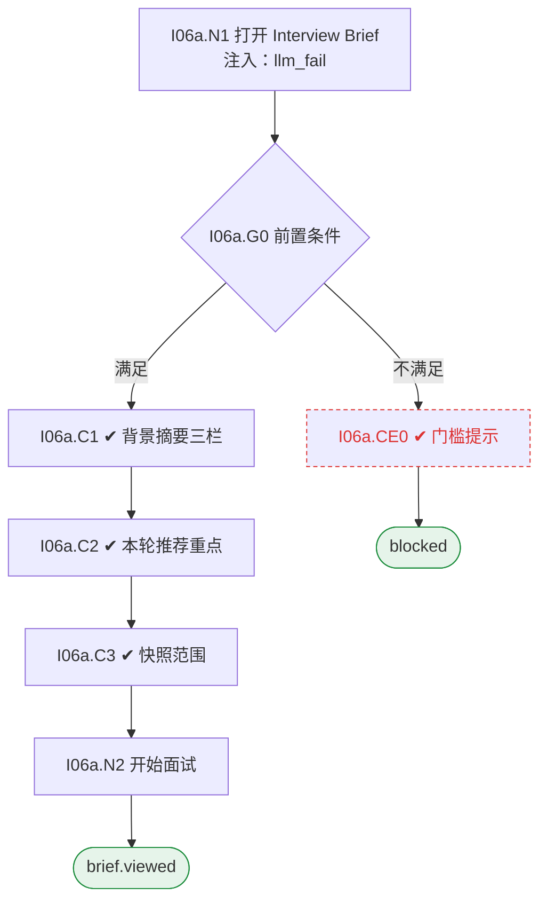

# I06 输入输出闭环：面试 Brief

| 项 | 内容 |
|---|---|
| 模块 | I06 面试 Brief |
| 版本 / 日期 | v1.0 / 2026-10-15（草稿，待评审） |
| 同目录文档 | [产品文档](PRD.md) · [User Journey](User_Journey.md) · [User Cases](User_Cases.md) |
| 依据 | [PRD.md](PRD.md)；公共约定见 [Interview README](../README.md) |
| 实现现状 | 🟡 后端基于已确认 Rubric 按 Job 生成每项能力的问题；背景摘要（Known / Unknown / Claims）、按轮快照、分工未实现 |

## 1. 结构化规格

```yaml
# ---------- I06a 查看 Brief ----------
flow_id: I06a
actor: interviewer_a
seed: S_round2_scheduled_round1_submitted
entry: I06a.N1
max_loop: 1
external: [llm.brief]

nodes:
  - {id: I06a.N1, type: action, do: "打开自己负责的轮次的 Brief", inject: [llm_fail]}
  - {id: I06a.G0, type: decision, on: "候选人已关联、该轮已排期"}
  - {id: I06a.CE0, type: check, expect: {ui: "未排期：Schedule a round before opening the live brief.；未关联：先关联候选人；未关联时只显示岗位要求"}}
  - {id: I06a.C1, type: check, expect: {ui: "Known / supported、Unknown / needs verification、Claims to verify；每条可打开来源抽屉；缺失的筛选 / 测评标为未提供"}}
  - {id: I06a.C2, type: check, expect: {ui: "本轮能力、推荐问题、STAR 追问顺序；View plan →；HR 与业务面试官分工说明"}}
  - {id: I06a.C3, type: check, expect: {ui: "显示快照时间与范围；不含本轮开始后产生的证据；第 1 轮未提交时看不到第 1 轮分数"}}
  - {id: I06a.N2, type: action, do: "点击 Start live interview"}
  - {id: I06a.T1, type: terminal, state: brief.viewed}
  - {id: I06a.T2, type: terminal, state: blocked}

edges:
  - [I06a.N1, I06a.G0]
  - [I06a.G0, I06a.CE0, {when: "不满足"}]
  - [I06a.CE0, I06a.T2]
  - [I06a.G0, I06a.C1, {when: "满足"}]
  - [I06a.C1, I06a.C2]
  - [I06a.C2, I06a.C3]
  - [I06a.C3, I06a.N2]
  - [I06a.N2, I06a.T1]
```

## 2. 测试数据

| 名称 | 内容 |
|---|---|
| no_screening | 项目没有筛选和测评资料 |
| vague_claim | 简历写 led migration to microservices，无范围和个人贡献 |
| round1_unsubmitted | 第 1 轮面试官尚未提交 Scorecard |
| later_evidence | 第 2 轮开始后新增的证据 |

## 3. 路径清单（一条路径 = 一个 test case）

| 路径 | 节点序列 | 数据 / 注入 | 终态 |
|---|---|---|---|
| P1 正常查看 | I06a: N1 → G0 → C1 → C2 → C3 → N2 | — | brief.viewed |
| P2 缺筛选测评 | I06a: … → C1 | no_screening | 标未提供 |
| P3 来源可打开 | I06a: C1 中逐条打开来源 | — | — |
| P4 快照范围 | I06a: C3 | later_evidence | 快照不含 |
| P5 未提交分数隐藏 | I06a: C3 | round1_unsubmitted | 看不到第 1 轮分数 |
| P6 未关联候选人 | seed S_jd_only_project；I06a: N1 → G0 → CE0 | — | 只显示岗位要求 |
| P7 Claim 标记 | I06a: C1 | vague_claim | 显示为待核实 |
| P8 未排期 | seed S_plan_approved；I06a: N1 → G0 → CE0 | — | blocked |
| P9 生成失败 | I06a: N1 注入 llm_fail | — | 显示失败与重试，岗位要求仍可看 |

## 4. 流程图（由规格生成）



## 5. 待确认

- Brief 是按轮快照还是始终最新（影响 C3）
- HR 面与业务面是否两份 Brief
