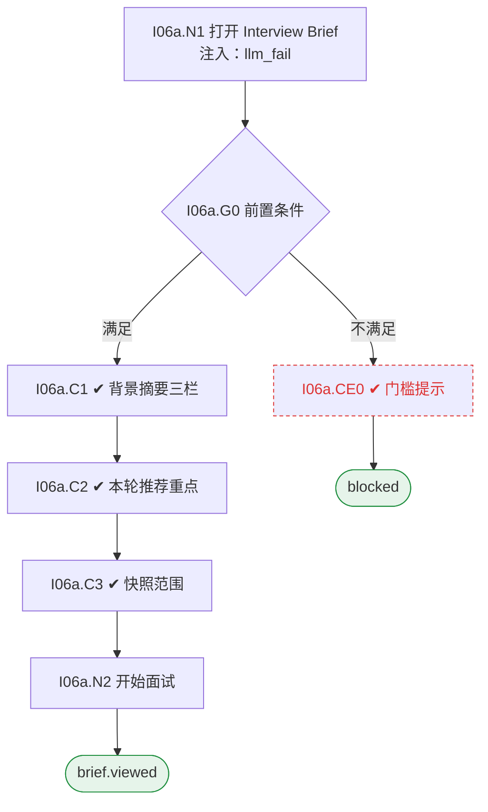

# I06 User Journey：面试 Brief

| 项 | 内容 |
|---|---|
| 模块 | I06 面试 Brief |
| 版本 / 日期 | v1.0 / 2026-10-15（草稿，待评审） |
| 同目录文档 | [产品文档](PRD.md) · [输入输出闭环](Loop_IO.md) · [User Cases](User_Cases.md) |
| 依据 | [PRD.md](PRD.md)；公共约定见 [Interview README](../README.md) |
| 实现现状 | 🟡 后端基于已确认 Rubric 按 Job 生成每项能力的问题；背景摘要（Known / Unknown / Claims）、按轮快照、分工未实现 |

## 角色与权限（公共）

| 角色 | 登录后的主要目的 | 测试身份 | 权限视图 |
|---|---|---|---|
| HR / Recruiter | 建项目、定标准、排期、推进流程；最终结论的 HR 方确认 | hr_a（原型 Sarah Chen） | editor：全部页面可用 |
| Hiring Manager | 统一岗位标准，看证据和分歧；最终结论的 HM 方确认；也可以担任面试官 | hm_a（原型 David Kim，第 1 轮面试官） | 原型通过角色切换完成 HM 确认 |
| Interviewer | 读 Brief、按计划提问、提交 Scorecard | interviewer_a（原型 Priya Nair，第 2 轮面试官） | assignee：只能打开 Overview、Brief、Live Interview、Review |
| Hiring Committee | 查看逐项证据和反证，参与 Debrief | hc_a | 原型未体现 |
| Candidate | 参与面试，知情录制 | — | 不访问面试工作区 |

所有权限由服务端保证，不能只靠前端隐藏；现有后端只校验 Workspace，没有业务角色校验（功能拆分 I15），权限类用例在实现前为 known gap。

# 旅程

**主角色**：Interviewer；HR / Recruiter、Hiring Manager 查看
**登录目的**：开面前用一页看清要验证什么、哪些已知、哪些只是简历说法。
**入口**：首页任务列表（Ready to interview）→ Interview Brief

## 输入

| 类型 | 内容 |
|---|---|
| 前置数据（seed） | I06a：S_round2_scheduled_round1_submitted |
| 用户数据 | —（只读） |
| 外部依赖 | llm.brief |

## 流程

流程图与 [输入输出闭环 §4](Loop_IO.md) 一致：

## 步骤

| # | 用户意图与操作 | 系统反馈（可观察） | 用户需要判断 |
|---|---|---|---|
| 1 | 打开 Brief | 未排期或未关联时提示原因 | — |
| 2 | 看背景摘要三栏 | Known / Unknown / Claims，每条可打开来源 | 哪些需要核实 |
| 3 | 看模糊的简历说法 | 例如 led migration to microservices 被列为待核实 | 先问清楚什么 |
| 4 | 看本轮推荐重点 | 本轮能力、推荐问题、STAR 顺序 | 提问顺序 |
| 5 | 看快照说明 | 快照时间和范围；看不到他人未提交的分数 | — |
| 6 | 点击 Start live interview | 进入 I07 | — |

## 可见 / 不可见

- Interviewer 只看自己负责轮次的 Brief，看不到他人未公开的评分和推荐。
- HR / HM 查看全部轮次。
- 只引用当前用户有权访问的证据。

## 异常与恢复

| 场景 | 预期 |
|---|---|
| 缺筛选 / 测评资料 | 标未提供，不写成通过或低能力 |
| Brief 生成失败 | 显示失败和重试，岗位要求部分仍可看 |
| 未关联候选人 | 只显示岗位要求 |

## 输出与交接

| 输出 | 内容 |
|---|---|
| 持久化 | Brief 快照（轮次、生成时间、证据版本、Known / Unknown / Claim、推荐问题）、AI 运行记录 |
| 交接 | → I07 实时面试 |

**禁止副作用**：把简历说法当作已验证事实；缺数据写成低能力；提交前泄露他人评分；引用无权访问的证据。

**成功标准**：每条结论可打开来源；快照不含之后的证据；缺失资料如实显示。

**测试映射**：闭环 I06a（见 [Loop_IO](Loop_IO.md)）；用例见 [User_Cases](User_Cases.md)。

**待确认**（来自 PRD）：

1. Brief 是按轮生成快照（原型），还是始终显示最新状态。
2. HR 面与业务面是否是两份 Brief，还是同一份按角色显示不同部分。
3. 面试官提交后能看到其他人评分的时机（PRD「反馈披露策略」待评审）。
