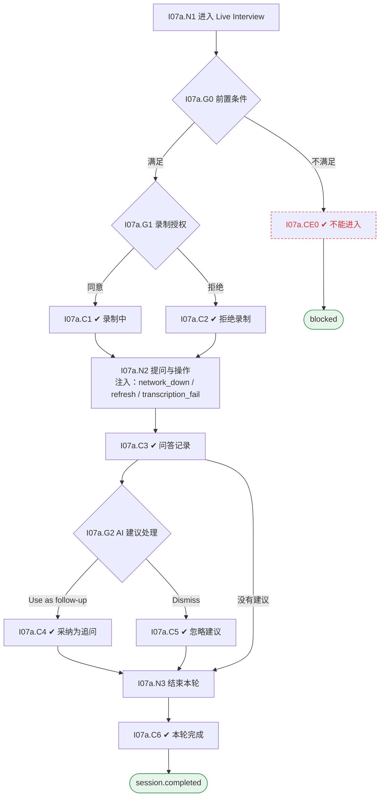

# I07 输入输出闭环：实时面试与记录

| 项 | 内容 |
|---|---|
| 模块 | I07 实时面试与记录 |
| 版本 / 日期 | v1.0 / 2026-10-15（草稿，待评审） |
| 同目录文档 | [产品文档](PRD.md) · [User Journey](User_Journey.md) · [User Cases](User_Cases.md) |
| 依据 | [PRD.md](PRD.md)；公共约定见 [Interview README](../README.md) |
| 实现现状 | 🟡 有 Zoom 主持与 RTMS 转写、个人笔记、转写查询、结束轮次；录制授权状态、AI 问题建议、证据缺口提示未实现；原型为 Google Meet |

## 1. 结构化规格

```yaml
# ---------- I07a 进行面试 ----------
flow_id: I07a
actor: interviewer_a
seed: S_round2_scheduled
entry: I07a.N1
max_loop: 5
external: [meeting.provider, transcription.rtms, llm.suggestions]

nodes:
  - {id: I07a.N1, type: action, do: "打开自己负责轮次的 Live Interview"}
  - {id: I07a.G0, type: decision, on: "已关联候选人、计划已批准、该轮已排期、是本人负责"}
  - {id: I07a.CE0, type: check, expect: {ui: "提示对应原因", api: "非本人场次 403"}}
  - {id: I07a.G1, type: decision, on: "候选人同意录制还是拒绝"}
  - {id: I07a.C1, type: check, expect: {ui: "Recording & transcript active；转写实时显示带时间码的内容"}}
  - {id: I07a.C2, type: check, expect: {ui: "说明本轮证据改为面试官手工记录", db: "录制授权 declined"}}
  - {id: I07a.N2, type: action, do: "按当前问题提问；执行 Next question / Skip / Add follow-up；写笔记", inject: [network_down, refresh, transcription_fail]}
  - {id: I07a.C3, type: check, expect: {db: "实际问答按发生保存；跳过的题标未问；追问标来源", ui: "笔记自动保存并显示保存状态"}}
  - {id: I07a.G2, type: decision, on: "对 AI 建议卡选择 Use as follow-up / Add to notes / Dismiss"}
  - {id: I07a.C4, type: check, expect: {db: "记录为人选择的追问"}}
  - {id: I07a.C5, type: check, expect: {db: "分数、证据、问题均无变化"}}
  - {id: I07a.N3, type: action, do: "点击 Complete session & go to Review"}
  - {id: I07a.C6, type: check, expect: {db: "InterviewSession completed；证据来源类型随记录保存", ui: "进入 Review"}}
  - {id: I07a.T1, type: terminal, state: session.completed}
  - {id: I07a.T2, type: terminal, state: blocked}

edges:
  - [I07a.N1, I07a.G0]
  - [I07a.G0, I07a.CE0, {when: "不满足"}]
  - [I07a.CE0, I07a.T2]
  - [I07a.G0, I07a.G1, {when: "满足"}]
  - [I07a.G1, I07a.C1, {when: "同意"}]
  - [I07a.G1, I07a.C2, {when: "拒绝"}]
  - [I07a.C1, I07a.N2]
  - [I07a.C2, I07a.N2]
  - [I07a.N2, I07a.C3]
  - [I07a.C3, I07a.G2]
  - [I07a.G2, I07a.C4, {when: "Use as follow-up"}]
  - [I07a.G2, I07a.C5, {when: "Dismiss"}]
  - [I07a.C4, I07a.N3]
  - [I07a.C5, I07a.N3]
  - [I07a.C3, I07a.N3, {when: "没有建议"}]
  - [I07a.N3, I07a.C6]
  - [I07a.C6, I07a.T1]
```

## 2. 测试数据

| 名称 | 内容 |
|---|---|
| consent_yes | 候选人同意录制 |
| consent_no | 候选人拒绝录制 |
| transcription_fail | 转写服务中途失败，之后恢复 |
| skip_q2 | 跳过第 2 题 |
| ai_suggestion | AI 建议追问连接池容量的量级估算 |
| notes | 笔记 "Explained idempotent consumer design; no numbers given" |

## 3. 路径清单（一条路径 = 一个 test case）

| 路径 | 节点序列 | 数据 / 注入 | 终态 |
|---|---|---|---|
| P1 录制下完成 | I07a: N1 → G0 → G1 → C1 → N2 → C3 → N3 → C6 | consent_yes、notes | session.completed |
| P2 拒绝录制 | I07a: … → G1 → C2 → N2 → C3 → N3 → C6 | consent_no | session.completed，来源 manual notes |
| P3 转写失败 | I07a: N2 注入 transcription_fail | transcription_fail | 录制不中断，手工记录为来源，重试恢复 |
| P4 跳过题目 | I07a: N2 → C3 | skip_q2 | 记录为未问 |
| P5 忽略 AI 建议 | I07a: … → G2 → C5 | ai_suggestion | 无变化 |
| P6 采纳 AI 建议 | I07a: … → G2 → C4 | ai_suggestion | 人选择的追问 |
| P7 刷新后笔记仍在 | I07a: N2 注入 refresh | notes | 已保存笔记仍在 |
| P8 未排期 | seed S_plan_approved；I07a: N1 → G0 → CE0 | — | blocked |
| P9 非本人场次 | interviewer_a 打开第 1 轮；I07a: N1 → G0 → CE0 | — | 403 |
| P10 已完成轮次再进入 | seed S_round1_completed | — | 提示会议已结束 |

## 4. 流程图（由规格生成）



## 5. 待确认

- 会议供应商与录制授权获取时机（影响 G1）
- AI 问题建议首期是会后还是会中（影响 G2 是否可测）
