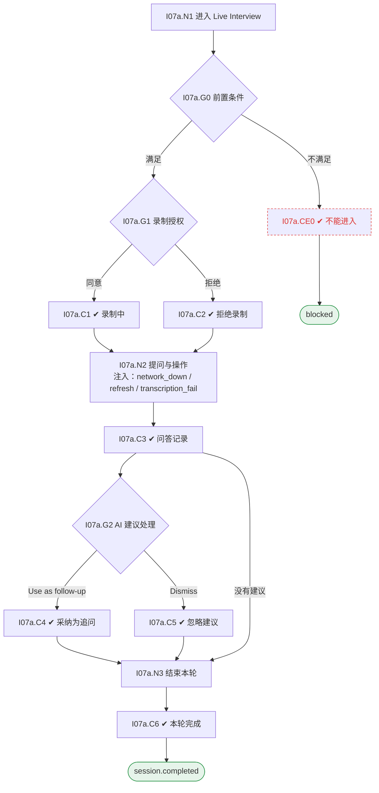

# I07 User Journey：实时面试与记录

| 项 | 内容 |
|---|---|
| 模块 | I07 实时面试与记录 |
| 版本 / 日期 | v1.0 / 2026-10-15（草稿，待评审） |
| 同目录文档 | [产品文档](PRD.md) · [输入输出闭环](Loop_IO.md) · [User Cases](User_Cases.md) |
| 依据 | [PRD.md](PRD.md)；公共约定见 [Interview README](../README.md) |
| 实现现状 | 🟡 有 Zoom 主持与 RTMS 转写、个人笔记、转写查询、结束轮次；录制授权状态、AI 问题建议、证据缺口提示未实现；原型为 Google Meet |

## 角色与权限（公共）

| 角色 | 登录后的主要目的 | 测试身份 | 权限视图 |
|---|---|---|---|
| HR / Recruiter | 建项目、定标准、排期、推进流程；最终结论的 HR 方确认 | hr_a（原型 Sarah Chen） | editor：全部页面可用 |
| Hiring Manager | 统一岗位标准，看证据和分歧；最终结论的 HM 方确认；也可以担任面试官 | hm_a（原型 David Kim，第 1 轮面试官） | 原型通过角色切换完成 HM 确认 |
| Interviewer | 读 Brief、按计划提问、提交 Scorecard | interviewer_a（原型 Priya Nair，第 2 轮面试官） | assignee：只能打开 Overview、Brief、Live Interview、Review |
| Hiring Committee | 查看逐项证据和反证，参与 Debrief | hc_a | 原型未体现 |
| Candidate | 参与面试，知情录制 | — | 不访问面试工作区 |

所有权限由服务端保证，不能只靠前端隐藏；现有后端只校验 Workspace，没有业务角色校验（功能拆分 I15），权限类用例在实现前为 known gap。

# 旅程

**主角色**：Interviewer
**登录目的**：按计划提问、灵活追问，留下可追溯的问答记录；录制不了也有证据。
**入口**：Brief → Start live interview；或首页 Ready to interview

## 输入

| 类型 | 内容 |
|---|---|
| 前置数据（seed） | I07a：S_round2_scheduled |
| 用户数据 | 笔记、跳过 / 追问操作、对 AI 建议的选择 |
| 外部依赖 | meeting.provider、transcription.rtms、llm.suggestions |

## 流程

流程图与 [输入输出闭环 §4](Loop_IO.md) 一致：

## 步骤

| # | 用户意图与操作 | 系统反馈（可观察） | 用户需要判断 |
|---|---|---|---|
| 1 | 进入 Live Interview | 不满足前置条件时提示原因 | — |
| 2 | 确认录制状态 | 同意时显示录制中；拒绝时说明改为手工记录 | — |
| 3 | 按当前问题提问，Next / Skip / Add follow-up | 跳过的题标未问；追问加入当前问题 | 是否追问 |
| 4 | 写笔记 | 自动保存并显示状态 | — |
| 5 | 处理 AI 建议 | 标 AI draft · suggestion only；采纳 / 加入笔记 / 忽略 | 是否采纳 |
| 6 | 转写失败时继续 | 提示手工记录成为证据来源；可 Retry transcription | — |
| 7 | 点击 Complete session & go to Review | 本轮完成，进入 Review | — |

## 可见 / 不可见

- Interviewer 只能进入自己的场次、写自己的笔记。
- 候选人只在会议中出现，不能访问工作区。

## 异常与恢复

| 场景 | 预期 |
|---|---|
| 候选人拒绝录制 | 仍可完成，证据来源为手工记录 |
| 转写失败 | 录制不中断，可重试 |
| 刷新 / 断网 | 已保存笔记不丢，恢复后补存 |
| 非本人场次 | 拒绝进入 |
| 已完成轮次 | 提示会议已结束 |

## 输出与交接

| 输出 | 内容 |
|---|---|
| 持久化 | InterviewSession、RecordNote、TranscriptLine、问答记录（是否跳过 / 追问 / 来源）、录制授权记录 |
| 交接 | → I08 Review（证据与来源类型） |

**禁止副作用**：AI 建议未经人操作改变计划、问题或分数；没有授权就录制；缺席或网络失败被计为低分。

**成功标准**：每道题的实际发生情况都被记录；证据来源类型清楚；录制或转写失败时本轮仍有证据。

**测试映射**：闭环 I07a（见 [Loop_IO](Loop_IO.md)）；用例见 [User_Cases](User_Cases.md)。

**待确认**（来自 PRD）：

1. 会议供应商（同 I05 待确认 1）。原型 Google Meet，实现 Zoom RTMS。
2. 录制授权由谁、在何时获取（会前邀请中 / 会议开始时）。
3. AI 问题建议首期是会后整理（P0）还是会中实时（P1）。
4. 多名面试官同场时，笔记各自独立还是共享。
