# I08 输入输出闭环：面后评审与 Scorecard

| 项 | 内容 |
|---|---|
| 模块 | I08 面后评审与 Scorecard |
| 版本 / 日期 | v1.0 / 2026-10-15（草稿，待评审） |
| 同目录文档 | [产品文档](PRD.md) · [User Journey](User_Journey.md) · [User Cases](User_Cases.md) |
| 依据 | [PRD.md](PRD.md)；公共约定见 [Interview README](../README.md) |
| 实现现状 | 🟡 后端支持 AI 逐项起草分数（引用原文、证据不足为 null）、人工分（null 为 Unknown）、摘要与本轮推荐；整体提交、提交后修订版本、证据映射修正未实现 |

本模块拆成 2 个子流程：**I08a 评分与提交**、**I08b 修订与可见性**。

## 1. 结构化规格

```yaml
# ---------- I08a 评分与提交 ----------
flow_id: I08a
actor: interviewer_a
seed: S_round2_completed
entry: I08a.N1
max_loop: 6
external: [llm.ai_scores]

nodes:
  - {id: I08a.N1, type: action, do: "打开本轮 Review"}
  - {id: I08a.G0, type: decision, on: "是否至少完成一轮"}
  - {id: I08a.CE0, type: check, expect: {ui: "提示 Complete at least one interview round before reviewing evidence."}}
  - {id: I08a.N2, type: action, do: "触发 AI 起草本轮分数", inject: [llm_fail]}
  - {id: I08a.C1, type: check, expect: {ui: "AI 摘要标 agent_run；每项 AI 草稿分标 AI draft；证据显示位置、时间码或 manual notes、可展开原始回答", record: "AI 引用原文可在转写中逐字找到"}}
  - {id: I08a.N3, type: action, do: "对每项能力填写人工分 S 和理由"}
  - {id: I08a.G1, type: decision, on: "S 与 AI 不同 / 与 AI 相同 / Unknown"}
  - {id: I08a.CE1, type: check, expect: {ui: "显示 AI / human differ；不填理由不能保存"}}
  - {id: I08a.C2, type: check, expect: {db: "AI 原始分与人工分都保留，人工理由已存"}}
  - {id: I08a.C3, type: check, expect: {ui: "说明 Unknown is not a zero", db: "人工分为 null，不参与加权"}}
  - {id: I08a.N4, type: action, do: "填写本轮整体推荐和理由，提交", inject: [double_click]}
  - {id: I08a.C4, type: check, expect: {db: "Scorecard 已提交", ui: "首页 Scorecards to submit 减 1"}}
  - {id: I08a.T1, type: terminal, state: scorecard.submitted}
  - {id: I08a.T2, type: terminal, state: blocked}

edges:
  - [I08a.N1, I08a.G0]
  - [I08a.G0, I08a.CE0, {when: "否"}]
  - [I08a.CE0, I08a.T2]
  - [I08a.G0, I08a.N2, {when: "是"}]
  - [I08a.N2, I08a.C1]
  - [I08a.C1, I08a.N3]
  - [I08a.N3, I08a.G1]
  - [I08a.G1, I08a.CE1, {when: "不同且未填理由"}]
  - [I08a.CE1, I08a.N3]
  - [I08a.G1, I08a.C2, {when: "不同且已填理由"}]
  - [I08a.G1, I08a.C3, {when: "Unknown"}]
  - [I08a.G1, I08a.N4, {when: "相同"}]
  - [I08a.C2, I08a.N4]
  - [I08a.C3, I08a.N4]
  - [I08a.N4, I08a.C4]
  - [I08a.C4, I08a.T1]
---
# ---------- I08b 修订与可见性 ----------
flow_id: I08b
actors: [interviewer_a, hm_a]
seed: S_round2_submitted
entry: I08b.N1

nodes:
  - {id: I08b.N1, type: action, do: "修改已提交的分数并填写原因"}
  - {id: I08b.C1, type: check, expect: {db: "生成新版本，旧版本和修改原因可审计"}}
  - {id: I08b.N2, type: action, actor: interviewer_a, do: "第 1 轮面试官未提交时，第 2 轮面试官查看第 1 轮分数"}
  - {id: I08b.C2, type: check, expect: {ui: "看不到", api: "响应不含"}}
  - {id: I08b.N3, type: action, actor: hm_a, do: "打开某项能力的证据追溯抽屉"}
  - {id: I08b.C3, type: check, expect: {ui: "Rubric → AI 草稿 → 人工分 → 理由 → 原始证据，标明来源"}}
  - {id: I08b.T1, type: terminal, state: reviewed}

edges:
  - [I08b.N1, I08b.C1]
  - [I08b.C1, I08b.T1]
  - [I08b.N2, I08b.C2]
  - [I08b.C2, I08b.T1]
  - [I08b.N3, I08b.C3]
  - [I08b.C3, I08b.T1]
```

## 2. 测试数据

| 名称 | 内容 |
|---|---|
| score_raise | Distributed Systems：AI 草稿 2，人工 4，理由 "Raising from AI draft's 2 to 4: …" |
| score_no_reason | 人工分与 AI 不同但理由为空 |
| unknown_security | Security & Compliance Awareness 标为 Unknown，理由说明缺少证据 |
| manual_round | 第 2 轮证据来自手工记录 |
| revise | 提交后把一项分数从 3 改为 4，原因 "Re-read transcript" |

## 3. 路径清单（一条路径 = 一个 test case）

| 路径 | 节点序列 | 数据 / 注入 | 终态 |
|---|---|---|---|
| P1 评分并提交 | I08a: N1 → G0 → N2 → C1 → N3 → G1 → C2 → N4 → C4 | score_raise | scorecard.submitted |
| P2 差异无理由 | I08a: … → G1 → CE1 | score_no_reason | 不能保存 |
| P3 Unknown | I08a: … → G1 → C3 | unknown_security | 分数为空 |
| P4 证据可展开 | I08a: C1 | — | 原始回答与时间码 |
| P5 AI 引用逐字匹配 | I08a: N2 → C1，跑 2 次 | — | 引用都能在转写中找到 |
| P6 手工记录来源 | I08a: C1 | manual_round | 来源 manual notes |
| P7 提交后修订 | I08b: N1 → C1 | revise | 新版本可审计 |
| P8 未提交不可见 | I08b: N2 → C2 | — | — |
| P9 首页计数 | P1 后查看首页 | — | Scorecards to submit 减 1 |
| P10 未完成轮次 | seed S_round1_scheduled；I08a: N1 → G0 → CE0 | — | blocked |
| P11 AI 起草失败 | I08a: N2 注入 llm_fail | — | 显示失败，人工评分不受影响 |

## 4. 流程图（由规格生成）

```mermaid
flowchart TD
  subgraph I08a["I08a 评分与提交"]
    I08a_N1["I08a.N1 打开 Review"]
    I08a_G0{"I08a.G0 已有完成轮次"}
    I08a_CE0["I08a.CE0 ✔ 门槛"]
    I08a_N2["I08a.N2 生成 AI 草稿<br/>注入：llm_fail"]
    I08a_C1["I08a.C1 ✔ AI 草稿与证据"]
    I08a_N3["I08a.N3 填写人工分"]
    I08a_G1{"I08a.G1 人工分类型"}
    I08a_CE1["I08a.CE1 ✔ 差异无理由"]
    I08a_C2["I08a.C2 ✔ 差异已说明"]
    I08a_C3["I08a.C3 ✔ Unknown"]
    I08a_N4["I08a.N4 提交 Scorecard<br/>注入：double_click"]
    I08a_C4["I08a.C4 ✔ 提交成功"]
    I08a_T1(["scorecard.submitted"])
    I08a_T2(["blocked"])
    I08a_N1 --> I08a_G0
    I08a_G0 -->|"否"| I08a_CE0
    I08a_CE0 --> I08a_T2
    I08a_G0 -->|"是"| I08a_N2
    I08a_N2 --> I08a_C1
    I08a_C1 --> I08a_N3
    I08a_N3 --> I08a_G1
    I08a_G1 -->|"不同且未填理由"| I08a_CE1
    I08a_CE1 --> I08a_N3
    I08a_G1 -->|"不同且已填理由"| I08a_C2
    I08a_G1 -->|"Unknown"| I08a_C3
    I08a_G1 -->|"相同"| I08a_N4
    I08a_C2 --> I08a_N4
    I08a_C3 --> I08a_N4
    I08a_N4 --> I08a_C4
    I08a_C4 --> I08a_T1
  end
  subgraph I08b["I08b 修订与可见性"]
    I08b_N1["I08b.N1 提交后修改分数"]
    I08b_C1["I08b.C1 ✔ 新版本"]
    I08b_N2["I08b.N2 未提交时他人查看"]
    I08b_C2["I08b.C2 ✔ 不可见"]
    I08b_N3["I08b.N3 打开证据追溯"]
    I08b_C3["I08b.C3 ✔ 完整追溯链"]
    I08b_T1(["reviewed"])
    I08b_N1 --> I08b_C1
    I08b_C1 --> I08b_T1
    I08b_N2 --> I08b_C2
    I08b_C2 --> I08b_T1
    I08b_N3 --> I08b_C3
    I08b_C3 --> I08b_T1
  end
  classDef err stroke:#d33,stroke-dasharray:4 3,color:#d33
  classDef done fill:#e6f4ea,stroke:#1e8e3e
  class I08a_CE0,I08a_CE1 err
  class I08a_T1,I08a_T2,I08b_T1 done
```



## 5. 待确认

- “提交”是否是独立动作（现有实现逐项保存）
- 差几级必须填理由
