# I08 User Journey：面后评审与 Scorecard

| 项 | 内容 |
|---|---|
| 模块 | I08 面后评审与 Scorecard |
| 版本 / 日期 | v1.0 / 2026-10-15（草稿，待评审） |
| 同目录文档 | [产品文档](PRD.md) · [输入输出闭环](Loop_IO.md) · [User Cases](User_Cases.md) |
| 依据 | [PRD.md](PRD.md)；公共约定见 [Interview README](../README.md) |
| 实现现状 | 🟡 后端支持 AI 逐项起草分数（引用原文、证据不足为 null）、人工分（null 为 Unknown）、摘要与本轮推荐；整体提交、提交后修订版本、证据映射修正未实现 |

## 角色与权限（公共）

| 角色 | 登录后的主要目的 | 测试身份 | 权限视图 |
|---|---|---|---|
| HR / Recruiter | 建项目、定标准、排期、推进流程；最终结论的 HR 方确认 | hr_a（原型 Sarah Chen） | editor：全部页面可用 |
| Hiring Manager | 统一岗位标准，看证据和分歧；最终结论的 HM 方确认；也可以担任面试官 | hm_a（原型 David Kim，第 1 轮面试官） | 原型通过角色切换完成 HM 确认 |
| Interviewer | 读 Brief、按计划提问、提交 Scorecard | interviewer_a（原型 Priya Nair，第 2 轮面试官） | assignee：只能打开 Overview、Brief、Live Interview、Review |
| Hiring Committee | 查看逐项证据和反证，参与 Debrief | hc_a | 原型未体现 |
| Candidate | 参与面试，知情录制 | — | 不访问面试工作区 |

所有权限由服务端保证，不能只靠前端隐藏；现有后端只校验 Workspace，没有业务角色校验（功能拆分 I15），权限类用例在实现前为 known gap。

# 旅程

**主角色**：Interviewer；HR / Recruiter、Hiring Manager 查看
**登录目的**：面完后给出有证据、有理由的逐项评分，AI 草稿只作参考。
**入口**：Live Interview → Complete session & go to Review；或首页 Scorecard pending

## 输入

| 类型 | 内容 |
|---|---|
| 前置数据（seed） | I08a：S_round2_completed；I08b：S_round2_submitted |
| 用户数据 | 人工分、理由、Unknown 标记、本轮推荐、修订原因 |
| 外部依赖 | llm.ai_scores |

## 流程

流程图与 [输入输出闭环 §4](Loop_IO.md) 一致：

```mermaid
flowchart TD
  subgraph I08a["I08a 评分与提交"]
    I08a_N1["I08a.N1 打开 Review"]
    I08a_G0{"I08a.G0 已有完成轮次"}
    I08a_CE0["I08a.CE0 ✔ 门槛"]
    I08a_N2["I08a.N2 生成 AI 草稿<br/>注入：llm_fail"]
    I08a_C1["I08a.C1 ✔ AI 草稿与证据"]
    I08a_N3["I08a.N3 填写人工分"]
    I08a_G1{"I08a.G1 人工分类型"}
    I08a_CE1["I08a.CE1 ✔ 差异无理由"]
    I08a_C2["I08a.C2 ✔ 差异已说明"]
    I08a_C3["I08a.C3 ✔ Unknown"]
    I08a_N4["I08a.N4 提交 Scorecard<br/>注入：double_click"]
    I08a_C4["I08a.C4 ✔ 提交成功"]
    I08a_T1(["scorecard.submitted"])
    I08a_T2(["blocked"])
    I08a_N1 --> I08a_G0
    I08a_G0 -->|"否"| I08a_CE0
    I08a_CE0 --> I08a_T2
    I08a_G0 -->|"是"| I08a_N2
    I08a_N2 --> I08a_C1
    I08a_C1 --> I08a_N3
    I08a_N3 --> I08a_G1
    I08a_G1 -->|"不同且未填理由"| I08a_CE1
    I08a_CE1 --> I08a_N3
    I08a_G1 -->|"不同且已填理由"| I08a_C2
    I08a_G1 -->|"Unknown"| I08a_C3
    I08a_G1 -->|"相同"| I08a_N4
    I08a_C2 --> I08a_N4
    I08a_C3 --> I08a_N4
    I08a_N4 --> I08a_C4
    I08a_C4 --> I08a_T1
  end
  subgraph I08b["I08b 修订与可见性"]
    I08b_N1["I08b.N1 提交后修改分数"]
    I08b_C1["I08b.C1 ✔ 新版本"]
    I08b_N2["I08b.N2 未提交时他人查看"]
    I08b_C2["I08b.C2 ✔ 不可见"]
    I08b_N3["I08b.N3 打开证据追溯"]
    I08b_C3["I08b.C3 ✔ 完整追溯链"]
    I08b_T1(["reviewed"])
    I08b_N1 --> I08b_C1
    I08b_C1 --> I08b_T1
    I08b_N2 --> I08b_C2
    I08b_C2 --> I08b_T1
    I08b_N3 --> I08b_C3
    I08b_C3 --> I08b_T1
  end
  classDef err stroke:#d33,stroke-dasharray:4 3,color:#d33
  classDef done fill:#e6f4ea,stroke:#1e8e3e
  class I08a_CE0,I08a_CE1 err
  class I08a_T1,I08a_T2,I08b_T1 done
```

## 步骤

| # | 用户意图与操作 | 系统反馈（可观察） | 用户需要判断 |
|---|---|---|---|
| 1 | 打开 Review | 未完成任何轮次时提示 | — |
| 2 | 查看 AI 摘要和逐项草稿分 | 标 AI draft 和 agent_run；说明 AI 草稿不覆盖人工分 | 草稿是否可信 |
| 3 | 展开证据 | 位置、时间码或 manual notes、原始回答 | 证据是否足够 |
| 4 | 填写人工分；与 AI 不同时写理由 | 显示 AI / human differ | 给几分 |
| 5 | 证据不足时标 Unknown | 说明 Unknown is not a zero | — |
| 6 | 填写本轮整体推荐并提交 | 首页 Scorecards to submit 减 1 | 推荐什么 |
| 7 | 提交后发现需要修改 | 生成新版本，要求填写原因 | — |

## 可见 / 不可见

- Interviewer 只评自己负责的轮次，提交前看不到他人评分和推荐。
- HR / HM 查看全部轮次。

## 异常与恢复

| 场景 | 预期 |
|---|---|
| AI 起草失败 | 显示失败和重试，人工评分不受影响 |
| 差异未填理由 | 不能保存 |
| 双击提交 | 只提交一次 |

## 输出与交接

| 输出 | 内容 |
|---|---|
| 持久化 | CardScore（AI / 人工，含版本与修改原因）、EvidenceItem / Link、本轮摘要与推荐 |
| 交接 | → I09 Debrief；首页 M03 计数 |

**禁止副作用**：AI 分覆盖人工分；Unknown 显示为 0 或参与加权；找不到原文的引用被当作事实；提交前看到他人评分。

**成功标准**：每个分数都有证据和理由；AI 与人工意见独立留存；修订可审计。

**测试映射**：闭环 I08a、I08b（见 [Loop_IO](Loop_IO.md)）；用例见 [User_Cases](User_Cases.md)。

**待确认**（来自 PRD）：

1. 面试官推荐枚举：现有实现为 strong_advance / advance / hold / do_not_advance / request_info，PRD §7 的 AI 建议为 Strong Hire … Insufficient Evidence。两者是否统一？
2. 「提交」是否是独立动作（现有实现逐项保存，没有整体提交状态）。
3. 提交后谁可以修改分数：仅本人，还是 HR / HM 也可以。
4. AI 草稿与人工分差几级时必须填理由（原型 Debrief 用 ≥ 2 级标记分歧）。
