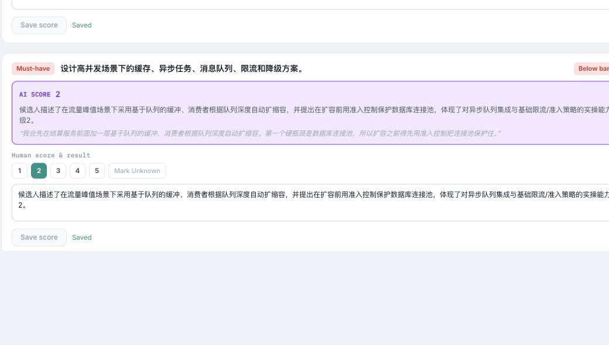
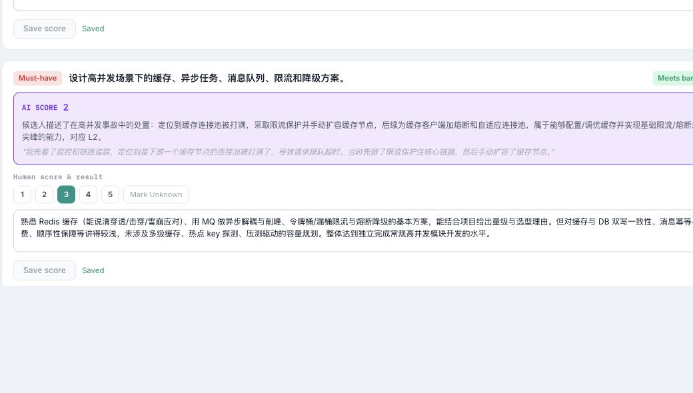
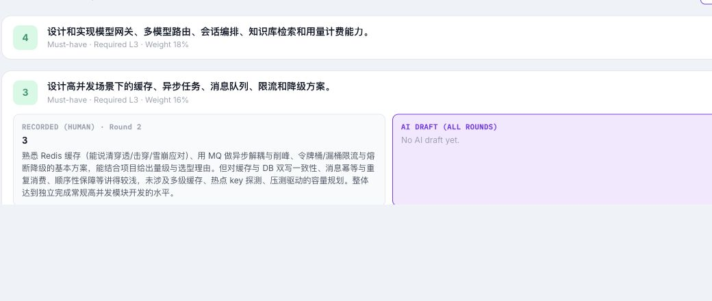
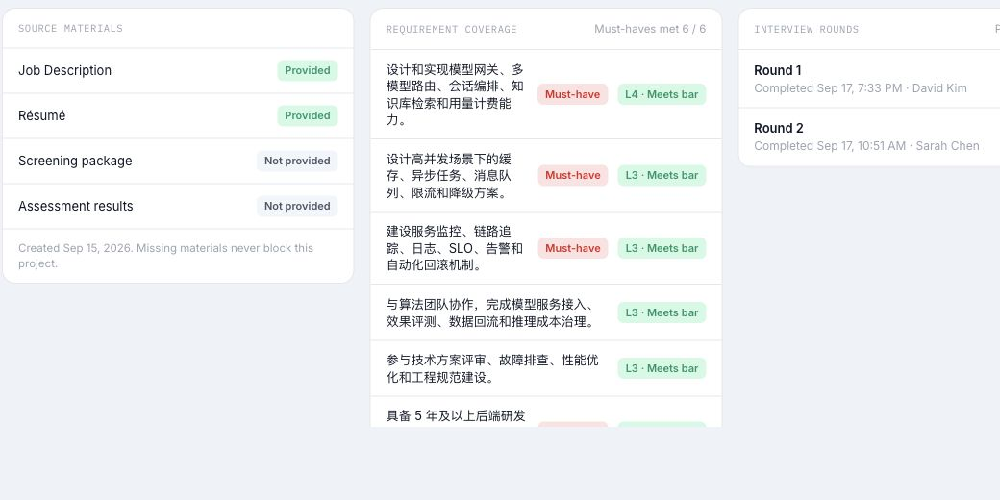
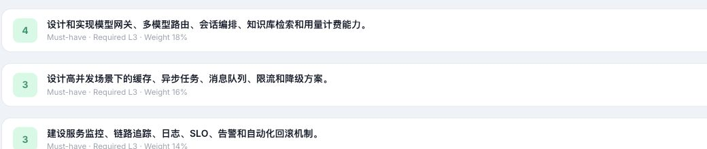
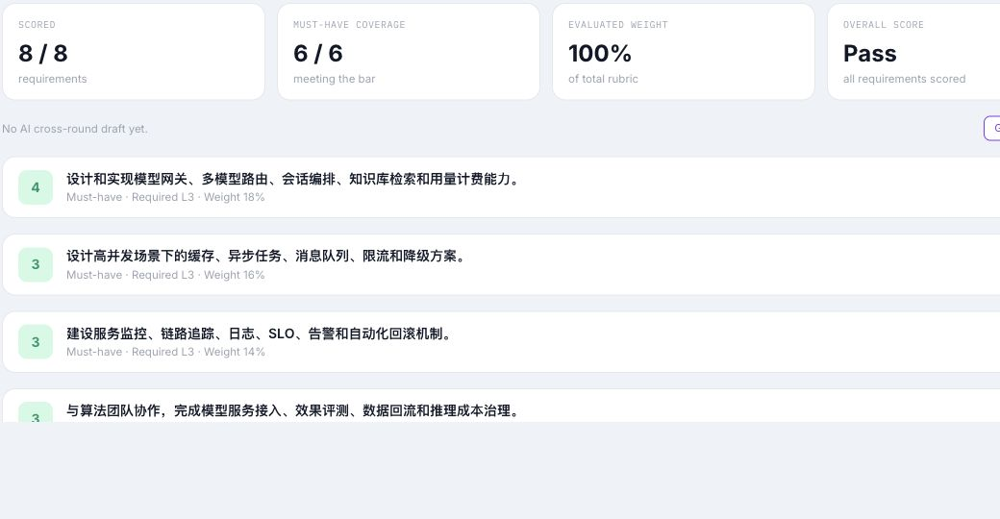
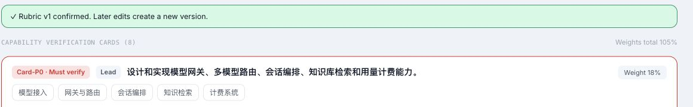

# I09 Issue 草稿与对应截图

日期：2026-10-15；2026-10-16 复核并提交 GitHub。以下保留提交前草稿格式，正式记录见对应 Issue。截图为线上 Chrome 页面原始截图，只裁切了含候选人姓名的页头及无关区域。草稿 4～8 可使用当前账号测试，但线上现有项目没有覆盖所需状态；不能把已发布项目的页面截图当作目标状态的复现证据。草稿 9 属于尚未实现的 I15 权限能力，当前阶段不做跨角色拒绝测试。

| 草稿 | GitHub 记录 | 截图 |
| --- | --- | --- |
| 1 | [#324](https://github.com/TelyAgent/HireOSV2/issues/324) | 3 张 |
| 2 | [#325](https://github.com/TelyAgent/HireOSV2/issues/325) | 2 张 |
| 3 | [#326](https://github.com/TelyAgent/HireOSV2/issues/326) | 1 张 |
| 4 | [#327](https://github.com/TelyAgent/HireOSV2/issues/327) | 无有效目标状态截图 |
| 5 | [#328](https://github.com/TelyAgent/HireOSV2/issues/328) | 无有效目标状态截图 |
| 6 | [#329](https://github.com/TelyAgent/HireOSV2/issues/329) | 无有效目标状态截图 |
| 7 | [#330](https://github.com/TelyAgent/HireOSV2/issues/330) | 无有效目标状态截图 |
| 8 | [#331](https://github.com/TelyAgent/HireOSV2/issues/331) | 无有效目标状态截图 |
| 9 | [#332](https://github.com/TelyAgent/HireOSV2/issues/332) | 权限功能未实现，暂无验证截图 |
| 10 | [#220 的补充证据](https://github.com/TelyAgent/HireOSV2/issues/220#issuecomment-6207599181) | 1 张；复用已有 Issue |

## 草稿 1｜Debrief 未展示全部轮次意见

**标题：** `[Bug] I09 Debrief 仅展示同一能力的单轮人工评分`

- **Type / Subsystem / Severity / Risk：** Bug / hireos-interview / S2 / medium
- **Problem：** 同一 Must-have 在第 1 轮显示未达标、第 2 轮显示达标；Debrief 仅展示第 2 轮的分数和说明，无法在汇总中查看第 1 轮意见。
- **User Outcome：** Hiring Manager 能在 Debrief 同时比较各轮评分、理由及反证，判断分歧是否已解决。
- **Scope：** Debrief 的逐项跨轮人工评分与证据展示。
- **Non-goals：** 不改变各轮原始评分，也不自动裁定分歧。
- **Acceptance Criteria：**
  - **AC-1：** 同一能力在多轮有评分时，Debrief 展示每轮分数、面试官、理由及对应证据。
  - **AC-2：** 两轮结论不同时，两份意见均可见，刷新后仍可追溯。
  - **AC-3：** 自动测试覆盖同一 Must-have 在两轮分别未达标、达标的情况。
- **References：** I09 PRD AC-3；[测试报告](Test_Report_2026-10-15.md) E-04、I09-UX-01。
- **Dependencies：** None。
- **Reproduction：** 打开报告所用两轮完成的演示项目；在 Review 分别查看“缓存、异步任务、消息队列、限流和降级”能力的两轮评分，再到 Debrief 展开该能力。
- **Expected / Actual：** 预期两轮意见同时可见；实际只显示 `RECORDED (HUMAN) · Round 2`。
- **Environment：** `https://hireos.aipollo.me/hireos/interview/`；线上构建号未知。

**截图证据：**

第 1 轮未达标：

第 2 轮达标：

Debrief 只显示第 2 轮：

## 草稿 2｜Must-have 要求等级跨页不一致

**标题：** `[Bug] I09 Debrief 将项目概览中的 L4 Must-have 显示为 L3`

- **Type / Subsystem / Severity / Risk：** Bug / hireos-interview / S2 / high
- **Problem：** 同一 Must-have 在项目 Overview 显示要求 L4，在 Debrief 显示 `Required L3`。等级降低可能导致错误的达标判断。
- **User Outcome：** Hiring Manager 在各页面看到一致的已确认要求等级，并据此判断 Must-have 是否达标。
- **Scope：** Debrief 的逐项要求等级来源及达标状态计算。
- **Non-goals：** 不修改已确认 Rubric 的内容。
- **Acceptance Criteria：**
  - **AC-1：** Debrief 对每项能力展示与当前确认版本一致的要求等级。
  - **AC-2：** Must-have 达标状态使用该项要求等级判断；低于要求时不得显示达标。
  - **AC-3：** 自动测试覆盖不同能力要求 L3、L4 的同一项目。
- **References：** I09 PRD FR-1、FR-4；[测试报告](Test_Report_2026-10-15.md) E-01、E-03、I09-UX-02。
- **Dependencies：** 需确认逐项要求等级的权威数据字段。
- **Reproduction：** 在报告所用演示项目的 Overview 查看首项 Must-have 要求 L4，再到 Debrief 查看同一项。
- **Expected / Actual：** 预期要求等级一致；实际 Debrief 显示 `Required L3`。
- **Environment：** 同上；线上构建号未知。

**截图证据：**

Overview 显示 L4：

Debrief 显示 L3：

## 草稿 3｜完整评分后缺少最终加权分

**标题：** `[Bug] I09 全部评分后 Debrief 仅显示 Pass，未显示最终加权分`

- **Type / Subsystem / Severity / Risk：** Bug / hireos-interview / S2 / medium
- **Problem：** 演示项目 8/8 项均已评分，但 Debrief 的 `OVERALL SCORE` 只显示 `Pass`，没有最终加权数值。该项目已确认 Rubric 的权重合计为 105%，计算口径也无法从页面复核。
- **User Outcome：** 招聘团队能查看并复核最终加权分，同时明确区分分数、覆盖率和达标结论。
- **Scope：** 权重计算口径、完整评分后的数值展示及说明。
- **Non-goals：** 不改变人工原始分数。
- **Acceptance Criteria：**
  - **AC-1：** 全部计分维度完成后，Debrief 显示最终加权数值、计算分母和达标结论。
  - **AC-2：** 存在未评分维度时，显示部分评估及覆盖率，不显示最终加权分。
  - **AC-3：** 对权重合计不等于 100% 的 Rubric，系统按明确规则处理，并能让用户理解该规则。
  - **AC-4：** 自动测试覆盖完整评分、缺项评分及权重合计 105%。
- **References：** I09 PRD FR-2、FR-3；[测试报告](Test_Report_2026-10-15.md) E-02、E-03、I09-UX-03。
- **Dependencies：** 需先确认权重合计超过 100% 时的产品计算规则。
- **Reproduction：** 打开报告所用项目的 Debrief，查看 `SCORED 8 / 8`、`EVALUATED WEIGHT 100%` 与 `OVERALL SCORE Pass`。
- **Expected / Actual：** 预期可见最终加权数值及口径；实际只见覆盖率和 Pass。
- **Environment：** 同上；线上构建号未知。

**截图证据：**

## 草稿 4｜Debrief 补证闭环尚未实现

**标题：** `[Feature] I09 在 Debrief 发起补证并生成补证轮`

- **Type / Subsystem / Severity / Risk：** Feature / hireos-interview / S2 / medium
- **Problem：** I09 产品文档要求从 Debrief 指定证据缺口、负责人、形式和截止日期，并生成补证轮；当前工作区 Debrief 实现没有这条流程。线上所查项目已发布，不能用于判定未完成项目中的入口表现。
- **User Outcome：** 证据不足时，Hiring Manager 能发起、跟踪并完成补证，再基于新证据作决定。
- **Scope：** 补证请求、补证轮、`Evidence requested` 状态、决定阻断及补证后的 Debrief 刷新。
- **Non-goals：** 不自动替人工确认最终决定；不改变已有轮次的原始评分。
- **Acceptance Criteria：**
  - **AC-1：** 在符合条件的 Debrief 中，可指定缺口、负责人、形式和截止日期并创建补证轮。
  - **AC-2：** 创建后计划中出现补证轮，项目显示 `Evidence requested`；补证未完成时不能确认最终结论。
  - **AC-3：** 补证轮提交后，Debrief 根据新证据刷新，并要求重新作决定。
  - **AC-4：** 重复点击创建操作只产生一个补证请求和一个补证轮；自动测试覆盖该情况。
- **References：** I09 PRD AC-5～AC-7；[测试报告](Test_Report_2026-10-15.md) E-06、I09-UX-04。
- **Dependencies：** 需确认补证入口设在 Debrief、决定页，还是两处都有。
- **Reproduction：** 当前工作区 [DebriefPage.tsx](../../../../hireos-interview/job-Interview-front/src/pages/project/DebriefPage.tsx#L184) 无补证流程；线上需使用 `S_all_rounds_scored_security_unknown` 复核。
- **Expected / Actual：** 预期证据缺口可进入补证闭环；当前代码没有对应流程，线上目标状态尚未验证。
- **Environment：** 线上入口同上；目标 seed 与构建号未知。

**截图证据：** 暂无有效线上截图；当前账号可测试，但需要隔离的 Unknown Must-have 测试项目，验证创建入口、状态和补证轮。现有已发布项目不能证明未完成项目中的入口行为。

## 草稿 5｜缺少 Candidate Evidence Map

**标题：** `[Feature] I09 提供按能力、来源和轮次查看的证据图`

- **Type / Subsystem / Severity / Risk：** Feature / hireos-interview / S2 / medium
- **Problem：** I09 要求提供 Requirement × Evidence × Round 视图，并按来源和能力筛选；当前 Debrief 实现只有逐项评分卡。
- **User Outcome：** Hiring Manager 能快速找到某项能力在各轮及其他来源中的支持证据和缺口。
- **Scope：** Debrief 中的证据图、来源与能力筛选、证据定位。
- **Non-goals：** 不自动修改人工评分。
- **Acceptance Criteria：**
  - **AC-1：** 用户能按能力查看关联证据及其来源、轮次。
  - **AC-2：** 用户能按能力和来源筛选，且能定位到原始证据。
  - **AC-3：** 没有证据的能力明确显示缺口，不显示虚构引用。
  - **AC-4：** 自动测试覆盖跨轮证据和空证据。
- **References：** I09 PRD FR-10；[测试报告](Test_Report_2026-10-15.md) E-06。
- **Dependencies：** 需确认独立页面还是合并在 Debrief。
- **Reproduction：** 当前工作区 [DebriefPage.tsx](../../../../hireos-interview/job-Interview-front/src/pages/project/DebriefPage.tsx#L184) 仅逐项渲染评分卡；线上已发布样本未用于完整功能验收。
- **Expected / Actual：** 预期可按来源、能力和轮次查证；当前实现无对应视图。
- **Environment：** 代码缺口，线上构建号未知。

**截图证据：** 暂无能证明完整证据图流程的线上截图；当前账号可测试，需要含两轮及多来源证据的隔离项目。

## 草稿 6｜未解决问题没有责任人

**标题：** `[Bug] I09 Debrief 的重大未解决问题无法标识负责人`

- **Type / Subsystem / Severity / Risk：** Bug / hireos-interview / S2 / medium
- **Problem：** I09 要求每项重大未解决问题有责任人；当前 Debrief 数据将其作为文本列表返回和显示，没有负责人字段。
- **User Outcome：** HR 和 Hiring Manager 知道每个问题由谁跟进。
- **Scope：** 未解决问题的数据结构、负责人展示及更新。
- **Non-goals：** 不让 AI 自动指定最终责任人。
- **Acceptance Criteria：**
  - **AC-1：** 每项重大未解决问题显示负责人或明确的“待分配”状态。
  - **AC-2：** 授权用户可指定负责人，刷新后仍保留。
  - **AC-3：** 自动测试覆盖多项问题分别指派不同负责人。
- **References：** I09 PRD FR-6；[tasks.service.ts](../../../../hireos-interview/job-Interview-backend/src/intake/tasks.service.ts#L145) 的 `unresolved: string[]`。
- **Dependencies：** 需确认谁可指派和修改负责人。
- **Reproduction：** 当前代码只返回未解决问题文本；本次线上样本没有 AI 跨轮草稿，尚无可观察的未解决问题列表。
- **Expected / Actual：** 预期每项有责任人；当前数据结构无法表达责任人。
- **Environment：** 代码依据，线上未验证。

**截图证据：** 暂无有效线上截图；当前账号可测试，需要包含两项未解决问题的 AI 草稿样本，才能核查逐项负责人。

## 草稿 7｜“See both traces”缺少完整追溯链

**标题：** `[Bug] I09 AI 与人工分歧只能展开摘要，无法查看两条完整追溯链`

- **Type / Subsystem / Severity / Risk：** Bug / hireos-interview / S2 / medium
- **Problem：** 当前 `See both traces` 只展开能力卡；卡片显示单轮人工说明、AI 理由和引文，没有同时定位到两侧原始证据的完整路径。
- **User Outcome：** Hiring Manager 能分别核查人工评分依据与 AI 引用的来源。
- **Scope：** 分歧列表、人工与 AI 证据追溯。
- **Non-goals：** 不强制人工接受 AI 分数。
- **Acceptance Criteria：**
  - **AC-1：** 差距达到 2 级的能力出现在分歧列表。
  - **AC-2：** 点击后同时展示人工评分来源与 AI 引用来源，包括轮次和可定位的原始证据。
  - **AC-3：** 引用无效时明确标识证据不足，不显示为已验证。
  - **AC-4：** 自动测试覆盖 1 级与 2 级差距边界。
- **References：** I09 PRD AC-4、FR-5；[测试报告](Test_Report_2026-10-15.md) UC-I09-04 未验证。
- **Dependencies：** 需要 `ai_gap` 测试数据和可追溯的证据标识。
- **Reproduction：** 当前 [DebriefPage.tsx](../../../../hireos-interview/job-Interview-front/src/pages/project/DebriefPage.tsx#L115) 的按钮仅展开卡片；本次线上样本无 AI 跨轮草稿。
- **Expected / Actual：** 预期打开两条来源链；当前实现只提供摘要展示。
- **Environment：** 代码依据，线上未验证。

**截图证据：** 暂无有效线上截图；当前账号可测试，需要有两级以上 AI/人工分歧及有效原始引用的样本。现有已发布样本显示 `No AI cross-round draft yet`。

## 草稿 8｜Unknown Must-have 的最终结论阻断需补齐

**标题：** `[Bug] I09/I10 Must-have 为 Unknown 时缺少最终结论阻断校验`

- **Type / Subsystem / Severity / Risk：** Bug / hireos-interview / S2 / high
- **Problem：** 产品规则要求无证据的 Must-have 保持 Unknown，阻止默认交接，或走 HR 与 HM 双方确认的例外。当前决定草稿接口只检查是否至少有一项人工评分，尚未看到对 Unknown Must-have 的阻断。
- **User Outcome：** 招聘团队不能在关键能力未验证时误确认和交接最终结论。
- **Scope：** Debrief → Decision → Evaluation Package 的服务端校验与例外状态。
- **Non-goals：** 不禁止记录 Hold 或 Request More Evidence。
- **Acceptance Criteria：**
  - **AC-1：** 存在 Unknown Must-have 时，普通推荐 Offer 路径不能完成最终确认或交接。
  - **AC-2：** 页面说明具体缺口及补证或例外路径。
  - **AC-3：** 例外仅在符合产品规定的 HR/HM 双方确认后生效。
  - **AC-4：** UI 与 API 自动测试均覆盖阻断和例外。
- **References：** I09 PRD BR-3、BR-4；[测试报告](Test_Report_2026-10-15.md) AC-2、AC-5 未验证。
- **Dependencies：** I10 的例外确认规则；需准备 Security Unknown seed。
- **Reproduction：** 当前 [tasks.service.ts](../../../../hireos-interview/job-Interview-backend/src/intake/tasks.service.ts#L249) 检查“至少一项评分”即可生成决定草稿；本次没有 Unknown 线上 seed，未执行最终确认。
- **Expected / Actual：** 预期 Unknown Must-have 阻断默认最终交接；当前代码未见对应校验。
- **Environment：** 代码风险，线上未验证。

**截图证据：** 暂无有效线上截图；当前账号可核普通路径，需要 Unknown Must-have 的隔离项目，并核 UI 与 API 阻断。HR/HM 双方例外确认属于后续权限能力，当前不能据单账号测试判定通过。

## 草稿 9｜Interviewer 的 Debrief 权限尚待实现

**标题：** `[Feature] I15 按面试业务角色限制 Debrief 访问`

- **Type / Subsystem / Severity / Risk：** Feature / hireos-interview / S2 / high
- **Problem：** I09 规定 Interviewer 不能进入 Debrief；当前 I15 业务角色权限尚未实现，接口只使用 Workspace 身份校验。
- **User Outcome：** 只有授权的 HR、Hiring Manager 和适用的委员会成员能查看跨轮评估。
- **Scope：** Debrief 页面入口及读取、AI 生成接口的角色校验。
- **Non-goals：** 不改变 Interviewer 对自己轮次 Review 的权限。
- **Acceptance Criteria：**
  - **AC-1：** Interviewer 无 Debrief 入口，直接调用读取与生成接口返回 403。
  - **AC-2：** HR、Hiring Manager 可按授权访问。
  - **AC-3：** 自动测试使用独立身份验证 UI 和 API。
- **References：** I09 User Cases UC-I09-10；Interview README 的 I15 权限缺口。
- **Dependencies：** I15 业务角色实现；完成后需具备 Interviewer 身份进行拒绝测试。
- **Reproduction：** 当前 [intake.controller.ts](../../../../hireos-interview/job-Interview-backend/src/intake/intake.controller.ts#L75) 未见业务角色判断。权限功能尚未交付，不将当前账号访问成功视为权限缺陷复现。
- **Expected / Actual：** 目标是 Interviewer 被服务端拒绝；现阶段为已知未实现能力，不判线上 Bug 复现。
- **Environment：** 当前账号；权限专项验收待 I15 实现。

**截图证据：** 当前阶段不需要截图；I15 实现后再以 Interviewer 身份取得无入口及 API 403 证据。

## 草稿 10｜确认的 Rubric 权重合计 105%

**标题：** `[Bug] I03 允许确认权重合计为 105% 的 Rubric`

- **Type / Subsystem / Severity / Risk：** Bug / hireos-interview / S2 / medium
- **Problem：** 线上演示项目的 Rubric v1 已确认，但页面显示 `Weights total 105%`，使 I09 的最终加权分缺乏明确计算基础。
- **User Outcome：** 用户确认 Rubric 前能得到明确的权重校验，后续评分结果可复核。
- **Scope：** Rubric 确认时的权重校验及已有异常版本的处理说明。
- **Non-goals：** 不静默改写已记录的人工评分。
- **Acceptance Criteria：**
  - **AC-1：** 权重合计不符合确认规则时，系统阻止确认并指出差额；若产品允许非 100%，则在确认及汇总页明确计算口径。
  - **AC-2：** 已确认的异常版本有明确提示和修复路径。
  - **AC-3：** 自动测试覆盖 100%、低于 100% 和高于 100%。
- **References：** [测试报告](Test_Report_2026-10-15.md) E-02、I09-UX-03；与草稿 3 的加权分展示相关。
- **Dependencies：** 需确认权重是否必须合计 100%。
- **Reproduction：** 打开报告所用项目的 Requirements & Rubric，页面同时显示 `Rubric v1 confirmed` 与 `Weights total 105%`。
- **Expected / Actual：** 预期确认规则与计算口径明确；实际已确认版本权重为 105%。
- **Environment：** 同一线上演示项目；构建号未知。

**截图证据：**

