# I09 输入输出闭环：跨轮 Debrief 与补证

| 项 | 内容 |
|---|---|
| 模块 | I09 跨轮 Debrief 与补证 |
| 版本 / 日期 | v1.0 / 2026-10-15（草稿，待评审） |
| 同目录文档 | [产品文档](PRD.md) · [User Journey](User_Journey.md) · [User Cases](User_Cases.md) |
| 依据 | [PRD.md](PRD.md)；公共约定见 [Interview README](../README.md) |
| 实现现状 | 🟡 后端可读取 Debrief、AI 跨轮起草（引用原文、证据不足为 null、列未解决问题）；补证请求与补证轮生成、证据图未实现 |

本模块拆成 2 个子流程：**I09a 跨轮汇总**、**I09b 发起补证**。

## 1. 结构化规格

```yaml
# ---------- I09a 跨轮汇总 ----------
flow_id: I09a
actor: hm_a
seed: S_all_rounds_scored_security_unknown
entry: I09a.N1
max_loop: 1
external: [llm.debrief]

nodes:
  - {id: I09a.N1, type: action, do: "打开 Debrief 标签", inject: [llm_fail]}
  - {id: I09a.C1, type: check, expect: {ui: "每项能力显示要求等级、Must-have、各轮人工分、AI 跨轮草稿分、支持证据和反证、当前状态"}}
  - {id: I09a.G1, type: decision, on: "所有计分维度是否都已评分"}
  - {id: I09a.C2, type: check, expect: {ui: "显示 Partial evaluation 与已评估权重覆盖率；不显示最终加权分"}}
  - {id: I09a.C3, type: check, expect: {ui: "全部评分后才显示最终加权分"}}
  - {id: I09a.C4, type: check, expect: {ui: "Security & Compliance Awareness（Must-have，L3，Unknown）单独突出，其他高分不改变其状态"}}
  - {id: I09a.C5, type: check, expect: {ui: "列出 AI 与人工相差 ≥ 2 级的维度，See both traces 同时打开两条追溯链；人工之间的分歧两份意见都保留；未解决问题有责任人"}}
  - {id: I09a.N2, type: action, do: "点击 Continue to decision"}
  - {id: I09a.T1, type: terminal, state: debrief.reviewed}

edges:
  - [I09a.N1, I09a.C1]
  - [I09a.C1, I09a.G1]
  - [I09a.G1, I09a.C2, {when: "否"}]
  - [I09a.G1, I09a.C3, {when: "是"}]
  - [I09a.C2, I09a.C4]
  - [I09a.C3, I09a.C4]
  - [I09a.C4, I09a.C5]
  - [I09a.C5, I09a.N2]
  - [I09a.N2, I09a.T1]
---
# ---------- I09b 发起补证 ----------
flow_id: I09b
actor: hm_a
seed: S_all_rounds_scored_security_unknown
entry: I09b.N1
max_loop: 1

nodes:
  - {id: I09b.N1, type: action, do: "点击 Request more evidence"}
  - {id: I09b.C1, type: check, expect: {ui: "显示缺口 Close the Security & Compliance gap；负责人默认 HM，形式默认 panel，截止日期"}}
  - {id: I09b.N2, type: action, do: "点击 Create follow-up round", inject: [double_click]}
  - {id: I09b.C2, type: check, expect: {db: "补证请求与一个补证轮；项目状态 Evidence requested", ui: "提示先排期并完成补证再回到决定；决定页无法确认最终结论"}}
  - {id: I09b.N3, type: action, do: "补证轮完成并提交 Scorecard 后打开 Debrief"}
  - {id: I09b.C3, type: check, expect: {ui: "原 Unknown 按新证据更新（演示：达到 L3）；需要新的决定"}}
  - {id: I09b.T1, type: terminal, state: evidence_requested}
  - {id: I09b.T2, type: terminal, state: debrief.refreshed}

edges:
  - [I09b.N1, I09b.C1]
  - [I09b.C1, I09b.N2]
  - [I09b.N2, I09b.C2]
  - [I09b.C2, I09b.T1]
  - [I09b.N3, I09b.C3]
  - [I09b.C3, I09b.T2]
```

## 2. 测试数据

| 名称 | 内容 |
|---|---|
| one_unscored | 有一项能力尚未评分 |
| security_unknown | Security & Compliance Awareness 为 Unknown |
| split_scores | 同一能力 Round 1 给 4、Round 2 给 2 |
| ai_gap | AI 跨轮草稿 2，人工 4 |
| followup | 负责人 David Kim，形式 panel，截止 2026-10-25 |

## 3. 路径清单（一条路径 = 一个 test case）

| 路径 | 节点序列 | 数据 / 注入 | 终态 |
|---|---|---|---|
| P1 部分评估 | I09a: N1 → C1 → G1 → C2 → C4 → C5 | one_unscored | 不显示最终分 |
| P2 全部评分 | I09a: … → G1 → C3 | 全部已评分 | 显示最终加权分 |
| P3 Must-have Unknown | I09a: C4 | security_unknown | 单独突出 |
| P4 人工分歧 | I09a: C5 | split_scores | 两份意见都保留 |
| P5 AI ≥ 2 级差距 | I09a: C5 | ai_gap | 列出并可同时看两条链 |
| P6 发起补证 | I09b: N1 → C1 → N2 → C2 | followup | evidence_requested |
| P7 补证后刷新 | I09b: N3 → C3 | 补证轮已提交 | debrief.refreshed |
| P8 双击创建补证轮 | P6，在 N2 注入 double_click | followup | 只有 1 个补证轮 |
| P9 AI 跨轮草稿失败 | I09a: N1 注入 llm_fail | — | 各轮人工分照常显示 |

## 4. 流程图（由规格生成）

```mermaid
flowchart TD
  subgraph I09a["I09a 跨轮汇总"]
    I09a_N1["I09a.N1 打开 Debrief<br/>注入：llm_fail"]
    I09a_C1["I09a.C1 ✔ 逐项跨轮结果"]
    I09a_G1{"I09a.G1 是否全部评分"}
    I09a_C2["I09a.C2 ✔ 部分评估"]
    I09a_C3["I09a.C3 ✔ 最终加权分"]
    I09a_C4["I09a.C4 ✔ Must-have 突出"]
    I09a_C5["I09a.C5 ✔ 分歧与未解决问题"]
    I09a_N2["I09a.N2 继续到决定"]
    I09a_T1(["debrief.reviewed"])
    I09a_N1 --> I09a_C1
    I09a_C1 --> I09a_G1
    I09a_G1 -->|"否"| I09a_C2
    I09a_G1 -->|"是"| I09a_C3
    I09a_C2 --> I09a_C4
    I09a_C3 --> I09a_C4
    I09a_C4 --> I09a_C5
    I09a_C5 --> I09a_N2
    I09a_N2 --> I09a_T1
  end
  subgraph I09b["I09b 发起补证"]
    I09b_N1["I09b.N1 打开补证弹窗"]
    I09b_C1["I09b.C1 ✔ 弹窗内容"]
    I09b_N2["I09b.N2 创建补证轮<br/>注入：double_click"]
    I09b_C2["I09b.C2 ✔ 补证轮已创建"]
    I09b_N3["I09b.N3 补证完成后刷新"]
    I09b_C3["I09b.C3 ✔ 按新证据更新"]
    I09b_T1(["evidence_requested"])
    I09b_T2(["debrief.refreshed"])
    I09b_N1 --> I09b_C1
    I09b_C1 --> I09b_N2
    I09b_N2 --> I09b_C2
    I09b_C2 --> I09b_T1
    I09b_N3 --> I09b_C3
    I09b_C3 --> I09b_T2
  end
  classDef err stroke:#d33,stroke-dasharray:4 3,color:#d33
  classDef done fill:#e6f4ea,stroke:#1e8e3e
  class I09a_T1,I09b_T1,I09b_T2 done
```



## 5. 待确认

- 补证入口在 Debrief 还是决定页（影响 I09b 与 I10 的分工）
- 人工之间的分歧阈值
