# I09 User Journey：跨轮 Debrief 与补证

| 项 | 内容 |
|---|---|
| 模块 | I09 跨轮 Debrief 与补证 |
| 版本 / 日期 | v1.0 / 2026-10-15（草稿，待评审） |
| 同目录文档 | [产品文档](PRD.md) · [输入输出闭环](Loop_IO.md) · [User Cases](User_Cases.md) |
| 依据 | [PRD.md](PRD.md)；公共约定见 [Interview README](../README.md) |
| 实现现状 | 🟡 后端可读取 Debrief、AI 跨轮起草（引用原文、证据不足为 null、列未解决问题）；补证请求与补证轮生成、证据图未实现 |

## 角色与权限（公共）

| 角色 | 登录后的主要目的 | 测试身份 | 权限视图 |
|---|---|---|---|
| HR / Recruiter | 建项目、定标准、排期、推进流程；最终结论的 HR 方确认 | hr_a（原型 Sarah Chen） | editor：全部页面可用 |
| Hiring Manager | 统一岗位标准，看证据和分歧；最终结论的 HM 方确认；也可以担任面试官 | hm_a（原型 David Kim，第 1 轮面试官） | 原型通过角色切换完成 HM 确认 |
| Interviewer | 读 Brief、按计划提问、提交 Scorecard | interviewer_a（原型 Priya Nair，第 2 轮面试官） | assignee：只能打开 Overview、Brief、Live Interview、Review |
| Hiring Committee | 查看逐项证据和反证，参与 Debrief | hc_a | 原型未体现 |
| Candidate | 参与面试，知情录制 | — | 不访问面试工作区 |

所有权限由服务端保证，不能只靠前端隐藏；现有后端只校验 Workspace，没有业务角色校验（功能拆分 I15），权限类用例在实现前为 known gap。

# 旅程

**主角色**：Hiring Manager、HR / Recruiter；Hiring Committee 查看
**登录目的**：多轮面试后围绕证据讨论；证据不够时去补，而不是凭印象拍板。
**入口**：Review → Continue to debrief；或首页 Review pending

## 输入

| 类型 | 内容 |
|---|---|
| 前置数据（seed） | I09a：S_all_rounds_scored_security_unknown；I09b：S_all_rounds_scored_security_unknown |
| 用户数据 | 补证负责人、形式、截止日期 |
| 外部依赖 | llm.debrief |

## 流程

流程图与 [输入输出闭环 §4](Loop_IO.md) 一致：

```mermaid
flowchart TD
  subgraph I09a["I09a 跨轮汇总"]
    I09a_N1["I09a.N1 打开 Debrief<br/>注入：llm_fail"]
    I09a_C1["I09a.C1 ✔ 逐项跨轮结果"]
    I09a_G1{"I09a.G1 是否全部评分"}
    I09a_C2["I09a.C2 ✔ 部分评估"]
    I09a_C3["I09a.C3 ✔ 最终加权分"]
    I09a_C4["I09a.C4 ✔ Must-have 突出"]
    I09a_C5["I09a.C5 ✔ 分歧与未解决问题"]
    I09a_N2["I09a.N2 继续到决定"]
    I09a_T1(["debrief.reviewed"])
    I09a_N1 --> I09a_C1
    I09a_C1 --> I09a_G1
    I09a_G1 -->|"否"| I09a_C2
    I09a_G1 -->|"是"| I09a_C3
    I09a_C2 --> I09a_C4
    I09a_C3 --> I09a_C4
    I09a_C4 --> I09a_C5
    I09a_C5 --> I09a_N2
    I09a_N2 --> I09a_T1
  end
  subgraph I09b["I09b 发起补证"]
    I09b_N1["I09b.N1 打开补证弹窗"]
    I09b_C1["I09b.C1 ✔ 弹窗内容"]
    I09b_N2["I09b.N2 创建补证轮<br/>注入：double_click"]
    I09b_C2["I09b.C2 ✔ 补证轮已创建"]
    I09b_N3["I09b.N3 补证完成后刷新"]
    I09b_C3["I09b.C3 ✔ 按新证据更新"]
    I09b_T1(["evidence_requested"])
    I09b_T2(["debrief.refreshed"])
    I09b_N1 --> I09b_C1
    I09b_C1 --> I09b_N2
    I09b_N2 --> I09b_C2
    I09b_C2 --> I09b_T1
    I09b_N3 --> I09b_C3
    I09b_C3 --> I09b_T2
  end
  classDef err stroke:#d33,stroke-dasharray:4 3,color:#d33
  classDef done fill:#e6f4ea,stroke:#1e8e3e
  class I09a_T1,I09b_T1,I09b_T2 done
```

## 步骤

| # | 用户意图与操作 | 系统反馈（可观察） | 用户需要判断 |
|---|---|---|---|
| 1 | 打开 Debrief | 逐项显示各轮人工分、AI 跨轮草稿、证据和反证 | 哪些能力已经有结论 |
| 2 | 查看覆盖率 | 未全部评分时显示 Partial evaluation，不显示最终分 | — |
| 3 | 查看 Must-have | Security & Compliance Awareness 为 Unknown，单独突出 | 是否需要补证 |
| 4 | 查看分歧 | AI 与人工 ≥ 2 级的维度列出，可同时看两条追溯链 | 分歧如何处理 |
| 5 | 点击 Request more evidence 并创建补证轮 | 状态变为 Evidence requested；提示先完成补证 | 谁来补、什么形式、何时截止 |
| 6 | 补证完成后回到 Debrief | Unknown 按新证据更新 | — |
| 7 | 点击 Continue to decision | 进入 I10 | — |

## 可见 / 不可见

- HM、HR 查看全部并可发起补证；Hiring Committee 查看（能否发起补证待确认）；Interviewer 不能进入 Debrief。

## 异常与恢复

| 场景 | 预期 |
|---|---|
| AI 跨轮草稿失败 | 显示失败和重试，各轮人工分照常显示 |
| 双击创建补证轮 | 只生成一个 |
| 补证未完成 | 决定页无法确认最终结论 |

## 输出与交接

| 输出 | 内容 |
|---|---|
| 持久化 | Debrief（AI 跨轮草稿、未解决问题、覆盖率）、RequirementEvaluation、补证请求与补证轮 |
| 交接 | → I10 决定；补证轮回到 I04 / I05 |

**禁止副作用**：缺失维度被静默剔除后显示完整总分；Must-have Unknown 被其他高分抵消；强制接受 AI 分数；补证未完成就确认结论。

**成功标准**：分歧、底线和缺口一目了然；证据不足时补证流程闭环。

**测试映射**：闭环 I09a、I09b（见 [Loop_IO](Loop_IO.md)）；用例见 [User_Cases](User_Cases.md)。

**待确认**（来自 PRD）：

1. 补证是 Debrief 页的动作（原型），还是决定页的「Request More Evidence」决定（PRD §7、现有 decision 枚举 `request_more_evidence`），还是两者都有？
2. Candidate Evidence Map 是否需要独立页面，还是合并在 Debrief 中（原型为合并）。
3. 「重大分歧」的阈值：AI 与人工 ≥ 2 级；人工与人工之间是否也需要阈值。
4. Hiring Committee 在系统中是否是独立角色。
