# I10 输入输出闭环：面试阶段决定与双方确认

| 项 | 内容 |
|---|---|
| 模块 | I10 面试阶段决定与双方确认 |
| 版本 / 日期 | v1.0 / 2026-10-15（草稿，待评审） |
| 同目录文档 | [产品文档](PRD.md) · [User Journey](User_Journey.md) · [User Cases](User_Cases.md) |
| 依据 | [PRD.md](PRD.md)；公共约定见 [Interview README](../README.md) |
| 实现现状 | 🟡 后端支持 AI 起草结论、记录决定、按请求中的 role 分别确认（不校验真实角色）；底线例外、补证未完成阻塞未实现 |

本模块拆成 2 个子流程：**I10a 决定与确认**、**I10b 权限与决定变更**。

## 1. 结构化规格

```yaml
# ---------- I10a 决定与确认 ----------
flow_id: I10a
actors: [hr_a, hm_a]
seed: S_debrief_ready_all_must_met
entry: I10a.N1
max_loop: 2
external: [llm.decision_draft]

nodes:
  - {id: I10a.N1, type: action, actor: hr_a, do: "打开 Decision & Next Steps"}
  - {id: I10a.C1, type: check, expect: {ui: "Draft conclusion：多少 Must-have 达标、哪些未达标或未评分；每个说法有引用；标明是建议"}}
  - {id: I10a.N2, type: action, actor: hr_a, do: "选择决定 X 并填写理由"}
  - {id: I10a.G1, type: decision, on: "补证或计划轮次是否完成；Must-have 是否有 Unknown / 未达标"}
  - {id: I10a.CE1, type: check, expect: {ui: "补证未完成：Complete the follow-up evidence round before confirming a final conclusion.；计划轮次未完成选推荐 Offer：提示先完成"}}
  - {id: I10a.C2, type: check, expect: {ui: "Must-have Unknown 时推荐 Offer 需要填写例外理由、风险和后续计划"}}
  - {id: I10a.N3, type: action, actor: hr_a, do: "HR 方确认并填写意见", inject: [double_click]}
  - {id: I10a.C3, type: check, expect: {ui: "HR has confirmed. Still waiting on the Hiring Manager…", db: "状态 pending"}}
  - {id: I10a.N4, type: action, actor: hm_a, do: "HM 方确认并填写意见"}
  - {id: I10a.C4, type: check, expect: {ui: "提示可以进入评估包", db: "记录双方确认人、时间、意见；写入审计"}}
  - {id: I10a.T1, type: terminal, state: decision.confirmed}
  - {id: I10a.T2, type: terminal, state: decision.pending}

edges:
  - [I10a.N1, I10a.C1]
  - [I10a.C1, I10a.N2]
  - [I10a.N2, I10a.G1]
  - [I10a.G1, I10a.CE1, {when: "补证 / 轮次未完成"}]
  - [I10a.CE1, I10a.T2]
  - [I10a.G1, I10a.C2, {when: "Must-have 未满足且推荐 Offer"}]
  - [I10a.C2, I10a.N3]
  - [I10a.G1, I10a.N3, {when: "门槛满足"}]
  - [I10a.N3, I10a.C3]
  - [I10a.C3, I10a.N4]
  - [I10a.N4, I10a.C4]
  - [I10a.C4, I10a.T1]
---
# ---------- I10b 权限与决定变更 ----------
flow_id: I10b
actors: [interviewer_a, hr_a]
seed: S_decision_hr_confirmed
entry: I10b.N1

nodes:
  - {id: I10b.N1, type: action, actor: interviewer_a, do: "以 interviewer_a 调用确认接口"}
  - {id: I10b.C1, type: check, expect: {ui: "Interviewers do not confirm conclusions", api: "403"}}
  - {id: I10b.N2, type: action, actor: hr_a, do: "以 hr_a 调用 HM 方确认"}
  - {id: I10b.C2, type: check, expect: {api: "4xx / 403；HM 方未确认"}}
  - {id: I10b.N3, type: action, actor: hr_a, do: "把决定从 Hold 改为 Recommend for offer"}
  - {id: I10b.C3, type: check, expect: {db: "原确认失效，需重新确认；变更写入审计"}}
  - {id: I10b.N4, type: action, do: "选择 Hold 或 Do not proceed 并双方确认"}
  - {id: I10b.C4, type: check, expect: {db: "没有 Offer 交接记录"}}
  - {id: I10b.T1, type: terminal, state: no_unauthorized_change}

edges:
  - [I10b.N1, I10b.C1]
  - [I10b.C1, I10b.T1]
  - [I10b.N2, I10b.C2]
  - [I10b.C2, I10b.T1]
  - [I10b.N3, I10b.C3]
  - [I10b.C3, I10b.T1]
  - [I10b.N4, I10b.C4]
  - [I10b.C4, I10b.T1]
```

## 2. 测试数据

| 名称 | 内容 |
|---|---|
| recommend_offer | Recommend for offer，理由引用证据 |
| continue_next | Continue to next round，带证据目标、负责人、时间 |
| exception | Must-have Security Unknown 时推荐 Offer：例外理由、风险、后续计划 |
| hold_reject | Hold；Do not proceed |

## 3. 路径清单（一条路径 = 一个 test case）

| 路径 | 节点序列 | 数据 / 注入 | 终态 |
|---|---|---|---|
| P1 双方确认 | I10a: N1 → C1 → N2 → G1 → N3 → C3 → N4 → C4 | recommend_offer | decision.confirmed |
| P2 只有 HR 确认 | I10a: … → N3 → C3 | recommend_offer | decision.pending |
| P3 首页计数 | P2 后分别以 HR、HM 查看首页 | — | HR 的 M04 不计、HM 计 1、G05 计 1 |
| P4 两个不同选项 | I10a: N2 | continue_next 与 recommend_offer | 前者不产生 Offer 推荐 |
| P5 例外 | seed S_debrief_security_unknown；I10a: … → G1 → C2 → N3 → … → C4 | exception | 双方确认后生效 |
| P6 补证未完成 | seed S_evidence_requested；I10a: … → G1 → CE1 | — | decision.pending |
| P7 Interviewer / HR 代确认 | I10b: N1 → C1；N2 → C2 | — | 被拒 |
| P8 决定变更 | I10b: N3 → C3 | — | 确认失效 |
| P9 Hold / Do not proceed | I10b: N4 → C4 | hold_reject | 无 Offer 交接 |
| P10 双击确认 | I10a: N3 注入 double_click | — | 只确认一次 |

## 4. 流程图（由规格生成）

```mermaid
flowchart TD
  subgraph I10a["I10a 决定与确认"]
    I10a_N1["I10a.N1 打开决定页"]
    I10a_C1["I10a.C1 ✔ AI 草稿结论"]
    I10a_N2["I10a.N2 选择决定"]
    I10a_G1{"I10a.G1 门槛"}
    I10a_CE1["I10a.CE1 ✔ 未完成被阻止"]
    I10a_C2["I10a.C2 ✔ 例外必填"]
    I10a_N3["I10a.N3 HR 确认<br/>注入：double_click"]
    I10a_C3["I10a.C3 ✔ 等待 HM"]
    I10a_N4["I10a.N4 HM 确认"]
    I10a_C4["I10a.C4 ✔ 双方确认"]
    I10a_T1(["decision.confirmed"])
    I10a_T2(["decision.pending"])
    I10a_N1 --> I10a_C1
    I10a_C1 --> I10a_N2
    I10a_N2 --> I10a_G1
    I10a_G1 -->|"补证 / 轮次未完成"| I10a_CE1
    I10a_CE1 --> I10a_T2
    I10a_G1 -->|"Must-have 未满足且推荐 Offer"| I10a_C2
    I10a_C2 --> I10a_N3
    I10a_G1 -->|"门槛满足"| I10a_N3
    I10a_N3 --> I10a_C3
    I10a_C3 --> I10a_N4
    I10a_N4 --> I10a_C4
    I10a_C4 --> I10a_T1
  end
  subgraph I10b["I10b 权限与决定变更"]
    I10b_N1["I10b.N1 Interviewer 确认"]
    I10b_C1["I10b.C1 ✔ 403"]
    I10b_N2["I10b.N2 HR 代 HM 确认"]
    I10b_C2["I10b.C2 ✔ 被拒"]
    I10b_N3["I10b.N3 修改已确认的决定"]
    I10b_C3["I10b.C3 ✔ 确认失效"]
    I10b_N4["I10b.N4 选择 Hold / Do not proceed"]
    I10b_C4["I10b.C4 ✔ 不触发 Offer"]
    I10b_T1(["no_unauthorized_change"])
    I10b_N1 --> I10b_C1
    I10b_C1 --> I10b_T1
    I10b_N2 --> I10b_C2
    I10b_C2 --> I10b_T1
    I10b_N3 --> I10b_C3
    I10b_C3 --> I10b_T1
    I10b_N4 --> I10b_C4
    I10b_C4 --> I10b_T1
  end
  classDef err stroke:#d33,stroke-dasharray:4 3,color:#d33
  classDef done fill:#e6f4ea,stroke:#1e8e3e
  class I10a_CE1 err
  class I10a_T1,I10a_T2,I10b_T1 done
```



## 5. 待确认

- 确认接口改为按登录身份判断角色（I15）
- 同一人兼任 HR 和 HM 能否两方都确认
