# I10 User Journey：面试阶段决定与双方确认

| 项 | 内容 |
|---|---|
| 模块 | I10 面试阶段决定与双方确认 |
| 版本 / 日期 | v1.0 / 2026-10-15（草稿，待评审） |
| 同目录文档 | [产品文档](PRD.md) · [输入输出闭环](Loop_IO.md) · [User Cases](User_Cases.md) |
| 依据 | [PRD.md](PRD.md)；公共约定见 [Interview README](../README.md) |
| 实现现状 | 🟡 后端支持 AI 起草结论、记录决定、按请求中的 role 分别确认（不校验真实角色）；底线例外、补证未完成阻塞未实现 |

## 角色与权限（公共）

| 角色 | 登录后的主要目的 | 测试身份 | 权限视图 |
|---|---|---|---|
| HR / Recruiter | 建项目、定标准、排期、推进流程；最终结论的 HR 方确认 | hr_a（原型 Sarah Chen） | editor：全部页面可用 |
| Hiring Manager | 统一岗位标准，看证据和分歧；最终结论的 HM 方确认；也可以担任面试官 | hm_a（原型 David Kim，第 1 轮面试官） | 原型通过角色切换完成 HM 确认 |
| Interviewer | 读 Brief、按计划提问、提交 Scorecard | interviewer_a（原型 Priya Nair，第 2 轮面试官） | assignee：只能打开 Overview、Brief、Live Interview、Review |
| Hiring Committee | 查看逐项证据和反证，参与 Debrief | hc_a | 原型未体现 |
| Candidate | 参与面试，知情录制 | — | 不访问面试工作区 |

所有权限由服务端保证，不能只靠前端隐藏；现有后端只校验 Workspace，没有业务角色校验（功能拆分 I15），权限类用例在实现前为 known gap。

# 旅程

**主角色**：HR / Recruiter、Hiring Manager
**登录目的**：记录面试阶段的人工决定，由 HR 和 HM 分别确认，任何一方都不能单独拍板。
**入口**：Debrief → Continue to decision；或首页 Needs my confirmation / Awaiting confirmation

## 输入

| 类型 | 内容 |
|---|---|
| 前置数据（seed） | I10a：S_debrief_ready_all_must_met；I10b：S_decision_hr_confirmed |
| 用户数据 | 决定、理由、例外理由 / 风险 / 后续计划、确认意见 |
| 外部依赖 | llm.decision_draft |

## 流程

流程图与 [输入输出闭环 §4](Loop_IO.md) 一致：

```mermaid
flowchart TD
  subgraph I10a["I10a 决定与确认"]
    I10a_N1["I10a.N1 打开决定页"]
    I10a_C1["I10a.C1 ✔ AI 草稿结论"]
    I10a_N2["I10a.N2 选择决定"]
    I10a_G1{"I10a.G1 门槛"}
    I10a_CE1["I10a.CE1 ✔ 未完成被阻止"]
    I10a_C2["I10a.C2 ✔ 例外必填"]
    I10a_N3["I10a.N3 HR 确认<br/>注入：double_click"]
    I10a_C3["I10a.C3 ✔ 等待 HM"]
    I10a_N4["I10a.N4 HM 确认"]
    I10a_C4["I10a.C4 ✔ 双方确认"]
    I10a_T1(["decision.confirmed"])
    I10a_T2(["decision.pending"])
    I10a_N1 --> I10a_C1
    I10a_C1 --> I10a_N2
    I10a_N2 --> I10a_G1
    I10a_G1 -->|"补证 / 轮次未完成"| I10a_CE1
    I10a_CE1 --> I10a_T2
    I10a_G1 -->|"Must-have 未满足且推荐 Offer"| I10a_C2
    I10a_C2 --> I10a_N3
    I10a_G1 -->|"门槛满足"| I10a_N3
    I10a_N3 --> I10a_C3
    I10a_C3 --> I10a_N4
    I10a_N4 --> I10a_C4
    I10a_C4 --> I10a_T1
  end
  subgraph I10b["I10b 权限与决定变更"]
    I10b_N1["I10b.N1 Interviewer 确认"]
    I10b_C1["I10b.C1 ✔ 403"]
    I10b_N2["I10b.N2 HR 代 HM 确认"]
    I10b_C2["I10b.C2 ✔ 被拒"]
    I10b_N3["I10b.N3 修改已确认的决定"]
    I10b_C3["I10b.C3 ✔ 确认失效"]
    I10b_N4["I10b.N4 选择 Hold / Do not proceed"]
    I10b_C4["I10b.C4 ✔ 不触发 Offer"]
    I10b_T1(["no_unauthorized_change"])
    I10b_N1 --> I10b_C1
    I10b_C1 --> I10b_T1
    I10b_N2 --> I10b_C2
    I10b_C2 --> I10b_T1
    I10b_N3 --> I10b_C3
    I10b_C3 --> I10b_T1
    I10b_N4 --> I10b_C4
    I10b_C4 --> I10b_T1
  end
  classDef err stroke:#d33,stroke-dasharray:4 3,color:#d33
  classDef done fill:#e6f4ea,stroke:#1e8e3e
  class I10a_CE1 err
  class I10a_T1,I10a_T2,I10b_T1 done
```

## 步骤

| # | 用户意图与操作 | 系统反馈（可观察） | 用户需要判断 |
|---|---|---|---|
| 1 | 打开决定页 | AI 草稿结论，引用证据，标明是建议 | 是否同意 AI 的判断 |
| 2 | 选择决定并写理由 | Continue to next round 与 Recommend for offer 分开说明 | 继续面试还是推荐 Offer |
| 3 | Must-have Unknown 时推荐 Offer | 要求填写例外理由、风险和后续计划 | 是否值得例外 |
| 4 | HR 确认 | 提示还在等 HM | — |
| 5 | HM 确认 | 双方确认，提示可以进入评估包 | — |
| 6 | 修改已确认的决定 | 原确认失效，需要重新确认 | — |

## 可见 / 不可见

- HR、HM 各自确认自己一方；Interviewer 没有确认按钮。
- 确认接口按登录身份校验角色。

## 异常与恢复

| 场景 | 预期 |
|---|---|
| 补证或计划轮次未完成 | 不能确认最终结论 |
| 只有一方确认 | 保持 pending，评估包不能发布 |
| 两人同时确认 | 互不覆盖 |
| 双击确认 | 只确认一次 |

## 输出与交接

| 输出 | 内容 |
|---|---|
| 持久化 | 决定（版本）、例外、双方确认记录、审计 |
| 交接 | → I11 评估包；首页 M04 / G05 计数 |

**禁止副作用**：AI 建议直接变成流程状态；一方确认就发布；HR 代 HM 确认；Hold / Do not proceed 触发 Offer；推荐 Offer 被当作 Offer 获批。

**成功标准**：最终结论由 HR、HM 分别确认；底线例外有理由且双方同意；状态和计数如实变化。

**测试映射**：闭环 I10a、I10b（见 [Loop_IO](Loop_IO.md)）；用例见 [User_Cases](User_Cases.md)。

**待确认**（来自 PRD）：

1. 确认接口目前用请求里的 `role` 字段决定确认哪一方，需要改为按登录身份的角色判断（I15）。
2. 同一人兼任 HR 和 HM 时能否两方都确认。
3. 「Request more evidence」作为决定选项，和 I09 Debrief 的补证弹窗是否是同一动作。
4. 原型确认动作挂在决定页，现有实现的确认接口叫 `package/confirm`。确认的对象是「决定」还是「评估包」？
