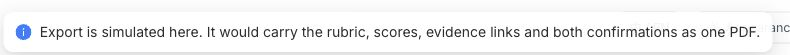
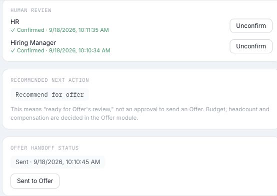
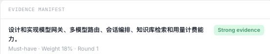

# I11 评估包与 Offer 交接：9 个 Issue 草稿及截图

以下均为草稿，尚未创建 GitHub Issue。截图摄于 2026-10-15 的线上既有项目，已裁去候选人姓名和评估正文。截图只证明可见 UI；ACK、权限 API、版本持久化、失效通知等仍须在隔离环境验证。严重度与 Risk 为草稿建议，待用户确认。依据：[I11 PRD](PRD.md)、[User Cases](User_Cases.md)、[线上测试报告](Test_Report_2026-10-15.md)。

## 草稿 1｜PDF 导出只有模拟提示

**标题：** `[Bug] I11 评估包 Export PDF 未生成可下载文件`

- **Type / Subsystem / Severity / Risk：** Bug / hireos-interview / S1 / high
- **Problem：** 已发布评估包的 `Export PDF` 按钮只显示模拟导出提示，没有生成或下载 PDF，HR 无法完成独立模式下的评估包存档。
- **User Outcome：** HR 能导出包含评估结论及确认信息的可阅读、可打印 PDF。
- **Scope：** I11 评估包 PDF 生成、下载及状态反馈。
- **Non-goals：** 不增加 PDF 以外的导出格式；不实现 Offer 审批或发放。
- **Acceptance Criteria：**
  - **AC-1：** 双方确认后的评估包可导出 PDF，内容包含 Rubric、逐项分数、受控证据引用和双方确认记录。
  - **AC-2：** PDF 使用适合阅读和打印的浅色样式。
  - **AC-3：** 界面分别显示生成失败与下载失败，不将两者混为同一状态。
  - **AC-4：** 自动测试覆盖导出成功、生成失败及生成成功后下载失败。
- **References：** I11 PRD AC-1、AC-8；测试报告 I11-001。
- **Dependencies：** I13 文件下载能力。
- **Reproduction：** 打开线上已有已发布项目的 Evaluation Package，点击 `Export PDF`。
- **Expected / Actual：** 预期获得 PDF；实际只提示“Export is simulated here…”。
- **Environment：** HireOS Interview 线上环境；Chrome 桌面浏览器；线上构建号未知。

**截图：** 点击后的即时提示；没有 PDF 产物，截图本身不用于证明下载历史。

## 草稿 2｜“Sent”缺少 Offer 接收确认

**标题：** `[Bug] I11 Offer 交接将本地 Sent 状态呈现为交接结果但缺少 ACK`

- **Type / Subsystem / Severity / Risk：** Bug / hireos-interview / S1 / high
- **Problem：** 已发布评估包显示 `Sent`，但页面没有 Offer 接收确认、精确包版本或交付记录。用户无法判断下游是否真正收到评估包。
- **User Outcome：** HR 能明确区分发送中、已接收和失败，并在失败后安全重试。
- **Scope：** I11 到 Offer 的版本化交接、ACK、失败记录、重试与幂等。
- **Non-goals：** 不实现 Offer 的预算、薪酬、审批或发放。
- **Acceptance Criteria：**
  - **AC-1：** 只有收到 Offer ACK 后，界面才显示“已接收”；仅发起发送不能显示为已接收。
  - **AC-2：** 超时或失败时显示失败原因、未部分发送的说明和重试入口。
  - **AC-3：** 同一包版本重复发送时，Offer 只接收一次。
  - **AC-4：** v2 已接收后到达的 v1 重放不能覆盖 v2。
  - **AC-5：** 自动测试覆盖超时重试、重复发送和乱序到达。
- **References：** I11 PRD AC-2～AC-4；测试报告 I11-003。
- **Dependencies：** Offer 模块或可验证的 Offer mock；包版本能力。
- **Reproduction：** 打开线上已有已发布项目的 Evaluation Package，查看 Offer handoff status。
- **Expected / Actual：** 预期能看到 Offer 接收结果；实际仅显示 `Sent`，没有 ACK 证据。本次未在线上触发新交接。
- **Environment：** 同上；构建号未知。

**截图：** 当前 UI 的 `Sent` 和 `Sent to Offer`；不能证明 Offer 端实际接收。

## 草稿 3｜评估包缺少精确版本

**标题：** `[Bug] I11 已发布评估包缺少包版本和来源 Rubric 版本`

- **Type / Subsystem / Severity / Risk：** Bug / hireos-interview / S2 / medium
- **Problem：** 已发布包头仅显示 Hiring Evaluation Package，未显示包 ID、Version n、来源 Rubric 版本或生成时间，用户无法确认查看与交接的是哪一版结论。
- **User Outcome：** HR 与 HM 能识别评估包的精确版本，并追溯其来源标准。
- **Scope：** 包版本、内容快照、包头信息和旧版只读访问。
- **Non-goals：** 本草稿不处理证据行内容和 Offer 接收逻辑。
- **Acceptance Criteria：**
  - **AC-1：** 包头显示包 ID、版本、来源 Rubric 版本和生成时间。
  - **AC-2：** 修订生成新版本，旧版本保留只读且不能被覆盖。
  - **AC-3：** 自动测试覆盖版本修订及旧版查看。
- **References：** I11 PRD FR-3、FR-12；测试报告 I11-002。
- **Dependencies：** 评估包快照与版本数据模型。
- **Reproduction：** 打开线上已有已发布项目的 Evaluation Package，查看包头。
- **Expected / Actual：** 预期显示 Version n 等信息；实际标题仅为 Hiring Evaluation Package。
- **Environment：** 同上；构建号未知。

**截图：** 包头标题区域；版本持久化仍需 API/DB 验证。

## 草稿 4｜双方确认权限边界缺少服务端保障

**标题：** `[Bug] I11 HR 与 HM 确认操作未按业务角色进行服务端校验`

- **Type / Subsystem / Severity / Risk：** Bug / hireos-interview / S2 / medium
- **Problem：** 同一线上页面同时显示 HR 与 HM 的确认控件；仓库实现按请求中的 `role` 写入确认槽位。本次未做越权 API 实测，线上越权是否可复现仍待验证。
- **User Outcome：** 只有获授权的 HR 或 HM 能确认各自负责的评估包，操作可追溯。
- **Scope：** I11 确认按钮可见性、服务端角色校验和确认审计。
- **Non-goals：** 不改变必须双方分别确认的业务规则。
- **Acceptance Criteria：**
  - **AC-1：** 服务端根据已验证身份判定确认权限，不以客户端提交的角色字段作为授权依据。
  - **AC-2：** HR、HM 只能完成各自授权的确认；未授权身份调用确认 API 被拒绝。
  - **AC-3：** 自动测试覆盖 HR、HM、Interviewer 的允许与拒绝路径。
- **References：** I11 PRD 权限章节；测试报告 I11-004。
- **Dependencies：** I15 业务角色与测试身份。
- **Reproduction：** 打开线上已发布包，可同时看到两个确认槽位的 `Unconfirm` 控件；服务端越权路径尚未在线上执行。
- **Expected / Actual：** 预期控件和 API 均按真实角色授权；实际 UI 未体现角色区分，API 行为待隔离环境验证。
- **Environment：** 同上；构建号未知。

**截图：** 两个确认槽位的控件；不能单凭截图断言服务端越权。

## 草稿 5｜上游变化后缺少包失效链路

**标题：** `[Bug] I11 JD 或上游数据变化后评估包缺少失效与 Offer 通知`

- **Type / Subsystem / Severity / Risk：** Bug / hireos-interview / S2 / medium
- **Problem：** 当前包页没有版本依赖或失效状态；I11 文档将 JD 更新后的需复核和下游通知列为未实现。用户难以判断已交接结论是否仍适用。
- **User Outcome：** 上游依据变化后，HR 能看到需复核状态，Offer 能识别已接收版本失效或受限。
- **Scope：** JD 更新、数据撤回和录制授权撤回触发的包失效、复核提示及 Offer 通知。
- **Non-goals：** 不自动替 HR/HM 重新确认结论。
- **Acceptance Criteria：**
  - **AC-1：** 相关上游数据变化后，受影响包显示“需复核”及原因。
  - **AC-2：** 已交接版本的失效或限制状态可靠通知 Offer，并保留通知结果。
  - **AC-3：** 重新复核后生成新版本，旧版本仍可只读追溯。
  - **AC-4：** 自动测试覆盖三类上游变化及通知失败后的恢复。
- **References：** I11 PRD AC-5、FR-11、FR-12；测试报告 I11-005。
- **Dependencies：** 包版本能力；Offer 模块或 mock；上游变更事件。
- **Reproduction：** 当前线上已发布包页仅显示建议动作和 `Sent`；本次未修改线上 JD 来触发失效。
- **Expected / Actual：** 预期上游变化后显示需复核并通知 Offer；实际触发结果未在线上验证。
- **Environment：** 同上；构建号未知。

**截图：** 当前页面无“需复核/失效”状态；此图不能证明更新 JD 后的真实行为。

## 草稿 6｜确认与发送时间顺序难以审计

**标题：** `[Bug] I11 评估包缺少可解释确认与交接顺序的版本化审计记录`

- **Type / Subsystem / Severity / Risk：** Bug / hireos-interview / S3 / low
- **Problem：** 线上已有包显示的 `Sent` 时间早于当前 HR 确认时间。历史上可能发生取消后重新确认；现有页面没有版本化时间线可供判断，不能据此断言交接当时绕过门槛。
- **User Outcome：** HR 能确认每次交接对应哪一包版本、哪两次人工确认，以及之后是否重新确认。
- **Scope：** 确认、取消确认、重新确认及交接的审计展示。
- **Non-goals：** 不根据现有历史时间戳直接修改或撤销交接记录。
- **Acceptance Criteria：**
  - **AC-1：** 每次确认和交接记录关联精确包版本与操作时间。
  - **AC-2：** 页面可区分交接前确认与交接后重新确认。
  - **AC-3：** 新建隔离数据的交接测试证明发送发生在同一版本双方确认之后。
- **References：** I11 PRD FR-6、BR-2；测试报告 I11-006。
- **Dependencies：** 包版本与审计记录。
- **Reproduction：** 查看线上已有已发布包的双方确认时间与 `Sent` 时间。
- **Expected / Actual：** 预期能解释操作顺序；实际只有当前时间戳，无法还原历史过程。
- **Environment：** 同上；构建号未知。

**截图：** 当前 HR 确认时间晚于 `Sent`；仅证明页面呈现的时间顺序。

## 草稿 7｜未确认评估包无法预览

**标题：** `[Bug] I11 未记录决定时评估包入口被禁用，无法预览未确认内容`

- **Type / Subsystem / Severity / Risk：** Bug / hireos-interview / S2 / medium
- **Problem：** 未记录决定的项目中 `Evaluation Package` 入口被禁用，提示先记录决定；I11 PRD 要求未记录决定或未双方确认时仍可预览，并标记 `unconfirmed`。
- **User Outcome：** HR 能在确认前检查包内容，明确知道该包尚不能发布或交接。
- **Scope：** 未确认包的只读预览、状态提示及操作门槛。
- **Non-goals：** 不允许未确认包发布或交接。
- **Acceptance Criteria：**
  - **AC-1：** 未记录决定或未双方确认时，授权用户可以打开包的只读预览。
  - **AC-2：** 预览明确标记 `unconfirmed`，说明阻塞原因，发布与交接不可用。
  - **AC-3：** 自动测试覆盖无决定、单方确认和双方确认三种状态。
- **References：** I11 PRD FR-1；测试报告 E3。
- **Dependencies：** None。
- **Reproduction：** 打开线上未记录决定的项目，点击禁用的 Evaluation Package 入口。
- **Expected / Actual：** 预期可预览并标记未确认；实际提示先记录决定，无法进入包页。
- **Environment：** 同上；构建号未知。

**截图：** 点击禁用入口出现的前置提示；项目历史状态不作为新建流程证据。

## 草稿 8｜证据清单缺少分数与受控引用

**标题：** `[Bug] I11 Evidence manifest 未展示逐项分数和受控证据引用`

- **Type / Subsystem / Severity / Risk：** Bug / hireos-interview / S2 / medium
- **Problem：** 已发布包显示能力名称、证据强弱标签和文字理由，但页面未显示逐项数字分数或可复核的受控证据引用。
- **User Outcome：** HR 与 HM 能核对每项评分及其证据来源。
- **Scope：** Evidence manifest 的评分、理由、来源轮次和受控引用展示。
- **Non-goals：** 不展示或交付完整录音、转写及内部笔记。
- **Acceptance Criteria：**
  - **AC-1：** 每项能力显示分数或明确的 Unknown 状态、理由和来源轮次。
  - **AC-2：** 有证据的项目显示按权限访问的受控引用；无证据时明确说明。
  - **AC-3：** 自动测试覆盖有分数、Unknown、无引用和无权限访问。
- **References：** I11 PRD FR-4、AC-6；测试报告 I11-002。
- **Dependencies：** 证据引用及访问控制能力。
- **Reproduction：** 打开线上已发布包，查看 Evidence manifest。
- **Expected / Actual：** 预期可逐项复核分数与引用；实际仅见摘要和证据强弱标签。
- **Environment：** 同上；构建号未知。

**截图：** 证据行顶部只有能力、权重、轮次和 Strong evidence；整行内容和受控引用仍需复测。

## 草稿 9｜人工确认缺少确认人和意见

**标题：** `[Bug] I11 Human review 仅显示确认时间，缺少确认人及意见`

- **Type / Subsystem / Severity / Risk：** Bug / hireos-interview / S2 / medium
- **Problem：** 已发布包的 Human review 显示 HR、Hiring Manager 的确认状态与时间，但未展示具体确认人和确认意见，难以追溯人工复核依据。
- **User Outcome：** 查看评估包的人能知道谁对哪个版本作了确认，以及确认时的意见。
- **Scope：** 双方确认记录的展示及与包版本的关联。
- **Non-goals：** 不改变必须双方确认的规则。
- **Acceptance Criteria：**
  - **AC-1：** Human review 展示 HR、HM 各自的确认人、时间和意见。
  - **AC-2：** 确认记录关联精确评估包版本；修订后旧确认不会被呈现为对新版本的确认。
  - **AC-3：** 自动测试覆盖双方确认、单方确认和修订后的展示。
- **References：** I11 PRD FR-6；测试报告步骤 2、I11-002。
- **Dependencies：** 业务角色身份及包版本记录。
- **Reproduction：** 打开线上已发布包，查看 Human review。
- **Expected / Actual：** 预期显示确认人、时间和意见；实际只显示角色及确认时间。
- **Environment：** 同上；构建号未知。

**截图：** Human review 当前显示的角色和时间；确认人及意见未显示。

