# I11 输入输出闭环：评估包与 Offer 交接

| 项 | 内容 |
|---|---|
| 模块 | I11 评估包与 Offer 交接 |
| 版本 / 日期 | v1.0 / 2026-10-15（草稿，待评审） |
| 同目录文档 | [产品文档](PRD.md) · [User Journey](User_Journey.md) · [User Cases](User_Cases.md) |
| 依据 | [PRD.md](PRD.md)；公共约定见 [Interview README](../README.md) |
| 实现现状 | 🟡 后端可读取评估包、在推荐 Offer 且双方确认后把 offerState 置为 sent（本地状态，无真实 Offer 模块、无 ACK / 重试 / 版本顺序）；导出 PDF、包版本、失效标记未实现 |

本模块拆成 2 个子流程：**I11a 查看、导出与交接**、**I11b 版本与失效**。

## 1. 结构化规格

```yaml
# ---------- I11a 查看、导出与交接 ----------
flow_id: I11a
actor: hr_a
seed: S_decision_both_confirmed_offer
entry: I11a.N1
max_loop: 3
external: [offer.module_mock, export.pdf, files.download]

nodes:
  - {id: I11a.N1, type: action, do: "打开 Evaluation Package"}
  - {id: I11a.G0, type: decision, on: "决定已记录且双方已确认、补证已完成"}
  - {id: I11a.CE0, type: check, expect: {ui: "显示 still in review；可预览（标 unconfirmed），不能发布或交接；补证未完成时说明阻塞原因"}}
  - {id: I11a.C1, type: check, expect: {ui: "Hiring Evaluation Package · Version n；Evidence manifest（受控引用）；Handoff limitations；Human review（双方确认）；Recommended next action 说明 ready for Offer's review", db: "包内容快照，不含完整录音、转写和内部笔记"}}
  - {id: I11a.N2, type: action, do: "点击 Export PDF", inject: [export_fail, download_fail]}
  - {id: I11a.C2, type: check, expect: {ui: "生成状态与下载状态分开显示", ext: "PDF 为浅色打印样式"}}
  - {id: I11a.N3, type: action, do: "点击发送到 Offer", inject: [offer_timeout, double_click]}
  - {id: I11a.G1, type: decision, on: "Offer mock 返回 ACK 还是超时"}
  - {id: I11a.CE1, type: check, expect: {ui: "显示失败和 Nothing was partially sent — retry any time", db: "交接记录 failed"}}
  - {id: I11a.C3, type: check, expect: {ui: "状态已接收；再次发送提示 Already sent and acknowledged", db: "同一包版本 Offer 只接收一次"}}
  - {id: I11a.T1, type: terminal, state: package.handed_off}
  - {id: I11a.T2, type: terminal, state: package.in_review}

edges:
  - [I11a.N1, I11a.G0]
  - [I11a.G0, I11a.CE0, {when: "否"}]
  - [I11a.CE0, I11a.T2]
  - [I11a.G0, I11a.C1, {when: "是"}]
  - [I11a.C1, I11a.N2]
  - [I11a.N2, I11a.C2]
  - [I11a.C2, I11a.N3]
  - [I11a.C1, I11a.N3, {when: "直接交接"}]
  - [I11a.N3, I11a.G1]
  - [I11a.G1, I11a.CE1, {when: "超时"}]
  - [I11a.CE1, I11a.N3, {when: "重试"}]
  - [I11a.G1, I11a.C3, {when: "ACK"}]
  - [I11a.C3, I11a.T1]
---
# ---------- I11b 版本与失效 ----------
flow_id: I11b
actor: hr_a
seed: S_package_v2_handed_off
entry: I11b.N1

nodes:
  - {id: I11b.N1, type: action, do: "让 Offer mock 在收到 v2 后再收到 v1 的重放事件"}
  - {id: I11b.C1, type: check, expect: {ext: "Offer 中仍是 v2"}}
  - {id: I11b.N2, type: action, do: "在上游更新 JD 或撤回数据"}
  - {id: I11b.C2, type: check, expect: {ui: "包显示需复核", ext: "已交接版本被通知为失效或受限"}}
  - {id: I11b.T1, type: terminal, state: package.invalidated}

edges:
  - [I11b.N1, I11b.C1]
  - [I11b.C1, I11b.T1]
  - [I11b.N2, I11b.C2]
  - [I11b.C2, I11b.T1]
```

## 2. 测试数据

| 名称 | 内容 |
|---|---|
| offer_timeout | Offer mock 首次超时，第二次 ACK |
| offer_dup | 同一版本发送两次 |
| replay_v1 | 先发 v2，再收到 v1 的重放 |
| jd_update | 上游 JD 新版本 |
| export_fail / download_fail | 导出生成失败；生成成功但下载失败 |

## 3. 路径清单（一条路径 = 一个 test case）

| 路径 | 节点序列 | 数据 / 注入 | 终态 |
|---|---|---|---|
| P1 独立闭环导出 | 端到端：I01 → … → I10 → I11a: N1 → G0 → C1 → N2 → C2 | JD-only 演示数据 | 导出成功 |
| P2 交接超时后重试 | I11a: … → N3 → G1 → CE1 → N3 → G1 → C3 | offer_timeout | package.handed_off |
| P3 重复发送 | I11a: C3 后再次 N3 | offer_dup | Offer 只接收一次 |
| P4 旧版本重放 | I11b: N1 → C1 | replay_v1 | v1 不覆盖 v2 |
| P5 JD 更新失效 | I11b: N2 → C2 | jd_update | package.invalidated |
| P6 不含原始材料 | I11a: C1 | — | 无完整录音 / 转写 / 内部笔记 |
| P7 一方确认 | seed S_decision_hr_confirmed；I11a: N1 → G0 → CE0 | — | package.in_review |
| P8 导出与下载失败分开 | I11a: N2 注入 export_fail / download_fail | — | 两种失败分别显示 |

## 4. 流程图（由规格生成）

```mermaid
flowchart TD
  subgraph I11a["I11a 查看、导出与交接"]
    I11a_N1["I11a.N1 打开评估包"]
    I11a_G0{"I11a.G0 已确认"}
    I11a_CE0["I11a.CE0 ✔ 仍在评审"]
    I11a_C1["I11a.C1 ✔ 包内容"]
    I11a_N2["I11a.N2 导出 PDF<br/>注入：export_fail / download_fail"]
    I11a_C2["I11a.C2 ✔ 导出结果"]
    I11a_N3["I11a.N3 交接给 Offer<br/>注入：offer_timeout / double_click"]
    I11a_G1{"I11a.G1 Offer 回执"}
    I11a_CE1["I11a.CE1 ✔ 交接失败"]
    I11a_C3["I11a.C3 ✔ 已接收"]
    I11a_T1(["package.handed_off"])
    I11a_T2(["package.in_review"])
    I11a_N1 --> I11a_G0
    I11a_G0 -->|"否"| I11a_CE0
    I11a_CE0 --> I11a_T2
    I11a_G0 -->|"是"| I11a_C1
    I11a_C1 --> I11a_N2
    I11a_N2 --> I11a_C2
    I11a_C2 --> I11a_N3
    I11a_C1 -->|"直接交接"| I11a_N3
    I11a_N3 --> I11a_G1
    I11a_G1 -->|"超时"| I11a_CE1
    I11a_CE1 -->|"重试"| I11a_N3
    I11a_G1 -->|"ACK"| I11a_C3
    I11a_C3 --> I11a_T1
  end
  subgraph I11b["I11b 版本与失效"]
    I11b_N1["I11b.N1 重放旧版本"]
    I11b_C1["I11b.C1 ✔ 旧版本不覆盖"]
    I11b_N2["I11b.N2 更新 JD"]
    I11b_C2["I11b.C2 ✔ 标记需复核"]
    I11b_T1(["package.invalidated"])
    I11b_N1 --> I11b_C1
    I11b_C1 --> I11b_T1
    I11b_N2 --> I11b_C2
    I11b_C2 --> I11b_T1
  end
  classDef err stroke:#d33,stroke-dasharray:4 3,color:#d33
  classDef done fill:#e6f4ea,stroke:#1e8e3e
  class I11a_CE0,I11a_CE1 err
  class I11a_T1,I11a_T2,I11b_T1 done
```



## 5. 待确认

- Offer 模块未实现前交接按钮是否隐藏（影响 N3 路径能否执行）
- 只有 Recommend for offer 才交接，还是 Do not proceed 也需存档
