# I11 User Journey：评估包与 Offer 交接

| 项 | 内容 |
|---|---|
| 模块 | I11 评估包与 Offer 交接 |
| 版本 / 日期 | v1.0 / 2026-10-15（草稿，待评审） |
| 同目录文档 | [产品文档](PRD.md) · [输入输出闭环](Loop_IO.md) · [User Cases](User_Cases.md) |
| 依据 | [PRD.md](PRD.md)；公共约定见 [Interview README](../README.md) |
| 实现现状 | 🟡 后端可读取评估包、在推荐 Offer 且双方确认后把 offerState 置为 sent（本地状态，无真实 Offer 模块、无 ACK / 重试 / 版本顺序）；导出 PDF、包版本、失效标记未实现 |

## 角色与权限（公共）

| 角色 | 登录后的主要目的 | 测试身份 | 权限视图 |
|---|---|---|---|
| HR / Recruiter | 建项目、定标准、排期、推进流程；最终结论的 HR 方确认 | hr_a（原型 Sarah Chen） | editor：全部页面可用 |
| Hiring Manager | 统一岗位标准，看证据和分歧；最终结论的 HM 方确认；也可以担任面试官 | hm_a（原型 David Kim，第 1 轮面试官） | 原型通过角色切换完成 HM 确认 |
| Interviewer | 读 Brief、按计划提问、提交 Scorecard | interviewer_a（原型 Priya Nair，第 2 轮面试官） | assignee：只能打开 Overview、Brief、Live Interview、Review |
| Hiring Committee | 查看逐项证据和反证，参与 Debrief | hc_a | 原型未体现 |
| Candidate | 参与面试，知情录制 | — | 不访问面试工作区 |

所有权限由服务端保证，不能只靠前端隐藏；现有后端只校验 Workspace，没有业务角色校验（功能拆分 I15），权限类用例在实现前为 known gap。

# 旅程

**主角色**：HR / Recruiter；Hiring Manager 查看与导出
**登录目的**：把确认后的面试结论整理成版本化的评估包，可靠地交给 Offer 或导出存档。
**入口**：决定页 → Record decision · build package；或首页 Package published

## 输入

| 类型 | 内容 |
|---|---|
| 前置数据（seed） | I11a：S_decision_both_confirmed_offer；I11b：S_package_v2_handed_off |
| 用户数据 | —（导出、交接、重试操作） |
| 外部依赖 | offer.module_mock、export.pdf、files.download |

## 流程

流程图与 [输入输出闭环 §4](Loop_IO.md) 一致：

```mermaid
flowchart TD
  subgraph I11a["I11a 查看、导出与交接"]
    I11a_N1["I11a.N1 打开评估包"]
    I11a_G0{"I11a.G0 已确认"}
    I11a_CE0["I11a.CE0 ✔ 仍在评审"]
    I11a_C1["I11a.C1 ✔ 包内容"]
    I11a_N2["I11a.N2 导出 PDF<br/>注入：export_fail / download_fail"]
    I11a_C2["I11a.C2 ✔ 导出结果"]
    I11a_N3["I11a.N3 交接给 Offer<br/>注入：offer_timeout / double_click"]
    I11a_G1{"I11a.G1 Offer 回执"}
    I11a_CE1["I11a.CE1 ✔ 交接失败"]
    I11a_C3["I11a.C3 ✔ 已接收"]
    I11a_T1(["package.handed_off"])
    I11a_T2(["package.in_review"])
    I11a_N1 --> I11a_G0
    I11a_G0 -->|"否"| I11a_CE0
    I11a_CE0 --> I11a_T2
    I11a_G0 -->|"是"| I11a_C1
    I11a_C1 --> I11a_N2
    I11a_N2 --> I11a_C2
    I11a_C2 --> I11a_N3
    I11a_C1 -->|"直接交接"| I11a_N3
    I11a_N3 --> I11a_G1
    I11a_G1 -->|"超时"| I11a_CE1
    I11a_CE1 -->|"重试"| I11a_N3
    I11a_G1 -->|"ACK"| I11a_C3
    I11a_C3 --> I11a_T1
  end
  subgraph I11b["I11b 版本与失效"]
    I11b_N1["I11b.N1 重放旧版本"]
    I11b_C1["I11b.C1 ✔ 旧版本不覆盖"]
    I11b_N2["I11b.N2 更新 JD"]
    I11b_C2["I11b.C2 ✔ 标记需复核"]
    I11b_T1(["package.invalidated"])
    I11b_N1 --> I11b_C1
    I11b_C1 --> I11b_T1
    I11b_N2 --> I11b_C2
    I11b_C2 --> I11b_T1
  end
  classDef err stroke:#d33,stroke-dasharray:4 3,color:#d33
  classDef done fill:#e6f4ea,stroke:#1e8e3e
  class I11a_CE0,I11a_CE1 err
  class I11a_T1,I11a_T2,I11b_T1 done
```

## 步骤

| # | 用户意图与操作 | 系统反馈（可观察） | 用户需要判断 |
|---|---|---|---|
| 1 | 打开评估包 | 未确认时显示 still in review，可预览不可发布 | — |
| 2 | 查看包内容 | 版本、证据清单、交接限制、双方确认、建议下一步 | 内容是否完整 |
| 3 | 导出 PDF | 生成状态与下载状态分开 | — |
| 4 | 发送到 Offer | 显示发送中 / 已接收 / 失败 | — |
| 5 | 交接失败时重试 | 说明没有部分发送，可随时重试 | — |
| 6 | JD 更新后查看 | 包显示需复核，已交接版本被标为失效 | 是否重新生成 |

## 可见 / 不可见

- HR 发布、导出、交接；HM 查看和导出；Interviewer 能否查看待确认。
- Offer 只能读取交接的包版本和受控引用。

## 异常与恢复

| 场景 | 预期 |
|---|---|
| 交接超时 | 显示失败，不部分发送，可重试 |
| 重复发送 | 提示已接收，不重复交接 |
| 导出失败 / 下载失败 | 分开显示 |
| 上游数据变化 | 标记需复核 |

## 输出与交接

| 输出 | 内容 |
|---|---|
| 持久化 | HiringEvaluationPackage（版本、快照、状态）、ExportArtifactRef、Offer 交接记录 |
| 交接 | → Offer 模块；导出文件 → I13 下载；首页 G09 计数 |

**禁止副作用**：一方确认就发布；把交接当作 Offer 获批；包中包含完整录音、转写或内部笔记；旧版本覆盖新版本；交接失败显示成功。

**成功标准**：JD-only 也能走通到导出；交接按版本、幂等、可重试；失效能被标记。

**测试映射**：闭环 I11a、I11b（见 [Loop_IO](Loop_IO.md)）；用例见 [User_Cases](User_Cases.md)。

**待确认**（来自 PRD）：

1. Offer 模块未实现前，交接按钮是否隐藏，只保留导出。
2. 导出格式：PDF 之外是否需要 Markdown / JSON。
3. 只有 Recommend for offer 才交接 Offer（现有实现），还是 Do not proceed 也需要把包交给下游存档。
4. Interviewer 能否查看最终评估包。
