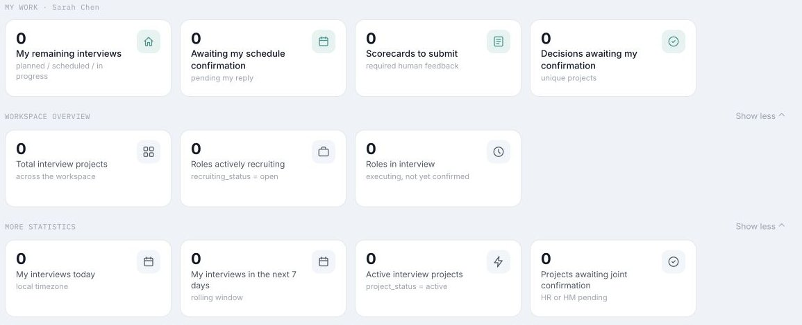
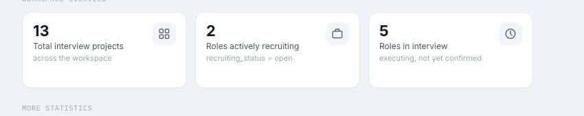
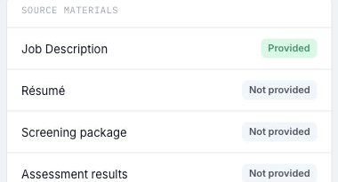
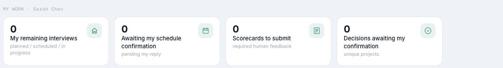
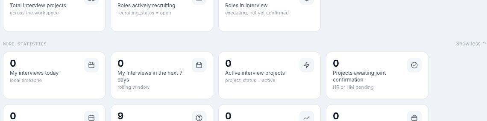
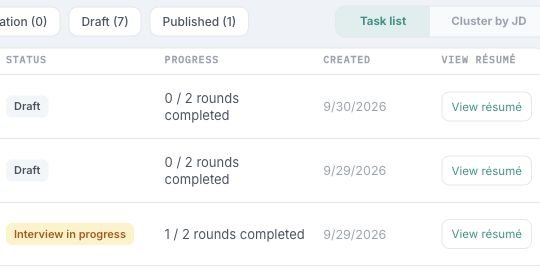
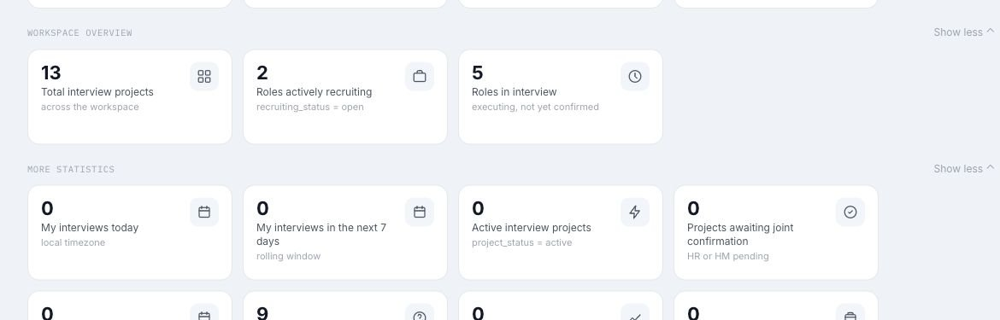
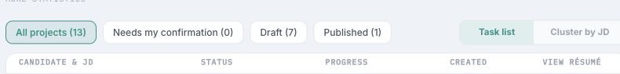
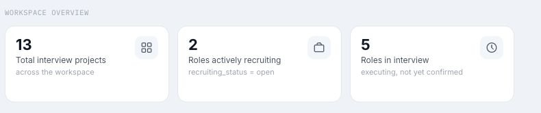
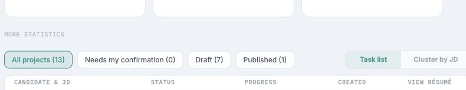

# I12：15 个 GitHub Bug Issue 与截图

状态：2026-10-16 已提交至 GitHub Issues #300–#314；截图证据位于 `codex/i12-issue-evidence` 分支。

Issue #302、#303、#309 标记 `AI Ready=No` 与 `needs-triage`，其余为 `AI Ready=Yes`。

## 01｜[Bug] I12 首页加载期间将未完成取数显示为零

[GitHub Issue #300](https://github.com/TelyAgent/HireOSV2/issues/300) · [Issue 正文备份](GitHub_Issue_Bodies_2026-10-16/01.md)

## 02｜[Bug] I12 首页统计卡无法进入对应口径的明细列表

[GitHub Issue #301](https://github.com/TelyAgent/HireOSV2/issues/301) · [Issue 正文备份](GitHub_Issue_Bodies_2026-10-16/02.md)

## 03｜[Bug] I12 Task list 默认排序未遵循 Action required first

[GitHub Issue #302](https://github.com/TelyAgent/HireOSV2/issues/302) · [Issue 正文备份](GitHub_Issue_Bodies_2026-10-16/03.md)

## 04｜[Bug] I12 面试进行中任务点击后错误进入 Overview

[GitHub Issue #303](https://github.com/TelyAgent/HireOSV2/issues/303) · [Issue 正文备份](GitHub_Issue_Bodies_2026-10-16/04.md)

## 05｜[Bug] I12 任务列表无简历时仍显示可点击预览入口

[GitHub Issue #304](https://github.com/TelyAgent/HireOSV2/issues/304) · [Issue 正文备份](GitHub_Issue_Bodies_2026-10-16/05.md)

## 06｜[Bug] I12 My Work 显示固定身份标签和零值待办

[GitHub Issue #305](https://github.com/TelyAgent/HireOSV2/issues/305) · [Issue 正文备份](GitHub_Issue_Bodies_2026-10-16/06.md)

## 07｜[Bug] I12 More statistics 未区分 T2 指标与 T3 Trends

[GitHub Issue #306](https://github.com/TelyAgent/HireOSV2/issues/306) · [Issue 正文备份](GitHub_Issue_Bodies_2026-10-16/07.md)

## 08｜[Bug] I12 多项补充统计使用固定零值

[GitHub Issue #307](https://github.com/TelyAgent/HireOSV2/issues/307) · [Issue 正文备份](GitHub_Issue_Bodies_2026-10-16/08.md)

## 09｜[Bug] I12 Workspace Overview 缺少独立的全局聚合口径

[GitHub Issue #308](https://github.com/TelyAgent/HireOSV2/issues/308) · [Issue 正文备份](GitHub_Issue_Bodies_2026-10-16/09.md)

## 10｜[Bug] I12 任务列表状态模型缺少三个规定状态

[GitHub Issue #309](https://github.com/TelyAgent/HireOSV2/issues/309) · [Issue 正文备份](GitHub_Issue_Bodies_2026-10-16/10.md)

## 11｜[Bug] I12 统计折叠偏好未按用户与 Workspace 隔离

[GitHub Issue #310](https://github.com/TelyAgent/HireOSV2/issues/310) · [Issue 正文备份](GitHub_Issue_Bodies_2026-10-16/11.md)

## 12｜[Bug] I12 Interviewer 首页沿用 HR 项目筛选项

[GitHub Issue #311](https://github.com/TelyAgent/HireOSV2/issues/311) · [Issue 正文备份](GitHub_Issue_Bodies_2026-10-16/12.md)

## 13｜[Bug] I12 统计加载失败无法定位到单项指标

[GitHub Issue #312](https://github.com/TelyAgent/HireOSV2/issues/312) · [Issue 正文备份](GitHub_Issue_Bodies_2026-10-16/13.md)

## 14｜[Bug] I12 零候选人 JD 的 Link candidate 只显示占位提示

[GitHub Issue #313](https://github.com/TelyAgent/HireOSV2/issues/313) · [Issue 正文备份](GitHub_Issue_Bodies_2026-10-16/14.md)

## 15｜[Bug] I12 首页未提供项目和候选人搜索控件

[GitHub Issue #314](https://github.com/TelyAgent/HireOSV2/issues/314) · [Issue 正文备份](GitHub_Issue_Bodies_2026-10-16/15.md)

