# I12 输入输出闭环：首页、任务列表与统计

| 项 | 内容 |
|---|---|
| 模块 | I12 首页、任务列表与统计 |
| 版本 / 日期 | v1.0 / 2026-10-15（草稿，待评审） |
| 同目录文档 | [产品文档](PRD.md) · [User Journey](User_Journey.md) · [User Cases](User_Cases.md) |
| 依据 | [PRD.md](PRD.md)；公共约定见 [Interview README](../README.md) |
| 实现现状 | 🟡 前端读取 jobs / tasks 并在前端计算统计和两种视图；无统计读模型、无按角色 My Work；折叠偏好存 localStorage；后端缺 No candidate linked、Withdrawn 状态 |

本模块拆成 2 个子流程：**I12a 统计卡片**、**I12b 任务列表**。

## 1. 结构化规格

```yaml
# ---------- I12a 统计卡片 ----------
flow_id: I12a
actors: [hr_a, hm_a, interviewer_a]
seed: S_home_mixed
entry: I12a.N1
max_loop: 1
external: [stats.read_model, clock]

nodes:
  - {id: I12a.N1, type: action, do: "以身份 U 打开 Interview Home", inject: [stats_fail, stale_cache]}
  - {id: I12a.C1, type: check, expect: {ui: "My Work T1：M01–M04（Interviewer 的 M04 显示 not applicable）；Workspace Overview T1：G01–G03；每张卡有单位与口径副标题"}}
  - {id: I12a.G1, type: decision, on: "加载中 / 真实 0 / 单项失败 / 缓存过期"}
  - {id: I12a.C2, type: check, expect: {ui: "占位；0 与空状态；Unavailable + Retry（不显示 0）；Last updated …；单项失败不影响其他卡"}}
  - {id: I12a.N2, type: action, do: "点击 Show more 展开 T2 / T3，刷新页面"}
  - {id: I12a.C3, type: check, expect: {ui: "展开状态保留", db: "按用户 + Workspace + 模块保存"}}
  - {id: I12a.N3, type: action, do: "点击某张统计卡"}
  - {id: I12a.C4, type: check, expect: {ui: "进入同口径过滤列表；只显示有权访问的记录并标 Showing records you can access"}}
  - {id: I12a.T1, type: terminal, state: home.viewed}

edges:
  - [I12a.N1, I12a.C1]
  - [I12a.C1, I12a.G1]
  - [I12a.G1, I12a.C2]
  - [I12a.C2, I12a.N2]
  - [I12a.N2, I12a.C3]
  - [I12a.C3, I12a.N3]
  - [I12a.N3, I12a.C4]
  - [I12a.C4, I12a.T1]
---
# ---------- I12b 任务列表 ----------
flow_id: I12b
actors: [hr_a, interviewer_a]
seed: S_home_13_statuses
entry: I12b.N1
max_loop: 1

nodes:
  - {id: I12b.N1, type: action, do: "查看 Task list 默认排序"}
  - {id: I12b.C1, type: check, expect: {ui: "覆盖 13 个状态；默认 Action required first，同状态按更新时间倒序"}}
  - {id: I12b.N2, type: action, do: "切换快捷筛选；切换到 Cluster by JD"}
  - {id: I12b.C2, type: check, expect: {ui: "筛选只缩小范围不改变相对顺序；两种视图中同一候选人的状态、进度、简历一致；无候选人的 JD 组显示 Link candidate"}}
  - {id: I12b.N3, type: action, do: "逐个点击每种状态的行"}
  - {id: I12b.C3, type: check, expect: {ui: "按任务列表 PRD §8 进入对应页面（如 Planning → Interview Plan、Awaiting confirmation → Decision）"}}
  - {id: I12b.N4, type: action, do: "点击已上传与未上传简历的行"}
  - {id: I12b.C4, type: check, expect: {ui: "已上传：右侧抽屉预览不离开列表；未上传：弱态不打开"}}
  - {id: I12b.T1, type: terminal, state: list.viewed}

edges:
  - [I12b.N1, I12b.C1]
  - [I12b.C1, I12b.N2]
  - [I12b.N2, I12b.C2]
  - [I12b.C2, I12b.N3]
  - [I12b.N3, I12b.C3]
  - [I12b.C3, I12b.N4]
  - [I12b.N4, I12b.C4]
  - [I12b.C4, I12b.T1]
```

## 2. 测试数据

| 名称 | 内容 |
|---|---|
| S_home_mixed | 同岗位多个项目、多轮、多面试官；含取消场次、归档项目、JD-only 项目、unknown 招聘状态岗位 |
| S_home_13_statuses | 13 个状态各至少一个项目 |
| confirm_split | HR 已确认、HM 未确认的项目；同项目多个确认请求 |
| partial_access | 只有部分记录权限的用户 |
| stats_fail | 某一个指标接口失败 |

## 3. 路径清单（一条路径 = 一个 test case）

| 路径 | 节点序列 | 数据 / 注入 | 终态 |
|---|---|---|---|
| P1 计数去重 | I12a: N1 → C1 | S_home_mixed | 各主键正确去重，取消 / 归档排除 |
| P2 确认拆分计数 | I12a: 以 HR、HM 各看一次 C1 | confirm_split | HR M04 不计、HM 计 1、G05 计 1 |
| P3 同项目多请求 | I12a: C1 | confirm_split | M04 / G05 各计 1 |
| P4 部分权限全局数字 | I12a: N1 → C1 → N3 → C4 | partial_access | 全局数相同，明细只显示有权部分 |
| P5 JD-only 与 unknown 岗位 | I12a: C1、T2 | S_home_mixed | 计入 G01；unknown 计入 G07 |
| P6 四种状态 | I12a: N1 注入 stats_fail / stale_cache → G1 → C2 | — | 语义不同 |
| P7 折叠偏好 | I12a: N2 → C3 | — | 保留 |
| P8 计数刷新 | 新建、评分、确认后回到首页 | — | 对应数字更新，重复事件不重复计 |
| P9 13 个状态点击 | I12b: N3 → C3 | S_home_13_statuses | 各进入对应页面 |
| P10 两种视图一致 | I12b: N2 → C2 | — | 一致 |
| P11 排序与筛选 | I12b: N1 → C1 → N2 → C2 | — | 筛选不改变顺序 |
| P12 无简历弱态 | I12b: N4 → C4 | — | 不打开 |

## 4. 流程图（由规格生成）

```mermaid
flowchart TD
  subgraph I12a["I12a 统计卡片"]
    I12a_N1["I12a.N1 打开首页<br/>注入：stats_fail / stale_cache"]
    I12a_C1["I12a.C1 ✔ My Work 与全局"]
    I12a_G1{"I12a.G1 数据状态"}
    I12a_C2["I12a.C2 ✔ 四种状态"]
    I12a_N2["I12a.N2 展开更多统计"]
    I12a_C3["I12a.C3 ✔ 折叠偏好保留"]
    I12a_N3["I12a.N3 点击卡片"]
    I12a_C4["I12a.C4 ✔ 同口径明细"]
    I12a_T1(["home.viewed"])
    I12a_N1 --> I12a_C1
    I12a_C1 --> I12a_G1
    I12a_G1 --> I12a_C2
    I12a_C2 --> I12a_N2
    I12a_N2 --> I12a_C3
    I12a_C3 --> I12a_N3
    I12a_N3 --> I12a_C4
    I12a_C4 --> I12a_T1
  end
  subgraph I12b["I12b 任务列表"]
    I12b_N1["I12b.N1 查看 Task list"]
    I12b_C1["I12b.C1 ✔ 13 个状态与排序"]
    I12b_N2["I12b.N2 切换筛选与视图"]
    I12b_C2["I12b.C2 ✔ 筛选与视图一致"]
    I12b_N3["I12b.N3 点击一行"]
    I12b_C3["I12b.C3 ✔ 进入对应页面"]
    I12b_N4["I12b.N4 点击简历入口"]
    I12b_C4["I12b.C4 ✔ 简历抽屉"]
    I12b_T1(["list.viewed"])
    I12b_N1 --> I12b_C1
    I12b_C1 --> I12b_N2
    I12b_N2 --> I12b_C2
    I12b_C2 --> I12b_N3
    I12b_N3 --> I12b_C3
    I12b_C3 --> I12b_N4
    I12b_N4 --> I12b_C4
    I12b_C4 --> I12b_T1
  end
  classDef err stroke:#d33,stroke-dasharray:4 3,color:#d33
  classDef done fill:#e6f4ea,stroke:#1e8e3e
  class I12a_T1,I12b_T1 done
```



## 5. 待确认

- 全局统计由 Interview 后端提供还是公共统计服务（影响 stats.read_model 桩）
- 后端是否补齐 No candidate linked、Withdrawn 状态
