# I12 User Journey：首页、任务列表与统计

| 项 | 内容 |
|---|---|
| 模块 | I12 首页、任务列表与统计 |
| 版本 / 日期 | v1.0 / 2026-10-15（草稿，待评审） |
| 同目录文档 | [产品文档](PRD.md) · [输入输出闭环](Loop_IO.md) · [User Cases](User_Cases.md) |
| 依据 | [PRD.md](PRD.md)；公共约定见 [Interview README](../README.md) |
| 实现现状 | 🟡 前端读取 jobs / tasks 并在前端计算统计和两种视图；无统计读模型、无按角色 My Work；折叠偏好存 localStorage；后端缺 No candidate linked、Withdrawn 状态 |

## 角色与权限（公共）

| 角色 | 登录后的主要目的 | 测试身份 | 权限视图 |
|---|---|---|---|
| HR / Recruiter | 建项目、定标准、排期、推进流程；最终结论的 HR 方确认 | hr_a（原型 Sarah Chen） | editor：全部页面可用 |
| Hiring Manager | 统一岗位标准，看证据和分歧；最终结论的 HM 方确认；也可以担任面试官 | hm_a（原型 David Kim，第 1 轮面试官） | 原型通过角色切换完成 HM 确认 |
| Interviewer | 读 Brief、按计划提问、提交 Scorecard | interviewer_a（原型 Priya Nair，第 2 轮面试官） | assignee：只能打开 Overview、Brief、Live Interview、Review |
| Hiring Committee | 查看逐项证据和反证，参与 Debrief | hc_a | 原型未体现 |
| Candidate | 参与面试，知情录制 | — | 不访问面试工作区 |

所有权限由服务端保证，不能只靠前端隐藏；现有后端只校验 Workspace，没有业务角色校验（功能拆分 I15），权限类用例在实现前为 known gap。

# 旅程

**主角色**：全部雇主端用户（HR、HM、Interviewer）
**登录目的**：打开就知道我接下来要处理什么，以及团队的面试规模。
**入口**：登录后的 Interview Home

## 输入

| 类型 | 内容 |
|---|---|
| 前置数据（seed） | I12a：S_home_mixed；I12b：S_home_13_statuses |
| 用户数据 | 筛选条件、视图切换、展开 / 折叠操作 |
| 外部依赖 | stats.read_model、clock |

## 流程

流程图与 [输入输出闭环 §4](Loop_IO.md) 一致：

```mermaid
flowchart TD
  subgraph I12a["I12a 统计卡片"]
    I12a_N1["I12a.N1 打开首页<br/>注入：stats_fail / stale_cache"]
    I12a_C1["I12a.C1 ✔ My Work 与全局"]
    I12a_G1{"I12a.G1 数据状态"}
    I12a_C2["I12a.C2 ✔ 四种状态"]
    I12a_N2["I12a.N2 展开更多统计"]
    I12a_C3["I12a.C3 ✔ 折叠偏好保留"]
    I12a_N3["I12a.N3 点击卡片"]
    I12a_C4["I12a.C4 ✔ 同口径明细"]
    I12a_T1(["home.viewed"])
    I12a_N1 --> I12a_C1
    I12a_C1 --> I12a_G1
    I12a_G1 --> I12a_C2
    I12a_C2 --> I12a_N2
    I12a_N2 --> I12a_C3
    I12a_C3 --> I12a_N3
    I12a_N3 --> I12a_C4
    I12a_C4 --> I12a_T1
  end
  subgraph I12b["I12b 任务列表"]
    I12b_N1["I12b.N1 查看 Task list"]
    I12b_C1["I12b.C1 ✔ 13 个状态与排序"]
    I12b_N2["I12b.N2 切换筛选与视图"]
    I12b_C2["I12b.C2 ✔ 筛选与视图一致"]
    I12b_N3["I12b.N3 点击一行"]
    I12b_C3["I12b.C3 ✔ 进入对应页面"]
    I12b_N4["I12b.N4 点击简历入口"]
    I12b_C4["I12b.C4 ✔ 简历抽屉"]
    I12b_T1(["list.viewed"])
    I12b_N1 --> I12b_C1
    I12b_C1 --> I12b_N2
    I12b_N2 --> I12b_C2
    I12b_C2 --> I12b_N3
    I12b_N3 --> I12b_C3
    I12b_C3 --> I12b_N4
    I12b_N4 --> I12b_C4
    I12b_C4 --> I12b_T1
  end
  classDef err stroke:#d33,stroke-dasharray:4 3,color:#d33
  classDef done fill:#e6f4ea,stroke:#1e8e3e
  class I12a_T1,I12b_T1 done
```

## 步骤

| # | 用户意图与操作 | 系统反馈（可观察） | 用户需要判断 |
|---|---|---|---|
| 1 | 打开首页 | My Work 与 Workspace Overview 分开；每张卡有单位和口径 | 先处理哪一类待办 |
| 2 | 查看待我确认（M04） | HR 已确认的项目只计入 HM | — |
| 3 | 点击统计卡 | 进入同口径列表，只显示有权记录 | — |
| 4 | 展开 More statistics / Trends | 显示额外指标数；刷新后保持 | — |
| 5 | 查看任务列表 | 默认待处理优先排序 | — |
| 6 | 切换筛选或 Cluster by JD | 筛选只缩小范围；两种视图数据一致 | — |
| 7 | 点击一行 | 进入该状态对应的页面 | — |
| 8 | 点击 View résumé | 右侧抽屉预览；没有简历时弱态 | — |

## 可见 / 不可见

- 全局汇总对 Workspace 全部雇主用户显示同一数字；明细按记录权限过滤。
- Interviewer 只看到分配给自己的面试和评分任务，看不到新建项目和 Files 入口。

## 异常与恢复

| 场景 | 预期 |
|---|---|
| 单项统计失败 | 显示 Unavailable 和 Retry，不显示 0，不影响其他卡 |
| 缓存过期 | 标 Last updated |
| 切换身份或 Workspace | 重新取数，不闪现上一身份的数字 |

## 输出与交接

| 输出 | 内容 |
|---|---|
| 持久化 | HomepagePreference（用户 + Workspace + 模块）；统计快照（读模型） |
| 交接 | 点击行或卡片进入 I02–I11 对应页面；失败提示进入 I13 Activity |

**禁止副作用**：项目、岗位、场次、反馈任务混算；失败显示为 0；用个人可访问明细求和得到全局数；筛选改变排序。

**成功标准**：个人待办与全局汇总口径清楚、去重正确；列表状态与跳转一致；四种数据状态可区分。

**测试映射**：闭环 I12a、I12b（见 [Loop_IO](Loop_IO.md)）；用例见 [User_Cases](User_Cases.md)。

**待确认**（来自 PRD）：

1. 全局统计读模型由 Interview 后端提供，还是将来统一到公共统计服务（SHARED-08）。
2. 后端状态枚举缺少 `No candidate linked`、`Withdrawn`，是否补齐；`Needs my confirmation` 是筛选还是状态（任务列表 PRD §12 把它列为排序第 1 位）。
3. 「Review pending」点击进入 Debrief（任务列表 PRD）还是 Review。
4. Hiring Manager 的 My Work 和筛选项是否与 HR 相同。
