# I13 输入输出闭环：Files & Integrations

| 项 | 内容 |
|---|---|
| 模块 | I13 Files & Integrations |
| 版本 / 日期 | v1.0 / 2026-10-15（草稿，待评审） |
| 同目录文档 | [产品文档](PRD.md) · [User Journey](User_Journey.md) · [User Cases](User_Cases.md) |
| 依据 | [PRD.md](PRD.md)；公共约定见 [Interview README](../README.md) |
| 实现现状 | ❌ 后端只有单文件上传和读取；邮件读取、文件夹监控、下载、批次、操作历史、重试均未实现；前端没有 Files 页面 |

本模块拆成 3 个子流程：**I13a 上传、预览与下载**、**I13b 邮件与文件夹连接**、**I13c Activity 与权限**。

## 1. 结构化规格

```yaml
# ---------- I13a 上传、预览与下载 ----------
flow_id: I13a
actor: hr_a
seed: S_files_empty
entry: I13a.N1
max_loop: 3
external: [files.storage, virus_scan, core_record.materials]

nodes:
  - {id: I13a.N1, type: action, do: "左侧栏 Files and integrations → Files"}
  - {id: I13a.N2, type: action, do: "拖放上传一批文件 B（不选项目）", inject: [cancel_item, close_panel]}
  - {id: I13a.C1, type: check, expect: {ui: "进度面板逐项显示成功 / 失败 / 取消 / 重试；关闭面板不取消任务；成功项不回滚", db: "材料为 Unassigned"}}
  - {id: I13a.N3, type: action, do: "点击 Retry failed items"}
  - {id: I13a.C2, type: check, expect: {record: "新的 attempt，原失败保留"}}
  - {id: I13a.N4, type: action, do: "打开详情预览，关闭后多选下载", inject: [download_expire]}
  - {id: I13a.C3, type: check, expect: {ui: "关闭预览回到原位置和选择状态；下载状态 Requested → Ready → Transfer started / served；无法确认本地保存时不显示已保存"}}
  - {id: I13a.T1, type: terminal, state: files.available}

edges:
  - [I13a.N1, I13a.N2]
  - [I13a.N2, I13a.C1]
  - [I13a.C1, I13a.N3]
  - [I13a.N3, I13a.C2]
  - [I13a.C2, I13a.N4]
  - [I13a.N4, I13a.C3]
  - [I13a.C3, I13a.T1]
---
# ---------- I13b 邮件与文件夹连接 ----------
flow_id: I13b
actor: hr_a
seed: S_connections
entry: I13b.N1
max_loop: 2
external: [mail.imap_mock, folder.mock]

nodes:
  - {id: I13b.N1, type: action, do: "对邮件连接点击 Read now", inject: [auth_expire]}
  - {id: I13b.C1, type: check, expect: {record: "每封邮件的正文和每个附件各有子记录；无匹配记为 Skipped 及原因，零结果也记录批次", ext: "源邮箱已读状态不变"}}
  - {id: I13b.N2, type: action, do: "首次扫描，之后新增和更新文件"}
  - {id: I13b.C2, type: check, expect: {db: "遵循首次读取范围；更新形成新 MaterialVersion，旧依据保留"}}
  - {id: I13b.N3, type: action, do: "暂停连接；让授权过期；重新授权"}
  - {id: I13b.C3, type: check, expect: {ui: "状态真实（Paused / Authorization required）", record: "恢复后从检查点补齐并去重"}}
  - {id: I13b.N4, type: action, do: "断开来源并删除一条材料"}
  - {id: I13b.C4, type: check, expect: {record: "历史保留，材料标不可用", ext: "源邮箱与源文件不变"}}
  - {id: I13b.T1, type: terminal, state: connections_synced}

edges:
  - [I13b.N1, I13b.C1]
  - [I13b.C1, I13b.T1]
  - [I13b.N2, I13b.C2]
  - [I13b.C2, I13b.T1]
  - [I13b.N3, I13b.C3]
  - [I13b.C3, I13b.T1]
  - [I13b.N4, I13b.C4]
  - [I13b.C4, I13b.T1]
---
# ---------- I13c Activity 与权限 ----------
flow_id: I13c
actors: [hr_a, interviewer_a, restricted_user]
seed: S_files_history
entry: I13c.N1

nodes:
  - {id: I13c.N1, type: action, do: "打开 Activity 并按操作、来源、状态筛选"}
  - {id: I13c.C1, type: check, expect: {ui: "上传、下载、读取、预览及每次失败和重试都能定位；批次可展开子项与尝试时间线"}}
  - {id: I13c.N2, type: action, do: "让 Interview 消费材料失败后点击重试"}
  - {id: I13c.C2, type: check, expect: {record: "读取状态与消费状态分开；只重试交付，不重新下载源文件"}}
  - {id: I13c.N3, type: action, actor: restricted_user, do: "以 restricted_user 打开无权来源的历史"}
  - {id: I13c.C3, type: check, expect: {ui: "不显示文件名、主题、路径、内容", api: "响应不含"}}
  - {id: I13c.N4, type: action, actor: interviewer_a, do: "以 interviewer_a 打开 Files"}
  - {id: I13c.C4, type: check, expect: {ui: "Assignees cannot access file and integration management", api: "403"}}
  - {id: I13c.T1, type: terminal, state: no_leak}

edges:
  - [I13c.N1, I13c.C1]
  - [I13c.C1, I13c.T1]
  - [I13c.N2, I13c.C2]
  - [I13c.C2, I13c.T1]
  - [I13c.N3, I13c.C3]
  - [I13c.C3, I13c.T1]
  - [I13c.N4, I13c.C4]
  - [I13c.C4, I13c.T1]
```

## 2. 测试数据

| 名称 | 内容 |
|---|---|
| batch_mixed | 一批 4 个文件：2 个合法 PDF、1 个 .exe、1 个上传中取消 |
| mail_multi | 一封邮件含正文和 2 个附件；另一封不匹配规则 |
| folder_changes | 首次扫描 3 个文件，之后新增 1 个、更新 1 个 |
| consume_fail | Interview 消费接口返回失败 |
| restricted_user | 无该来源权限的普通用户 |

## 3. 路径清单（一条路径 = 一个 test case）

| 路径 | 节点序列 | 数据 / 注入 | 终态 |
|---|---|---|---|
| P1 无项目上传 | I13a: N1 → N2 → C1 | 1 个 PDF | Unassigned，之后关联不需重传 |
| P2 批量部分失败 | I13a: N2 → C1 → N3 → C2 | batch_mixed | 成功项不回滚，只重试失败项 |
| P3 预览与多选下载 | I13a: N4 → C3 | — | 回到原位置；下载状态如实 |
| P4 关闭进度面板 | I13a: N2 注入 close_panel | batch_mixed | 任务继续 |
| P5 下载过期 | I13a: N4 注入 download_expire | — | 不显示已保存；重新下载为新尝试 |
| P6 邮件读取 | I13b: N1 → C1 | mail_multi | 子记录可追溯；零结果也记录 |
| P7 文件夹扫描 | I13b: N2 → C2 | folder_changes | 新版本不覆盖 |
| P8 重复与补扫 | I13b: N2 重复触发 | folder_changes | 不重复创建 |
| P9 暂停 / 授权 / 恢复 | I13b: N3 → C3 | 注入 auth_expire | 从检查点补齐 |
| P10 断开与删除 | I13b: N4 → C4 | — | 历史保留，源不变 |
| P11 Activity 定位 | I13c: N1 → C1 | — | 全部可定位 |
| P12 消费失败只重试交付 | I13c: N2 → C2 | consume_fail | — |
| P13 无权不泄露 | I13c: N3 → C3 | restricted_user | no_leak |
| P14 Interviewer 无权 | I13c: N4 → C4 | — | 403 |

## 4. 流程图（由规格生成）

```mermaid
flowchart TD
  subgraph I13a["I13a 上传、预览与下载"]
    I13a_N1["I13a.N1 打开 Files"]
    I13a_N2["I13a.N2 批量上传<br/>注入：cancel_item / close_panel"]
    I13a_C1["I13a.C1 ✔ 逐项进度"]
    I13a_N3["I13a.N3 重试失败项"]
    I13a_C2["I13a.C2 ✔ 只重试失败项"]
    I13a_N4["I13a.N4 预览与多选下载<br/>注入：download_expire"]
    I13a_C3["I13a.C3 ✔ 预览与下载状态"]
    I13a_T1(["files.available"])
    I13a_N1 --> I13a_N2
    I13a_N2 --> I13a_C1
    I13a_C1 --> I13a_N3
    I13a_N3 --> I13a_C2
    I13a_C2 --> I13a_N4
    I13a_N4 --> I13a_C3
    I13a_C3 --> I13a_T1
  end
  subgraph I13b["I13b 邮件与文件夹连接"]
    I13b_N1["I13b.N1 邮件 Read now<br/>注入：auth_expire"]
    I13b_C1["I13b.C1 ✔ 邮件子记录"]
    I13b_N2["I13b.N2 文件夹扫描"]
    I13b_C2["I13b.C2 ✔ 新版本不覆盖"]
    I13b_N3["I13b.N3 暂停 / 授权失效 / 恢复"]
    I13b_C3["I13b.C3 ✔ 从检查点恢复"]
    I13b_N4["I13b.N4 断开与删除"]
    I13b_C4["I13b.C4 ✔ 历史保留"]
    I13b_T1(["connections_synced"])
    I13b_N1 --> I13b_C1
    I13b_C1 --> I13b_T1
    I13b_N2 --> I13b_C2
    I13b_C2 --> I13b_T1
    I13b_N3 --> I13b_C3
    I13b_C3 --> I13b_T1
    I13b_N4 --> I13b_C4
    I13b_C4 --> I13b_T1
  end
  subgraph I13c["I13c Activity 与权限"]
    I13c_N1["I13c.N1 查看 Activity"]
    I13c_C1["I13c.C1 ✔ 全部操作可追溯"]
    I13c_N2["I13c.N2 读取成功但消费失败"]
    I13c_C2["I13c.C2 ✔ 只重试交付"]
    I13c_N3["I13c.N3 无权用户查看历史"]
    I13c_C3["I13c.C3 ✔ 不泄露"]
    I13c_N4["I13c.N4 Interviewer 进入 Files"]
    I13c_C4["I13c.C4 ✔ 不能进入"]
    I13c_T1(["no_leak"])
    I13c_N1 --> I13c_C1
    I13c_C1 --> I13c_T1
    I13c_N2 --> I13c_C2
    I13c_C2 --> I13c_T1
    I13c_N3 --> I13c_C3
    I13c_C3 --> I13c_T1
    I13c_N4 --> I13c_C4
    I13c_C4 --> I13c_T1
  end
  classDef err stroke:#d33,stroke-dasharray:4 3,color:#d33
  classDef done fill:#e6f4ea,stroke:#1e8e3e
  class I13a_T1,I13b_T1,I13c_T1 done
```



## 5. 待确认

- 首期范围：只做手工上传 + 历史，还是邮件、文件夹一起做
- 模块放在 Interview 后端还是 Core Record
