# I13 User Journey：Files & Integrations

| 项 | 内容 |
|---|---|
| 模块 | I13 Files & Integrations |
| 版本 / 日期 | v1.0 / 2026-10-15（草稿，待评审） |
| 同目录文档 | [产品文档](PRD.md) · [输入输出闭环](Loop_IO.md) · [User Cases](User_Cases.md) |
| 依据 | [PRD.md](PRD.md)；公共约定见 [Interview README](../README.md) |
| 实现现状 | ❌ 后端只有单文件上传和读取；邮件读取、文件夹监控、下载、批次、操作历史、重试均未实现；前端没有 Files 页面 |

## 角色与权限（公共）

| 角色 | 登录后的主要目的 | 测试身份 | 权限视图 |
|---|---|---|---|
| HR / Recruiter | 建项目、定标准、排期、推进流程；最终结论的 HR 方确认 | hr_a（原型 Sarah Chen） | editor：全部页面可用 |
| Hiring Manager | 统一岗位标准，看证据和分歧；最终结论的 HM 方确认；也可以担任面试官 | hm_a（原型 David Kim，第 1 轮面试官） | 原型通过角色切换完成 HM 确认 |
| Interviewer | 读 Brief、按计划提问、提交 Scorecard | interviewer_a（原型 Priya Nair，第 2 轮面试官） | assignee：只能打开 Overview、Brief、Live Interview、Review |
| Hiring Committee | 查看逐项证据和反证，参与 Debrief | hc_a | 原型未体现 |
| Candidate | 参与面试，知情录制 | — | 不访问面试工作区 |

所有权限由服务端保证，不能只靠前端隐藏；现有后端只校验 Workspace，没有业务角色校验（功能拆分 I15），权限类用例在实现前为 known gap。

# 旅程

**主角色**：HR / Recruiter；管理员查看 Workspace 范围历史
**登录目的**：在一个地方上传、接入、下载面试材料，并能查清每一次操作的结果。
**入口**：左侧栏 Files and integrations

## 输入

| 类型 | 内容 |
|---|---|
| 前置数据（seed） | I13a：S_files_empty；I13b：S_connections；I13c：S_files_history |
| 用户数据 | 文件、邮件连接规则、文件夹连接设置、下载选择 |
| 外部依赖 | files.storage、virus_scan、core_record.materials、mail.imap_mock、folder.mock |

## 流程

流程图与 [输入输出闭环 §4](Loop_IO.md) 一致：

```mermaid
flowchart TD
  subgraph I13a["I13a 上传、预览与下载"]
    I13a_N1["I13a.N1 打开 Files"]
    I13a_N2["I13a.N2 批量上传<br/>注入：cancel_item / close_panel"]
    I13a_C1["I13a.C1 ✔ 逐项进度"]
    I13a_N3["I13a.N3 重试失败项"]
    I13a_C2["I13a.C2 ✔ 只重试失败项"]
    I13a_N4["I13a.N4 预览与多选下载<br/>注入：download_expire"]
    I13a_C3["I13a.C3 ✔ 预览与下载状态"]
    I13a_T1(["files.available"])
    I13a_N1 --> I13a_N2
    I13a_N2 --> I13a_C1
    I13a_C1 --> I13a_N3
    I13a_N3 --> I13a_C2
    I13a_C2 --> I13a_N4
    I13a_N4 --> I13a_C3
    I13a_C3 --> I13a_T1
  end
  subgraph I13b["I13b 邮件与文件夹连接"]
    I13b_N1["I13b.N1 邮件 Read now<br/>注入：auth_expire"]
    I13b_C1["I13b.C1 ✔ 邮件子记录"]
    I13b_N2["I13b.N2 文件夹扫描"]
    I13b_C2["I13b.C2 ✔ 新版本不覆盖"]
    I13b_N3["I13b.N3 暂停 / 授权失效 / 恢复"]
    I13b_C3["I13b.C3 ✔ 从检查点恢复"]
    I13b_N4["I13b.N4 断开与删除"]
    I13b_C4["I13b.C4 ✔ 历史保留"]
    I13b_T1(["connections_synced"])
    I13b_N1 --> I13b_C1
    I13b_C1 --> I13b_T1
    I13b_N2 --> I13b_C2
    I13b_C2 --> I13b_T1
    I13b_N3 --> I13b_C3
    I13b_C3 --> I13b_T1
    I13b_N4 --> I13b_C4
    I13b_C4 --> I13b_T1
  end
  subgraph I13c["I13c Activity 与权限"]
    I13c_N1["I13c.N1 查看 Activity"]
    I13c_C1["I13c.C1 ✔ 全部操作可追溯"]
    I13c_N2["I13c.N2 读取成功但消费失败"]
    I13c_C2["I13c.C2 ✔ 只重试交付"]
    I13c_N3["I13c.N3 无权用户查看历史"]
    I13c_C3["I13c.C3 ✔ 不泄露"]
    I13c_N4["I13c.N4 Interviewer 进入 Files"]
    I13c_C4["I13c.C4 ✔ 不能进入"]
    I13c_T1(["no_leak"])
    I13c_N1 --> I13c_C1
    I13c_C1 --> I13c_T1
    I13c_N2 --> I13c_C2
    I13c_C2 --> I13c_T1
    I13c_N3 --> I13c_C3
    I13c_C3 --> I13c_T1
    I13c_N4 --> I13c_C4
    I13c_C4 --> I13c_T1
  end
  classDef err stroke:#d33,stroke-dasharray:4 3,color:#d33
  classDef done fill:#e6f4ea,stroke:#1e8e3e
  class I13a_T1,I13b_T1,I13c_T1 done
```

## 步骤

| # | 用户意图与操作 | 系统反馈（可观察） | 用户需要判断 |
|---|---|---|---|
| 1 | 打开 Files，拖放上传一批文件 | 逐项显示进度；不选项目也能上传，材料为 Unassigned | — |
| 2 | 关闭进度面板 | 任务继续，不取消 | — |
| 3 | 对失败项点击 Retry failed items | 只重试失败项 | — |
| 4 | 预览后多选下载 | 关闭预览回到原位置；下载状态如实 | — |
| 5 | 配置邮件连接并 Read now | 正文和附件各有子记录；无匹配记为 Skipped | 规则是否正确 |
| 6 | 配置文件夹连接并扫描 | 新增和更新被识别，新版本不覆盖 | 首次读取范围 |
| 7 | 授权过期后重新授权 | 从检查点继续 | — |
| 8 | 打开 Activity 定位问题 | 每次操作、失败和重试都可查 | — |

## 可见 / 不可见

- HR 上传、管理连接、下载、查看所属范围历史；Interviewer 不能进入。
- 操作历史按权限过滤，不通过文件名、主题、路径泄露无权材料。

## 异常与恢复

| 场景 | 预期 |
|---|---|
| 批量中个别失败 | 成功项不回滚 |
| 授权过期 | 显示 Authorization required，暂停读取 |
| 读取成功但业务消费失败 | 分开显示，只重试交付 |
| 下载链接过期 | 不虚构已保存 |

## 输出与交接

| 输出 | 内容 |
|---|---|
| 持久化 | Material / MaterialVersion、SourceConnection / RuleVersion、ReadRun、Operation / Attempt、消费回执、DownloadAttempt |
| 交接 | 材料 → I01 / I02；评估包产物下载 ← I11 |

**禁止副作用**：把文件读取成功当作业务导入成功；修改源邮箱已读状态或移动 / 删除源文件；无权用户通过历史看到文件名；失败被覆盖不留记录。

**成功标准**：上传、下载、读取都有逐项状态和完整历史；四类状态分开；可从检查点恢复。

**测试映射**：闭环 I13a、I13b、I13c（见 [Loop_IO](Loop_IO.md)）；用例见 [User_Cases](User_Cases.md)。

**待确认**（来自 PRD）：

1. 首期实现范围：只做手工上传 + 历史，还是邮件、文件夹一起做。
2. 邮件、文件夹的供应商和连接方式（PRD §13 待评审）。
3. 此模块放在 Interview 后端，还是直接放到 Core Record 作为公共服务（与材料主档迁移计划对齐）。
4. 文件大小、数量和格式上限；历史保留期。
