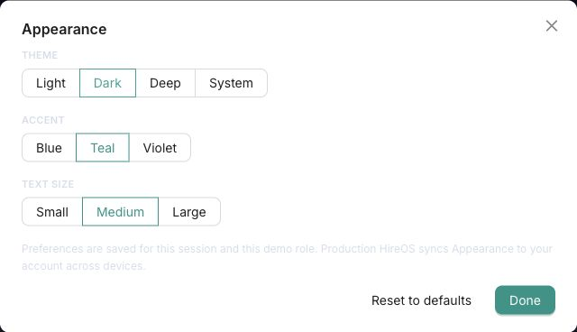
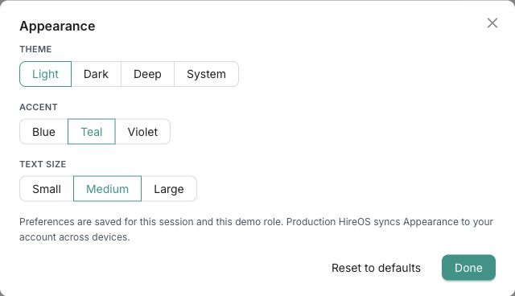
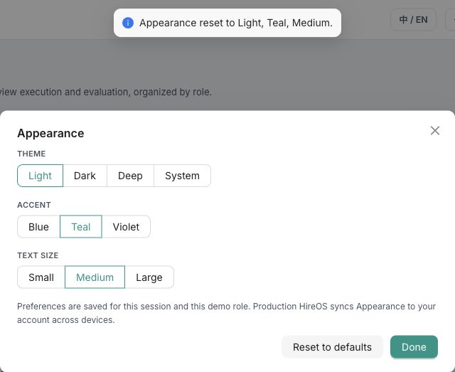

# I14 外观、字号与偏好｜GitHub Issue 草稿

依据：[线上测试报告](Test_Report_2026-10-15.md)及本目录规格。用户已于 2026-10-16 确认并提交以下四项：[草稿 1 → #291](https://github.com/TelyAgent/HireOSV2/issues/291)、[草稿 2 → #292](https://github.com/TelyAgent/HireOSV2/issues/292)、[草稿 3 → #293](https://github.com/TelyAgent/HireOSV2/issues/293)、[草稿 4 → #295](https://github.com/TelyAgent/HireOSV2/issues/295)。截图均为 2026-10-15 线上 Chrome 实拍，裁切到外观弹层以避免候选人资料。UX 严重级别 P1/P2 与 GitHub Bug 表单的 Severity S1–S4 分开使用。

## 草稿 1｜暗色主题下 Appearance 弹层说明文字难以辨认

**标题：** `[Bug] I14 暗色主题下 Appearance 弹层说明文字与分组标签对比度不足`

- **Type / Subsystem / Severity / Risk：** Bug / hireos-interview / S3 / low
- **Owner / AI Ready：** @JsonSuCoder / Yes（用户已确认 AC）。
- **Problem：** 线上切换为 Dark 后，Appearance 弹层仍是白底，保存范围与跨设备同步说明变为很浅的灰蓝色。DOM 计算样式为文字 `rgb(214,222,234)`、背景 `rgb(255,255,255)`，对比度约 1.36:1；THEME、ACCENT、TEXT SIZE 分组标签也明显变淡。用户很难读到影响偏好持久性的关键说明。
- **User Outcome：** 用户在所有主题下都能清楚读到设置分组、保存范围及操作结果。
- **Scope：** Interview 的 Appearance 弹层及个人设置中与主题相关的文字、选中态和焦点可读性。
- **Non-goals：** 不改变主题种类、强调色选项或偏好存储规则。
- **Acceptance Criteria：**
  - **AC-1：** 在 Dark、Deep、Light 和 System 解析出的浅/暗界面中，Appearance 说明文字的对比度均达到普通文字至少 4.5:1。
  - **AC-2：** 三个设置分组标签、选中态和键盘焦点在四种主题下均可辨认，不只靠颜色表达选中状态。
  - **AC-3：** 自动化检查覆盖主题切换后的弹层文字对比度和主要控件可访问名称。
- **References：** [I14 PRD](PRD.md) FR-5/FR-6/FR-14、AC-4/AC-5；[测试报告](Test_Report_2026-10-15.md) E-08 / I14-UX-01；[UX/UI 审查标准](../../HireOS_Command_JD_Management_UX_UI_Review_Standard_v1.0.md) U10。
- **Dependencies：** None。
- **Reproduction：** 在[线上 Interview](https://hireos.aipollo.me/hireos/interview/)登录后点击顶栏 Appearance → 选 Dark → 阅读弹层底部说明及分组标签；每次切换均复现。
- **Expected / Actual：** 预期说明与标签清晰可读；实际浅色文字落在白色弹层背景上，说明文字对比度约 1.36:1。
- **Environment：** 线上 HTTPS 环境；Chrome 桌面端；线上构建号未知。截图仅包含 Appearance 弹层。
- **截图：** [Dark 对比度证据](evidence/I14_Appearance_Dark_Contrast_2026-10-15.jpg)。

## 草稿 2｜偏好只存浏览器却宣称账号级同步

**标题：** `[Bug] I14 Appearance 声称跨设备账号同步但偏好仅保存于浏览器`

- **Type / Subsystem / Severity / Risk：** Bug / hireos-interview、hireos-identity、cross-cutting / S2 / medium
- **Owner / AI Ready：** @JsonSuCoder / Yes（用户已确认 AC；账号偏好存储服务由实现阶段确定）。
- **Problem：** 线上 Appearance 弹层写有 “Production HireOS syncs Appearance to your account across devices”，设置页又标为 “Account — personal”。当前仓库 `StoreContext.tsx` 只读写单个无用户或 Workspace 区分的 `hireos_prefs` localStorage 键，未见账号偏好 API。线上本浏览器刷新会保留设置，但**尚未以两个账号或两台设备实测同步失败**。现有文案会让用户以为设置已同步且彼此隔离。
- **User Outcome：** 同一用户跨设备恢复自己的外观设置，不同用户互不覆盖；保存失败时知道尚未同步并可以重试。
- **Scope：** Interview 外观偏好的账号级读写、用户隔离、同步状态和相关文案；首页折叠按用户、Workspace、模块隔离。
- **Non-goals：** 不在本次统一 JD、Screening、Written Test 的界面实现；不共享面试业务数据。
- **Acceptance Criteria：**
  - **AC-1：** 用户 A 改变主题、强调色和字号后，在另一设备或独立浏览器资料中登录同一账号，能恢复相同设置。
  - **AC-2：** 同一浏览器先后登录用户 A 和用户 B，双方各自看到自己的外观和按 Workspace/模块保存的首页折叠偏好，不能读写对方设置。
  - **AC-3：** 偏好保存失败时，界面仍可操作，并明确显示未同步状态与重试入口；不能显示已同步文案。
  - **AC-4：** 自动测试覆盖跨设备恢复、双账号隔离和保存失败重试。
- **References：** [I14 PRD](PRD.md) FR-9～FR-13、AC-2/AC-8；[测试报告](Test_Report_2026-10-15.md) E-03 / I14-UX-02；`hireos-interview/job-Interview-front/src/store/StoreContext.tsx`；`hireos-interview/job-Interview-front/src/components/AppearanceModal.tsx`。
- **Dependencies：** 账号偏好存储归属（identity / Core Record / 其他服务）由实现阶段确定；依赖 I15 身份与角色能力。
- **Reproduction：** 登录线上 Interview → 打开 Appearance，可见跨设备同步承诺；本地代码检查上述 localStorage 键和缺少账号偏好调用。跨账号、跨设备的实际结果尚待专用账号复测。
- **Expected / Actual：** 预期线上承诺与实际账号级同步能力一致；实际线上文案宣称已同步，而当前代码仅显示浏览器本地保存。线上跨设备行为未取得最终证据。
- **Environment：** 线上 HTTPS 环境及当前工作区代码；Chrome 桌面端；线上构建号、偏好 API/DB 证据未知。截图只证明线上文案与控件，不单独证明服务端缺失。
- **截图：** [同步文案证据](evidence/I14_Appearance_Light_Preview_Sync_2026-10-15.jpg)。

## 草稿 3｜字号选项缺少真实预览

**标题：** `[Bug] I14 字号设置只有 Small/Medium/Large 标签而缺少实时预览`

- **Type / Subsystem / Severity / Risk：** Bug / hireos-interview / S3 / low
- **Owner / AI Ready：** @JsonSuCoder / Yes（用户已确认 AC）。
- **Problem：** 线上 Appearance 弹层和个人设置页的 TEXT SIZE 区域仅提供 Small、Medium、Large 三个按钮，没有 PRD FR-7 要求的真实预览文本。用户无法在选择前比较正文或长标签的实际尺寸。
- **User Outcome：** 用户能在设置区域直接比较字号效果，选中后立即看见真实文本的变化。
- **Scope：** 顶栏 Appearance 弹层及个人设置 Appearance 页的字号预览、可读标签与布局。
- **Non-goals：** 不新增字号档位，不改变其他模块的字号规范。
- **Acceptance Criteria：**
  - **AC-1：** 三档字号均有真实文本预览，用户无需离开设置区域即可比较文字大小。
  - **AC-2：** 切换字号后预览立即更新，长英文示例可换行且不被裁切；键盘用户能读到当前选项与预览。
  - **AC-3：** 自动测试覆盖顶栏弹层与个人设置页的三档预览和长文本布局。
- **References：** [I14 PRD](PRD.md) FR-7、AC-1/AC-5；[测试报告](Test_Report_2026-10-15.md) E-01 / I14-UX-03；[UX/UI 审查标准](../../HireOS_Command_JD_Management_UX_UI_Review_Standard_v1.0.md) U2/U10。
- **Dependencies：** None。
- **Reproduction：** 登录线上 Interview → 点击顶栏 Appearance → 查看 TEXT SIZE；再进入 Settings → Appearance 查看同一设置。两处只有三档文字按钮。
- **Expected / Actual：** 预期字号旁有可随选择改变的真实预览；实际没有预览区域。
- **Environment：** 线上 HTTPS 环境；Chrome 桌面端；线上构建号未知。截图为顶栏弹层；设置页在测试报告中有可访问性树证据。
- **截图：** [字号控件证据](evidence/I14_Appearance_Light_Preview_Sync_2026-10-15.jpg)。

## 草稿 4｜Reset 默认强调色与已确认的 Blue 不符

**标题：** `[Bug] I14 Reset 恢复 Teal 与 PRD 默认 Blue 不一致`

- **Type / Subsystem / Severity / Risk：** Bug / hireos-interview / S3 / low
- **Owner / AI Ready：** @JsonSuCoder / Yes（默认色 Blue 与 AC 均已确认）。
- **Problem：** I14 PRD BR-2 要求无偏好时默认 Light + Blue + Medium，用户于 2026-10-15 明确确认 **Blue**。线上 Reset 提示及选中态仍为 Light + Teal + Medium，违反已确认的默认值。
- **User Outcome：** 新用户与点击 Reset 的用户都获得 Blue 默认强调色，并能从提示中理解实际结果。
- **Scope：** Interview 无偏好初始值、Reset 行为与提示、PRD 默认值及对应验收断言。
- **Non-goals：** 不增删 Blue、Teal、Violet 选项；不改变用户已明确选择的偏好。
- **Acceptance Criteria：**
  - **AC-1：** 无个人偏好的用户首次打开 Interview 时，外观为 Light + Blue + Medium。
  - **AC-2：** 从任意已选外观点击 Reset 后，恢复 Light + Blue + Medium；提示准确显示这三项，已有面试业务数据不变。
  - **AC-3：** 自动测试覆盖无偏好首次访问和 Reset 的默认值一致性。
- **References：** [I14 PRD](PRD.md) BR-2、FR-12、AC-6、2026-10-15 用户决定；[测试报告](Test_Report_2026-10-15.md) E-06 / I14-UX-04；`hireos-interview/job-Interview-front/src/store/initialState.ts`。
- **Dependencies：** None；默认色 Blue 的产品决定已明确。
- **Reproduction：** 登录线上 Interview → Appearance → 先选 Dark → 点击 Reset to defaults；Toast 显示 “Appearance reset to Light, Teal, Medium.”，Teal 处于选中态。
- **Expected / Actual：** 预期恢复 Light + Blue + Medium；实际线上恢复 Light + Teal + Medium。
- **Environment：** 线上 HTTPS 环境；Chrome 桌面端；线上构建号未知。截图包括 Reset Toast 和外观控件，不含候选人资料。
- **截图：** [Reset Teal 证据](evidence/I14_Appearance_Reset_Teal_2026-10-15.jpg)。

## 确认记录

1. 默认强调色为 **Blue**（2026-10-15 用户决定）。
2. 用户已确认四份草稿及其 AC，并于 2026-10-16 要求提交到 GitHub 且附带截图。草稿 2 的目标为真正的账号级同步；具体存储服务归属是实现选择。
