# I14 输入输出闭环：外观、字号与偏好

| 项 | 内容 |
|---|---|
| 模块 | I14 外观、字号与偏好 |
| 版本 / 日期 | v1.0 / 2026-10-15（草稿，待评审） |
| 同目录文档 | [产品文档](PRD.md) · [User Journey](User_Journey.md) · [User Cases](User_Cases.md) |
| 依据 | [PRD.md](PRD.md)；公共约定见 [Interview README](../README.md) |
| 实现现状 | 🟡 前端支持四主题、三强调色、三字号，偏好存 localStorage（无账号级同步、未按用户 + Workspace 区分）；默认强调色 Teal 与 PRD 的 Blue 不同 |

本模块拆成 2 个子流程：**I14a 调整外观**、**I14b 可访问性与隔离**。

## 1. 结构化规格

```yaml
# ---------- I14a 调整外观 ----------
flow_id: I14a
actor: hr_a
seed: S_review_draft_in_progress
entry: I14a.N1
max_loop: 3
external: [os.color_scheme, prefs.storage]

nodes:
  - {id: I14a.N1, type: action, do: "顶栏点击 Appearance（或键盘操作）"}
  - {id: I14a.C1, type: check, expect: {ui: "THEME、ACCENT COLOR、TEXT SIZE 三组，每个选项有文字标签；字号旁有真实预览"}}
  - {id: I14a.N2, type: action, do: "依次切换为 Dark、Violet、Large", inject: [save_fail]}
  - {id: I14a.C2, type: check, expect: {ui: "整个模块即时生效；当前页面、筛选、未提交的评分理由保留；三项互不重置；语义色不被强调色覆盖"}}
  - {id: I14a.G1, type: decision, on: "显式主题还是 System"}
  - {id: I14a.C3, type: check, expect: {ui: "System 跟随系统浅 / 暗变化"}}
  - {id: I14a.C4, type: check, expect: {ui: "选择 Dark 后系统改为浅色，界面仍为 Dark"}}
  - {id: I14a.N3, type: action, do: "刷新页面并重新登录"}
  - {id: I14a.C5, type: check, expect: {ui: "设置恢复", db: "账号级偏好（生产）"}}
  - {id: I14a.N4, type: action, do: "点击 Reset to defaults"}
  - {id: I14a.C6, type: check, expect: {ui: "恢复 Light + Blue + Medium 及首页折叠默认状态", db: "面试数据和草稿保留"}}
  - {id: I14a.T1, type: terminal, state: prefs.saved}

edges:
  - [I14a.N1, I14a.C1]
  - [I14a.C1, I14a.N2]
  - [I14a.N2, I14a.C2]
  - [I14a.C2, I14a.G1]
  - [I14a.G1, I14a.C3, {when: "System"}]
  - [I14a.G1, I14a.C4, {when: "显式"}]
  - [I14a.C3, I14a.N3]
  - [I14a.C4, I14a.N3]
  - [I14a.N3, I14a.C5]
  - [I14a.C5, I14a.N4]
  - [I14a.N4, I14a.C6]
  - [I14a.C6, I14a.T1]
---
# ---------- I14b 可访问性与隔离 ----------
flow_id: I14b
actors: [hr_a, interviewer_a]
seed: S_home_mixed
entry: I14b.N1

nodes:
  - {id: I14b.N1, type: action, do: "在 1366×768、Large、Dark 下打开首页和决定页"}
  - {id: I14b.C1, type: check, expect: {ui: "无文字裁切、无操作被遮挡；卡片换行"}}
  - {id: I14b.N2, type: action, do: "只用键盘、200% 浏览器缩放展开统计、调整设置、进入列表"}
  - {id: I14b.C2, type: check, expect: {ui: "焦点可见，主要操作可完成"}}
  - {id: I14b.N3, type: action, do: "遍历 3 强调色 × 4 主题"}
  - {id: I14b.C3, type: check, expect: {ui: "状态文字 / 图标、证据高亮、焦点、表单和弹层可辨认"}}
  - {id: I14b.N4, type: action, actor: interviewer_a, do: "hr_a 设为 Dark，interviewer_a 设为 Light"}
  - {id: I14b.C4, type: check, expect: {ui: "两人设置互不影响"}}
  - {id: I14b.T1, type: terminal, state: accessible}

edges:
  - [I14b.N1, I14b.C1]
  - [I14b.C1, I14b.T1]
  - [I14b.N2, I14b.C2]
  - [I14b.C2, I14b.T1]
  - [I14b.N3, I14b.C3]
  - [I14b.C3, I14b.T1]
  - [I14b.N4, I14b.C4]
  - [I14b.C4, I14b.T1]
```

## 2. 测试数据

| 名称 | 内容 |
|---|---|
| S_review_draft_in_progress | Review 页正在写一段未提交的评分理由 |
| combo | Light + Medium、Dark + Large、Deep + Large |
| os_switch | 操作系统在浅色与暗色之间切换 |

## 3. 路径清单（一条路径 = 一个 test case）

| 路径 | 节点序列 | 数据 / 注入 | 终态 |
|---|---|---|---|
| P1 切换并保留内容 | I14a: N1 → C1 → N2 → C2 | combo | 即时生效，理由不丢 |
| P2 System 跟随 | I14a: G1 → C3 | os_switch | 跟随 |
| P3 显式不被覆盖 | I14a: G1 → C4 | os_switch | 仍为 Dark |
| P4 刷新与重登 | I14a: N3 → C5 | — | 恢复 |
| P5 恢复默认 | I14a: N4 → C6 | — | 业务数据保留 |
| P6 保存失败 | I14a: N2 注入 save_fail | — | 界面可用，提示未同步可重试 |
| P7 小屏大字号暗色 | I14b: N1 → C1 | — | 无裁切 |
| P8 键盘与缩放 | I14b: N2 → C2 | — | 可操作 |
| P9 组合辨认 | I14b: N3 → C3 | — | 可辨认 |
| P10 角色隔离 | I14b: N4 → C4 | — | 互不影响 |

## 4. 流程图（由规格生成）

```mermaid
flowchart TD
  subgraph I14a["I14a 调整外观"]
    I14a_N1["I14a.N1 打开 Appearance"]
    I14a_C1["I14a.C1 ✔ 三组选项"]
    I14a_N2["I14a.N2 切换主题 / 强调色 / 字号<br/>注入：save_fail"]
    I14a_C2["I14a.C2 ✔ 即时生效且不丢内容"]
    I14a_G1{"I14a.G1 主题模式"}
    I14a_C3["I14a.C3 ✔ 跟随系统"]
    I14a_C4["I14a.C4 ✔ 显式不被覆盖"]
    I14a_N3["I14a.N3 刷新与重登"]
    I14a_C5["I14a.C5 ✔ 设置恢复"]
    I14a_N4["I14a.N4 恢复默认"]
    I14a_C6["I14a.C6 ✔ 默认值"]
    I14a_T1(["prefs.saved"])
    I14a_N1 --> I14a_C1
    I14a_C1 --> I14a_N2
    I14a_N2 --> I14a_C2
    I14a_C2 --> I14a_G1
    I14a_G1 -->|"System"| I14a_C3
    I14a_G1 -->|"显式"| I14a_C4
    I14a_C3 --> I14a_N3
    I14a_C4 --> I14a_N3
    I14a_N3 --> I14a_C5
    I14a_C5 --> I14a_N4
    I14a_N4 --> I14a_C6
    I14a_C6 --> I14a_T1
  end
  subgraph I14b["I14b 可访问性与隔离"]
    I14b_N1["I14b.N1 1366×768 + Large + 暗色"]
    I14b_C1["I14b.C1 ✔ 无裁切"]
    I14b_N2["I14b.N2 键盘与 200% 缩放"]
    I14b_C2["I14b.C2 ✔ 可完成主要操作"]
    I14b_N3["I14b.N3 组合辨认"]
    I14b_C3["I14b.C3 ✔ 状态可辨认"]
    I14b_N4["I14b.N4 两个角色各自设置"]
    I14b_C4["I14b.C4 ✔ 互不影响"]
    I14b_T1(["accessible"])
    I14b_N1 --> I14b_C1
    I14b_C1 --> I14b_T1
    I14b_N2 --> I14b_C2
    I14b_C2 --> I14b_T1
    I14b_N3 --> I14b_C3
    I14b_C3 --> I14b_T1
    I14b_N4 --> I14b_C4
    I14b_C4 --> I14b_T1
  end
  classDef err stroke:#d33,stroke-dasharray:4 3,color:#d33
  classDef done fill:#e6f4ea,stroke:#1e8e3e
  class I14a_T1,I14b_T1 done
```



## 5. 已确认与待确认

- **已确认**：默认强调色为 Blue（2026-10-15 用户决定）；I14a.C6 应断言 Reset 恢复 Light + Blue + Medium。当前实现仍为 Teal，待修复。
- **待确认**：账号级偏好存储位置（影响 C5 的 db 断言）。
