# I14 User Journey：外观、字号与偏好

| 项 | 内容 |
|---|---|
| 模块 | I14 外观、字号与偏好 |
| 版本 / 日期 | v1.0 / 2026-10-15（草稿，待评审） |
| 同目录文档 | [产品文档](PRD.md) · [输入输出闭环](Loop_IO.md) · [User Cases](User_Cases.md) |
| 依据 | [PRD.md](PRD.md)；公共约定见 [Interview README](../README.md) |
| 实现现状 | 🟡 前端支持四主题、三强调色、三字号，偏好存 localStorage（无账号级同步、未按用户 + Workspace 区分）；默认强调色 Teal 与 PRD 的 Blue 不同 |

## 角色与权限（公共）

| 角色 | 登录后的主要目的 | 测试身份 | 权限视图 |
|---|---|---|---|
| HR / Recruiter | 建项目、定标准、排期、推进流程；最终结论的 HR 方确认 | hr_a（原型 Sarah Chen） | editor：全部页面可用 |
| Hiring Manager | 统一岗位标准，看证据和分歧；最终结论的 HM 方确认；也可以担任面试官 | hm_a（原型 David Kim，第 1 轮面试官） | 原型通过角色切换完成 HM 确认 |
| Interviewer | 读 Brief、按计划提问、提交 Scorecard | interviewer_a（原型 Priya Nair，第 2 轮面试官） | assignee：只能打开 Overview、Brief、Live Interview、Review |
| Hiring Committee | 查看逐项证据和反证，参与 Debrief | hc_a | 原型未体现 |
| Candidate | 参与面试，知情录制 | — | 不访问面试工作区 |

所有权限由服务端保证，不能只靠前端隐藏；现有后端只校验 Workspace，没有业务角色校验（功能拆分 I15），权限类用例在实现前为 known gap。

# 旅程

**主角色**：全部雇主端用户
**登录目的**：按自己的习惯调整主题和字号，换设置时不丢正在写的内容，下次登录还在。
**入口**：顶栏 Appearance；个人设置

## 输入

| 类型 | 内容 |
|---|---|
| 前置数据（seed） | I14a：S_review_draft_in_progress；I14b：S_home_mixed |
| 用户数据 | 主题、强调色、字号选择 |
| 外部依赖 | os.color_scheme、prefs.storage |

## 流程

流程图与 [输入输出闭环 §4](Loop_IO.md) 一致：

```mermaid
flowchart TD
  subgraph I14a["I14a 调整外观"]
    I14a_N1["I14a.N1 打开 Appearance"]
    I14a_C1["I14a.C1 ✔ 三组选项"]
    I14a_N2["I14a.N2 切换主题 / 强调色 / 字号<br/>注入：save_fail"]
    I14a_C2["I14a.C2 ✔ 即时生效且不丢内容"]
    I14a_G1{"I14a.G1 主题模式"}
    I14a_C3["I14a.C3 ✔ 跟随系统"]
    I14a_C4["I14a.C4 ✔ 显式不被覆盖"]
    I14a_N3["I14a.N3 刷新与重登"]
    I14a_C5["I14a.C5 ✔ 设置恢复"]
    I14a_N4["I14a.N4 恢复默认"]
    I14a_C6["I14a.C6 ✔ 默认值"]
    I14a_T1(["prefs.saved"])
    I14a_N1 --> I14a_C1
    I14a_C1 --> I14a_N2
    I14a_N2 --> I14a_C2
    I14a_C2 --> I14a_G1
    I14a_G1 -->|"System"| I14a_C3
    I14a_G1 -->|"显式"| I14a_C4
    I14a_C3 --> I14a_N3
    I14a_C4 --> I14a_N3
    I14a_N3 --> I14a_C5
    I14a_C5 --> I14a_N4
    I14a_N4 --> I14a_C6
    I14a_C6 --> I14a_T1
  end
  subgraph I14b["I14b 可访问性与隔离"]
    I14b_N1["I14b.N1 1366×768 + Large + 暗色"]
    I14b_C1["I14b.C1 ✔ 无裁切"]
    I14b_N2["I14b.N2 键盘与 200% 缩放"]
    I14b_C2["I14b.C2 ✔ 可完成主要操作"]
    I14b_N3["I14b.N3 组合辨认"]
    I14b_C3["I14b.C3 ✔ 状态可辨认"]
    I14b_N4["I14b.N4 两个角色各自设置"]
    I14b_C4["I14b.C4 ✔ 互不影响"]
    I14b_T1(["accessible"])
    I14b_N1 --> I14b_C1
    I14b_C1 --> I14b_T1
    I14b_N2 --> I14b_C2
    I14b_C2 --> I14b_T1
    I14b_N3 --> I14b_C3
    I14b_C3 --> I14b_T1
    I14b_N4 --> I14b_C4
    I14b_C4 --> I14b_T1
  end
  classDef err stroke:#d33,stroke-dasharray:4 3,color:#d33
  classDef done fill:#e6f4ea,stroke:#1e8e3e
  class I14a_T1,I14b_T1 done
```

## 步骤

| # | 用户意图与操作 | 系统反馈（可观察） | 用户需要判断 |
|---|---|---|---|
| 1 | 打开 Appearance | 三组选项，每项有文字标签 | — |
| 2 | 切换主题、强调色、字号 | 即时生效，正在写的评分理由保留 | 哪种更舒服 |
| 3 | 选择 System | 跟随系统浅 / 暗变化 | — |
| 4 | 刷新或重新登录 | 设置恢复 | — |
| 5 | 点击 Reset to defaults | 恢复 Light + Blue + Medium 及首页折叠默认状态，业务数据保留 | — |
| 6 | 只用键盘完成以上操作 | 焦点可见，可以完成 | — |

## 可见 / 不可见

- 每个用户只能读写自己的偏好，不影响其他用户和导出产物。

## 异常与恢复

| 场景 | 预期 |
|---|---|
| 保存失败 | 界面仍可用，提示未同步并可重试 |
| 系统主题变化 | 只有 System 模式跟随 |

## 输出与交接

| 输出 | 内容 |
|---|---|
| 持久化 | DisplayPreference（账号级）、HomepagePreference（用户 + Workspace + 模块） |
| 交接 | 被所有页面使用；导出文档固定浅色（I11） |

**禁止副作用**：切换设置丢失未提交内容；只改首页背景；显式主题被系统覆盖；Reset 清空业务数据；不同用户设置互相串用。

**成功标准**：三项设置独立、即时、持久；小屏、大字号、键盘、200% 缩放下可用。

**测试映射**：闭环 I14a、I14b（见 [Loop_IO](Loop_IO.md)）；用例见 [User_Cases](User_Cases.md)。

**已确认**：默认强调色为 Blue（2026-10-15 用户决定）；原型与当前实现仍为 Teal，待修复。

**待确认**（来自 PRD）：

1. 原型和实现都有 EN / 中文切换，PRD 写「默认英文」。中文界面是正式范围，还是只用于内部演示？
2. 账号级偏好存储放在哪个服务（identity / Core Record / 各模块自存）。
3. 与 JD、Screening、Written Test 等模块统一设置的时间点。
