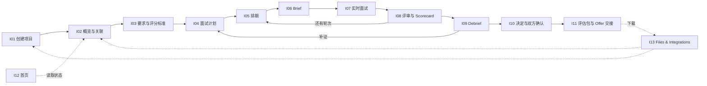

# Interview 主流程产品文档

按 [功能拆分](Interview_Feature_Breakdown.md) 的 I01～I14，每个功能一个文件夹，各放四份文档：`PRD.md`（产品文档）、`Loop_IO.md`（输入输出闭环：结构化流程、测试数据、路径清单、流程图）、`User_Journey.md`（用户旅程）、`User_Cases.md`（功能测试用例）。后三份按 PRD 依次生成：闭环 → User Journey → User Cases。格式与 [Written_Test](../Written_Test/README.md) 下的 `Wxx_*/PRD.md` 保持一致。

| 编号 | 文件夹 | 功能 | 原型页面 |
|---|---|---|---|
| I01 | [I01_Project_Intake](I01_Project_Intake/PRD.md) | 创建项目与 JD 接入 | 新建项目弹窗 |
| I02 | [I02_Project_Overview_Linking](I02_Project_Overview_Linking/PRD.md) | 项目概览与候选人关联 | Overview |
| I03 | [I03_Requirements_Rubric](I03_Requirements_Rubric/PRD.md) | 要求与评分标准 | Requirements & Rubric |
| I04 | [I04_Interview_Plan](I04_Interview_Plan/PRD.md) | 面试计划 | Interview Plan |
| I05 | [I05_Scheduling](I05_Scheduling/PRD.md) | 排期与会议邀请 | Schedule |
| I06 | [I06_Interview_Brief](I06_Interview_Brief/PRD.md) | 面试 Brief | Interview Brief |
| I07 | [I07_Live_Interview](I07_Live_Interview/PRD.md) | 实时面试与记录 | Live Interview |
| I08 | [I08_Review_Scorecard](I08_Review_Scorecard/PRD.md) | 面后评审与 Scorecard | Review |
| I09 | [I09_Debrief_Evidence](I09_Debrief_Evidence/PRD.md) | 跨轮 Debrief 与补证 | Debrief |
| I10 | [I10_Decision_Confirmation](I10_Decision_Confirmation/PRD.md) | 面试阶段决定与双方确认 | Decision & Next Steps |
| I11 | [I11_Evaluation_Package_Handoff](I11_Evaluation_Package_Handoff/PRD.md) | 评估包与 Offer 交接 | Evaluation Package |
| I12 | [I12_Home_Tasks_Statistics](I12_Home_Tasks_Statistics/PRD.md) | 首页、任务列表与统计 | Interview Home |
| I13 | [I13_Files_Integrations](I13_Files_Integrations/PRD.md) | Files & Integrations（公共能力） | Files & Integrations |
| I14 | [I14_Appearance_Preferences](I14_Appearance_Preferences/PRD.md) | 外观、字号与偏好（公共能力） | Appearance 弹层 |

业务顺序：I01 → I02 → I03 → I04 → I05 → I06 → I07 → I08 是单轮主闭环；多轮时 I05～I08 每轮重复一次；全部轮次完成后进入 I09 → I10 → I11。I09 发起补证时回到 I04 追加补证轮。I12 读取主闭环产生的状态；I13、I14 是被各页面调用的公共能力。测试时每个功能用 seed 直接造出前置数据，不依赖前一个功能真跑。

## 依据

- [Interview PRD v1.5](HireOS_Command_Interview_PRD_v1.5.md)：需求基线；与其他文档冲突时以它为准。
- [任务列表状态、点击流程与排序规则 PRD v1.0](HireOS_Command_Interview_Task_List_Status_and_Sorting_PRD_v1.0.md)：首页任务列表的状态、跳转、排序和筛选。
- [原型](../../design/Interview/index.html)：页面与交互。
- [UI Guidelines v0.1](HireOS_Command_Interview_UI_Guidelines_v0.1.md)：视觉与组件规范。
- [Prototype Design Brief v1.0](HireOS_Command_Interview_Prototype_Design_Brief_v1.0.md)：此前的设计交接，首页、主题和字号以 PRD v1.5 为准。

## 公共约定

### 角色

PRD §2 定义的用户，与原型中的演示身份对应如下：

| 角色 | 登录后的主要目的 | 原型身份 | 原型权限视图 |
|---|---|---|---|
| HR / Recruiter | 建项目、定标准、排期、推进流程；最终结论的 HR 方确认 | Sarah Chen（HR Manager） | editor：全部页面可用 |
| Hiring Manager | 统一岗位标准，看证据和分歧；最终结论的 HM 方确认；也可以担任面试官 | David Kim（第 1 轮面试官、HM 确认方） | 原型通过角色切换完成 HM 确认 |
| Interviewer（业务面试官） | 读 Brief、按计划提问、提交 Scorecard | Priya Nair（Business Interviewer，第 2 轮面试官） | assignee：只能打开 Overview、Brief、Live Interview、Review；不能编辑排期、不能进入 Files、不能建项目、不能确认结论 |
| Hiring Committee | 查看逐项证据和反证，参与 Debrief | — | 原型未体现 |
| Candidate | 参与面试，知情录制 | — | 不访问面试工作区的任何内部页面 |

所有权限由服务端保证，不能只靠前端隐藏。现有后端只校验 Workspace，没有业务角色校验（见功能拆分 I15）。

### 演示数据（原型）

| 项 | 内容 |
|---|---|
| 岗位 | Senior Backend Engineer · Platform Engineering · Remote — APAC / EU overlap · L5 / Senior |
| 候选人 | Elena Torres（elena.torres@example.com），简历 `Elena_Torres_Resume.pdf` |
| 能力（6 项） | Distributed Systems Design（Must，L4，22%）、Backend Engineering Depth（Must，L4，22%）、Production Ownership & Incident Response（Must，L3，18%）、Security & Compliance Awareness（Must，L3，13%）、Technical Communication（L3，13%）、Collaboration & Mentorship（L3，12%） |
| 轮次 | Round 1 System Design & Architecture（David Kim）；Round 2 Technical Deep Dive & Collaboration（Priya Nair） |
| 关键场景 | Security & Compliance Awareness 只有空泛回答，保持 Unknown → Debrief 发起补证轮 → 补证后达到 L3 → HR、HM 分别确认 → 发布评估包 → Offer 首次交接超时、重试成功 |

所有测试项目、候选人名称加 `[UJ-TEST]` 前缀，测试后清理；邮箱使用 `example.com`。

### 测试身份

| 身份 | 角色 | 说明 |
|---|---|---|
| hr_a | HR / Recruiter | 大多数用例的默认执行者 |
| hm_a | Hiring Manager | 第 1 轮面试官、HM 方确认 |
| interviewer_a | Interviewer | 第 2 轮面试官（assignee 视图） |
| hc_a | Hiring Committee | Debrief 查看 |
| restricted_user | 无相关来源权限的普通用户 | I13 历史泄露检查 |

现有后端只校验 Workspace，多身份需要先补测试账号与角色校验（I15）。

### Seed（前置状态）目录

| Seed | 内容 |
|---|---|
| S0_logged_in_hr | hr_a 已登录，首页无同名项目 |
| S_jd_only_project | 只有 JD 的项目，未关联候选人，未抽取要求 |
| S_project_linked | 已关联候选人 Elena Torres，未抽取要求 |
| S_project_with_materials | 已关联候选人，含重复筛选报告和未归类附件 |
| S_rubric_draft | 已抽取能力草稿，未确认 |
| S_rubric_confirmed | Rubric v1 已确认，计划未批准 |
| S_rubric_v1_scored | Rubric v1 已有评分 |
| S_plan_approved | 两轮已规划并批准，未排期 |
| S_round1_scheduled | 第 1 轮已排期 |
| S_round1_completed | 第 1 轮已完成，有转写和笔记，未评分 |
| S_round2_scheduled | 第 2 轮已排期（第 1 轮未提交 Scorecard） |
| S_round2_scheduled_round1_submitted | 第 2 轮已排期，第 1 轮已提交 |
| S_round2_completed | 第 2 轮已完成，未评分（含手工记录证据） |
| S_round2_submitted | 第 2 轮 Scorecard 已提交 |
| S_all_rounds_scored_security_unknown | 全部轮次已评分，Security & Compliance Awareness 为 Unknown |
| S_all_rounds_fully_scored | 全部维度已评分 |
| S_followup_round_submitted | 补证轮已完成并提交 |
| S_evidence_requested | 已发起补证，补证轮未完成 |
| S_debrief_ready_all_must_met | Debrief 完成，Must-have 全部达标 |
| S_debrief_security_unknown | Debrief 完成，一项 Must-have 为 Unknown |
| S_decision_hr_confirmed | 已记录决定，只有 HR 确认 |
| S_decision_both_confirmed_offer | 推荐 Offer，双方已确认 |
| S_package_handed_off | 评估包已交接并收到 ACK |
| S_package_v2_handed_off | 评估包 v2 已交接 |
| S_home_mixed | 同岗位多项目、多轮、多面试官；含取消场次、归档项目、JD-only 项目、unknown 招聘状态岗位 |
| S_home_13_statuses | 13 个任务状态各至少一个项目 |
| S_files_empty | Files 中没有材料 |
| S_files_history | 有上传、下载、读取、失败和重试历史 |
| S_connections | 已配置邮件连接和文件夹连接（mock） |
| S_review_draft_in_progress | Review 页有未提交的评分理由 |

### 注入点

| 注入 | 含义 | 通过标准 |
|---|---|---|
| double_click | 重复点击提交类按钮 | 只生效一次 |
| network_down | 断网 | 提示失败，输入不丢 |
| refresh | 中途刷新 | 已保存内容不丢，不产生半成品 |
| llm_fail | AI 失败 / 超时 | 显示失败与重试，人工路径不受影响，无假成功 |
| concurrent_edit | 两个会话同时编辑 | 后提交方收到冲突，不静默覆盖 |
| transcription_fail | 转写服务失败 | 录制不中断，手工记录为证据来源 |
| offer_timeout | Offer 交接超时 | 显示失败、无部分发送、可重试 |
| export_fail / download_fail | 导出生成失败 / 下载失败 | 两种失败分开显示 |
| stats_fail / stale_cache | 统计单项失败 / 缓存过期 | Unavailable + Retry / Last updated |
| cancel_item / close_panel | 上传中取消 / 关闭进度面板 | 取消项单独记录；关闭面板不取消任务 |
| download_expire | 下载链接过期 | 不虚构已保存，重新下载为新尝试 |
| auth_expire | 连接授权过期 | Authorization required，恢复后从检查点继续 |
| save_fail | 偏好保存失败 | 界面可用，提示未同步可重试 |

### 用例统计

| 模块 | 用例 | ✅ 可测 | 🟡 部分可测 | ❌ 未实现 |
|---|---|---|---|---|
| I01 | 13 | 6 | 6 | 1 |
| I02 | 11 | 2 | 2 | 7 |
| I03 | 12 | 10 | 1 | 1 |
| I04 | 11 | 5 | 1 | 5 |
| I05 | 10 | 3 | 2 | 5 |
| I06 | 9 | 0 | 4 | 5 |
| I07 | 10 | 1 | 4 | 5 |
| I08 | 11 | 3 | 5 | 3 |
| I09 | 10 | 1 | 5 | 4 |
| I10 | 10 | 2 | 3 | 5 |
| I11 | 8 | 1 | 2 | 5 |
| I12 | 13 | 2 | 8 | 3 |
| I13 | 14 | 0 | 0 | 14 |
| I14 | 9 | 4 | 4 | 1 |
| **合计** | **151** | **40** | **47** | **64** |

“✅ 可测”表示功能已有实现、用例可直接执行，不代表会通过。

### 状态与对象分离

- 项目 ≠ 岗位 ≠ 场次 ≠ 反馈任务；每个计数和状态都要标明单位。
- AI 建议（Strong Hire … Insufficient Evidence）≠ 人工阶段决定（Proceed / Hold / Reject / Request More Evidence）≠ HR / HM 确认 ≠ Offer 批准。
- Continue to next round ≠ Recommend for offer。
- Unknown / Not Evaluated 是空分数，不能显示为 0 或低分。
- 材料可用 ≠ 业务已消费 ≠ 产物已生成 ≠ 已下载。

## 说明

- 各 PRD 的「实现现状」是 2026-10-14 按代码目录和接口做的初步核对，没有逐项验证 AC。
- 原型与 PRD 有冲突的地方已在各 PRD「待确认」中标出，需要用户决定后回写。
- 身份与权限、AI 追溯与质量指标、P1 / P2 增强能力是功能拆分中的 I15～I17，未在此建文件夹。
