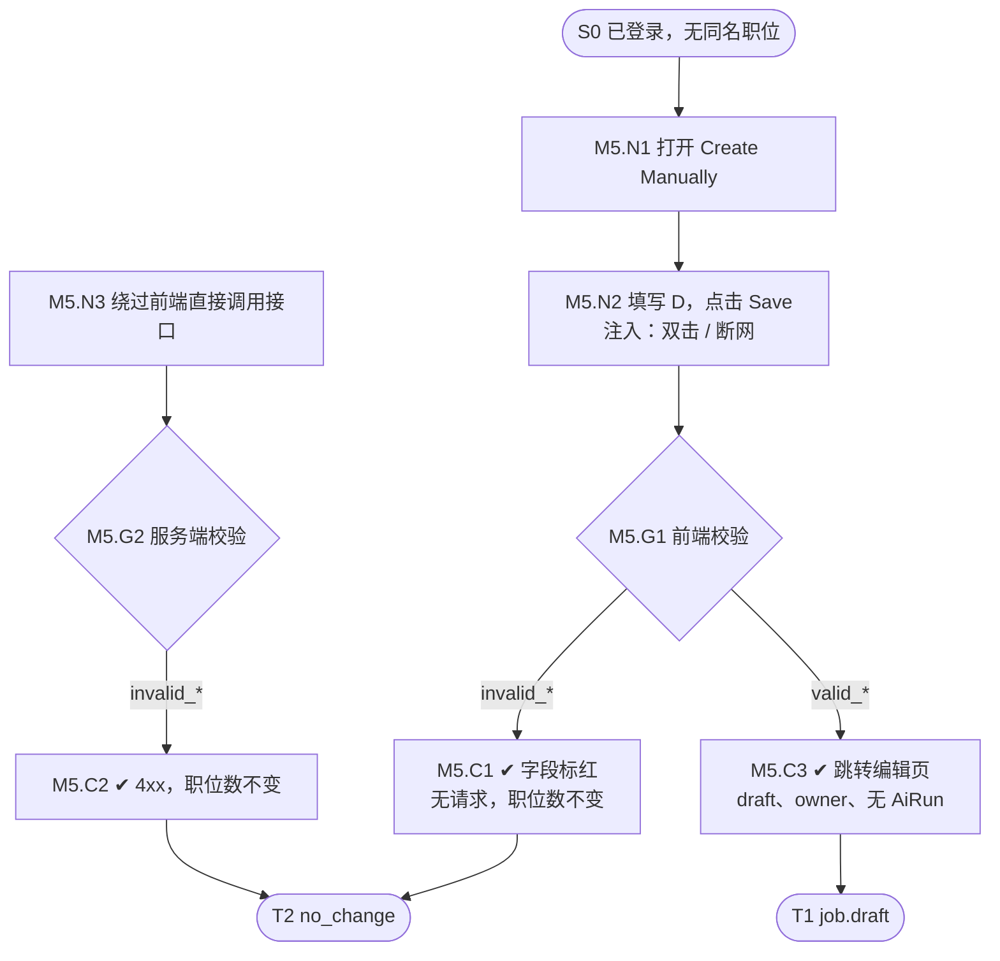

# 流程图规格样例：M5 手动表单创建（v0.1，用于确认结构）

本文件演示“可供 AI 模拟执行”的流程图结构。结构确认后，按同一格式改写其余闭环，再从“路径清单”展开 test case。

结构分四块：**结构化规格（AI 读）→ 路径清单 → mermaid 图（人看，由规格生成，不手改）→ 待确认**。

## 1. 结构化规格

```yaml
flow_id: M5
name: 手动表单创建职位
actor: recruiter_a         # 测试身份，取自角色矩阵（Recruiter / TA、Hiring Manager、HR Approver、Viewer）
seed: S0_logged_in_no_job  # 前置状态：已登录、在职位列表、不存在同名职位
entry: N1
max_loop: 3                # 同一个回路最多走 3 次，防止路径无限展开

nodes:
  - id: M5.N1
    type: action           # action=AI 执行操作 / decision=按条件分支 / check=断言 / terminal=终态
    do: 点击 Ask Copilot → Create Manually
    expect:
      ui: 对话中出现表单；必填项有标记
  - id: M5.N2
    type: action
    do: 按测试数据 D 填写表单，点击 Save
    inject: [double_click, network_down]     # J10 注入点
  - id: M5.G1
    type: decision
    on: 前端校验结果
  - id: M5.C1
    type: check
    expect:
      ui: D 对应的字段标红并提示
      api: 没有发出创建请求
      db: 职位总数不变
  - id: M5.N3
    type: action
    do: 绕过前端，直接调用创建接口提交 D
  - id: M5.G2
    type: decision
    on: 服务端校验结果
  - id: M5.C2
    type: check
    expect:
      api: 返回 4xx 和明确的错误码
      db: 职位总数不变
  - id: M5.C3
    type: check
    expect:
      ui: 直接跳转编辑页，不经过 Workspace 预览；未填的选填项不显示
      db: Core Job status=draft，owner=actor；文档章节内容与表单一致
      record: 没有 AiRun
  - id: M5.T1
    type: terminal
    state: job.draft       # 对应状态图 2.1
  - id: M5.T2
    type: terminal
    state: no_change

edges:
  - [M5.N1, M5.N2]
  - [M5.N2, M5.G1]
  - [M5.G1, M5.C1, {when: D 属于 invalid_*}]
  - [M5.G1, M5.C3, {when: D 属于 valid_*}]
  - [M5.C1, M5.T2]
  - [M5.C3, M5.T1]
  - [M5.N3, M5.G2]          # 第二个入口：服务端校验路径
  - [M5.G2, M5.C2, {when: D 属于 invalid_*}]
  - [M5.C2, M5.T2]

data:                       # 每条分支由哪组数据触发
  valid_full: {title: "[UJ-TEST] Content Creator", location: Singapore, headcount: 2, responsibilities: "Write weekly posts", requirements: "2+ years of writing", salary: {min: 25, max: 40, period: hour}}
  invalid_empty: {}
  invalid_hc_zero: {headcount: 0}
  invalid_hc_decimal: {headcount: 1.5}
  invalid_hc_negative: {headcount: -1}
  invalid_resp_blank: {responsibilities: "1."}
  invalid_req_empty: {requirements: ""}
  invalid_salary_range: {salary: {min: 40, max: 25}}
```

## 2. 路径清单（test case 从这里展开）

| 路径 | 节点序列 | 数据 | 终态 |
|---|---|---|---|
| P1 主流程 | N1 → N2 → G1 → C3 → T1 | valid_full | job.draft |
| P2–P8 前端拦截 | N1 → N2 → G1 → C1 → T2 | invalid_*（每组一条） | no_change |
| P9–P15 服务端拦截 | N3 → G2 → C2 → T2 | invalid_*（每组一条） | no_change |
| P16 双击 Save | P1 + 在 N2 注入 double_click | valid_full | 只有 1 个 job.draft |
| P17 保存时断网 | P1 + 在 N2 注入 network_down | valid_full | no_change，输入不丢，可重试 |

## 3. mermaid 图（由规格生成）



## 4. 待确认

- Viewer 打开 Create Manually 的预期：入口不可见，还是可见但不可用（补一条无权路径 P18）。

- 必填项口径（5 / 9 / 11 项）决定 invalid_* 有哪几组。
- 手动创建实际调用的接口，在实现时确认后填入 N3。
