# HireOS Command — JD Management 闭环流程图

Doc ID：CMD-JD-FLOW-001
版本：v1.0（草稿，待评审）
日期：2026-10-14
依据：[九模块 User Journey v1.0](HireOS_Command_JD_Management_Module_User_Journeys_v1.0.md)、[测试闭环输入/输出清单 v0.1](JD_Test_Loops_IO_v0.1.md)、[PRD v1.3](HireOS_Command_JD_Management_PRD_v1.3.md)、[Interface Spec v1.3](HireOS_Command_JD_Management_Interface_Spec_v1.3.md)、[完整性标准 v0.1](HireOS_Command_JD_Completeness_Standard_v0.1.md)、Issue #9 / #15

## 怎么读这份文档

- **第 1 章 全景图**：11 个闭环（M1–M9 + 建议的 M10、M11）之间怎么衔接、传递什么数据。
- **第 2 章 状态图**：职位、文档、AI 建议、发布四类对象的状态变化。测试断言的“终态”都从这里取。
- **第 3 章 闭环泳道图**：每个闭环一张，分三条泳道：
  - **用户**：用户的操作和判断；
  - **JD 系统**：前端和 JD 后端；
  - **AI / 外部**：LLM、Core Record、文件解析、外部网页、发布渠道。
- 图中 `✔n` 是**测试断言点**，图下的表格写明每个断言点要检查什么。
- 红色虚线框是异常分支，绿色框是闭环的终态（输出）。

图例：

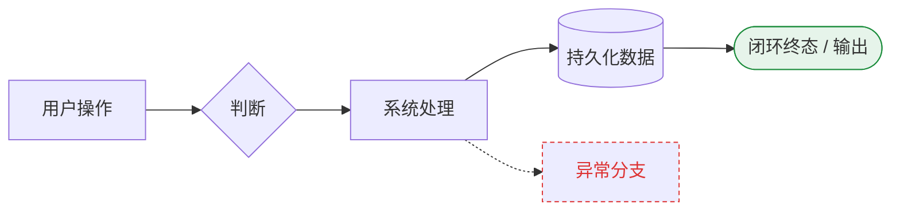

---

## 1. 全景图：闭环之间的衔接

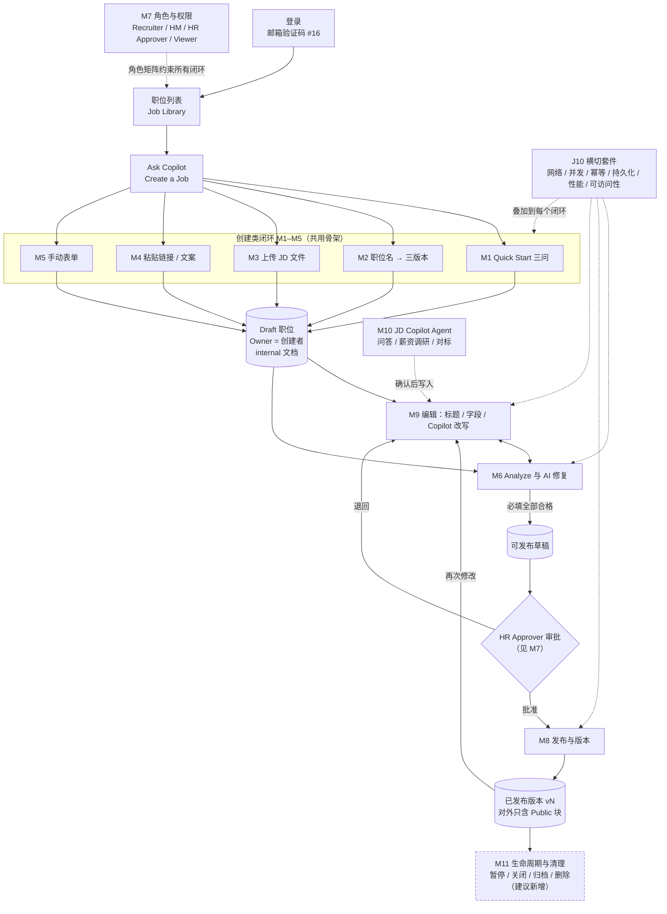

### 1.1 闭环之间传递的数据

| 交接 | 产物 | 说明 |
|---|---|---|
| M1–M5 → M6 / M9 | Draft 职位 + internal 文档 | Core Job `status=draft`；可能缺必填项 |
| M9 ⇄ M6 | 文档新 revision | 编辑后分析结果过期，需要重新 Analyze |
| M6 → M8 | 可发布草稿 | 必填全部 Pass，且没有 Weak 项 |
| M8 → M9 | 已发布版本 vN | 再次编辑后页头出现 Unpublished changes |
| M10 → M9 | 带来源的薪资参考 | 人工确认后才写入字段 |
| M6 → M7 | 可提交审批的草稿 | Recruiter 提交，HR Approver 审批 |
| M7 → M8 | 已批准的候选版本 | 发布引用精确的已批准版本 |
| M7 → 全部 | 角色矩阵 | 每个闭环的身份前置条件 |

> 闭环独立测试时，前置数据用 seed 一步造出，**不要**按上图把前一个闭环真跑一遍。上图只表示业务上的先后关系。

---

## 2. 状态图

### 2.1 职位状态（当前实现）

当前后端只有两态，对应 Core Record 的 `draft / open`：

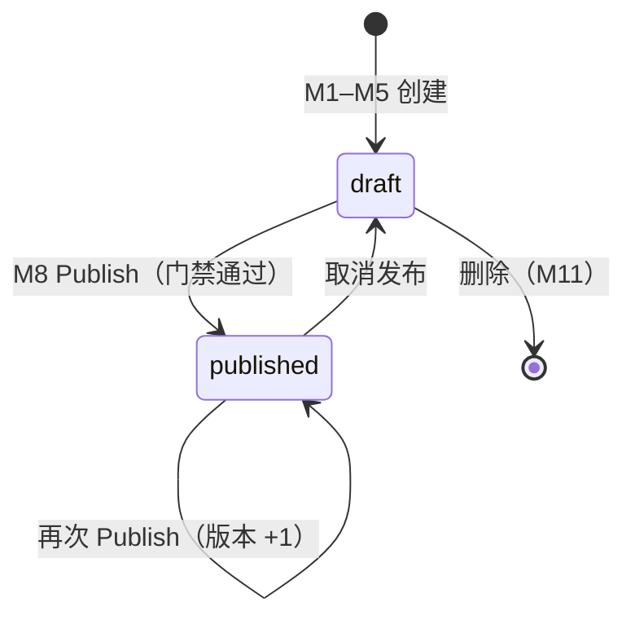

### 2.2 职位状态（PRD 目标，供 M11 使用）

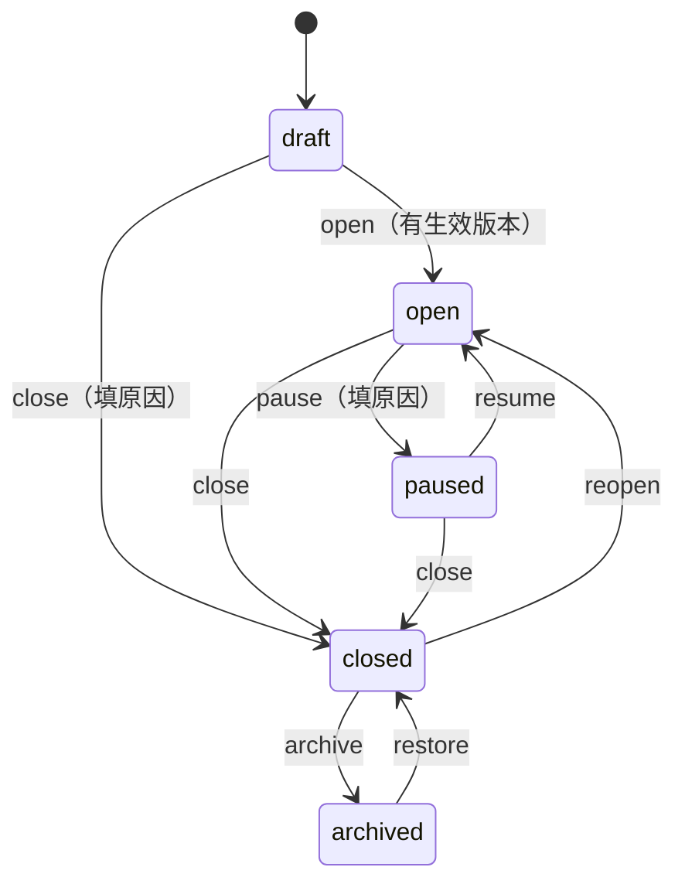

### 2.3 文档、审批与完整性状态（M6 / M7 / M8 / M9）

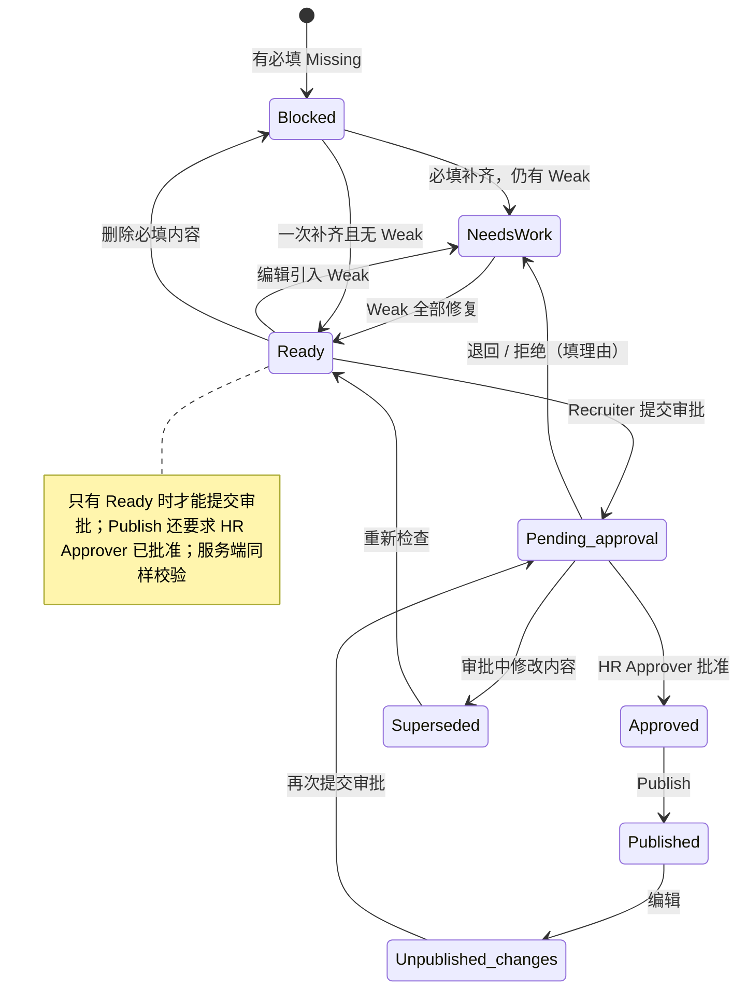

### 2.4 AI 建议状态（M1–M4、M6、M9）

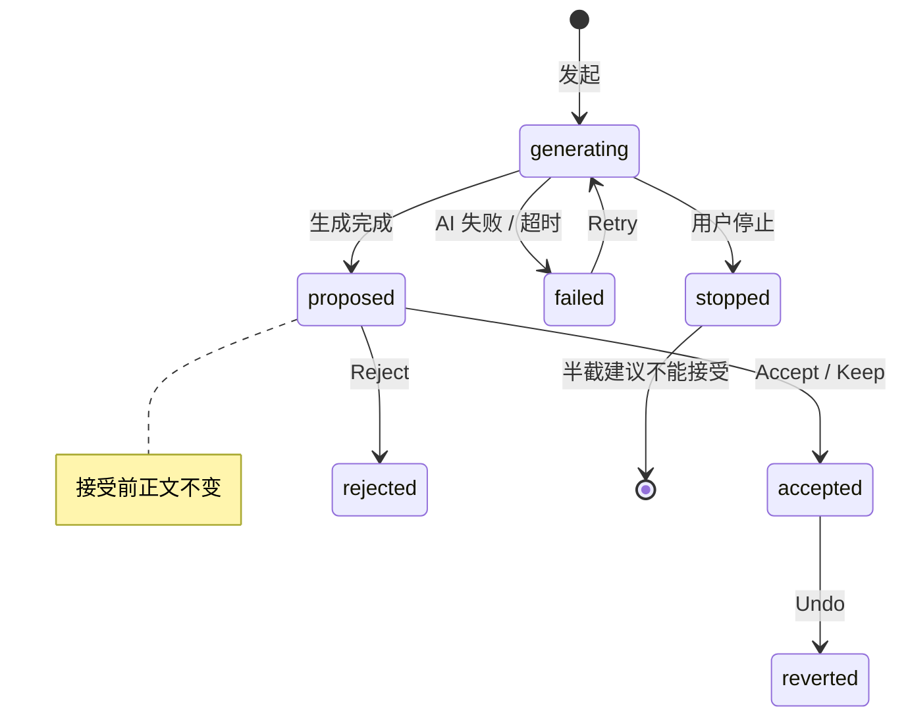

### 2.5 发布状态（M8，每个渠道独立）

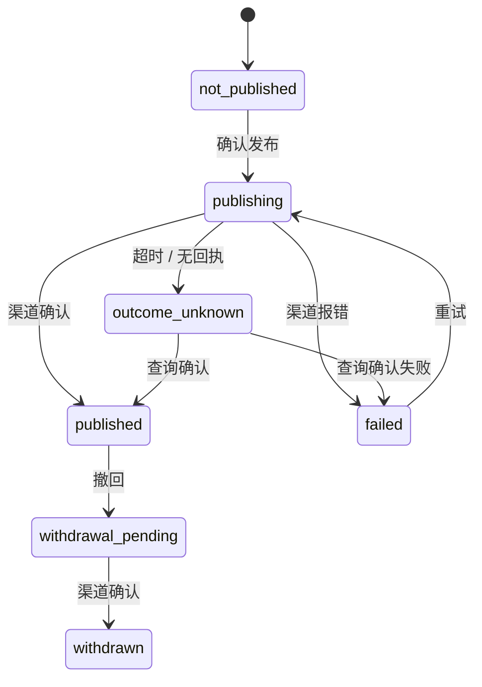

---

## 3. 闭环泳道图

### 3.0 创建类公共骨架（M1–M5 共用）

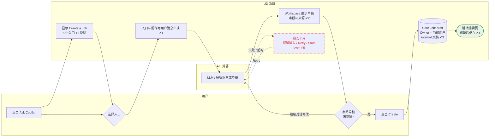

| 断言点 | 检查什么 |
|---|---|
| ✔1 | 入口标题只出现一次；Agent 立即开始引导 |
| ✔2 | 点击 Create **之前**，Core 里没有新职位（API 计数不变） |
| ✔3 | `status=draft`；Owner = 当前用户；有 internal 文档；没有发布记录 |
| ✔4 | 刷新和返回列表后职位仍在；字段行显示 Location / Headcount / Workplace type |
| ✔5 | 错误后输入不丢；Retry 不重复创建；New conversation 清空错误状态 |

---

### 3.1 M1 Quick Start 三问创建

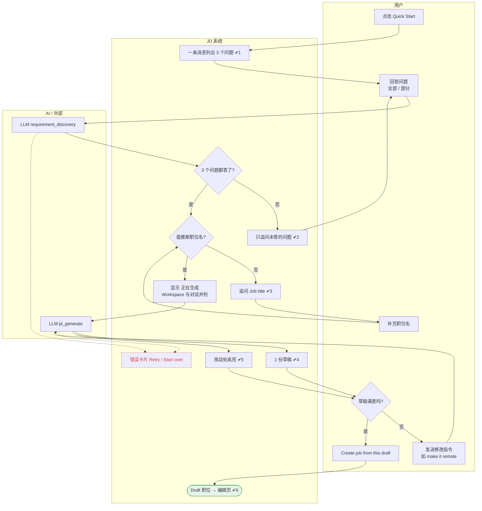

| 断言点 | 检查什么 | 输入示例 |
|---|---|---|
| ✔1 | 3 个问题在**同一条**消息里 | — |
| ✔2 | 只追问第 3 个，不重复前两个 | 只答前两行 |
| ✔3 | 不使用 `New Role` 或空标题 | `Things are messy` ⏎ `Tidy them up` ⏎ … |
| ✔4 | 只有 1 份草稿；概述 2–4 句；职责 ≥3；包含回答里的硬技能；没有编造的数字 | v0.1 §3.2 三行回答 |
| ✔5 | 工作模式变为 Remote；用户消息只出现一次 | `add TikTok growth experience and make it remote` |
| ✔6 | 同 3.0 的 ✔3、✔4 | — |

---

### 3.2 M2 职位名 → 三版本

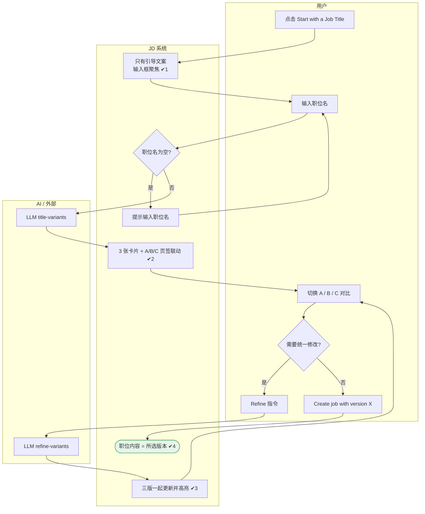

| 断言点 | 检查什么 |
|---|---|
| ✔1 | 引导消息里没有内嵌输入框和按钮 |
| ✔2 | 三版风格不同（A 最短、B 面向候选人、C 最详细）；职位名、地点、HC 等**事实字段一致** |
| ✔3 | 三版都更新；停留在当前所选版本 |
| ✔4 | 创建后的职责、要求与所选版本逐字一致 |

---

### 3.3 M3 上传 JD 文件

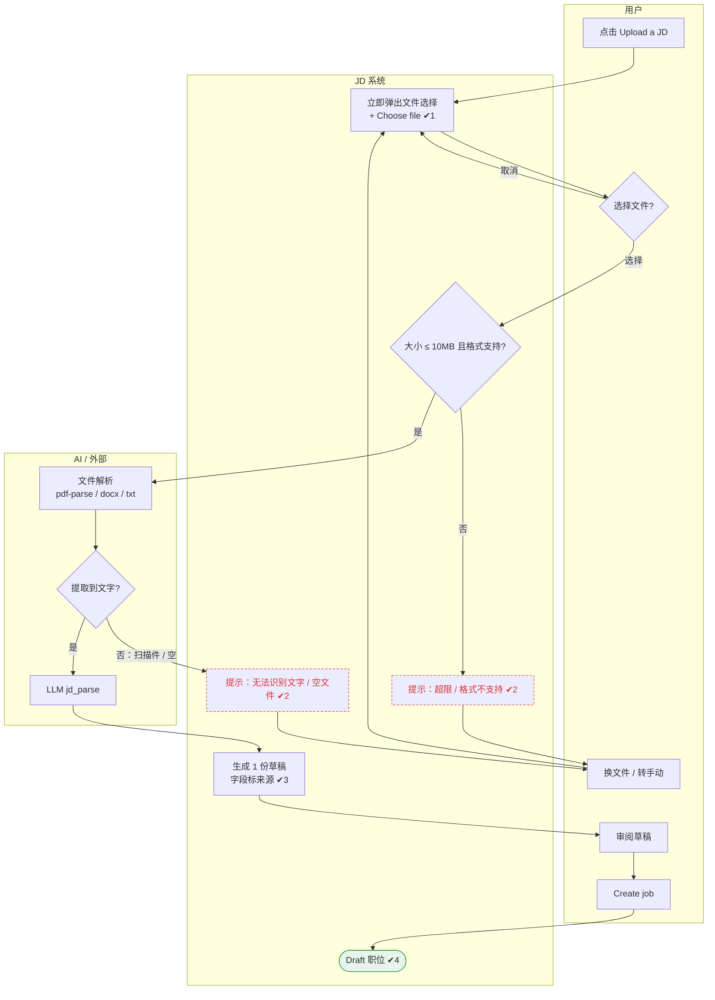

| 断言点 | 检查什么 | 输入示例 |
|---|---|---|
| ✔1 | 点击入口即弹出；取消后可再次选择且不报错 | — |
| ✔2 | 每种异常文件都有明确原因；**不生成空草稿或编造内容** | 扫描版 PDF、空 txt、>10MB、.png、.zip |
| ✔3 | 职位名 `Sales Manager`；地点 `Singapore`、`Remote` 取自文件；概述不是 “Adapted from…”；三种格式结果一致 | sales-jd.docx / .pdf / .txt |
| ✔4 | 同 3.0 的 ✔3、✔4；文件中的提示注入不改变 AI 行为 | 含注入文本的 JD |

---

### 3.4 M4 粘贴链接 / 文案

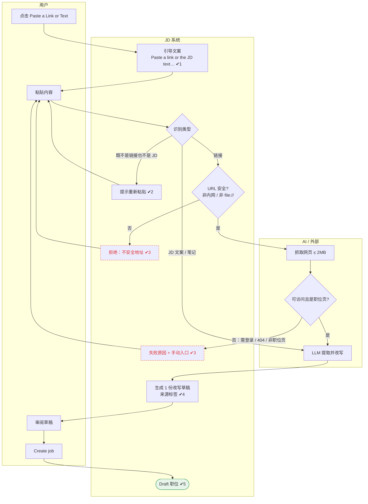

| 断言点 | 检查什么 | 输入示例 |
|---|---|---|
| ✔1 | 没有内嵌输入框 | — |
| ✔2 | 停留在本步，说明怎么重新粘贴 | `not a link` |
| ✔3 | 每种失败分别给出原因，**不编造草稿**；内网地址被拒绝 | 需登录页、404、公司首页、`ftp://`、`http://127.0.0.1` |
| ✔4 | 链接只显示一次；内容与页面一致；没有大段照搬 | 公开职位链接 |
| ✔5 | `Customer Success Manager`；3 职责 / 2 要求 / 1 加分项；`Hanoi, VN`、`Hybrid` | v0.1 §3.2 粘贴文案 |

---

### 3.5 M5 手动表单

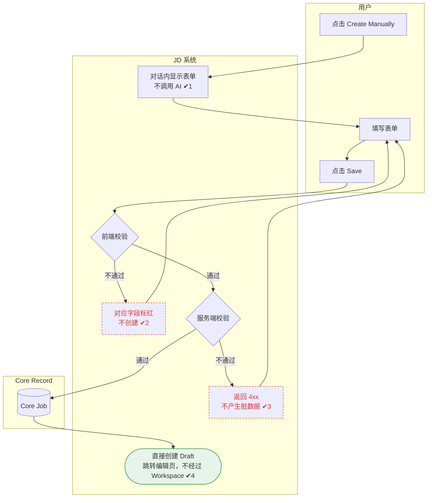

| 断言点 | 检查什么 | 输入示例 |
|---|---|---|
| ✔1 | 整个流程没有 AiRun 记录 | — |
| ✔2 | 每个必填项缺失时分别标红；HC 必须是 ≥1 的整数；薪资最大值不小于最小值 | 空表单、HC=`0`/`1.5`/`-1`、薪资 40>25、职责只填 `1.` |
| ✔3 | 绕过前端直接提交非法数据，服务端拒绝 | 直接调用接口提交 HC=0 |
| ✔4 | 薪资显示 `USD 25–40 per hour`；`3+ years in sales` 原样保留；未填的选填项不显示 | v0.1 §3.2 表单数据 |

---

### 3.6 M6 Analyze 与 AI 修复

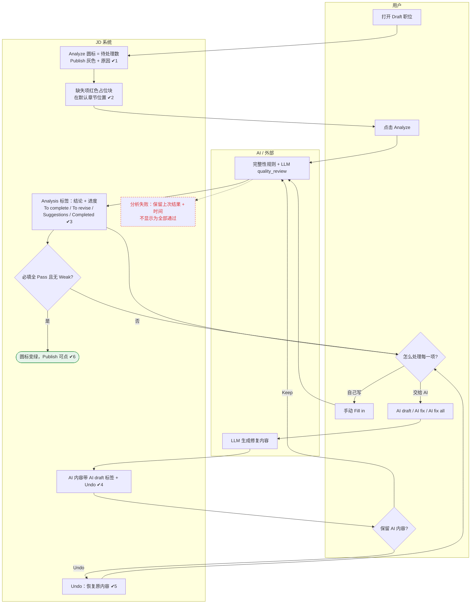

| 断言点 | 检查什么 | 前置数据 / 输入 |
|---|---|---|
| ✔1 | 圆标数字等于待处理项数；悬停说明还差 N 项 | seed①缺多项必填 |
| ✔2 | 占位块位置符合默认章节顺序 | seed① |
| ✔3 | 四个分组正确；每条 Weak 规则各有一个用例落到 To revise | `Must have strong communication skills`、一句话概述、Junior 5 年+、Remote 无地区 |
| ✔4 | AI 内容可验证、没有编造的数字；滚动位置不变 | AI fix all |
| ✔5 | 内容精确恢复到处理前 | — |
| ✔6 | Publish 可点状态 = 必填全 Pass 且无 Weak；**服务端也拒绝不合格的发布请求**；刷新后状态一致 | seed③全部合格 |

---

### 3.7 M7 角色与权限（四角色）

角色定义见 [九模块 User Journey §0.1](HireOS_Command_JD_Management_Module_User_Journeys_v1.0.md)：Recruiter / TA、Hiring Manager、HR Approver、Viewer。2026-10-14 已决定恢复审批；审批流程后端尚未实现，图中虚线框节点的用例先标记为 known gap。

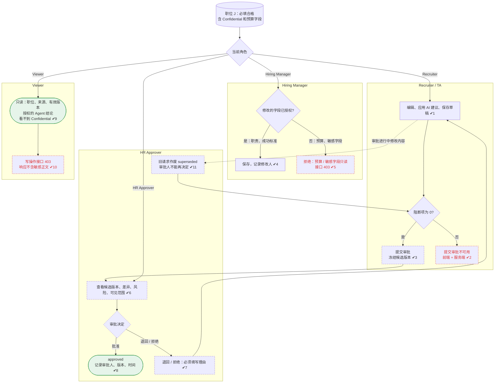

| 断言点 | 检查什么 |
|---|---|
| ✔1 | Recruiter 可编辑、可见 Confidential、可保存草稿和应用 AI 建议 |
| ✔2 | 有阻断项时提交审批不可用；直接调用接口也被拒绝 |
| ✔3 | 生成待审批的候选版本，内容被冻结；Recruiter 不能批准自己提交的版本 |
| ✔4 | Hiring Manager 修改授权字段后保存成功，记录修改人和时间 |
| ✔5 | Hiring Manager 修改预算 / 敏感字段：界面只读，接口返回 403 |
| ✔6 | 审批人看到内容、与上一版的差异、风险；无 restricted 权限时看不到 restricted 字段 |
| ✔7 | 退回或拒绝不填理由时不能提交 |
| ✔8 | 批准记录人工审批人、精确版本和时间；AI 不能作为审批人 |
| ✔9 | Viewer 只读，没有编辑类按钮，看不到 Confidential 和敏感字段 |
| ✔10 | **用 API 直接请求**：Viewer 的响应里不含 Confidential 正文；编辑、保存、提交、发布接口都返回 403 |
| ✔11 | 审批进行中修改内容：旧请求变为 superseded，必须重新提交；审批人对旧版本的决定被拒绝 |

---

### 3.8 M8 发布与版本

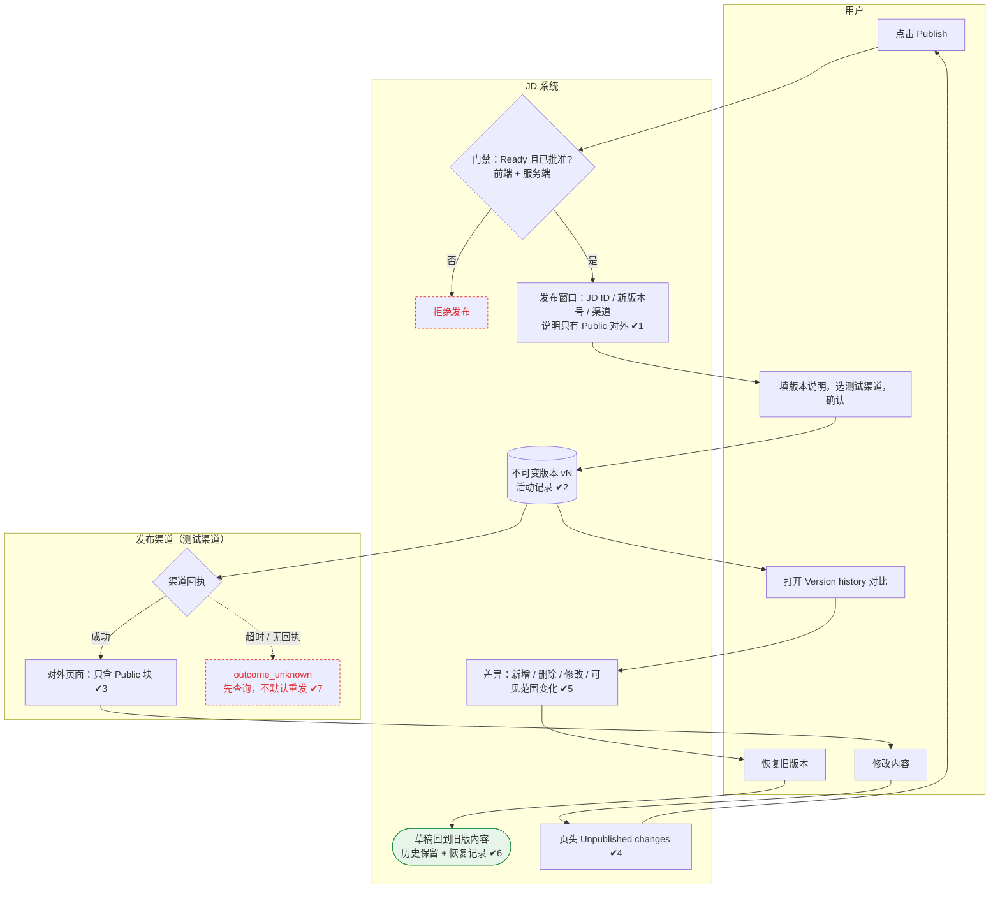

| 断言点 | 检查什么 |
|---|---|
| ✔1 | JD ID 格式 `JD-年份-编号`；第二次发布时窗口列出相对上一版的变更 |
| ✔2 | 每次发布版本号 +1；已发布版本内容不可修改；双击 Publish 只生成一个版本 |
| ✔3 | 对外页面**没有** Internal 和 Confidential 内容 |
| ✔4 | 修改后对外内容仍是旧版本 |
| ✔5 | 能对比任意两个版本 |
| ✔6 | 恢复不删除任何历史版本 |
| ✔7 | 超时后不显示成功，主操作是查询状态 |

> 线上暂无发布渠道：✔3、✔7 等渠道上线后再测；其余断言可以先测“仅生成版本”的部分。

---

### 3.9 M9 编辑：字段、标题联动与 Copilot 改写

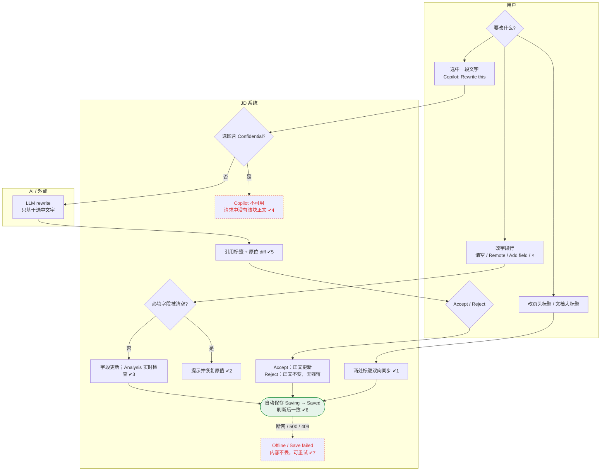

| 断言点 | 检查什么 | 输入示例 |
|---|---|---|
| ✔1 | 改任意一处，另一处同步；必填检查仍通过 | `[UJ-TEST] Staff Backend Engineer` |
| ✔2 | Location 不能为空，值恢复 | 清空 Location |
| ✔3 | `Remote` 触发 To revise；Add field 菜单不含已显示字段；× 隐藏后可加回；Level 设为 Not set 后不显示 | — |
| ✔4 | 网络请求里没有 Confidential 正文 | 选中 Confidential 块 |
| ✔5 | 改写只作用于选区；Accept 前正文不变 | `Rewrite this` |
| ✔6 | 刷新、返回列表后，标题、Location、HC、Workplace type 一致 | — |
| ✔7 | 保存失败时不显示 Saved；两个标签页同时编辑不静默覆盖 | 断网、两个标签页 |

---

### 3.10 M10 招聘问答与市场薪资调研（建议新增）

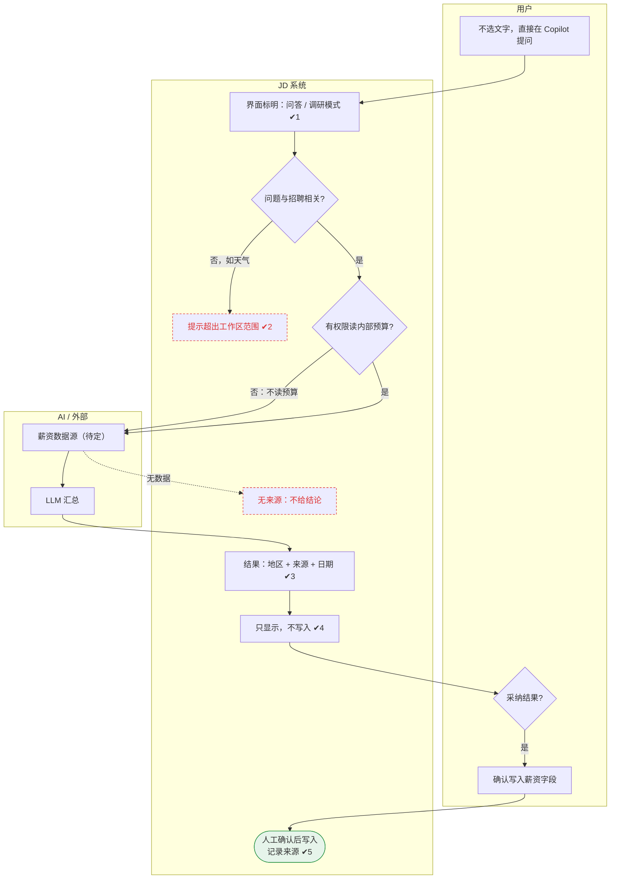

| 断言点 | 检查什么 |
|---|---|
| ✔1 | 不需要选中文字；用户能分辨当前是问答还是编辑 |
| ✔2 | 不调用无关工具 |
| ✔3 | 每个结论都有地区、来源、日期 |
| ✔4 | 未确认前薪资字段不变 |
| ✔5 | 无权用户诱导读取内部预算时拿不到值 |

> 依赖产品决策：薪资数据源；结果是否允许自动写入。

---

### 3.11 M11 生命周期与清理（建议新增）

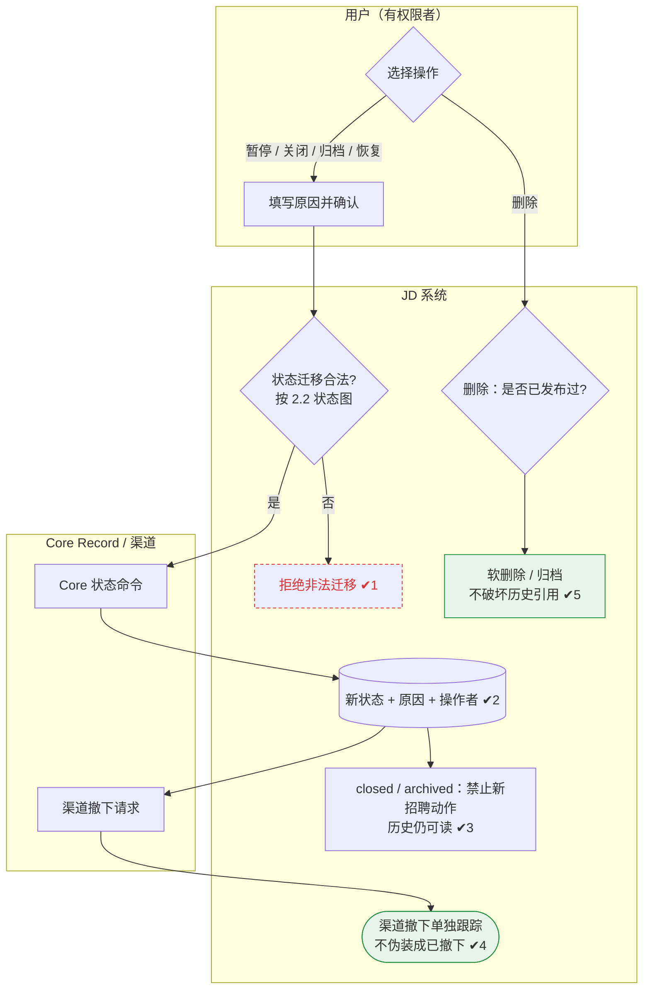

| 断言点 | 检查什么 |
|---|---|
| ✔1 | 非法迁移（如 archived → open）被拒绝 |
| ✔2 | 暂停、关闭、归档、重开都必须填原因 |
| ✔3 | 关闭或归档后不能再发布 |
| ✔4 | 渠道撤下状态与职位状态分开记录 |
| ✔5 | 测试数据（`[UJ-TEST]`）可以被清理，且不留下孤立的版本记录 |

> 当前后端只有 `draft ↔ published`；本闭环先按 2.2 的目标状态写用例，未实现部分标记 known gap。

---

### 3.12 J10 横切套件：叠加到每个闭环

不单独成闭环。每个闭环的测试都要对下列注入点各跑一遍：

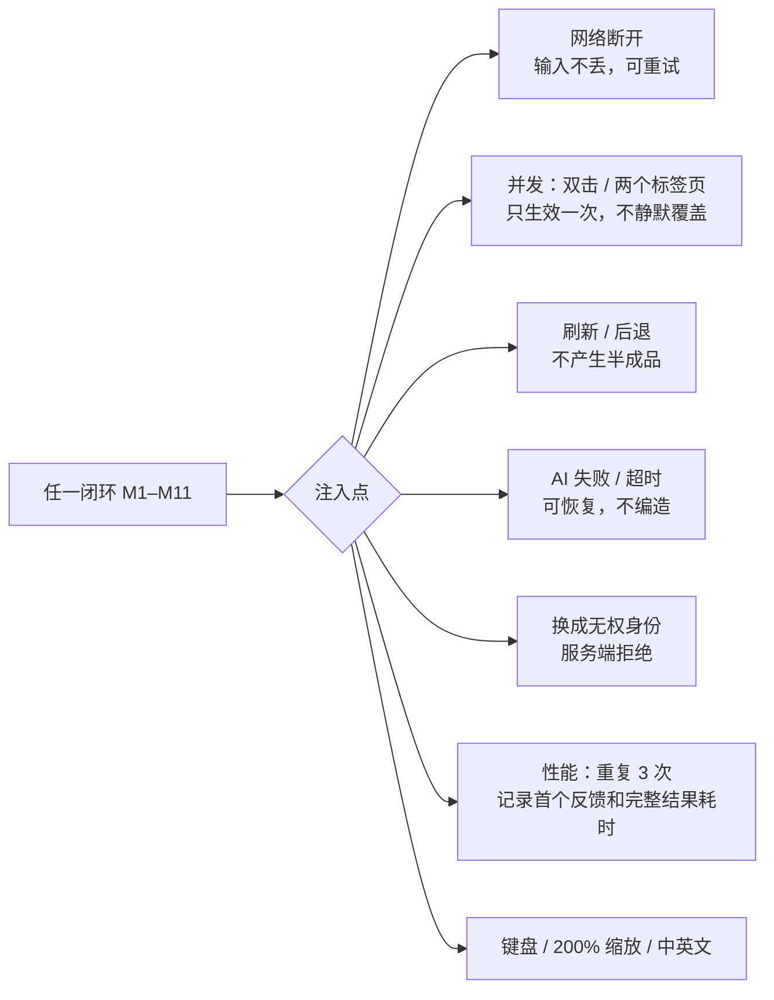

| 注入点 | 通过标准 | 阈值 |
|---|---|---|
| 网络断开 | 有明确失败提示和重试；已输入内容不丢 | — |
| 并发 | 双击只创建一个职位、只发布一个版本；同时编辑不静默覆盖 | — |
| 刷新 / 后退 | 不产生半成品职位，可以继续 | — |
| AI 失败 | 错误可恢复，不显示假成功 | — |
| 无权身份 | API 层拒绝，响应不含敏感正文 | — |
| 性能 | 同一输入 3 次都满足判定条件 | **待确认**（v0.1 建议首个反馈 ≤2 秒、完整结果 ≤20 秒） |
| 可访问性 | 主要流程可以只用键盘完成 | — |
