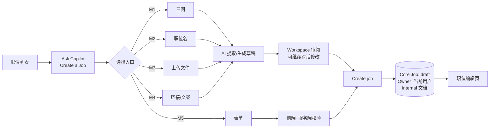
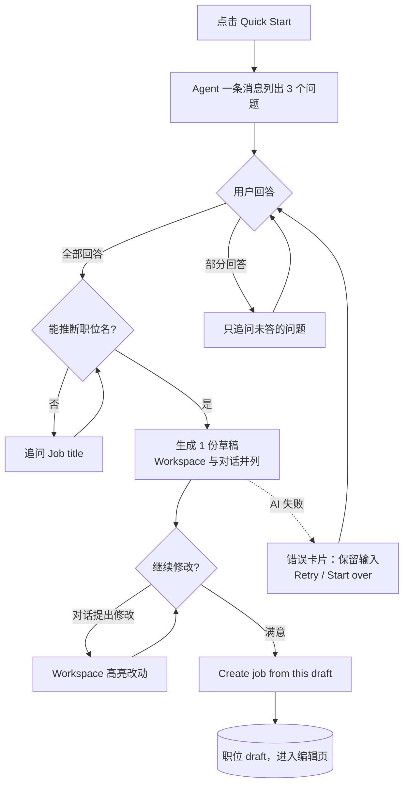
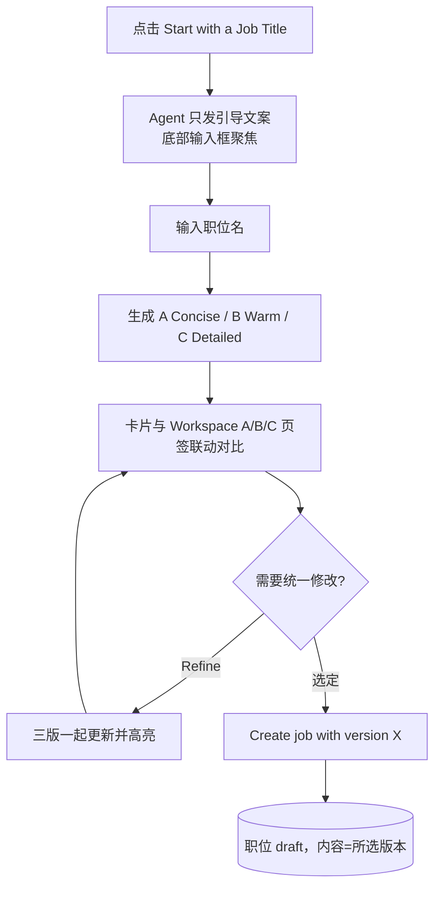
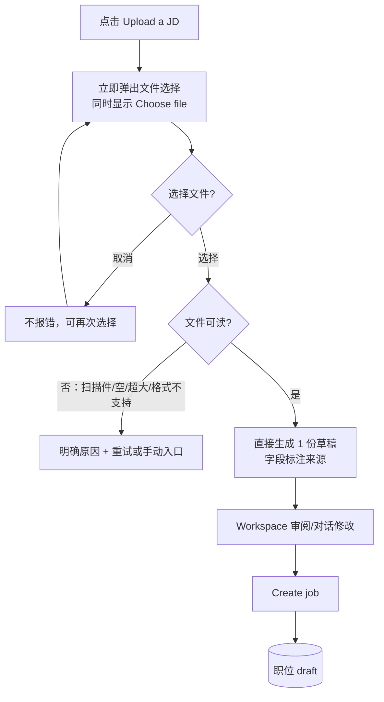
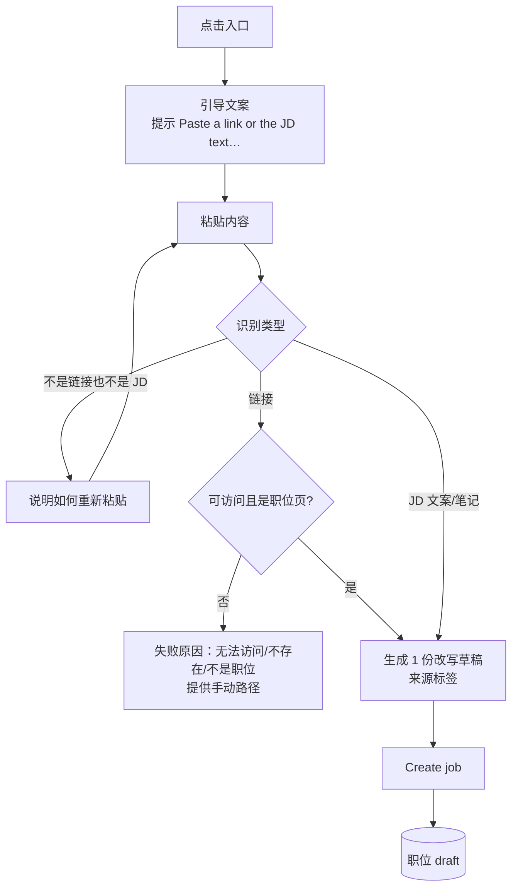
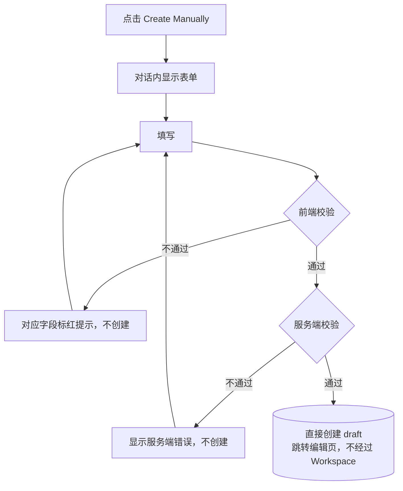
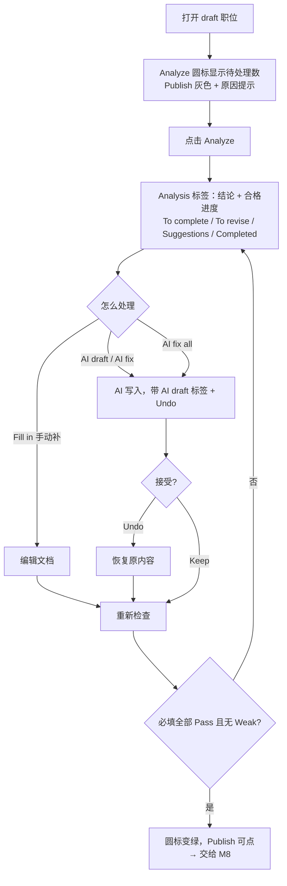
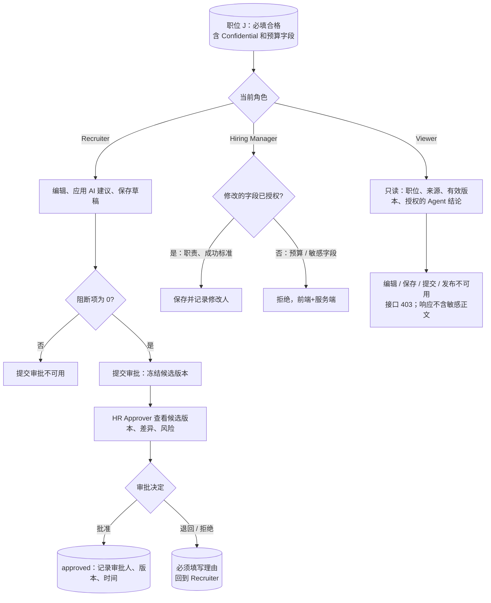
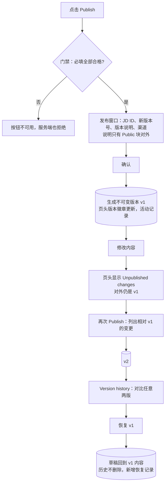
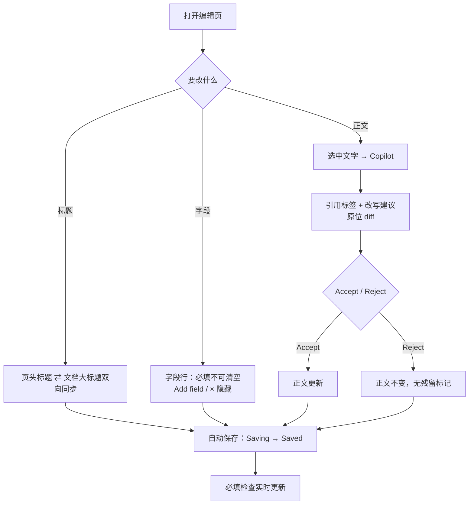

# HireOS Command — JD Management 九模块 User Journey

Doc ID：CMD-JD-UJ-002
版本：v1.0（草稿，待评审）
日期：2026-10-14
范围：按团队拆分的 9 个独立小闭环（M1–M9，对应测试脚本 J1–J9）编写 User Journey，作为 AI 生成 testcase、闭环模拟测试、压力/性能/UI 交互测试的输入。

依据（冲突时按顺序裁定）：

1. **2026-10-14 用户决定**：角色采用本文 §0.1 的四个角色；**恢复审批流程**。这两点覆盖 [#9](https://github.com/JsonSuCoder/HireOSV2/issues/9)（岗位库去掉审批）和 [#15](https://github.com/JsonSuCoder/HireOSV2/issues/15)（工作区级三档权限）中相冲突的部分；#9 的 Owner=创建者 仍有效。需要回写到 #15，并评估是否另开 Issue 恢复岗位库的审批信息
2. [JD 完整性标准 v0.1](HireOS_Command_JD_Completeness_Standard_v0.1.md)
3. 用户旅程与测试脚本 v0.1（正文 v0.2）：J1–J10 步骤与测试数据（已于 #30 删除，测试数据已并入各模块 `Loop_IO.md` 第 2 节）
4. [JD Management PRD v1.3](HireOS_Command_JD_Management_PRD_v1.3.md)、[Interface Spec v1.3](HireOS_Command_JD_Management_Interface_Spec_v1.3.md)
5. [User Journeys v1.0](HireOS_Command_JD_Management_User_Journeys_v1.0.md)、[评审会议总结 2026-10-13](Meeting_Summary_20261013_JD_User_Journey_Review.md)
6. [测试闭环输入/输出清单 v0.1](JD_Test_Loops_IO_v0.1.md)

> 与 v0.1 测试脚本的区别：v0.1 是“怎么点、看到什么”的执行脚本。本文按会议纪要 §4 的 11 项要求补齐**角色目的、用户决定、可见/不可见、输入/输出、交接产物、恢复路径**，并为每个模块给出流程图。步骤级的测试数据仍沿用 v0.1，不重复抄写。

---

## 0. 公共约定

### 0.1 统一角色与权限

| 角色 | 登录后的主要目的 | 核心操作 | 默认限制 |
|---|---|---|---|
| Recruiter / TA | 将招聘需求整理成合格 JD，协调协作者并推动审批/交付 | 创建职位、补全字段、应用 AI 建议、保存草稿、提交审批、追踪发布 | 不能替审批人作出审批结论，不能绕过阻断项提交或发布 |
| Hiring Manager | 说明为什么招、招什么人、成功标准和团队上下文，并确认业务取舍 | 回答追问、编辑授权字段、解决冲突、确认岗位内容、参与审批 | 不能修改未授权预算/敏感字段，不能自动替代 HR 或审批政策发布 |
| HR Approver | 确认内容、预算、风险和流程前置条件已经处理 | 查看候选版本、差异、风险和影响，批准、退回或拒绝 | 不能把 AI 建议当成人工决策；无权限时不能查看 restricted 字段 |
| Viewer | 阅读获授权的 JD、分析结论和当前有效版本 | 查看职位、来源、版本和授权的 Agent 结论 | 不能应用修改、保存、提交审批、发布或查看敏感字段 |

> 2026-10-14 用户决定：采用以上四个角色，并恢复审批流程。这替代了 [#15](https://github.com/JsonSuCoder/HireOSV2/issues/15) 的三档权限和 [#9](https://github.com/JsonSuCoder/HireOSV2/issues/9) 中“去掉审批”的部分。审批流程目前后端没有实现，相关用例在实现前标记为 known gap。

### 0.2 每个模块的写法

每个模块固定包含：**元信息 → 输入 → 流程图 → 步骤 → 可见/不可见 → 异常与恢复 → 输出与交接 → 禁止副作用 → 成功标准 → 测试映射 → 待确认**。

- **输入**分三类：前置数据（seed）、用户数据、外部依赖（需要能模拟成功、失败、超时）。
- **输出**分四类：用户可见结果、持久化数据、记录（AiRun/版本/活动）、交给下一个模块的产物。
- **AI 输出写判定条件，不写固定文字**（同一输入至少跑 2 次）。

### 0.3 测试数据

所有测试职位名加 `[UJ-TEST]` 前缀；输入文本、文件、链接见各模块 `Loop_IO.md` 第 2 节（原 v0.1 §3.2–3.3，已于 #30 删除）。每个模块自己造数据，不依赖其他模块的结果（M6/M8/M9 的前置数据用 seed 脚本或 M5 的表单一步造出）。

### 0.4 创建类模块（M1–M5）的共同骨架

共同规则（M1–M5 都必须满足）：

1. 每个入口标题旁有 “i”，点击只显示说明，不进入入口。
2. 点击入口后，入口标题先作为用户消息出现一次，Agent 随即引导。
3. 在点击 Create / Save **之前**，系统中不存在新职位（刷新、关闭面板后也没有半成品）。
4. 创建后：Core Job `status=draft`，Owner=当前用户，生成 internal 文档；刷新后仍在，职位列表可见。
5. 创建过程不产生发布记录，也不对外发送任何内容。
6. AI 失败时保留用户输入，提供 Retry 和 Start over；New conversation 清空消息和错误状态（对应线上问题 F-001～F-003、#32、#33）。
7. 字段行始终显示 Location、Headcount、Workplace type；未提供时 Location=`Ho Chi Minh City, VN`、Headcount=`1`；未填的选填项不显示。

---

## M1 用 Quick Start 回答三个问题创建职位（P0）

**主角色**：Recruiter / TA（Hiring Manager 也可使用）
**登录目的**：手里只有“为什么招、要解决什么问题”，不知道怎么写完整 JD，希望 AI 帮忙组织成一份草稿。
**入口**：职位列表 → Ask Copilot → Quick Start

### 输入

| 类型 | 内容 |
|---|---|
| 前置数据 | 已登录，无需已有职位 |
| 用户数据 | v0.1 §3.2 的三行回答（中英各一套）；只答两行；推断不出职位名的回答（`Things are messy`…）；只发一个字母 |
| 外部依赖 | LLM（requirement_discovery、jd_generate）；语音转写（可选） |

### 流程

### 步骤

| # | 用户意图与操作 | 系统反馈（可观察） | 用户需要判断 |
|---|---|---|---|
| 1 | 点击 Quick Start | Agent 用**一条消息**同时列出 3 个问题；输入框聚焦 | 自己能回答哪几个 |
| 2 | 只回答前两个 | 只追问第 3 个，不重复问前两个 | — |
| 3 | 补答第 3 个 | 显示“正在生成”；生成 **1 份**草稿；Workspace 与对话并列 | 推断出的职位名是否合理 |
| 4 | 审阅草稿 | 概述 2–4 句、含职位名；职责 ≥3 条、以动词开头；要求包含回答中的硬技能；没有编造的数字 | 哪些内容需要改 |
| 5 | 发送 `add TikTok growth experience and make it remote` | 改动处高亮；工作模式变为 Remote；用户消息只出现一次 | 改动是否符合意图 |
| 6 | 点击 Create job from this draft | 跳转编辑页，提示创建成功；刷新后仍在 | — |
| 7 | （可选）新对话后用麦克风回答 | 允许权限后真实转写并发送；拒绝权限时有提示，不崩溃 | — |

### 可见 / 不可见

- 可见：自己的回答、Agent 追问、草稿、哪些内容是推断的。
- 不可见：其他用户的会话；工作区里其他职位的 Confidential 内容（不能进入 AI 上下文）。

### 异常与恢复

| 场景 | 预期 |
|---|---|
| AI 服务失败（如线上 `Sign-in service is unavailable.`） | 错误卡片说明原因；保留已输入内容；Retry 不会重复创建；Start over 回到五个入口 |
| 生成过程中再次发送消息 | 提示仍在生成；不重复生成或创建 |
| 推断不出职位名 | 追问 Job title；不使用 `New Role` 或空标题 |
| 中途刷新或后退 | 不产生半成品职位；回到可继续的状态 |
| 网络断开 | 有失败提示和重试方式，输入不丢 |

### 输出与交接

| 输出 | 内容 |
|---|---|
| 用户可见 | 职位编辑页，字段行符合 0.4 第 7 条 |
| 持久化 | CopilotConversation + Messages；Core Job（draft，Owner=当前用户）；internal JobDocument |
| 记录 | AiRun（模型、prompt 版本、耗时） |
| 交接 | → M6：一份可能缺 Level、对外薪资等必填项的 draft 职位 |

**禁止副作用**：点 Create 之前就生成职位；生成 3 份草稿；三个问题拆成三条消息逐个问；编造回答里没有的数字或事实。

**成功标准**：只追问缺失项；生成 1 份可编辑草稿；Create 后数据持久化；全程失败可恢复。

**测试映射**：闭环 A1；线上问题 F-001、F-002、F-003、#32、#33。

**待确认**：“已回答”的判定标准；推断字段是否需要在 UI 上标注“AI 推断”。

---

## M2 从职位名称开始，对比三个版本后创建（P0）

**主角色**：Recruiter / TA（Hiring Manager 也可使用）
**登录目的**：已经知道要招什么职位，想快速拿到几种不同写法，选一种最合适的。
**入口**：Ask Copilot → Start with a Job Title

### 输入

| 类型 | 内容 |
|---|---|
| 前置数据 | 已登录 |
| 用户数据 | `Finance Manager`；无法识别的名称 `Chief Tidy Officer`；空串 |
| 外部依赖 | LLM（title-variants、refine-variants） |

### 流程

### 步骤

| # | 用户意图与操作 | 系统反馈 | 用户需要判断 |
|---|---|---|---|
| 1 | 点击入口 | 只有引导文案，没有内嵌输入框和按钮 | — |
| 2 | 发送 `Finance Manager` | 职位名在对话里只出现一次；显示“正在生成” | — |
| 3 | 查看结果 | 3 张选择卡片 + Workspace 顶部 A/B/C 页签，两者联动 | 哪种风格适合公司 |
| 4 | 切换 B、C | 风格明显不同（A 最短、B 面向候选人、C 最详细）；**职位名、地点等事实一致** | — |
| 5 | 选 B，发送 `make it remote` | 三版都变为 Remote 并高亮，仍停留在 B | — |
| 6 | Create job with version B | 创建职位；职责、要求使用 B 版措辞 | — |

### 异常与恢复

空串不触发生成并提示；无法识别的职位名时先确认职位含义再生成；AI 失败同 M1。

### 输出与交接

- 持久化：Core Job（draft）+ internal 文档，内容 = 所选版本；会话记录三个版本和选择结果。
- 交接 → M6。

**禁止副作用**：三版之间事实不一致；创建出的内容与所选版本不同；其他入口也生成 3 个版本。

**成功标准**：只有本入口生成 3 个版本；选择与创建一致；事实不扩散。

**测试映射**：闭环 A2；线上 J2 阻塞（受 F-001/F-002 影响）。

**待确认**：“事实一致”用字段比对还是 LLM 判定；哪些字段允许 AI 填默认值。

---

## M3 上传已有 JD 创建职位（P1）

**主角色**：Recruiter / TA（Hiring Manager 也可使用）
**登录目的**：手里已有 Word/PDF 版 JD，想直接转成系统里的结构化职位，不想重新录入。
**入口**：Ask Copilot → Upload a JD

### 输入

| 类型 | 内容 |
|---|---|
| 前置数据 | 已登录 |
| 用户数据 | `sales-jd.docx/.pdf/.txt`（同一内容三种格式）；扫描版 PDF；空文件；超过上限的文件（代码上限 10MB）；`.png`/`.zip`；含提示注入的 JD |
| 外部依赖 | 文件解析（pdf-parse、docx）；LLM（jd_parse） |

### 流程

### 步骤

| # | 用户意图与操作 | 系统反馈 | 用户需要判断 |
|---|---|---|---|
| 1 | 点击入口 | **立即弹出**系统文件选择窗口；同时出现引导文案和 Choose file | — |
| 2 | 取消，再点 Choose file | 再次弹出，不报错 | — |
| 3 | 选择 `sales-jd.docx` | 无额外配置，直接生成 1 份草稿；职位名 `Sales Manager`；职责/要求/加分项取自文件 | 提取是否准确 |
| 4 | 查看地点与工作模式 | `Singapore`、`Remote`（取自文件，不是默认值） | — |
| 5 | 查看概述 | 是正常的岗位介绍，不是 “Adapted from…”；来源单独显示 | — |
| 6 | 分别上传 PDF、TXT | 三种格式解析出的职位名、职责、要求一致 | — |
| 7 | 上传异常文件 | 扫描件提示无法识别文字；空/超大/不支持格式都有明确提示并可重试；不生成空草稿 | 换文件还是转手动 |

### 输出与交接

- 持久化：附件记录（文件名、类型、大小、提取状态）；草稿；Create 后 Core Job + 文档。
- 交接 → M6。

**禁止副作用**：解析失败生成空草稿或编造内容；文件里的指令改变 AI 行为；上传完成就视为已创建。

**成功标准**：点击入口即弹出选择；三种格式结果一致；异常文件都有可操作的提示。

**测试映射**：闭环 A3；线上问题 F-006。

**待确认**：正式支持的格式和大小上限（代码 10MB，文档未写）；扫描件是否 OCR；是否做病毒/安全检查。

---

## M4 粘贴链接或文案创建职位（P1）

**主角色**：Recruiter / TA（Hiring Manager 也可使用）
**登录目的**：看到别家公开职位或手上有会议笔记，想改写成自己公司的草稿。
**入口**：Ask Copilot → Paste a Link or Text

### 输入

| 类型 | 内容 |
|---|---|
| 前置数据 | 已登录 |
| 用户数据 | `not a link`；可访问的公开职位链接；需登录页、404、非职位页、`ftp://`、无协议文本；v0.1 §3.2 的“粘贴文案”；内网地址（SSRF 检查） |
| 外部依赖 | 外部 HTTP（测试用本地 mock 服务）；LLM |

### 流程

### 步骤

| # | 用户意图与操作 | 系统反馈 | 用户需要判断 |
|---|---|---|---|
| 1 | 点击入口 | 只有引导文案；底部提示 `Paste a link or the JD text…` | — |
| 2 | 发送 `not a link` | 提示这不是链接或 JD，停留在本步 | — |
| 3 | 发送可访问链接 | 链接只显示一次；真实读取页面；职位名、职责与页面一致；来源标签标明链接 | 内容是否可借鉴 |
| 4 | 发送需登录页、404、非职位页 | 分别给出原因，不编造草稿 | — |
| 5 | 新对话，粘贴“粘贴文案” | 职位名 `Customer Success Manager`；3 条职责、2 条要求、1 条加分项；`Hanoi, VN`、`Hybrid` | — |
| 6 | 检查改写 | 原创表述，没有大段照搬 | — |

### 输出与交接

- 持久化：链接读取记录（URL、状态、读取时间）；草稿；Create 后 Core Job + 文档。
- 交接 → M6。

**禁止副作用**：页面打不开时编造内容；内网地址或 file:// 能被读取；大段复制原文。

**成功标准**：链接真实抓取、文案真实解析；所有失败都不编造。

**测试映射**：闭环 A4；线上问题 F-007。

**待确认**：“太短/不可识别”的阈值；外链抓取的授权和版权边界；“照搬”的判定阈值。

---

## M5 手动表单创建职位（P0）

**主角色**：Recruiter / TA（Hiring Manager 也可使用）
**登录目的**：不想用 AI，要逐字段自己控制内容。
**入口**：Ask Copilot → Create Manually

### 输入

| 类型 | 内容 |
|---|---|
| 前置数据 | 已登录 |
| 用户数据 | v0.1 §3.2 表单数据；HC=`0`/`1.5`/`-1`；薪资最小 40 > 最大 25；职责只填 `1.` 或空行；`3+ years in sales`；绕过前端直接调接口的非法数据 |
| 外部依赖 | 无（必须断言没有调用 LLM） |

### 流程

### 步骤

| # | 用户意图与操作 | 系统反馈 | 用户需要判断 |
|---|---|---|---|
| 1 | 点击入口 | 对话内出现表单；标出必填和选填 | 需要准备哪些信息 |
| 2 | 空表单点 Save | 职位名标红提示，不创建 | — |
| 3 | HC 填 `0`、`1.5`、`-1` | 都被拒绝：必须是 ≥1 的整数 | — |
| 4 | 职责、要求依次留空保存 | 分别标红，不创建；只填 `1.` 或空行视为空 | — |
| 5 | 薪资最小 40、最大 25 | 最大值标红：不能低于最小值 | — |
| 6 | 补齐合法数据，薪资 25–40、周期 Hour | 直接创建并跳转编辑页；薪资显示 `USD 25–40 per hour` | — |
| 7 | 要求写 `3+ years in sales` | 保存后原样保留 `3+` | — |
| 8 | 绕过前端提交 HC=0 | 服务端拒绝，不产生脏数据 | — |

### 输出与交接

- 持久化：Core Job（draft）+ internal 文档，表单内容原样进入对应章节；记录操作者和时间。
- 记录：**没有** AiRun。
- 交接 → M6（缺少的必填项交给 Analyze 检查）。

**禁止副作用**：调用 AI；前端拦住了但服务端放行；校验失败仍创建。

**成功标准**：必填项逐项生效且服务端也校验；保存结果与表单一致。

**测试映射**：闭环 A5；线上问题 F-008、F-009、#34（创建失败时静默生成本地假职位，已由 #38 修复，需回归）。

**待确认**：必填项以哪套为准：v0.1 写 5 项（无概述），线上表单（测试报告 E8）包含 Role summary 和 Level，完整性标准有 9 项必填，原型 README 写 11 项。

---

## M6 补全必填项，用 Analyze 和 AI 修复，直到可以发布（P0）

**主角色**：Recruiter / TA；Hiring Manager 确认业务内容；Viewer 只读
**登录目的**：把一份不完整的草稿补到“可以发布”的状态，并且清楚还差什么。
**入口**：职位列表 → 打开 draft 职位 → 编辑页工具栏 Analyze

### 输入

| 类型 | 内容 |
|---|---|
| 前置数据（seed 三档） | ①缺多项必填（缺 Role summary、Level、对外薪资）②只差 1 条待修改 ③全部合格 |
| 用户数据 | 触发待修改（Weak）规则的文本：`Must have strong communication skills`、只有一句的概述、Junior 要求 5 年+、Remote 不写地区、营销词、职责少于 3 条或以 Responsible for 开头 |
| 外部依赖 | LLM（quality_review、AI draft、AI fix） |

### 流程

### 步骤

| # | 用户意图与操作 | 系统反馈 | 用户需要判断 |
|---|---|---|---|
| 1 | 打开职位 | Analyze 圆标显示需处理项数；Publish 灰色，悬停提示还差 N 项 | 还差多少 |
| 2 | 浏览文档 | 缺失项以红色虚线占位块出现在默认章节顺序的位置，提供 AI draft / Fill in | 自己写还是让 AI 写 |
| 3 | 点击 Analyze | 处理中状态；完成后自动切到 Analysis，显示分析时间 | — |
| 4 | 查看 Analysis | 顶部结论 + 合格进度；四个分组；Completed 默认展开 | 先处理哪项 |
| 5 | AI fix all | 缺失与待修改项被处理；AI 内容带 `AI draft · Keep` 标签；出现 Undo；滚动位置不变 | AI 写的是否可信 |
| 6 | 检查 AI 内容 | 概述 2–4 句；职责 ≥3；要求 ≥3 且可验证；没有编造的数字 | — |
| 7 | Undo | 恢复到处理前 | — |
| 8 | 加一条 `Must have strong communication skills` | To revise 出现“无法验证”；文档内黄色提示条 | — |
| 9 | 单项 AI fix | 改写为可验证表述；To revise 清空 | — |
| 10 | 补齐所有项 | 圆标变绿；Publish 可点 | — |
| 11 | 刷新 | 内容和检查状态一致 | — |

### 可见 / 不可见

- Viewer：Analysis 可读，但 AI fix、Fill in、Publish 不可用，也看不到敏感字段。
- Hiring Manager：只能修改获授权字段，不能修改预算/敏感字段。
- Confidential 块不交给 AI 改写（完整性标准 §1.3）。

### 异常与恢复

| 场景 | 预期 |
|---|---|
| Analyze 时 AI 失败 | 保留上一次结果并标注时间；可重试；不把失败显示成“全部通过” |
| AI fix 重复点击 | 不重复写入 |
| 文档在分析后又被修改 | 分析结果标记为过期，需重新 Analyze |

### 输出与交接

| 输出 | 内容 |
|---|---|
| 用户可见 | 结论 Ready / Needs work / Blocked；Publish 可点状态 |
| 持久化 | 文档 revision；AI 建议的接受/撤销记录；分析结果与分析时间 |
| 交接 | → M8：一份全部必填合格、可以发布的草稿 |

**禁止副作用**：有阻断项时 Publish 可点；全部合格后 Publish 仍是灰色；只靠前端控制门禁（服务端必须拒绝不合格的发布请求）；AI 内容不经确认直接成为正式内容。

**成功标准**：Publish 的可点状态始终与“必填全部合格且无待修改项”一致，服务端同样校验。

**测试映射**：闭环 B3、B1（单项 AI fix 的 diff）；线上问题 F-010、F-011。

**待确认**：门禁以完整性标准（9 项必填）还是原型的 11 项为准；Weak 规则是确定性规则还是 LLM 判定（决定能否精确断言）；概述句数规则（标准 2–4 句，原型超过 5 句才提示）。

---

## M7 角色与权限：不同角色看到和能做的不同（P0）

> 本模块按 §0.1 的四个角色编写（Recruiter / TA、Hiring Manager、HR Approver、Viewer）。2026-10-14 已决定恢复审批；审批流程后端尚未实现，相关用例先标记为 known gap。

**主角色**：Recruiter / TA（发起）；Hiring Manager、HR Approver、Viewer（验证各自的可见内容和操作）
**登录目的**：每个角色登录后只看到、只能做自己职责内的事情；敏感信息只给有权限的人，审批结论只能由审批人作出。
**入口**：职位编辑页；待我审批 / 待我确认列表

### 输入

| 类型 | 内容 |
|---|---|
| 前置数据 | 四个账号：Recruiter R、Hiring Manager H、HR Approver A、Viewer V；R 创建的职位 J，必填全部合格，含 Confidential 块 `Internal budget ceiling: 100000 USD`，含一个预算字段 |
| 用户数据 | H 修改职责（授权字段）和预算（未授权字段）；R 提交审批；A 批准 / 退回 / 拒绝；V 尝试编辑、保存、发布 |
| 外部依赖 | 登录服务（邮箱验证码，#16）；角色分配方式（待确认） |

### 流程

### 步骤

| # | 用户意图与操作 | 系统反馈 | 用户需要判断 |
|---|---|---|---|
| 1 | R 打开职位 J | 可编辑；可见 Confidential；可以保存草稿、应用 AI 建议 | — |
| 2 | R 在有阻断项时尝试提交审批 | 提交审批不可用，并说明原因；服务端也拒绝 | — |
| 3 | R 清除阻断项后提交审批 | 生成待审批的候选版本；显示审批人；R 不能自己批准 | 提交哪个版本 |
| 4 | H 打开职位 J，修改职责 | 保存成功，记录修改人和时间 | 业务内容是否准确 |
| 5 | H 尝试修改预算字段 | 字段只读；直接调用接口返回 403 | — |
| 6 | A 从待我审批进入候选版本 | 看到内容、与上一版的差异、风险和可见范围 | 是否批准 |
| 7 | A 退回或拒绝时不填理由 | 不能提交 | — |
| 8 | A 批准 | 记录审批人、精确版本、时间；AI 不能作为审批人 | — |
| 9 | 无 restricted 权限的 A 打开职位 | restricted 字段不可见 | — |
| 10 | V 打开职位 J | 只读；看不到 Confidential 和敏感字段；没有编辑类按钮 | — |
| 11 | V 查看 Network 响应 | 响应中**不含** Confidential 正文 | — |
| 12 | V 直接调用编辑、保存、提交、发布接口 | 都返回 403 | — |
| 13 | 审批进行中，R 修改了内容 | 旧审批请求作废（superseded），需要重新提交；A 无法再对旧版本作出决定 | 是否重新提交 |
| 14 | 审批超时未处理 | 按审批规则提醒审批人 | — |

### 输出与交接

- 持久化：角色分配记录；审批请求和审批决定（审批人、版本、时间、理由）；角色变更与审批审计。
- 交接：角色矩阵作为 M1–M9 所有模块的身份前置条件；批准后的版本交给 M8 发布。

**禁止副作用**：只靠前端隐藏敏感内容；Recruiter 自己批准自己提交的版本；AI 建议被当成审批结论；角色撤销后仍能看到缓存内容。

**成功标准**：每个角色的可见内容和可执行操作与 §0.1 一致，且由服务端保证；审批结论只能由 HR Approver 人工作出。

**测试映射**：闭环 D1、D2、D3、D5、B5、I1；线上问题 F-004、F-014、F-015；Issue #9、#15、#16。

**待确认**：
1. ~~采用哪套角色模型~~：2026-10-14 已决定采用 §0.1 四角色。
2. ~~审批流程是否恢复~~：2026-10-14 已决定恢复。
2a. 审批超时是 24 小时还是 48 小时；超时是提醒、升级，还是自动生效（会议纪要待确认）。
2b. 审批步骤：只有 HR Approver 一步，还是 Hiring Manager → HR 两步（PRD §6.2 默认两步）。
2c. 岗位库是否恢复审批状态列（#9 已去掉）。
3. 角色由谁分配、在哪里分配；一个人能否同时有多个角色。
4. Hiring Manager 的“授权字段”具体是哪些。
5. Viewer 能否评论。

---

## M8 发布与版本：发布 v1、修改、发布 v2、对比与恢复（P0）

**主角色**：Recruiter / TA（发布）；HR Approver（发布前审批，见 M7）
**登录目的**：把合格的 JD 发布出去，之后的修改可以追溯、对比，必要时能回到旧版本。
**入口**：职位编辑页 → Publish；页头 → Version history

### 输入

| 类型 | 内容 |
|---|---|
| 前置数据 | 一份全部合格的草稿（seed，或 M6 的结果），含 Public / Internal / Confidential 三种块 |
| 用户数据 | 版本说明；修改一条要点；修改某块的可见范围 |
| 外部依赖 | 发布渠道（**线上暂无**；先用测试渠道或“仅生成版本”模式） |

### 流程

### 步骤

| # | 用户意图与操作 | 系统反馈 | 用户需要判断 |
|---|---|---|---|
| 1 | 点击 Publish | 窗口显示 JD 唯一 ID（JD-年份-编号）、新版本号、可选说明、渠道；说明只有 Public 块对外 | 发布到哪里 |
| 2 | 填说明并确认（只选测试渠道） | 发布成功；版本徽章更新；活动记录新增一条 | — |
| 3 | 打开对外页面 | 只有 Public 内容；没有 Internal 和 Confidential | 对外内容是否合适 |
| 4 | 修改一条要点 | 页头出现 `Unpublished changes`；对外仍是旧内容 | — |
| 5 | 再次 Publish | 版本号 +1；窗口列出本次相对上一版的变更 | 变更是否都要发布 |
| 6 | 版本页对比两版 | 显示新增、删除、修改、可见范围变化 | — |
| 7 | 恢复到旧版本 | 草稿回到旧版内容；历史版本保留；新增恢复记录 | — |
| 8 | 撤回测试渠道 | 对外页面下线，记录撤回时间 | — |

### 异常与恢复

| 场景 | 预期 |
|---|---|
| 双击 Publish | 只生成一个版本（幂等键） |
| 渠道超时或无回执 | 显示结果未知，主操作是查询状态，不默认重发 |
| 发布时网络断开 | 不显示成功；恢复后可以查询实际结果 |

### 输出与交接

| 输出 | 内容 |
|---|---|
| 持久化 | JobDocumentVersion（版本号、内容哈希、发布者、时间、说明）；Job 状态 draft→published（Core 为 open）；JD 唯一 ID |
| 记录 | 活动记录：发布、恢复、撤回 |
| 交接 | 对外：只含 Public 块的精确版本；对下游（筛选/面试）：引用精确的版本号，而不是“最新版” |

**禁止副作用**：Internal/Confidential 内容出现在对外页面；修改已发布的版本内容；恢复时删除历史；不合格时服务端放行发布。

**成功标准**：每次发布生成新的不可变版本；对外只有 Public 内容；历史可追溯、可对比、可恢复。

**测试映射**：闭环 F1、E1、E2、E4（部分）；线上问题 F-005、F-013。

**待确认**：测试渠道是哪个、怎么控制对外影响；后端是否已有恢复接口；发布前必须经过 HR Approver 审批（2026-10-14 已决定恢复审批）。

---

## M9 编辑职位：字段、标题联动与 Copilot 改写（P1）

**主角色**：Recruiter / TA；Hiring Manager 编辑授权字段
**登录目的**：在一个页面里改好 JD 的标题、字段和正文，并让 Copilot 帮忙改写选中的段落。
**入口**：职位编辑页

### 输入

| 类型 | 内容 |
|---|---|
| 前置数据 | 一个已有的 draft 职位（seed） |
| 用户数据 | 新标题 `[UJ-TEST] Staff Backend Engineer`；Location 清空 / `Remote`；Add field 选 Recruiter；Level 设为 Not set；选中一段文字 + `Rewrite this`；中英文切换 |
| 外部依赖 | LLM（rewrite） |

### 流程

### 步骤

| # | 用户意图与操作 | 系统反馈 | 用户需要判断 |
|---|---|---|---|
| 1 | 改页头标题 | 文档第一行大标题同步；必填检查仍通过 | — |
| 2 | 改文档大标题 | 页头标题同步 | — |
| 3 | 清空 Location | 提示不能为空，值恢复 | — |
| 4 | Location 改为 `Remote` | Analysis 出现 To revise：需写明地区或时区 | 补哪个地区 |
| 5 | Add field | 菜单不含已显示字段和 Workplace type；加上 Recruiter 后一直显示 | — |
| 6 | 点字段 × | 字段隐藏，可从 Add field 加回 | — |
| 7 | Level 设为 Not set | Level 不显示 | — |
| 8 | 拖动右侧面板边缘 | 宽度在 300px 到窗口 60% 之间；刷新后保持 | — |
| 9 | 选中一段，在 Copilot 输入 `Rewrite this` | 输入框上方出现引用标签；原位显示改写差异；内容只基于选中文字 | 接受还是拒绝 |
| 10 | 切换到中文界面 | 入口、字段、检查提示都有中文，没有残留英文 | — |

### 可见 / 不可见

- 选中 Confidential 块时，Copilot 输入框不可用，并提示不能读取保密内容；网络请求里没有该块正文（v0.1 E6）。
- Viewer：全部只读，没有编辑类按钮。
- Hiring Manager：预算/敏感字段只读。

### 异常与恢复

| 场景 | 预期 |
|---|---|
| 保存失败或断网 | 显示 Offline / Save failed，内容不丢，恢复后重试成功；不显示 Saved |
| 两个标签页同时编辑同一职位 | 不静默覆盖：提示冲突，或后保存者能看到对方修改 |
| AI 改写时停止生成 | 不留下半截建议进正文 |

### 输出与交接

- 持久化：Core Job 字段（title/location/HC/level 等，Core 字段名）；文档 revision；建议的 accepted/rejected 状态。
- 交接 → M6（修改后重新检查）→ M8（产生 Unpublished changes）。

**禁止副作用**：AI 改写未经 Accept 就覆盖正文；改写内容超出选区却没有说明；保存失败仍显示 Saved；Confidential 内容进入 AI 请求。

**成功标准**：编辑、保存、刷新、返回列表后，标题、Location、HC、Workplace type 一致；Copilot 改写只作用于选区并由用户确认。

**测试映射**：闭环 B1、B5、B6、C3；线上问题 F-012、F-016、F-017。

**待确认**：并发编辑的预期行为（冲突提示还是自动合并）；documents 接口是否有版本校验。

---

## 10. 对九模块拆法的评估

### 10.1 结论

九个模块对**创建和单人编辑发布主流程**覆盖较完整，每个模块都能独立造数据、独立断言，适合做闭环测试。主要问题有两个：

1. **前 5 个创建模块共用同一套骨架**（0.4 节）。测试时建议共享一套“创建后断言”，每个模块只测各自的差异部分，避免同一个断言写 5 遍。
2. **有几块需求没有落到任何模块里**（见 10.3）。

### 10.2 测试闭环清单与九模块的对应

| 模块 | 覆盖的闭环（见 JD_Test_Loops_IO_v0.1） |
|---|---|
| M1–M5 | A1–A5 |
| M6 | B3、B1（部分） |
| M7 | D1、D2、B5、I1（部分） |
| M8 | F1、E1、E2、E4（部分） |
| M9 | B1、B5、B6、C3 |
| J10 异常专项 | 横切到各模块：网络、并发、幂等、持久化、性能 |

### 10.3 建议补充的模块

| 建议 | 理由 | 优先级 |
|---|---|---|
| **M10 招聘问答与市场薪资调研**（闭环 B2） | 会议纪要列为 P0：不选文字也能问；带来源的薪资调研；确认后写入薪资字段。现在没有任何模块覆盖 | P0 |
| **M11 职位生命周期与清理**（闭环 E4） | 暂停、关闭、归档、删除（列表里已有 delete）；测试数据也需要清理路径 | P1 |
| **J10 保留为横切套件，不算独立模块** | 网络、并发、幂等、性能、可访问性要叠加到 M1–M9 每个模块上跑 | — |

以下**暂不建模块**，产品方向确定后再加：激活与转派（D4，以及 D5 的转派部分；D1–D3 和超时提醒已并入 M7）、评论与 Suggesting 协作（C1、C2）、模板/克隆创建（A6）、Files 未关联上传（A7）、下游影响复核（F2–F4）、首页统计与 My Tasks（G2、G3）、设置中心的外观、连接、模型、通知（H1–H3、H5）。

---

## 11. 汇总待确认

1. 必填项口径：v0.1 的 5 项 / 完整性标准 9 项 / 原型 README 11 项 / 线上表单字段，以哪个为准？（M5、M6）
2. 角色与审批：2026-10-14 已决定采用 §0.1 四角色并恢复审批。仍待确认：角色由谁、在哪里分配；审批步骤和超时规则；岗位库是否恢复审批状态列；restricted 的服务端过滤方案。（M7、M8）
3. 发布测试渠道，以及如何控制对外影响。（M8）
4. 文件格式和大小上限、是否 OCR。（M3）
5. 链接抓取的授权、版权边界和 SSRF 策略。（M4）
6. 并发编辑的预期行为。（M9）
7. 性能验收阈值（v0.1 E11 建议首个反馈 ≤2 秒、完整结果 ≤20 秒，尚未确认）。（全部）
8. 是否增加 M10 招聘问答与薪资调研、M11 生命周期与清理。
