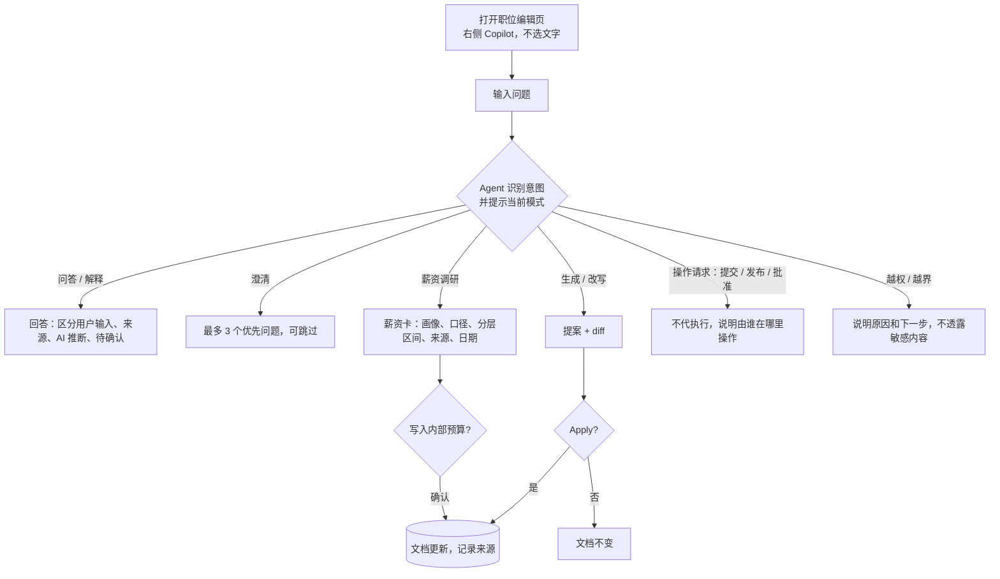

# M10 User Journey：JD Copilot Agent 问答、调研与行为边界

| 项 | 内容 |
|---|---|
| 模块 | M10 |
| 版本 / 日期 | v1.0 / 2026-10-14（草稿，待评审） |
| 同目录文档 | [产品文档](PRD.md) · [输入输出闭环](Loop_IO.md) |
| 来源 | JD Copilot Agent PRD v0.3（外部文档）；[JD AI Agent 用户问题清单](../JD_AI_Agent_Question_Catalog.md)；[评审会议总结](../Meeting_Summary_20261013_JD_User_Journey_Review.md) |

## 角色与权限（公共，摘自 [九模块 User Journey §0.1](../HireOS_Command_JD_Management_Module_User_Journeys_v1.0.md)）

| 角色 | 登录后的主要目的 | 核心操作 | 默认限制 |
|---|---|---|---|
| Recruiter / TA | 将招聘需求整理成合格 JD，协调协作者并推动审批/交付 | 创建职位、补全字段、应用 AI 建议、保存草稿、提交审批、追踪发布 | 不能替审批人作出审批结论，不能绕过阻断项提交或发布 |
| Hiring Manager | 说明为什么招、招什么人、成功标准和团队上下文，并确认业务取舍 | 回答追问、编辑授权字段、解决冲突、确认岗位内容、参与审批 | 不能修改未授权预算/敏感字段，不能自动替代 HR 或审批政策发布 |
| HR Approver | 确认内容、预算、风险和流程前置条件已经处理 | 查看候选版本、差异、风险和影响，批准、退回或拒绝 | 不能把 AI 建议当成人工决策；无权限时不能查看 restricted 字段 |
| Viewer | 阅读获授权的 JD、分析结论和当前有效版本 | 查看职位、来源、版本和授权的 Agent 结论 | 不能应用修改、保存、提交审批、发布或查看敏感字段 |

> 2026-10-14 用户决定：采用以上四个角色，并恢复审批流程。这替代了 [#15](https://github.com/JsonSuCoder/HireOSV2/issues/15) 的三档权限和 [#9](https://github.com/JsonSuCoder/HireOSV2/issues/9) 中“去掉审批”的部分。审批流程目前后端没有实现，相关用例在实现前标记为 known gap。

# 旅程

**主角色**：Recruiter / TA、Hiring Manager、HR Approver、Viewer（每个角色一段旅程，可以独立测试）
**登录目的**：在编辑 JD 的过程中随时向 Copilot 提问，得到有依据、分得清事实和推断的回答；需要改内容时拿到可审阅的提案；需要市场信息时拿到带来源的调研结果。
**入口**：职位编辑页右侧 Copilot 标签（不需要选中文字）；职位列表 → Ask Copilot

## 输入

| 类型 | 内容 |
|---|---|
| 前置数据 | 一个必填齐全、有 1 条 Weak 的职位（含 Confidential 块 `Internal budget ceiling: 100000 USD`）；四个角色的测试账号 |
| 用户数据 | [问题清单](../JD_AI_Agent_Question_Catalog.md) 中的问题，按角色选取（见各段旅程） |
| 外部依赖 | LLM；市场薪资数据源（待定）；对标 JD 来源（待定）；公司画像库（待定） |

## 总流程

## 旅程 1：Recruiter 调研市场薪资并写入预算

**目的**：填薪资前想知道市场水平和当前预算是否合理，不想离开系统去用别的工具（会议纪要 §3.1）。

| # | 用户意图与操作 | 系统反馈（可观察） | 用户需要判断 |
|---|---|---|---|
| 1 | 不选文字，问 SAL-03“这个岗位的 P25、P50、P75 薪资分别是多少？” | 界面显示当前为调研模式、上下文为整份文档 | — |
| 2 | （职位缺地点或职级时） | Agent 先追问缺失的画像字段，不直接给数字 | 补充哪个地点 / 职级 |
| 3 | 补充信息 | 薪资卡逐条列职位、职级、地区、口径、来源、采集日期、样本量、换算方法和分层配置版本；仅证据充分时显示分位，企业资料不足标未分类 | 数据是否可信，口径是否和公司一致 |
| 4 | 问 SAL-36“每条结论的来源和日期？” | 逐条列出来源和日期；样本不足的结论标为估算 | — |
| 5 | 点击把建议薪资带应用到内部预算 | 确认框列出写入的字段和值；确认后写入，记录来源 | 是否采纳 |
| 6 | 问 SAL-75“同时生成内部薪资建议和对外公开范围” | 对外范围作为单独提案，需要另行确认；市场来源不进入对外版本 | 对外公开多少 |

**数据不足时**：薪资卡标记“证据不足”，列出可用来源和局限，不给精确 P25/P50/P75。

## 旅程 2：Hiring Manager 把业务目标转成职责，并核对 AI 推断

**目的**：只知道团队缺什么，需要 AI 帮忙梳理成职责和要求，同时清楚哪些是自己说的、哪些是 AI 猜的。

| # | 用户意图与操作 | 系统反馈 | 用户需要判断 |
|---|---|---|---|
| 1 | 问 HM-05“职责还不明确，你能通过提问帮我梳理吗？” | 最多 3 个优先问题 | 先回答哪些 |
| 2 | 回答一部分，对一个问题选“先跳过” | 只追问剩下的；跳过的字段保持未确认 | — |
| 3 | 说 HM-17“只改职责部分，其他不要动” | 提案只涉及职责章节，以 diff 呈现 | 是否接受 |
| 4 | 问 HM-18“哪些是你推断的？” | 逐项标注：用户输入 / AI 推断 | 推断是否准确 |
| 5 | 问 HM-19“列出需要我确认的假设” | 按优先级列出，注明确认人 | — |
| 6 | 试图让 Agent 修改预算 | 说明 Hiring Manager 不能修改预算字段，建议联系有权限的人 | — |

## 旅程 3：HR Approver 审批前做合规检查

**目的**：审批前快速确认 JD 是否符合公司标准、有没有歧视性表达或内部信息泄露到外部版本。

| # | 用户意图与操作 | 系统反馈 | 用户需要判断 |
|---|---|---|---|
| 1 | 问 HR-02“是否缺少必填字段？” | 回答与 Analyze 结果一致 | — |
| 2 | 问 HR-03 / HR-05“是否有歧视性表达，‘年轻、有活力’合适吗？” | 指出具体位置并给出替代表达（提案形式） | 是否要求退回修改 |
| 3 | 问 HR-12“内部敏感内容有没有出现在外部版本？” | 逐项检查并定位；无权查看的 restricted 内容不展示 | — |
| 4 | 说“帮我批准这份 JD” | 不代为执行；说明批准需要审批人本人在审批页面操作 | 自己去审批 |

## 旅程 4：Viewer 理解 JD 内容

**目的**：面试前读懂岗位要求，知道自己为什么看不到某些内容。

| # | 用户意图与操作 | 系统反馈 | 用户需要判断 |
|---|---|---|---|
| 1 | 问 V-07“帮我总结这份 JD” | 只基于自己有权查看的内容总结 | — |
| 2 | 问 V-08“解释一下这项任职要求” | 给出解释，不修改文档 | — |
| 3 | 问 V-03“为什么我看不到薪资？” | 说明因权限不可见，并给出下一步；不透露预算 | 是否申请权限 |
| 4 | 说 V-11“帮我直接改一下职责” | 说明 Viewer 不能修改；没有 Apply 按钮 | — |

## 可见 / 不可见

- Agent 能看到的内容须同时满足当前用户的角色、职位范围、字段授权和 Workspace AI 政策。Viewer、无 restricted 权限的 HR Approver 提问时，模型输入里没有 Confidential / restricted 正文。
- Agent 不使用其他职位（除非用户明确引用且有权限）或其他 Workspace 的信息。

## 异常与恢复

| 场景 | 预期 |
|---|---|
| AI 服务失败 | 错误提示，保留输入，可 Retry；手动编辑不受影响（X-04） |
| 停止生成 | 保留已输入内容；半截提案不能接受 |
| 重试 | 产生新提案，不重放已执行的操作，不重复创建（X-06、X-07） |
| 附件或链接中含指令 | 不执行，回答不受影响 |
| 薪资数据源不可用 | 说明不可用，不给数字；其他问答不受影响 |
| 对标页面无法访问 | 如实提示，不编造对比 |

## 输出与交接

| 输出 | 内容 |
|---|---|
| 用户可见 | 回答、追问、提案、薪资卡、对标结果 |
| 持久化 | 会话与消息；接受的提案（文档 revision）；写入的预算字段及来源 |
| 记录 | AiRun；每次建议与应用的来源、时间、操作者 |
| 交接 | 提案被接受后 → M6 重新检查；预算写入后 → M7 审批时可见；对外公开薪资 → M8 发布 |

**禁止副作用**：未经确认写入任何字段；代为提交审批、批准或发布；把推断写成事实；向无权用户透露敏感内容；没有来源时给出精确薪资数字。

**成功标准**：问题清单中的常见问题都能得到正确类别的处理（回答 / 追问 / 提案 / 引导操作 / 拒绝）；所有写入都经过用户确认；回答可追溯。

**测试映射**：闭环 M10a～M10e（见 [Loop_IO](Loop_IO.md)）；原闭环清单 B2；会议纪要 §3.1 P0。

**已定口径**：自动识别并显示模式与上下文，用户可纠正；F/A 问题按实际权限处理；默认值标系统默认·待确认；四业务角色和审批恢复。详见[六项产品口径](Agent_Decisions_2026-10-15.md)。

**待确认**：市场薪资调研优先级和获授权数据源及阈值；对标来源、引用与缓存规则；Finance 的角色位置和 F/A 逐题处理类别；具体字段授权与允许预填字段。
