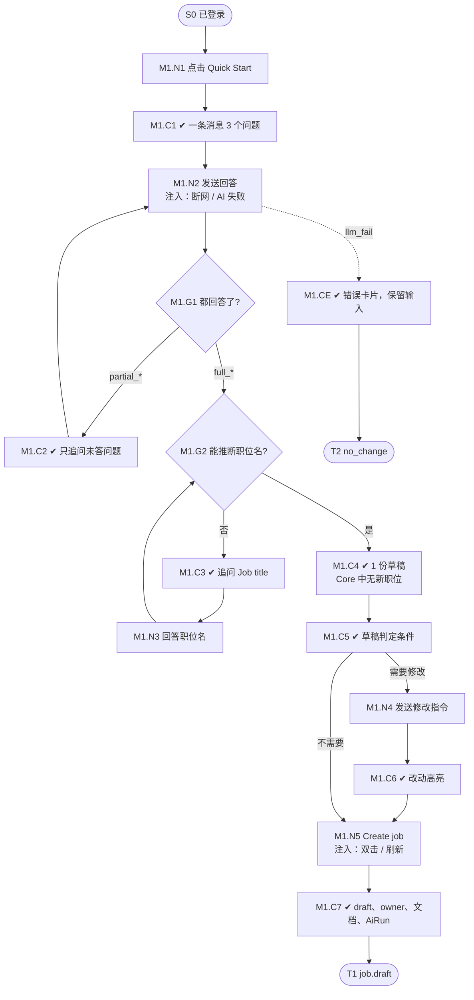

# M1 输入输出闭环：Quick Start 三问创建职位

| 项 | 内容 |
|---|---|
| 模块 | M1（P0） |
| 版本 / 日期 | v1.0 / 2026-10-14（草稿，结构待确认） |
| 同目录文档 | [产品文档](PRD.md) · [User Journey](User_Journey.md) |
| 格式说明 | 见 [模块索引 README](../README_Modules.md#闭环文档格式) |

## 1. 结构化规格

```yaml
flow_id: M1
actor: recruiter_a
seed: S0_logged_in            # 已登录，在职位列表，无需已有职位
entry: M1.N1
max_loop: 3
external: [llm.requirement_discovery, llm.jd_generate, voice.asr]

nodes:
  - {id: M1.N1, type: action, do: "点击 Ask Copilot → Quick Start"}
  - {id: M1.C1, type: check, expect: {ui: "入口标题作为用户消息出现一次；Agent 用一条消息列出 3 个问题；输入框聚焦"}}
  - {id: M1.N2, type: action, do: "发送回答 A", inject: [network_down, llm_fail]}
  - {id: M1.G1, type: decision, on: "3 个问题是否都有回答"}
  - {id: M1.C2, type: check, expect: {ui: "只追问未回答的问题，不重复已答问题"}}
  - {id: M1.G2, type: decision, on: "能否推断职位名"}
  - {id: M1.C3, type: check, expect: {ui: "追问 Job title；不出现 New Role 或空标题"}}
  - {id: M1.N3, type: action, do: "回答职位名"}
  - {id: M1.C4, type: check, expect: {ui: "显示生成中；生成 1 份草稿；Workspace 与对话并列；字段标来源", db: "此时 Core 中没有新职位"}}
  - {id: M1.C5, type: check, expect: {ui: "草稿满足判定条件：概述 2–4 句含职位名；职责 ≥3 条以动词开头；要求包含回答的硬技能；无编造数字"}}
  - {id: M1.N4, type: action, do: "发送修改指令 R"}
  - {id: M1.C6, type: check, expect: {ui: "改动处高亮；用户消息只出现一次"}}
  - {id: M1.N5, type: action, do: "点击 Create job from this draft", inject: [double_click, refresh]}
  - {id: M1.C7, type: check, expect: {ui: "跳转编辑页；字段行显示 Location / Headcount / Workplace type", db: "Core Job status=draft，owner=actor；有 internal 文档", record: "有 AiRun；无发布记录"}}
  - {id: M1.CE, type: check, expect: {ui: "错误卡片；保留输入；有 Retry 和 Start over", db: "没有新职位"}}
  - {id: M1.T1, type: terminal, state: job.draft}
  - {id: M1.T2, type: terminal, state: no_change}

edges:
  - [M1.N1, M1.C1]
  - [M1.C1, M1.N2]
  - [M1.N2, M1.G1]
  - [M1.G1, M1.C2, {when: "A 属于 partial_*"}]
  - [M1.C2, M1.N2]
  - [M1.G1, M1.G2, {when: "A 属于 full_*"}]
  - [M1.G2, M1.C3, {when: "A = full_no_title"}]
  - [M1.C3, M1.N3]
  - [M1.N3, M1.G2]
  - [M1.G2, M1.C4, {when: "能推断"}]
  - [M1.C4, M1.C5]
  - [M1.C5, M1.N4, {when: "需要修改"}]
  - [M1.N4, M1.C6]
  - [M1.C6, M1.N5]
  - [M1.C5, M1.N5, {when: "不需要修改"}]
  - [M1.N5, M1.C7]
  - [M1.C7, M1.T1]
  - [M1.N2, M1.CE, {when: "注入 llm_fail"}]
  - [M1.CE, M1.T2]
```

## 2. 测试数据

| 名称 | 内容 |
|---|---|
| full_en | `We have nobody owning growth in Vietnam` ⏎ `Build a repeatable local growth process` ⏎ `SQL, growth analytics, experiment design` |
| full_zh | `团队缺少人负责日常运营` ⏎ `希望他组建运营团队，负责产品日常运营` ⏎ `数据分析, SQL, 流程管理` |
| partial_two | full_en 的前两行 |
| partial_one_char | `a` |
| full_no_title | `Things are messy` ⏎ `Tidy them up` ⏎ `Patience, curiosity, kindness`；随后职位名 `Chief Tidy Officer` |
| refine_remote | `add TikTok growth experience and make it remote` |

## 3. 路径清单（一条路径 = 一个 test case）

| 路径 | 节点序列 | 数据 / 注入 | 终态 |
|---|---|---|---|
| P1 主流程 | N1 → C1 → N2 → G1 → G2 → C4 → C5 → N5 → C7 | full_en；再用 full_zh 跑一遍 | job.draft |
| P2 部分回答 | N1 → C1 → N2 → G1 → C2 → N2 → … → C7 | partial_two，然后补第 3 行 | job.draft |
| P3 追问职位名 | … → G2 → C3 → N3 → G2 → C4 → … → C7 | full_no_title | job.draft，title=`Chief Tidy Officer` |
| P4 对话修改 | P1 中在 C5 后走 N4 → C6 | refine_remote | job.draft，工作方式 Remote |
| P5 AI 失败 | N1 → C1 → N2 → CE | 注入 llm_fail | no_change；Retry 后可继续，不重复创建 |
| P6 中途刷新 | P1 在 C4 后刷新 | 注入 refresh | no_change，无半成品职位 |
| P7 双击创建 | P1 在 N5 注入 double_click | full_en | 只有 1 个 job.draft |
| P8 只发一个字母 | N1 → C1 → N2 → G1 → C2 | partial_one_char | 继续追问，不崩溃 |
| P9 语音 | 新对话后用麦克风回答；拒绝权限一次 | voice.asr | 允许时转写并发送；拒绝时有提示 |

## 4. 流程图（由规格生成）



## 5. 待确认

- “已回答”的判定标准（影响 G1 能否精确断言）。
- 推断字段是否需要在 UI 上标注。
- 性能阈值（C4 的首个反馈和完整结果耗时）。
