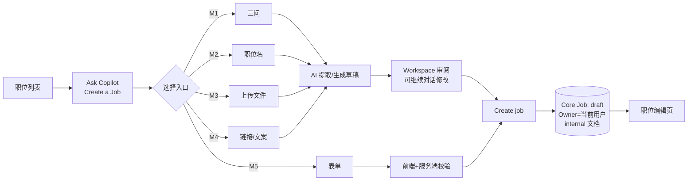
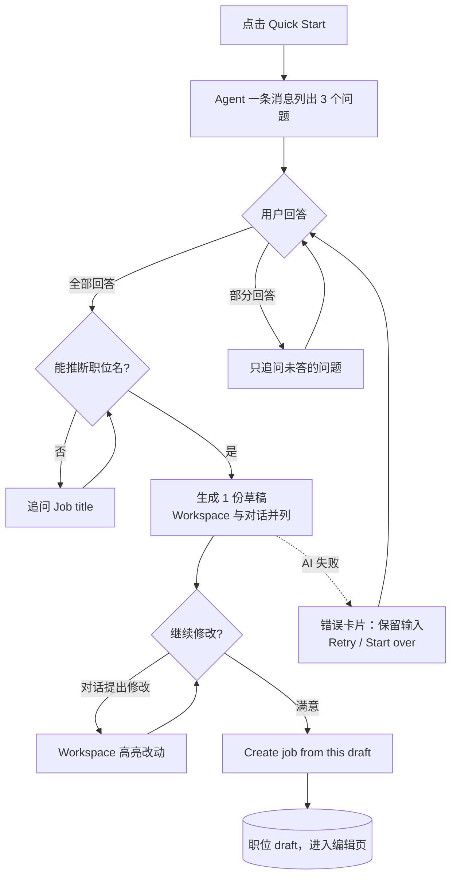

# M1 User Journey：用 Quick Start 回答三个问题创建职位（P0）

| 项 | 内容 |
|---|---|
| 模块 | M1（测试脚本 J1） |
| 版本 / 日期 | v1.0 / 2026-10-14（草稿，待评审） |
| 同目录文档 | [产品文档](PRD.md) · [输入输出闭环](Loop_IO.md) |
| 来源 | [九模块 User Journey v1.0](../HireOS_Command_JD_Management_Module_User_Journeys_v1.0.md) M1 节；测试数据见 [输入输出闭环 §2](Loop_IO.md)（原测试脚本 v0.1 已于 #30 删除） |

## 角色与权限（公共，摘自 [九模块 User Journey §0.1](../HireOS_Command_JD_Management_Module_User_Journeys_v1.0.md)）

| 角色 | 登录后的主要目的 | 核心操作 | 默认限制 |
|---|---|---|---|
| Recruiter / TA | 将招聘需求整理成合格 JD，协调协作者并推动审批/交付 | 创建职位、补全字段、应用 AI 建议、保存草稿、提交审批、追踪发布 | 不能替审批人作出审批结论，不能绕过阻断项提交或发布 |
| Hiring Manager | 说明为什么招、招什么人、成功标准和团队上下文，并确认业务取舍 | 回答追问、编辑授权字段、解决冲突、确认岗位内容、参与审批 | 不能修改未授权预算/敏感字段，不能自动替代 HR 或审批政策发布 |
| HR Approver | 确认内容、预算、风险和流程前置条件已经处理 | 查看候选版本、差异、风险和影响，批准、退回或拒绝 | 不能把 AI 建议当成人工决策；无权限时不能查看 restricted 字段 |
| Viewer | 阅读获授权的 JD、分析结论和当前有效版本 | 查看职位、来源、版本和授权的 Agent 结论 | 不能应用修改、保存、提交审批、发布或查看敏感字段 |

> 2026-10-14 用户决定：采用以上四个角色，并恢复审批流程。这替代了 [#15](https://github.com/JsonSuCoder/HireOSV2/issues/15) 的三档权限和 [#9](https://github.com/JsonSuCoder/HireOSV2/issues/9) 中“去掉审批”的部分。审批流程目前后端没有实现，相关用例在实现前标记为 known gap。

## 创建类公共骨架（M1–M5 共用）

共同规则（M1–M5 都必须满足）：

1. 每个入口标题旁有 “i”，点击只显示说明，不进入入口。
2. 点击入口后，入口标题先作为用户消息出现一次，Agent 随即引导。
3. 在点击 Create / Save **之前**，系统中不存在新职位（刷新、关闭面板后也没有半成品）。
4. 创建后：Core Job `status=draft`，Owner=当前用户，生成 internal 文档；刷新后仍在，职位列表可见。
5. 创建过程不产生发布记录，也不对外发送任何内容。
6. AI 失败时保留用户输入，提供 Retry 和 Start over；New conversation 清空消息和错误状态（对应线上问题 F-001～F-003、#32、#33）。
7. 字段行始终显示 Location、Headcount、Workplace type；未提供时 Location=`Ho Chi Minh City, VN`、Headcount=`1`；未填的选填项不显示。

# 旅程

**主角色**：Recruiter / TA（Hiring Manager 也可使用）
**登录目的**：手里只有“为什么招、要解决什么问题”，不知道怎么写完整 JD，希望 AI 帮忙组织成一份草稿。
**入口**：职位列表 → Ask Copilot → Quick Start

## 输入

| 类型 | 内容 |
|---|---|
| 前置数据 | 已登录，无需已有职位 |
| 用户数据 | v0.1 §3.2 的三行回答（中英各一套）；只答两行；推断不出职位名的回答（`Things are messy`…）；只发一个字母 |
| 外部依赖 | LLM（requirement_discovery、jd_generate）；语音转写（可选） |

## 流程

## 步骤

| # | 用户意图与操作 | 系统反馈（可观察） | 用户需要判断 |
|---|---|---|---|
| 1 | 点击 Quick Start | Agent 用**一条消息**同时列出 3 个问题；输入框聚焦 | 自己能回答哪几个 |
| 2 | 只回答前两个 | 只追问第 3 个，不重复问前两个 | — |
| 3 | 补答第 3 个 | 显示“正在生成”；生成 **1 份**草稿；Workspace 与对话并列 | 推断出的职位名是否合理 |
| 4 | 审阅草稿 | 概述 2–4 句、含职位名；职责 ≥3 条、以动词开头；要求包含回答中的硬技能；没有编造的数字 | 哪些内容需要改 |
| 5 | 发送 `add TikTok growth experience and make it remote` | 改动处高亮；工作模式变为 Remote；用户消息只出现一次 | 改动是否符合意图 |
| 6 | 点击 Create job from this draft | 跳转编辑页，提示创建成功；刷新后仍在 | — |
| 7 | （可选）新对话后用麦克风回答 | 允许权限后真实转写并发送；拒绝权限时有提示，不崩溃 | — |

## 可见 / 不可见

- 可见：自己的回答、Agent 追问、草稿、哪些内容是推断的。
- 不可见：其他用户的会话；工作区里其他职位的 Confidential 内容（不能进入 AI 上下文）。

## 异常与恢复

| 场景 | 预期 |
|---|---|
| AI 服务失败（如线上 `Sign-in service is unavailable.`） | 错误卡片说明原因；保留已输入内容；Retry 不会重复创建；Start over 回到五个入口 |
| 生成过程中再次发送消息 | 提示仍在生成；不重复生成或创建 |
| 推断不出职位名 | 追问 Job title；不使用 `New Role` 或空标题 |
| 中途刷新或后退 | 不产生半成品职位；回到可继续的状态 |
| 网络断开 | 有失败提示和重试方式，输入不丢 |

## 输出与交接

| 输出 | 内容 |
|---|---|
| 用户可见 | 职位编辑页，字段行符合 0.4 第 7 条 |
| 持久化 | CopilotConversation + Messages；Core Job（draft，Owner=当前用户）；internal JobDocument |
| 记录 | AiRun（模型、prompt 版本、耗时） |
| 交接 | → M6：一份可能缺对外薪资等必填项的 draft 职位；Level 可为 Not set |

**禁止副作用**：点 Create 之前就生成职位；生成 3 份草稿；三个问题拆成三条消息逐个问；编造回答里没有的数字或事实。

**成功标准**：只追问缺失项；生成 1 份可编辑草稿；Create 后数据持久化；全程失败可恢复。

**测试映射**：闭环 A1；线上问题 F-001、F-002、F-003、#32、#33。

**待确认**：“已回答”的判定标准；推断字段是否需要在 UI 上标注“AI 推断”。
