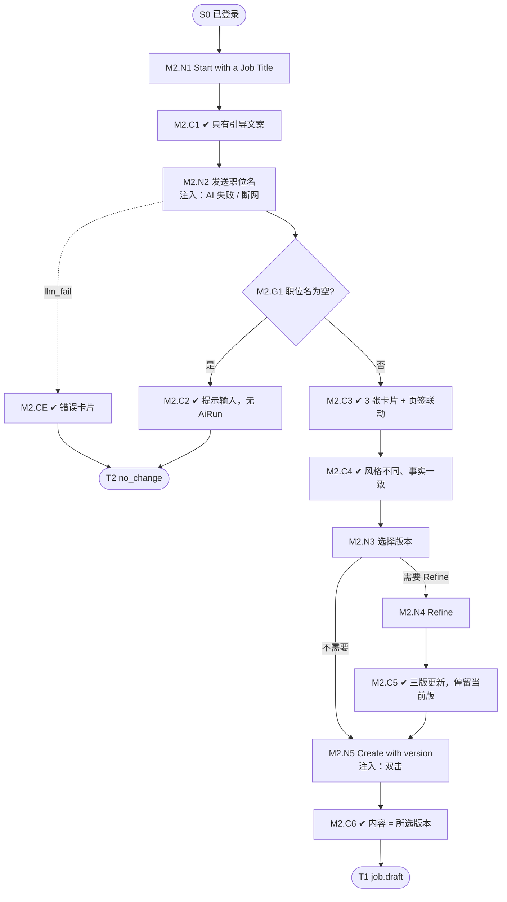

# M2 输入输出闭环：职位名生成三个版本并创建

| 项 | 内容 |
|---|---|
| 模块 | M2（P0） |
| 版本 / 日期 | v1.0 / 2026-10-14（草稿，结构待确认） |
| 同目录文档 | [产品文档](PRD.md) · [User Journey](User_Journey.md) |
| 格式说明 | 见 [模块索引 README](../README_Modules.md#闭环文档格式) |

## 1. 结构化规格

```yaml
flow_id: M2
actor: recruiter_a
seed: S0_logged_in
entry: M2.N1
max_loop: 3
external: [llm.title_variants, llm.refine_variants]

nodes:
  - {id: M2.N1, type: action, do: "点击 Ask Copilot → Start with a Job Title"}
  - {id: M2.C1, type: check, expect: {ui: "只有引导文案，无内嵌输入框和按钮；底部输入框聚焦"}}
  - {id: M2.N2, type: action, do: "发送职位名 T", inject: [llm_fail, network_down]}
  - {id: M2.G1, type: decision, on: "T 是否为空"}
  - {id: M2.C2, type: check, expect: {ui: "提示输入职位名", record: "无 AiRun"}}
  - {id: M2.C3, type: check, expect: {ui: "职位名只出现一次；3 张卡片 A/B/C；Workspace 页签与卡片联动"}}
  - {id: M2.C4, type: check, expect: {ui: "三版风格不同（A 最短、B 面向候选人、C 最详细）；职位名、地点、HC、工作方式一致"}}
  - {id: M2.N3, type: action, do: "选择版本 V"}
  - {id: M2.N4, type: action, do: "发送 Refine 指令 R"}
  - {id: M2.C5, type: check, expect: {ui: "三版都更新并高亮；仍停留在 V"}}
  - {id: M2.N5, type: action, do: "点击 Create job with version V", inject: [double_click]}
  - {id: M2.C6, type: check, expect: {db: "Core Job status=draft，owner=actor；文档职责、要求与 V 逐字一致"}}
  - {id: M2.CE, type: check, expect: {ui: "错误卡片；保留输入；Retry / Start over", db: "没有新职位"}}
  - {id: M2.T1, type: terminal, state: job.draft}
  - {id: M2.T2, type: terminal, state: no_change}

edges:
  - [M2.N1, M2.C1]
  - [M2.C1, M2.N2]
  - [M2.N2, M2.G1]
  - [M2.G1, M2.C2, {when: "T = empty"}]
  - [M2.C2, M2.T2]
  - [M2.G1, M2.C3, {when: "T 非空"}]
  - [M2.C3, M2.C4]
  - [M2.C4, M2.N3]
  - [M2.N3, M2.N4, {when: "需要 Refine"}]
  - [M2.N4, M2.C5]
  - [M2.C5, M2.N5]
  - [M2.N3, M2.N5, {when: "不需要 Refine"}]
  - [M2.N5, M2.C6]
  - [M2.C6, M2.T1]
  - [M2.N2, M2.CE, {when: "注入 llm_fail"}]
  - [M2.CE, M2.T2]
```

## 2. 测试数据

| 名称 | 内容 |
|---|---|
| title_common | `Finance Manager` |
| title_unknown | `Chief Tidy Officer` |
| title_empty | 空串 |
| refine_remote | `make it remote` |
| pick | `B` |

## 3. 路径清单

| 路径 | 节点序列 | 数据 / 注入 | 终态 |
|---|---|---|---|
| P1 主流程 | N1 → C1 → N2 → G1 → C3 → C4 → N3 → N5 → C6 | title_common，选 B | job.draft，内容 = B |
| P2 Refine | P1 中 N3 → N4 → C5 → N5 | refine_remote | job.draft，三版均 Remote |
| P3 空职位名 | N1 → C1 → N2 → G1 → C2 | title_empty | no_change |
| P4 AI 失败 | N1 → C1 → N2 → CE | 注入 llm_fail | no_change |
| P5 罕见职位名 | 同 P1 | title_unknown | 待确认（先追问还是直接生成） |
| P6 双击创建 | P1 在 N5 注入 double_click | title_common | 只有 1 个 job.draft |

## 4. 流程图（由规格生成）



## 5. 待确认

- “事实一致”的比对方式（影响 C4 的断言方法）。
- 罕见职位名的预期（P5）。
