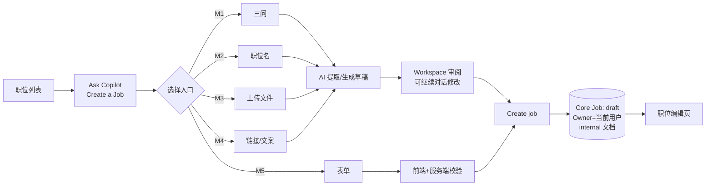
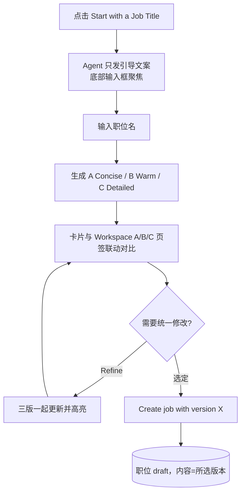

# M2 User Journey：从职位名称开始，对比三个版本后创建（P0）

| 项 | 内容 |
|---|---|
| 模块 | M2（测试脚本 J2） |
| 版本 / 日期 | v1.0 / 2026-10-14（草稿，待评审） |
| 同目录文档 | [产品文档](PRD.md) · [输入输出闭环](Loop_IO.md) |
| 来源 | [九模块 User Journey v1.0](../HireOS_Command_JD_Management_Module_User_Journeys_v1.0.md) M2 节；测试数据见 [用户旅程与测试脚本 v0.1 §3](../HireOS_Command_JD_Management_User_Journeys_v0.1.md) |

## 角色与权限（公共，摘自 [九模块 User Journey §0.1](../HireOS_Command_JD_Management_Module_User_Journeys_v1.0.md)）

| 角色 | 登录后的主要目的 | 核心操作 | 默认限制 |
|---|---|---|---|
| Recruiter / TA | 将招聘需求整理成合格 JD，协调协作者并推动审批/交付 | 创建职位、补全字段、应用 AI 建议、保存草稿、提交审批、追踪发布 | 不能替审批人作出审批结论，不能绕过阻断项提交或发布 |
| Hiring Manager | 说明为什么招、招什么人、成功标准和团队上下文，并确认业务取舍 | 回答追问、编辑授权字段、解决冲突、确认岗位内容、参与审批 | 不能修改未授权预算/敏感字段，不能自动替代 HR 或审批政策发布 |
| HR Approver | 确认内容、预算、风险和流程前置条件已经处理 | 查看候选版本、差异、风险和影响，批准、退回或拒绝 | 不能把 AI 建议当成人工决策；无权限时不能查看 restricted 字段 |
| Viewer | 阅读获授权的 JD、分析结论和当前有效版本 | 查看职位、来源、版本和授权的 Agent 结论 | 不能应用修改、保存、提交审批、发布或查看敏感字段 |

> 2026-10-14 用户决定：采用以上四个角色，并恢复审批流程。这替代了 [#15](https://github.com/JsonSuCoder/HireOSV2/issues/15) 的三档权限和 [#9](https://github.com/JsonSuCoder/HireOSV2/issues/9) 中“去掉审批”的部分。审批流程目前后端没有实现，相关用例在实现前标记为 known gap。

## 创建类公共骨架（M1–M5 共用）

共同规则（M1–M5 都必须满足）：

1. 每个入口标题旁有 “i”，点击只显示说明，不进入入口。
2. 点击入口后，入口标题先作为用户消息出现一次，Agent 随即引导。
3. 在点击 Create / Save **之前**，系统中不存在新职位（刷新、关闭面板后也没有半成品）。
4. 创建后：Core Job `status=draft`，Owner=当前用户，生成 internal 文档；刷新后仍在，职位列表可见。
5. 创建过程不产生发布记录，也不对外发送任何内容。
6. AI 失败时保留用户输入，提供 Retry 和 Start over；New conversation 清空消息和错误状态（对应线上问题 F-001～F-003、#32、#33）。
7. 字段行始终显示 Location、Headcount、Workplace type；未提供时 Location=`Ho Chi Minh City, VN`、Headcount=`1`；未填的选填项不显示。

# 旅程

**主角色**：Recruiter / TA（Hiring Manager 也可使用）
**登录目的**：已经知道要招什么职位，想快速拿到几种不同写法，选一种最合适的。
**入口**：Ask Copilot → Start with a Job Title

## 输入

| 类型 | 内容 |
|---|---|
| 前置数据 | 已登录 |
| 用户数据 | `Finance Manager`；无法识别的名称 `Chief Tidy Officer`；空串 |
| 外部依赖 | LLM（title-variants、refine-variants） |

## 流程

## 步骤

| # | 用户意图与操作 | 系统反馈 | 用户需要判断 |
|---|---|---|---|
| 1 | 点击入口 | 只有引导文案，没有内嵌输入框和按钮 | — |
| 2 | 发送 `Finance Manager` | 职位名在对话里只出现一次；显示“正在生成” | — |
| 3 | 查看结果 | 3 张选择卡片 + Workspace 顶部 A/B/C 页签，两者联动 | 哪种风格适合公司 |
| 4 | 切换 B、C | 风格明显不同（A 最短、B 面向候选人、C 最详细）；**职位名、地点等事实一致** | — |
| 5 | 选 B，发送 `make it remote` | 三版都变为 Remote 并高亮，仍停留在 B | — |
| 6 | Create job with version B | 创建职位；职责、要求使用 B 版措辞 | — |

## 异常与恢复

空串不触发生成并提示；无法识别的职位名时先确认职位含义再生成；AI 失败同 M1。

## 输出与交接

- 持久化：Core Job（draft）+ internal 文档，内容 = 所选版本；会话记录三个版本和选择结果。
- 交接 → M6。

**禁止副作用**：三版之间事实不一致；创建出的内容与所选版本不同；其他入口也生成 3 个版本。

**成功标准**：只有本入口生成 3 个版本；选择与创建一致；事实不扩散。

**测试映射**：闭环 A2；线上 J2 阻塞（受 F-001/F-002 影响）。

**待确认**：“事实一致”用字段比对还是 LLM 判定；哪些字段允许 AI 填默认值。
