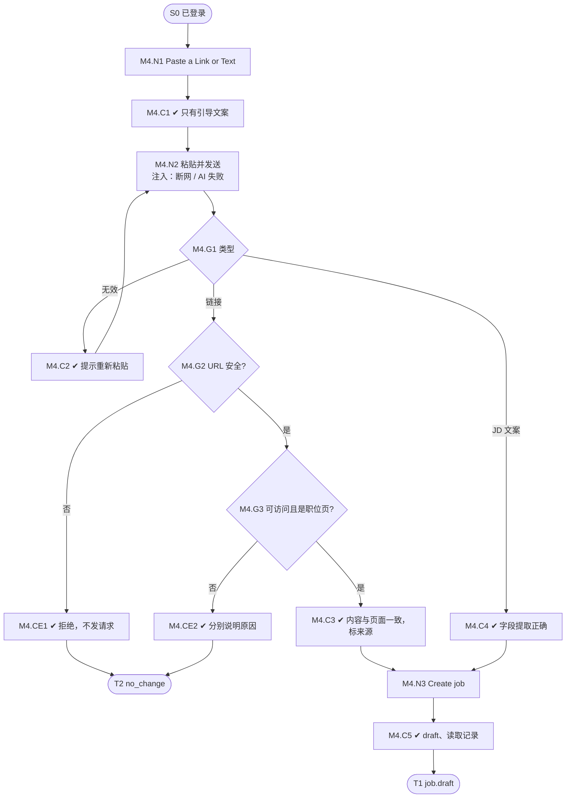

# M4 输入输出闭环：粘贴链接或文案创建职位

| 项 | 内容 |
|---|---|
| 模块 | M4（P1） |
| 版本 / 日期 | v1.1 / 2026-10-15（草稿，M4-LIVE-06 产品决定已同步） |
| 同目录文档 | [产品文档](PRD.md) · [User Journey](User_Journey.md) |
| 格式说明 | 见 [模块索引 README](../README_Modules.md#闭环文档格式) |

## 1. 结构化规格

```yaml
flow_id: M4
actor: recruiter_a
seed: S0_logged_in
entry: M4.N1
max_loop: 3
external: [http.mock_server, llm.jd_parse]   # 测试用本地 mock 页面，不依赖真实外网

nodes:
  - {id: M4.N1, type: action, do: "点击 Ask Copilot → Paste a Link or Text"}
  - {id: M4.C1, type: check, expect: {ui: "只有引导文案；底部提示 Paste a link or the JD text…"}}
  - {id: M4.N2, type: action, do: "粘贴内容 X 并发送", inject: [network_down, llm_fail]}
  - {id: M4.G1, type: decision, on: "X 的类型：链接 / JD 文案 / 无效"}
  - {id: M4.C2, type: check, expect: {ui: "提示这不是链接或 JD，说明如何重新粘贴；停留本步"}}
  - {id: M4.G2, type: decision, on: "URL 是否安全（http/https 且非内网）"}
  - {id: M4.CE1, type: check, expect: {ui: "拒绝该地址", api: "未发起对该地址的请求", db: "无草稿"}}
  - {id: M4.G3, type: decision, on: "页面是否可访问且是职位页"}
  - {id: M4.CE2, type: check, expect: {ui: "分别提示：无法访问 / 页面不存在 / 看起来不是职位；提供手动入口", db: "无草稿"}}
  - {id: M4.C3, type: check, expect: {ui: "链接只显示一次；职位名、职责与页面一致；来源标签标明链接；不自动改写；建议与草稿分开"}}
  - {id: M4.C4, type: check, expect: {ui: "识别为正文；字段和原有条件提取正确；不自动改写或增写；建议与草稿分开"}}
  - {id: M4.N3, type: action, do: "点击 Create job"}
  - {id: M4.C5, type: check, expect: {db: "Core Job status=draft，owner=actor；internal 文档", record: "链接读取记录（如有）+ AiRun"}}
  - {id: M4.T1, type: terminal, state: job.draft}
  - {id: M4.T2, type: terminal, state: no_change}

edges:
  - [M4.N1, M4.C1]
  - [M4.C1, M4.N2]
  - [M4.N2, M4.G1]
  - [M4.G1, M4.C2, {when: "X = invalid_text"}]
  - [M4.C2, M4.N2]
  - [M4.G1, M4.G2, {when: "X 属于 link_*"}]
  - [M4.G2, M4.CE1, {when: "X 属于 link_intranet / link_bad_scheme"}]
  - [M4.CE1, M4.T2]
  - [M4.G2, M4.G3, {when: "安全"}]
  - [M4.G3, M4.CE2, {when: "X 属于 link_login / link_404 / link_not_job"}]
  - [M4.CE2, M4.T2]
  - [M4.G3, M4.C3, {when: "X = link_ok"}]
  - [M4.C3, M4.N3]
  - [M4.G1, M4.C4, {when: "X = paste_jd"}]
  - [M4.C4, M4.N3]
  - [M4.N3, M4.C5]
  - [M4.C5, M4.T1]
```

## 2. 测试数据

| 名称 | 内容 |
|---|---|
| invalid_text | `not a link` |
| link_ok | mock 服务上的公开职位页 |
| link_login | mock 服务返回登录页（302 → /login） |
| link_404 | mock 服务返回 404 |
| link_not_job | mock 服务上的公司首页 |
| link_intranet | `http://127.0.0.1:8080/`、`http://169.254.169.254/` |
| link_bad_scheme | `ftp://example.com/jd`、`file:///etc/passwd` |
| link_too_large | mock 页面 > 2MB |
| paste_jd | v0.1“粘贴文案”：Customer Success Manager，Hanoi hybrid，3 条职责、2 条要求、1 条加分项 |

## 3. 路径清单

| 路径 | 节点序列 | 数据 | 终态 |
|---|---|---|---|
| P1 公开链接 | N1 → C1 → N2 → G1 → G2 → G3 → C3 → N3 → C5 | link_ok | job.draft |
| P2 无效输入 | N1 → C1 → N2 → G1 → C2 | invalid_text | 停留本步 |
| P3 需登录 | … → G3 → CE2 | link_login | no_change |
| P4 404 | … → G3 → CE2 | link_404 | no_change |
| P5 非职位页 | … → G3 → CE2 | link_not_job | no_change |
| P6 内网地址 | … → G2 → CE1 | link_intranet | no_change |
| P7 非法协议 | … → G2 → CE1 | link_bad_scheme | no_change |
| P8 粘贴文案 | N1 → C1 → N2 → G1 → C4 → N3 → C5 | paste_jd | job.draft；`Hanoi, VN`、`Hybrid` |
| P9 页面过大 | … → G3 | link_too_large | 截断或拒绝，有提示 |

## 4. 流程图（由规格生成）



## 5. 待确认

- “太短 / 不可识别”的阈值（影响 G1 的判定数据）。
- 2026-10-15 已确认：M4 导入不自动改写；如有修改建议，用户确认前不应用到草稿（C3、C4）。
- 当前实现是否已拦截内网地址（P6 可能直接失败，属于有效发现）。
