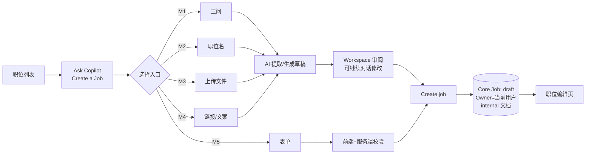
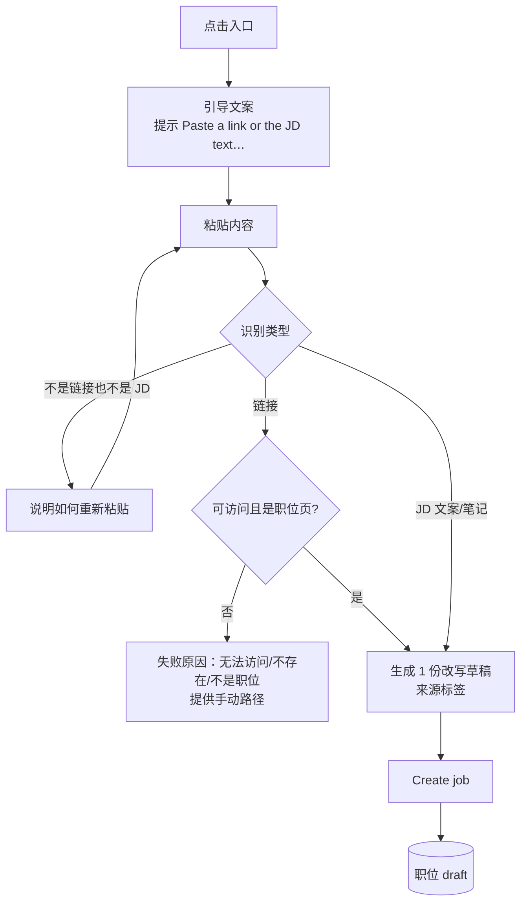

# M4 User Journey：粘贴链接或文案创建职位（P1）

| 项 | 内容 |
|---|---|
| 模块 | M4（测试脚本 J4） |
| 版本 / 日期 | v1.0 / 2026-10-14（草稿，待评审） |
| 同目录文档 | [产品文档](PRD.md) · [输入输出闭环](Loop_IO.md) |
| 来源 | [九模块 User Journey v1.0](../HireOS_Command_JD_Management_Module_User_Journeys_v1.0.md) M4 节；测试数据见 [输入输出闭环 §2](Loop_IO.md)（原测试脚本 v0.1 已于 #30 删除） |

## 角色与权限（公共，摘自 [九模块 User Journey §0.1](../HireOS_Command_JD_Management_Module_User_Journeys_v1.0.md)）

| 角色 | 登录后的主要目的 | 核心操作 | 默认限制 |
|---|---|---|---|
| Recruiter / TA | 将招聘需求整理成合格 JD，协调协作者并推动审批/交付 | 创建职位、补全字段、应用 AI 建议、保存草稿、提交审批、追踪发布 | 不能替审批人作出审批结论，不能绕过阻断项提交或发布 |
| Hiring Manager | 说明为什么招、招什么人、成功标准和团队上下文，并确认业务取舍 | 回答追问、编辑授权字段、解决冲突、确认岗位内容、参与审批 | 不能修改未授权预算/敏感字段，不能自动替代 HR 或审批政策发布 |
| HR Approver | 确认内容、预算、风险和流程前置条件已经处理 | 查看候选版本、差异、风险和影响，批准、退回或拒绝 | 不能把 AI 建议当成人工决策；无权限时不能查看 restricted 字段 |
| Viewer | 阅读获授权的 JD、分析结论和当前有效版本 | 查看职位、来源、版本和授权的 Agent 结论 | 不能应用修改、保存、提交审批、发布或查看敏感字段 |

> 2026-10-14 用户决定：采用以上四个角色，并恢复审批流程。这替代了 [#15](https://github.com/JsonSuCoder/HireOSV2/issues/15) 的三档权限和 [#9](https://github.com/JsonSuCoder/HireOSV2/issues/9) 中“去掉审批”的部分。审批流程目前后端没有实现，相关用例在实现前标记为 known gap。

## 创建类公共骨架（M1–M5 共用）

共同规则（M1–M5 都必须满足）：

1. 每个入口标题旁有 “i”，点击只显示说明，不进入入口。
2. 点击入口后，入口标题先作为用户消息出现一次，Agent 随即引导。
3. 在点击 Create / Save **之前**，系统中不存在新职位（刷新、关闭面板后也没有半成品）。
4. 创建后：Core Job `status=draft`，Owner=当前用户，生成 internal 文档；刷新后仍在，职位列表可见。
5. 创建过程不产生发布记录，也不对外发送任何内容。
6. AI 失败时保留用户输入，提供 Retry 和 Start over；New conversation 清空消息和错误状态（对应线上问题 F-001～F-003、#32、#33）。
7. 字段行始终显示 Location、Headcount、Workplace type；未提供时 Location=`Ho Chi Minh City, VN`、Headcount=`1`；未填的选填项不显示。

# 旅程

**主角色**：Recruiter / TA（Hiring Manager 也可使用）
**登录目的**：看到别家公开职位或手上有会议笔记，想改写成自己公司的草稿。
**入口**：Ask Copilot → Paste a Link or Text

## 输入

| 类型 | 内容 |
|---|---|
| 前置数据 | 已登录 |
| 用户数据 | `not a link`；可访问的公开职位链接；需登录页、404、非职位页、`ftp://`、无协议文本；v0.1 §3.2 的“粘贴文案”；内网地址（SSRF 检查） |
| 外部依赖 | 外部 HTTP（测试用本地 mock 服务）；LLM |

## 流程

## 步骤

| # | 用户意图与操作 | 系统反馈 | 用户需要判断 |
|---|---|---|---|
| 1 | 点击入口 | 只有引导文案；底部提示 `Paste a link or the JD text…` | — |
| 2 | 发送 `not a link` | 提示这不是链接或 JD，停留在本步 | — |
| 3 | 发送可访问链接 | 链接只显示一次；真实读取页面；职位名、职责与页面一致；来源标签标明链接 | 内容是否可借鉴 |
| 4 | 发送需登录页、404、非职位页 | 分别给出原因，不编造草稿 | — |
| 5 | 新对话，粘贴“粘贴文案” | 职位名 `Customer Success Manager`；3 条职责、2 条要求、1 条加分项；`Hanoi, VN`、`Hybrid` | — |
| 6 | 检查改写 | 原创表述，没有大段照搬 | — |

## 输出与交接

- 持久化：链接读取记录（URL、状态、读取时间）；草稿；Create 后 Core Job + 文档。
- 交接 → M6。

**禁止副作用**：页面打不开时编造内容；内网地址或 file:// 能被读取；大段复制原文。

**成功标准**：链接真实抓取、文案真实解析；所有失败都不编造。

**测试映射**：闭环 A4；线上问题 F-007。

**待确认**：“太短/不可识别”的阈值；外链抓取的授权和版权边界；“照搬”的判定阈值。
