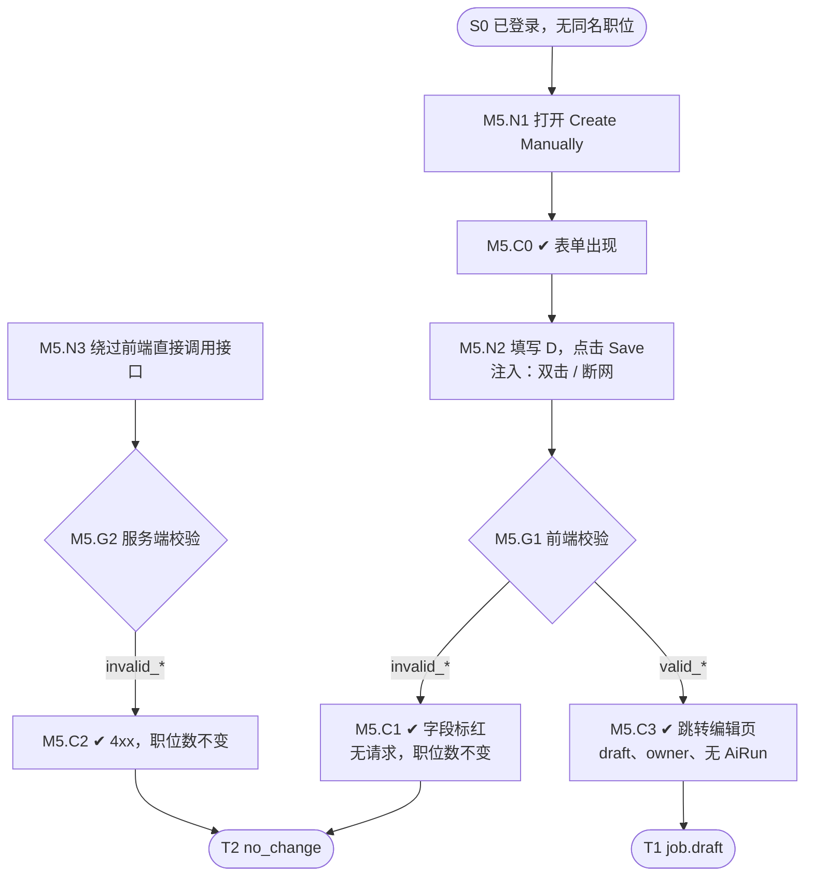

# M5 输入输出闭环：手动表单创建职位

| 项 | 内容 |
|---|---|
| 模块 | M5（P0） |
| 版本 / 日期 | v1.0 / 2026-10-14（草稿，结构待确认；由 [Flow_Spec_Sample_M5_v0.1](../Flow_Spec_Sample_M5_v0.1.md) 迁移） |
| 同目录文档 | [产品文档](PRD.md) · [User Journey](User_Journey.md) |
| 格式说明 | 见 [模块索引 README](../README_Modules.md#闭环文档格式) |

## 1. 结构化规格

```yaml
flow_id: M5
actor: recruiter_a
seed: S0_logged_in          # 已登录、在职位列表、不存在同名职位
entry: M5.N1
max_loop: 3
external: []                # 不调用 AI

nodes:
  - {id: M5.N1, type: action, do: "点击 Ask Copilot → Create Manually"}
  - {id: M5.C0, type: check, expect: {ui: "对话中出现表单；必填项有标记"}}
  - {id: M5.N2, type: action, do: "按测试数据 D 填写表单，点击 Save", inject: [double_click, network_down]}
  - {id: M5.G1, type: decision, on: "前端校验结果"}
  - {id: M5.C1, type: check, expect: {ui: "D 对应的字段标红并提示", api: "没有发出创建请求", db: "职位总数不变"}}
  - {id: M5.N3, type: action, do: "绕过前端，直接调用创建接口提交 D"}
  - {id: M5.G2, type: decision, on: "服务端校验结果"}
  - {id: M5.C2, type: check, expect: {api: "返回 4xx 和明确错误码", db: "职位总数不变"}}
  - {id: M5.C3, type: check, expect: {ui: "直接跳转编辑页，不经过 Workspace；逐项回显已填必要项和选填项，未填选填项不显示为已确认事实；长 JD 保留三级结构", db: "Core Job status=draft，owner=actor；草稿文档内容与表单一致", record: "没有 AiRun"}}
  - {id: M5.T1, type: terminal, state: job.draft}
  - {id: M5.T2, type: terminal, state: no_change}

edges:
  - [M5.N1, M5.C0]
  - [M5.C0, M5.N2]
  - [M5.N2, M5.G1]
  - [M5.G1, M5.C1, {when: "D 属于 invalid_*"}]
  - [M5.G1, M5.C3, {when: "D 属于 valid_*"}]
  - [M5.C1, M5.T2]
  - [M5.C3, M5.T1]
  - [M5.N3, M5.G2]          # 第二个入口：服务端校验
  - [M5.G2, M5.C2, {when: "D 属于 invalid_*"}]
  - [M5.C2, M5.T2]
```

## 2. 测试数据

| 名称 | 内容 |
|---|---|
| valid_full | title `[UJ-TEST] Content Creator`、location `Singapore`、headcount `2`、responsibilities `Write weekly posts`、requirements `3+ years in sales`；薪资等选填项可分别以填写/留空两组验证 |
| valid_structured | 一级 `基础信息` / `职位描述` / `职位要求`，二级 `1.基础条件` / `2.专业能力`，每个二级标题下有独立描述/列表项 |
| invalid_empty | 空表单 |
| invalid_hc_zero / invalid_hc_decimal / invalid_hc_negative | headcount `0` / `1.5` / `-1` |
| invalid_resp_blank | responsibilities 只填 `1.` 或空行 |
| invalid_req_empty | requirements 为空 |
| invalid_salary_range | salary min `40`、max `25` |

## 3. 路径清单

| 路径 | 节点序列 | 数据 / 注入 | 终态 |
|---|---|---|---|
| P1 主流程 | N1 → C0 → N2 → G1 → C3 | valid_full | job.draft；`3+` 原样保留 |
| P2–P8 前端拦截 | N1 → C0 → N2 → G1 → C1 | invalid_*（每组一条，共 7 条） | no_change |
| P9–P15 服务端拦截 | N3 → G2 → C2 | invalid_*（每组一条，共 7 条） | no_change |
| P16 双击 Save | P1，在 N2 注入 double_click | valid_full | 只有 1 个 job.draft |
| P17 保存时断网 | P1，在 N2 注入 network_down | valid_full | no_change；输入不丢；**不生成本地假职位**（#34） |
| P18 分层长 JD | N1 → C0 → N2 → G1 → C3 | valid_structured | 草稿保留一级章节、二级标题、三级内容 |

## 4. 流程图（由规格生成）



## 5. 待确认

- 用户已确认创建草稿前必须填齐必要项；当前沿用 PRD 的五项，逐字段清单若调整须另行确认。发布必填项清单仍需与完整性标准统一，完善建议不计入发布阻断。
- 手动创建实际调用的接口（填入 N3）。
- Viewer 打开入口的预期（是否补一条无权路径 P18）。
