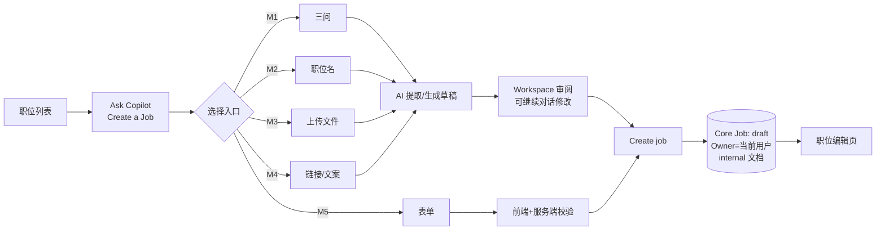
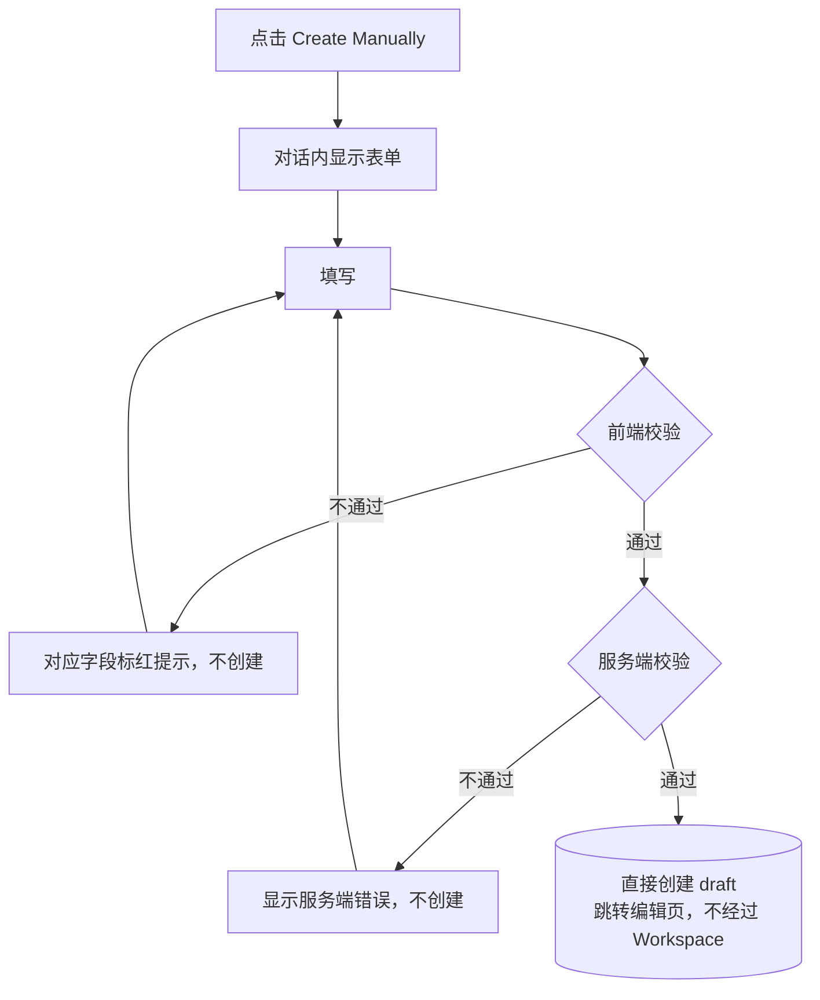

# M5 User Journey：手动表单创建职位（P0）

| 项 | 内容 |
|---|---|
| 模块 | M5（测试脚本 J5） |
| 版本 / 日期 | v1.0 / 2026-10-14（草稿，待评审） |
| 同目录文档 | [产品文档](PRD.md) · [输入输出闭环](Loop_IO.md) |
| 来源 | [九模块 User Journey v1.0](../HireOS_Command_JD_Management_Module_User_Journeys_v1.0.md) M5 节；测试数据见 [输入输出闭环 §2](Loop_IO.md)（原测试脚本 v0.1 已于 #30 删除） |

## 角色与权限（公共，摘自 [九模块 User Journey §0.1](../HireOS_Command_JD_Management_Module_User_Journeys_v1.0.md)）

| 角色 | 登录后的主要目的 | 核心操作 | 默认限制 |
|---|---|---|---|
| Recruiter / TA | 将招聘需求整理成合格 JD，协调协作者并推动审批/交付 | 创建职位、补全字段、应用 AI 建议、保存草稿、提交审批、追踪发布 | 不能替审批人作出审批结论，不能绕过阻断项提交或发布 |
| Hiring Manager | 说明为什么招、招什么人、成功标准和团队上下文，并确认业务取舍 | 回答追问、编辑授权字段、解决冲突、确认岗位内容、参与审批 | 不能修改未授权预算/敏感字段，不能自动替代 HR 或审批政策发布 |
| HR Approver | 确认内容、预算、风险和流程前置条件已经处理 | 查看候选版本、差异、风险和影响，批准、退回或拒绝 | 不能把 AI 建议当成人工决策；无权限时不能查看 restricted 字段 |
| Viewer | 阅读获授权的 JD、分析结论和当前有效版本 | 查看职位、来源、版本和授权的 Agent 结论 | 不能应用修改、保存、提交审批、发布或查看敏感字段 |

> 2026-10-14 用户决定：采用以上四个角色，并恢复审批流程。这替代了 [#15](https://github.com/JsonSuCoder/HireOSV2/issues/15) 的三档权限和 [#9](https://github.com/JsonSuCoder/HireOSV2/issues/9) 中“去掉审批”的部分。审批流程目前后端没有实现，相关用例在实现前标记为 known gap。

## 创建类公共骨架（M1–M5 共用）

共同规则（M1–M5 都必须满足）：

1. 每个入口标题旁有 “i”，点击只显示说明，不进入入口。
2. 点击入口后，入口标题先作为用户消息出现一次，Agent 随即引导。
3. 在点击 Create / Save **之前**，系统中不存在新职位（刷新、关闭面板后也没有半成品）。
4. 创建后：Core Job `status=draft`，Owner=当前用户，生成 internal 文档；刷新后仍在，职位列表可见。
5. 创建过程不产生发布记录，也不对外发送任何内容。
6. AI 失败时保留用户输入，提供 Retry 和 Start over；New conversation 清空消息和错误状态（对应线上问题 F-001～F-003、#32、#33）。
7. 字段行始终显示 Location、Headcount、Workplace type；未提供时 Location=`Ho Chi Minh City, VN`、Headcount=`1`；未填的选填项不显示。

M5 的验收口径以用户于 2026-10-14 确认的“已填内容准确进入草稿”为准。公共骨架中独立 internal 文档及默认字段的要求仍需与 M5 的选填事实规则核对；不能仅以 Internal 计数为 0 判定 M5 创建失败。

# 旅程

**主角色**：Recruiter / TA（Hiring Manager 也可使用）
**登录目的**：不想用 AI，要逐字段自己控制内容。
**入口**：Ask Copilot → Create Manually

**本模块创建口径（2026-10-14 用户确认）**：必须填齐创建必要项才能创建草稿；目前沿用 PRD 中的职位名称、地点、招聘人数、职责和要求五项。其余内容选填，填写了就带入草稿。创建后只需核对已填内容及层级是否准确呈现。发布前另查发布必填项；完善建议不阻断发布。

## 输入

| 类型 | 内容 |
|---|---|
| 前置数据 | 已登录 |
| 用户数据 | v0.1 §3.2 表单数据；HC=`0`/`1.5`/`-1`；薪资最小 40 > 最大 25；职责只填 `1.` 或空行；`3+ years in sales`；绕过前端直接调接口的非法数据 |
| 外部依赖 | 无（必须断言没有调用 LLM） |

## 流程

## 步骤

| # | 用户意图与操作 | 系统反馈 | 用户需要判断 |
|---|---|---|---|
| 1 | 点击入口 | 对话内出现表单；标出必填和选填 | 需要准备哪些信息 |
| 2 | 空表单点 Save | 职位名标红提示，不创建 | — |
| 3 | HC 填 `0`、`1.5`、`-1` | 都被拒绝：必须是 ≥1 的整数 | — |
| 4 | 职责、要求依次留空保存 | 分别标红，不创建；只填 `1.` 或空行视为空 | — |
| 5 | 薪资最小 40、最大 25 | 最大值标红：不能低于最小值 | — |
| 6 | 补齐必要内容，并按需填写薪资等选填项 | 直接创建并跳转编辑页；已填内容按输入值和单位显示，未填选填项不冒充已确认事实 | 已填内容是否准确进入草稿 |
| 7 | 要求写 `3+ years in sales` | 保存后原样保留 `3+` | — |
| 8 | 绕过前端提交 HC=0 | 服务端拒绝，不产生脏数据 | — |
| 9 | 输入含“基础信息／职位描述／职位要求”一级章节、`1.基础条件`等二级分组和分组内描述的长 JD | 草稿保留三级结构；分组标题不是普通列表项的一部分 | 信息能否按原结构阅读与编辑 |

## 输出与交接

- 持久化：Core Job（draft）+ 草稿文档，已填必要和选填内容进入对应字段与章节；长 JD 保留一级章节、二级分组标题、三级描述；记录操作者和时间。M5 成功与否以草稿内容回显为准，不能仅凭 Internal 块数判定。
- 记录：**没有** AiRun。
- 交接 → M6（发布必填项交给 Analyze 检查；完善建议只提示，不阻断发布）。

**禁止副作用**：调用 AI；前端拦住了但服务端放行；校验失败仍创建。

**成功标准**：创建必要项逐项生效且服务端也校验；保存的草稿逐项呈现所有已填内容与三级结构；未填选填项不被默认成事实。

**测试映射**：闭环 A5；线上问题 F-008、F-009、#34（创建失败时静默生成本地假职位，已由 #38 修复，需回归）。

**待确认**：发布必填项的逐字段清单需与完整性标准统一；创建草稿目前沿用 PRD 的五项必要内容，如需调整逐字段清单须另行确认。
