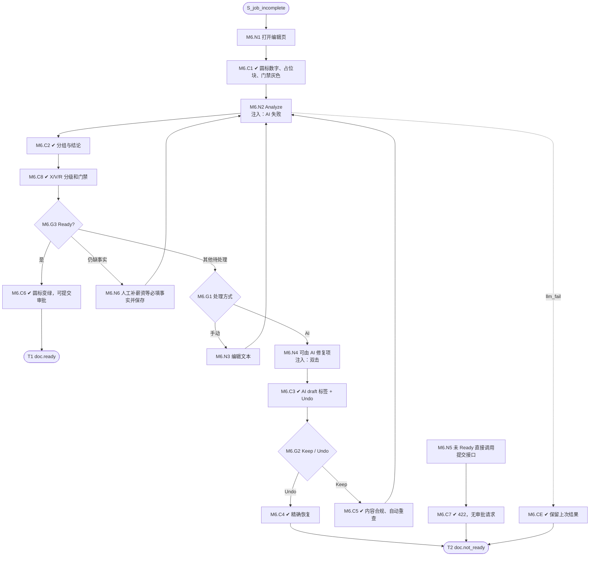

# M6 输入输出闭环：Analyze 完整性检查与 AI 修复

| 项 | 内容 |
|---|---|
| 模块 | M6（P0） |
| 版本 / 日期 | v1.2 / 2026-10-15（Level 规则更新） |
| 同目录文档 | [产品文档](PRD.md) · [User Journey](User_Journey.md) |
| 格式说明 | 见 [模块索引 README](../README_Modules.md#闭环文档格式) |

## 1. 结构化规格

```yaml
flow_id: M6
actor: recruiter_a
seed: S_job_incomplete        # 可替换为 S_job_weak / S_job_ready，见测试数据
entry: M6.N1
max_loop: 5
external: [rules.completeness, llm.quality_review, llm.ai_fix]

nodes:
  - {id: M6.N1, type: action, do: "打开职位编辑页"}
  - {id: M6.C1, type: check, expect: {ui: "10 项必填；Level=Not set 不计 Missing；Analyze 圆标 = 待处理项数；未 Ready 时提交审批灰色并说明原因；审批前 Publish 灰色；缺失项红色占位块在默认章节位置；概述不显示句数提示"}}
  - {id: M6.N2, type: action, do: "点击 Analyze", inject: [llm_fail]}
  - {id: M6.C2, type: check, expect: {ui: "处理中状态；完成后切到 Analysis；显示分析时间；结论 + 进度；To complete / To revise / Suggestions / Completed"}}
  - {id: M6.G1, type: decision, on: "处理方式"}
  - {id: M6.N3, type: action, do: "手动编辑文本 E"}
  - {id: M6.N4, type: action, do: "点击单项 AI fix 或批量处理可由 AI 修复的项", inject: [double_click]}
  - {id: M6.C3, type: check, expect: {ui: "AI 内容带 AI draft · Keep 标签；出现 Undo；滚动位置不变；修复前后差异可见", record: "建议状态 proposed"}}
  - {id: M6.G2, type: decision, on: "Keep 还是 Undo"}
  - {id: M6.C4, type: check, expect: {ui: "内容精确恢复到处理前", record: "建议状态 reverted"}}
  - {id: M6.C5, type: check, expect: {ui: "概述有非空内容且无句数提示；职责 ≥3；要求 ≥3 且可验证；无编造数字、技能或职位事实；Keep 后自动重查"}}
  - {id: M6.N6, type: action, do: "人工补齐 AI 不得编造的薪资等必填事实并保存当前 revision；Level 可保持 Not set"}
  - {id: M6.C8, type: check, expect: {ui: "X1–X8、V1–V5、R1–R3 按完整性标准进入统一结论；阻断/待修改计入门禁，建议不阻断；Confidential 正文不交给 AI"}}
  - {id: M6.G3, type: decision, on: "结论是否 Ready"}
  - {id: M6.C6, type: check, expect: {ui: "10 项必填 Pass、Level 可为 Not set、X/V/R 无阻断或待修改、AI 提案已确认且 revision 已保存；圆标变绿，提交审批可用，Publish 仍不可用", db: "刷新后内容和检查状态一致"}}
  - {id: M6.N5, type: action, do: "未 Ready 时直接调用提交审批接口"}
  - {id: M6.C7, type: check, expect: {api: "422，列出未满足项", db: "无审批请求"}}
  - {id: M6.CE, type: check, expect: {ui: "分析失败：保留上次结果并标注时间；不显示为全部通过"}}
  - {id: M6.T1, type: terminal, state: doc.ready}
  - {id: M6.T2, type: terminal, state: doc.not_ready}

edges:
  - [M6.N1, M6.C1]
  - [M6.C1, M6.N2]
  - [M6.N2, M6.C2]
  - [M6.C2, M6.C8]
  - [M6.C8, M6.G3]
  - [M6.G3, M6.G1, {when: "其他待处理"}]
  - [M6.G1, M6.N3, {when: "手动"}]
  - [M6.N3, M6.N2]
  - [M6.G1, M6.N4, {when: "AI"}]
  - [M6.N4, M6.C3]
  - [M6.C3, M6.G2]
  - [M6.G2, M6.C4, {when: "Undo"}]
  - [M6.C4, M6.T2]
  - [M6.G2, M6.C5, {when: "Keep"}]
  - [M6.C5, M6.N2, {when: "Keep 自动重查"}]
  - [M6.G3, M6.N6, {when: "仍缺事实"}]
  - [M6.N6, M6.N2]
  - [M6.G3, M6.C6, {when: "Ready"}]
  - [M6.C6, M6.T1]
  - [M6.N5, M6.C7]
  - [M6.C7, M6.T2]
  - [M6.N2, M6.CE, {when: "注入 llm_fail"}]
  - [M6.CE, M6.T2]
```

## 2. 测试数据

| 名称 | 内容 |
|---|---|
| S_job_incomplete | 只有必填的职位名、地点、HC，职责和要求各 1 条；缺 Role summary、对外薪资；Level 为 Not set 不计缺失 |
| S_job_weak | 必填齐全，只有 1 条 Weak |
| S_job_ready | 全部合格 |
| weak_unverifiable | 要求中加 `Must have strong communication skills` |
| summary_one_sentence | 概述只有一句；验证不出现句数提示，非 Weak |
| weak_level_conflict | Level=Junior，要求 `5+ years` |
| weak_remote_no_region | Location=`Remote` |
| weak_resp | 职责少于 3 条，或以 `Responsible for` 开头 |
| weak_title | 职位名含 `Ninja` 或内部编号 |

## 3. 路径清单

| 路径 | 节点序列 | 数据 / 注入 | 终态 |
|---|---|---|---|
| P1 初始状态 | N1 → C1 → N2 → C2 | S_job_incomplete | doc.not_ready；圆标数字、占位块位置正确 |
| P2–P6 Weak 规则 | N1 → N3 → N2 → C2 | 每条 weak_* 一条路径（共 5 条） | doc.not_ready；对应项在 To revise，文档有黄色提示条 |
| P7 句数与跨项/合规 | N1 → N2 → C2 → C8 → G3 | summary_one_sentence；X1–X8/V1–V5/R1–R3 各级别 | 概述无句数提示；阻断/待修改不 Ready，建议不阻断 |
| P8 批量 AI 修复 | N2 → C2 → C8 → G1 → N4 → C3 → G2 → C5 → N2 → C2 → C8 → G3 → N6 → N2 → C2 → C8 → G3 → C6 | S_job_incomplete | AI 只处理有来源项；人工补事实、Keep 自动重查并保存后可 Ready |
| P9 Undo | … → N4 → C3 → G2 → C4 | S_job_incomplete | doc.not_ready，内容精确恢复 |
| P10 单项 AI fix | … → N4 → C3 → C5 | S_job_weak + weak_unverifiable | 该项移到 Completed |
| P11 门禁打开 | N1 → N2 → C2 → C8 → G3 → C6 | S_job_ready | doc.ready；提交审批可用 |
| P12 服务端门禁 | N5 → C7 | S_job_incomplete | doc.not_ready；422 |
| P13 Viewer | 以 viewer 身份执行 N1、N4、N5 | S_job_incomplete | Analysis 只读；AI fix 不可用；N5 返回 403 |
| P14 AI 失败 | N2 → CE | 注入 llm_fail | 不显示为全部通过 |
| P15 双击 AI fix | P8 在 N4 注入 double_click | S_job_incomplete | 内容只写入一次 |

## 4. 流程图（由规格生成）



## 5. 产品决定与待确认

2026-10-15 用户先确认 11 项必填，随后允许 Level 为 Not set；当前为 10 项必填。概述无句数提示；Keep 后自动重查；X1–X8/V1–V5/R1–R3 纳入本期门禁；Ready 后提交审批。仍待确认 Weak 规则是确定性还是 LLM 判定；若为 LLM，P2–P6 按判定条件断言。
