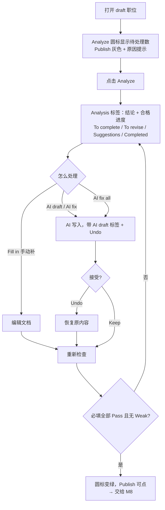

# M6 User Journey：补全必填项，用 Analyze 和 AI 修复，直到可以发布（P0）

| 项 | 内容 |
|---|---|
| 模块 | M6（测试脚本 J6） |
| 版本 / 日期 | v1.0 / 2026-10-14（草稿，待评审） |
| 同目录文档 | [产品文档](PRD.md) · [输入输出闭环](Loop_IO.md) |
| 来源 | [九模块 User Journey v1.0](../HireOS_Command_JD_Management_Module_User_Journeys_v1.0.md) M6 节；测试数据见 [用户旅程与测试脚本 v0.1 §3](../HireOS_Command_JD_Management_User_Journeys_v0.1.md) |

## 角色与权限（公共，摘自 [九模块 User Journey §0.1](../HireOS_Command_JD_Management_Module_User_Journeys_v1.0.md)）

| 角色 | 登录后的主要目的 | 核心操作 | 默认限制 |
|---|---|---|---|
| Recruiter / TA | 将招聘需求整理成合格 JD，协调协作者并推动审批/交付 | 创建职位、补全字段、应用 AI 建议、保存草稿、提交审批、追踪发布 | 不能替审批人作出审批结论，不能绕过阻断项提交或发布 |
| Hiring Manager | 说明为什么招、招什么人、成功标准和团队上下文，并确认业务取舍 | 回答追问、编辑授权字段、解决冲突、确认岗位内容、参与审批 | 不能修改未授权预算/敏感字段，不能自动替代 HR 或审批政策发布 |
| HR Approver | 确认内容、预算、风险和流程前置条件已经处理 | 查看候选版本、差异、风险和影响，批准、退回或拒绝 | 不能把 AI 建议当成人工决策；无权限时不能查看 restricted 字段 |
| Viewer | 阅读获授权的 JD、分析结论和当前有效版本 | 查看职位、来源、版本和授权的 Agent 结论 | 不能应用修改、保存、提交审批、发布或查看敏感字段 |

> 2026-10-14 用户决定：采用以上四个角色，并恢复审批流程。这替代了 [#15](https://github.com/JsonSuCoder/HireOSV2/issues/15) 的三档权限和 [#9](https://github.com/JsonSuCoder/HireOSV2/issues/9) 中“去掉审批”的部分。审批流程目前后端没有实现，相关用例在实现前标记为 known gap。

# 旅程

**主角色**：Recruiter / TA；Hiring Manager 确认业务内容；Viewer 只读
**登录目的**：把一份不完整的草稿补到“可以发布”的状态，并且清楚还差什么。
**入口**：职位列表 → 打开 draft 职位 → 编辑页工具栏 Analyze

## 输入

| 类型 | 内容 |
|---|---|
| 前置数据（seed 三档） | ①缺多项必填（缺 Role summary、Level、对外薪资）②只差 1 条待修改 ③全部合格 |
| 用户数据 | 触发待修改（Weak）规则的文本：`Must have strong communication skills`、只有一句的概述、Junior 要求 5 年+、Remote 不写地区、营销词、职责少于 3 条或以 Responsible for 开头 |
| 外部依赖 | LLM（quality_review、AI draft、AI fix） |

## 流程

## 步骤

| # | 用户意图与操作 | 系统反馈 | 用户需要判断 |
|---|---|---|---|
| 1 | 打开职位 | Analyze 圆标显示需处理项数；Publish 灰色，悬停提示还差 N 项 | 还差多少 |
| 2 | 浏览文档 | 缺失项以红色虚线占位块出现在默认章节顺序的位置，提供 AI draft / Fill in | 自己写还是让 AI 写 |
| 3 | 点击 Analyze | 处理中状态；完成后自动切到 Analysis，显示分析时间 | — |
| 4 | 查看 Analysis | 顶部结论 + 合格进度；四个分组；Completed 默认展开 | 先处理哪项 |
| 5 | AI fix all | 缺失与待修改项被处理；AI 内容带 `AI draft · Keep` 标签；出现 Undo；滚动位置不变 | AI 写的是否可信 |
| 6 | 检查 AI 内容 | 概述 2–4 句；职责 ≥3；要求 ≥3 且可验证；没有编造的数字 | — |
| 7 | Undo | 恢复到处理前 | — |
| 8 | 加一条 `Must have strong communication skills` | To revise 出现“无法验证”；文档内黄色提示条 | — |
| 9 | 单项 AI fix | 改写为可验证表述；To revise 清空 | — |
| 10 | 补齐所有项 | 圆标变绿；Publish 可点 | — |
| 11 | 刷新 | 内容和检查状态一致 | — |

## 可见 / 不可见

- Viewer：Analysis 可读，但 AI fix、Fill in、Publish 不可用，也看不到敏感字段。
- Hiring Manager：只能修改获授权字段，不能修改预算/敏感字段。
- Confidential 块不交给 AI 改写（完整性标准 §1.3）。

## 异常与恢复

| 场景 | 预期 |
|---|---|
| Analyze 时 AI 失败 | 保留上一次结果并标注时间；可重试；不把失败显示成“全部通过” |
| AI fix 重复点击 | 不重复写入 |
| 文档在分析后又被修改 | 分析结果标记为过期，需重新 Analyze |

## 输出与交接

| 输出 | 内容 |
|---|---|
| 用户可见 | 结论 Ready / Needs work / Blocked；Publish 可点状态 |
| 持久化 | 文档 revision；AI 建议的接受/撤销记录；分析结果与分析时间 |
| 交接 | → M8：一份全部必填合格、可以发布的草稿 |

**禁止副作用**：有阻断项时 Publish 可点；全部合格后 Publish 仍是灰色；只靠前端控制门禁（服务端必须拒绝不合格的发布请求）；AI 内容不经确认直接成为正式内容。

**成功标准**：Publish 的可点状态始终与“必填全部合格且无待修改项”一致，服务端同样校验。

**测试映射**：闭环 B3、B1（单项 AI fix 的 diff）；线上问题 F-010、F-011。

**待确认**：门禁以完整性标准（9 项必填）还是原型的 11 项为准；Weak 规则是确定性规则还是 LLM 判定（决定能否精确断言）；概述句数规则（标准 2–4 句，原型超过 5 句才提示）。
