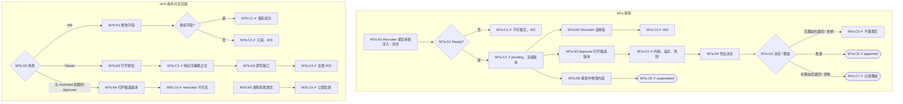

# M7 输入输出闭环：角色权限与审批

| 项 | 内容 |
|---|---|
| 模块 | M7（P0） |
| 版本 / 日期 | v1.0 / 2026-10-14（草稿，结构待确认） |
| 同目录文档 | [产品文档](PRD.md) · [User Journey](User_Journey.md) |
| 格式说明 | 见 [模块索引 README](../README_Modules.md#闭环文档格式) |
| 实现现状 | ❌ 审批和服务端角色权限未实现；本文件的路径在实现前全部标记 known gap |

本模块拆成两个子流程：**M7a 审批**（Recruiter → HR Approver）、**M7b 角色可见范围**（Hiring Manager、Viewer、角色变更）。

## 1. 结构化规格

```yaml
# ---------- M7a 审批 ----------
flow_id: M7a
actors: [recruiter_a, approver_a]
seed: S_job_ready_with_confidential   # 职位 J：必填合格，含 Confidential 块和预算字段，由 recruiter_a 创建
entry: M7a.N1
max_loop: 2

nodes:
  - {id: M7a.N1, type: action, actor: recruiter_a, do: "打开职位 J，点击提交审批", inject: [double_click]}
  - {id: M7a.G1, type: decision, on: "文档是否 Ready"}
  - {id: M7a.C1, type: check, expect: {ui: "提交审批不可用并说明原因", api: "直接调用返回 422", db: "无审批请求"}}
  - {id: M7a.C2, type: check, expect: {ui: "显示审批人和冻结的版本", db: "审批请求 status=pending，记录候选版本哈希、提交人、时间"}}
  - {id: M7a.N2, type: action, actor: recruiter_a, do: "尝试批准自己提交的请求（调用决定接口）"}
  - {id: M7a.C3, type: check, expect: {api: "403", db: "请求仍为 pending"}}
  - {id: M7a.N3, type: action, actor: approver_a, do: "从待我审批进入候选版本"}
  - {id: M7a.C4, type: check, expect: {ui: "显示内容、与上一版的差异、风险、可见范围"}}
  - {id: M7a.N4, type: action, actor: approver_a, do: "作出决定 D"}
  - {id: M7a.G2, type: decision, on: "D 的类型与是否填写理由"}
  - {id: M7a.C5, type: check, expect: {ui: "不能提交，提示必须填写理由", db: "请求仍为 pending"}}
  - {id: M7a.C6, type: check, expect: {db: "status=approved；决定记录人工审批人、版本哈希、时间"}}
  - {id: M7a.C7, type: check, expect: {db: "status=changes_requested 或 rejected；记录理由", ui: "Recruiter 看到退回理由"}}
  - {id: M7a.N5, type: action, actor: recruiter_a, do: "请求 pending 时修改文档内容"}
  - {id: M7a.C8, type: check, expect: {db: "旧请求 status=superseded", api: "approver_a 对旧请求作出决定返回 409 或 422"}}
  - {id: M7a.T1, type: terminal, state: approval.approved}
  - {id: M7a.T2, type: terminal, state: approval.changes_requested_or_rejected}
  - {id: M7a.T3, type: terminal, state: approval.superseded}
  - {id: M7a.T4, type: terminal, state: approval.not_submitted}

edges:
  - [M7a.N1, M7a.G1]
  - [M7a.G1, M7a.C1, {when: "seed 改为 S_job_incomplete"}]
  - [M7a.C1, M7a.T4]
  - [M7a.G1, M7a.C2, {when: "Ready"}]
  - [M7a.C2, M7a.N2, {when: "测自审批"}]
  - [M7a.N2, M7a.C3]
  - [M7a.C2, M7a.N3]
  - [M7a.N3, M7a.C4]
  - [M7a.C4, M7a.N4]
  - [M7a.N4, M7a.G2]
  - [M7a.G2, M7a.C5, {when: "D 属于 reject_no_reason / changes_no_reason"}]
  - [M7a.G2, M7a.C6, {when: "D = approve"}]
  - [M7a.C6, M7a.T1]
  - [M7a.G2, M7a.C7, {when: "D 属于 reject_with_reason / changes_with_reason"}]
  - [M7a.C7, M7a.T2]
  - [M7a.C2, M7a.N5, {when: "测审批中修改"}]
  - [M7a.N5, M7a.C8]
  - [M7a.C8, M7a.T3]

---
# ---------- M7b 角色可见范围 ----------
flow_id: M7b
actors: [hm_a, viewer_a, approver_no_restricted]
seed: S_job_ready_with_confidential
entry: M7b.G0

nodes:
  - {id: M7b.G0, type: decision, on: "当前角色"}
  - {id: M7b.N1, type: action, actor: hm_a, do: "修改字段 F 并保存"}
  - {id: M7b.G1, type: decision, on: "F 是否为授权字段"}
  - {id: M7b.C1, type: check, expect: {db: "保存成功，记录修改人和时间"}}
  - {id: M7b.C2, type: check, expect: {ui: "字段只读", api: "直接调用返回 403", db: "值不变"}}
  - {id: M7b.N2, type: action, actor: viewer_a, do: "打开职位 J"}
  - {id: M7b.C3, type: check, expect: {ui: "只读；无编辑类按钮；Confidential 不可见", api: "GET 响应中不含 Confidential 正文"}}
  - {id: M7b.N3, type: action, actor: viewer_a, do: "直接调用编辑、保存、提交审批、发布接口"}
  - {id: M7b.C4, type: check, expect: {api: "全部 403", db: "无变化"}}
  - {id: M7b.N4, type: action, actor: approver_no_restricted, do: "打开含 restricted 字段的候选版本"}
  - {id: M7b.C5, type: check, expect: {ui: "restricted 字段不可见", api: "响应不含 restricted 值"}}
  - {id: M7b.N5, type: action, do: "管理员把 viewer_a 改为 recruiter，viewer_a 立即再次请求；再改回"}
  - {id: M7b.C6, type: check, expect: {api: "改为 recruiter 后立即可编辑；改回后立即 403", ui: "改回后不再展示缓存的敏感内容"}}
  - {id: M7b.T1, type: terminal, state: no_unauthorized_change}

edges:
  - [M7b.G0, M7b.N1, {when: "hm_a"}]
  - [M7b.N1, M7b.G1]
  - [M7b.G1, M7b.C1, {when: "F 属于 hm_allowed_fields"}]
  - [M7b.G1, M7b.C2, {when: "F 属于 hm_denied_fields"}]
  - [M7b.G0, M7b.N2, {when: "viewer_a"}]
  - [M7b.N2, M7b.C3]
  - [M7b.C3, M7b.N3]
  - [M7b.N3, M7b.C4]
  - [M7b.G0, M7b.N4, {when: "approver_no_restricted"}]
  - [M7b.N4, M7b.C5]
  - [M7b.N5, M7b.C6]
  - [M7b.C1, M7b.T1]
  - [M7b.C2, M7b.T1]
  - [M7b.C4, M7b.T1]
  - [M7b.C5, M7b.T1]
  - [M7b.C6, M7b.T1]
```

## 2. 测试数据

| 名称 | 内容 |
|---|---|
| 身份 | recruiter_a、hm_a、approver_a、approver_no_restricted、viewer_a |
| S_job_ready_with_confidential | recruiter_a 创建；必填合格；Confidential 块 `Internal budget ceiling: 100000 USD`；预算字段 |
| hm_allowed_fields | 职责、成功标准（清单待确认） |
| hm_denied_fields | 内部预算、Confidential 块 |
| approve | 批准 |
| changes_with_reason / changes_no_reason | 退回，带 / 不带理由 |
| reject_with_reason / reject_no_reason | 拒绝，带 / 不带理由 |

## 3. 路径清单

| 路径 | 节点序列 | 数据 | 终态 |
|---|---|---|---|
| P1 未 Ready 不能提交 | M7a: N1 → G1 → C1 | seed 改为 S_job_incomplete | not_submitted |
| P2 提交审批 | M7a: N1 → G1 → C2 | — | pending |
| P3 不能自审批 | M7a: … → C2 → N2 → C3 | — | pending |
| P4 HM 改授权字段 | M7b: G0 → N1 → G1 → C1 | hm_allowed_fields | 保存成功 |
| P5 HM 改预算 | M7b: G0 → N1 → G1 → C2 | hm_denied_fields | 值不变，403 |
| P6 批准 | M7a: … → N3 → C4 → N4 → G2 → C6 | approve | approved |
| P7 退回 / 拒绝不填理由 | M7a: … → N4 → G2 → C5 | changes_no_reason、reject_no_reason | pending |
| P8 退回 / 拒绝填理由 | M7a: … → N4 → G2 → C7 | changes_with_reason、reject_with_reason | changes_requested / rejected |
| P9 审批中修改 | M7a: … → C2 → N5 → C8 | — | superseded |
| P10 Viewer 只读 | M7b: G0 → N2 → C3 | — | 无变化 |
| P11 Viewer 写接口 | M7b: … → N3 → C4 | — | 全部 403 |
| P12 角色变更立即生效 | M7b: N5 → C6 | — | 按新角色生效 |
| P13 审批人无 restricted 权限 | M7b: G0 → N4 → C5 | — | restricted 不可见 |
| P14 双击提交 | P2 在 N1 注入 double_click | — | 只有 1 个 pending 请求 |

## 4. 流程图（由规格生成）



## 5. 待确认

- 审批步骤数（一步还是 HM → HR 两步）；若两步，M7a 需要加一个 HM 审批节点。
- 审批超时时长和超时行为（确定后补路径 P15：时钟快进 → 提醒）。
- Hiring Manager 授权字段清单。
- 角色分配入口（影响 M7b.N5 的操作方式）。
