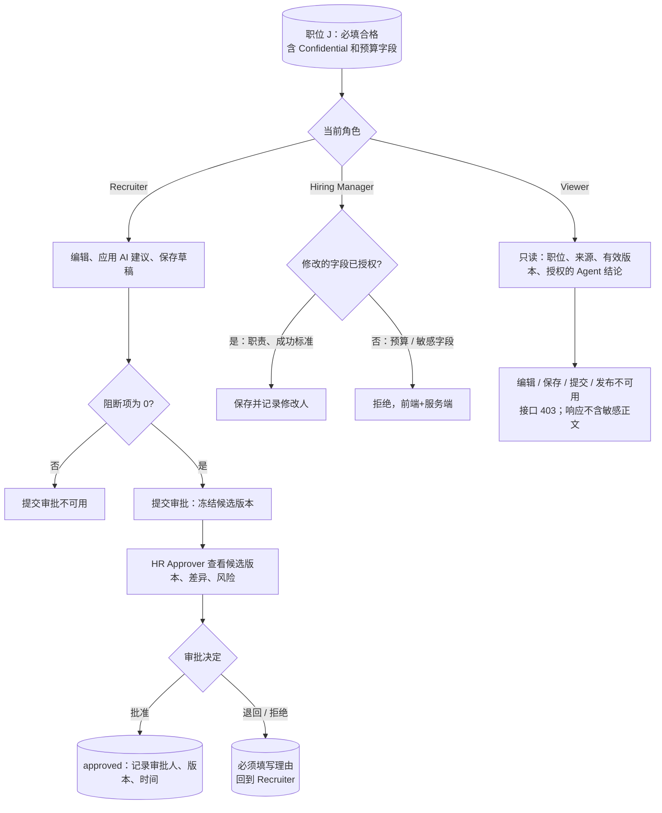

# M7 User Journey：角色与权限：不同角色看到和能做的不同（P0）

| 项 | 内容 |
|---|---|
| 模块 | M7（测试脚本 J7） |
| 版本 / 日期 | v1.0 / 2026-10-14（草稿，待评审） |
| 同目录文档 | [产品文档](PRD.md) · [输入输出闭环](Loop_IO.md) |
| 来源 | [九模块 User Journey v1.0](../HireOS_Command_JD_Management_Module_User_Journeys_v1.0.md) M7 节；测试数据见 [输入输出闭环 §2](Loop_IO.md)（原测试脚本 v0.1 已于 #30 删除） |

## 角色与权限（公共，摘自 [九模块 User Journey §0.1](../HireOS_Command_JD_Management_Module_User_Journeys_v1.0.md)）

| 角色 | 登录后的主要目的 | 核心操作 | 默认限制 |
|---|---|---|---|
| Recruiter / TA | 将招聘需求整理成合格 JD，协调协作者并推动审批/交付 | 创建职位、补全字段、应用 AI 建议、保存草稿、提交审批、追踪发布 | 不能替审批人作出审批结论，不能绕过阻断项提交或发布 |
| Hiring Manager | 说明为什么招、招什么人、成功标准和团队上下文，并确认业务取舍 | 回答追问、编辑授权字段、解决冲突、确认岗位内容、参与审批 | 不能修改未授权预算/敏感字段，不能自动替代 HR 或审批政策发布 |
| HR Approver | 确认内容、预算、风险和流程前置条件已经处理 | 查看候选版本、差异、风险和影响，批准、退回或拒绝 | 不能把 AI 建议当成人工决策；无权限时不能查看 restricted 字段 |
| Viewer | 阅读获授权的 JD、分析结论和当前有效版本 | 查看职位、来源、版本和授权的 Agent 结论 | 不能应用修改、保存、提交审批、发布或查看敏感字段 |

> 2026-10-14 用户决定：采用以上四个角色，并恢复审批流程。这替代了 [#15](https://github.com/JsonSuCoder/HireOSV2/issues/15) 的三档权限和 [#9](https://github.com/JsonSuCoder/HireOSV2/issues/9) 中“去掉审批”的部分。审批流程目前后端没有实现，相关用例在实现前标记为 known gap。

# 旅程

> 本模块按 §0.1 的四个角色编写（Recruiter / TA、Hiring Manager、HR Approver、Viewer）。2026-10-14 已决定恢复审批；审批流程后端尚未实现，相关用例先标记为 known gap。

**主角色**：Recruiter / TA（发起）；Hiring Manager、HR Approver、Viewer（验证各自的可见内容和操作）
**登录目的**：每个角色登录后只看到、只能做自己职责内的事情；敏感信息只给有权限的人，审批结论只能由审批人作出。
**入口**：职位编辑页；待我审批 / 待我确认列表

## 输入

| 类型 | 内容 |
|---|---|
| 前置数据 | 四个账号：Recruiter R、Hiring Manager H、HR Approver A、Viewer V；R 创建的职位 J，必填全部合格，含 Confidential 块 `Internal budget ceiling: 100000 USD`，含一个预算字段 |
| 用户数据 | H 修改职责（授权字段）和预算（未授权字段）；R 提交审批；A 批准 / 退回 / 拒绝；V 尝试编辑、保存、发布 |
| 外部依赖 | 登录服务（邮箱验证码，#16）；角色分配方式（待确认） |

## 流程

## 步骤

| # | 用户意图与操作 | 系统反馈 | 用户需要判断 |
|---|---|---|---|
| 1 | R 打开职位 J | 可编辑；可见 Confidential；可以保存草稿、应用 AI 建议 | — |
| 2 | R 在有阻断项时尝试提交审批 | 提交审批不可用，并说明原因；服务端也拒绝 | — |
| 3 | R 清除阻断项后提交审批 | 生成待审批的候选版本；显示审批人；R 不能自己批准 | 提交哪个版本 |
| 4 | H 打开职位 J，修改职责 | 保存成功，记录修改人和时间 | 业务内容是否准确 |
| 5 | H 尝试修改预算字段 | 字段只读；直接调用接口返回 403 | — |
| 6 | A 从待我审批进入候选版本 | 看到内容、与上一版的差异、风险和可见范围 | 是否批准 |
| 7 | A 退回或拒绝时不填理由 | 不能提交 | — |
| 8 | A 批准 | 记录审批人、精确版本、时间；AI 不能作为审批人 | — |
| 9 | 无 restricted 权限的 A 打开职位 | restricted 字段不可见 | — |
| 10 | V 打开职位 J | 只读；看不到 Confidential 和敏感字段；没有编辑类按钮 | — |
| 11 | V 查看 Network 响应 | 响应中**不含** Confidential 正文 | — |
| 12 | V 直接调用编辑、保存、提交、发布接口 | 都返回 403 | — |
| 13 | 审批进行中，R 修改了内容 | 旧审批请求作废（superseded），需要重新提交；A 无法再对旧版本作出决定 | 是否重新提交 |
| 14 | 审批超时未处理 | 按审批规则提醒审批人 | — |

## 输出与交接

- 持久化：角色分配记录；审批请求和审批决定（审批人、版本、时间、理由）；角色变更与审批审计。
- 交接：角色矩阵作为 M1–M9 所有模块的身份前置条件；批准后的版本交给 M8 发布。

**禁止副作用**：只靠前端隐藏敏感内容；Recruiter 自己批准自己提交的版本；AI 建议被当成审批结论；角色撤销后仍能看到缓存内容。

**成功标准**：每个角色的可见内容和可执行操作与 §0.1 一致，且由服务端保证；审批结论只能由 HR Approver 人工作出。

**测试映射**：闭环 D1、D2、D3、D5、B5、I1；线上问题 F-004、F-014、F-015；Issue #9、#15、#16。

**待确认**：
1. ~~采用哪套角色模型~~：2026-10-14 已决定采用 §0.1 四角色。
2. ~~审批流程是否恢复~~：2026-10-14 已决定恢复。
2a. 审批超时是 24 小时还是 48 小时；超时是提醒、升级，还是自动生效（会议纪要待确认）。
2b. 审批步骤：只有 HR Approver 一步，还是 Hiring Manager → HR 两步（PRD §6.2 默认两步）。
2c. 岗位库是否恢复审批状态列（#9 已去掉）。
3. 角色由谁分配、在哪里分配；一个人能否同时有多个角色。
4. Hiring Manager 的“授权字段”具体是哪些。
5. Viewer 能否评论。
